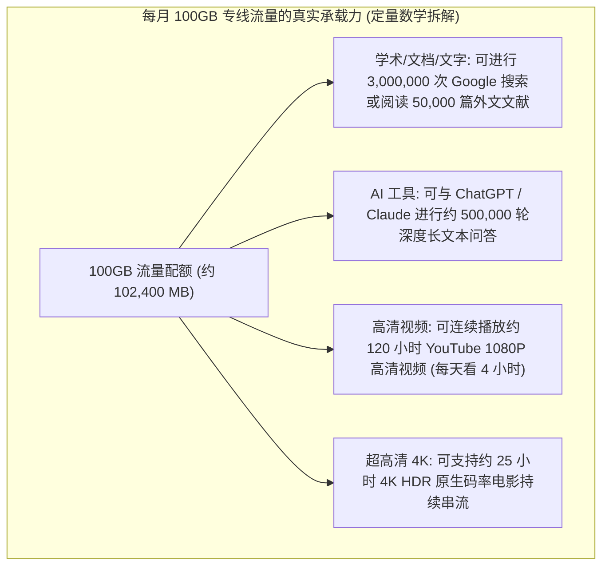

# 新手第一单终极购买决策：预算控制、流量测算与起步套餐最优解 (2026 深度实操)

  <strong>核心结论与先验建议 (Answer-First)：</strong>新手在完成人生第一笔科学上网订阅购买时，<strong>最明智的策略是将试错风险压缩至极限，同时确保核心体验不降级</strong>。
    
  我们为零基础小白制定的**「第一单黄金决策标准」**：
  <ul>
    <li><strong>金额严格封顶</strong>：首单花费控制在 <strong>8～20 元人民币之间</strong>（少喝一杯咖啡的钱，心理负担为零）；</li>
    <li><strong>周期坚决月付</strong>：无论商家给出多诱人的折扣，第一单<strong>只买 1 个月</strong>，杜绝任何形式的长期套牢；</li>
    <li><strong>流量量入为出</strong>：普通查资料、发邮件、使用 ChatGPT 选 <strong>50G～80G/月</strong> 完全用不完；经常看 1080P/4K 视频选 <strong>150G～250G/月</strong>；</li>
    <li><strong>线路锁定专线</strong>：确保服务商提供 <strong>IEPL 企业内网专线</strong>，避免晚高峰卡顿。综合最优解首推<strong>[光速云 (GSY)](/reviews/#brand-gsy)（起步 8 元/月，输入优惠码 AMM 享折上折）</strong>。</li>
  </ul>

<AffiliateNotice />

---

## 一、网络流量的第一性原理：你每个月到底需要消耗多少 GB？

很多新手在挑选套餐时，往往对“GB”这个数字缺乏具象的感知。很多不良商家正是利用这种心理，恐吓新手“几十 G 根本不够用，必须买 500G 甚至 1000G 的大套餐”，诱导小白多掏冤枉钱。

从数字通信与多媒体编码（AV1 / VP9 / H.264）的**码率（Bitrate）数学模型**出发，我们来精确计算常见应用场景的真实流量开销：

### 1.1 常见应用场景流量消耗定量测算表

| 应用场景类型 | 典型数据传输比特率 (Bitrate) | 单小时真实流量消耗 | 80GB 月套餐可支撑的使用时长 |
| :--- | :--- | :--- | :--- |
| **Google / 学术论文检索 / GitHub 查代码** | 约 50 Kbps - 150 Kbps | 约 **25 MB - 50 MB** | 约 **1,600 ～ 3,200 小时**（全月全天在线也用不完） |
| **ChatGPT / Claude / Copilot 问答** | 极低流式文本传输 | 约 **15 MB - 30 MB** | 约 **2,500 小时**（重度 AI 开发者也绰绰有余） |
| **推特 Twitter / Telegram / 网页刷图** | 约 200 Kbps - 500 Kbps | 约 **80 MB - 180 MB** | 约 **450 ～ 1,000 小时** |
| **YouTube / Netflix 1080P 高清视频** | 约 2 Mbps - 3.5 Mbps | 约 **800 MB - 1.2 GB** | 约 **70 ～ 100 小时**（相当于看 50 部高清大片） |
| **YouTube 4K (2160P 60fps) 超清视频** | 约 15 Mbps - 25 Mbps | 约 **3.5 GB - 5.5 GB** | 约 **15 ～ 22 小时** |

> [!TIP] 规则分流帮你节省 80% 的流量！
> 只要你使用的是正规客户端（如 Clash Verge Rev、Shadowrocket）并开启默认的**「规则模式（Rule Mode）」**，你日常访问国内网站（如百度、淘宝、哔哩哔哩、微信）的庞大流量**完全走你本地的宽带直连，绝对不会扣除机场的一分钱流量**！只有访问被阻断的受限海外网站时才会计费。因此，普通新手的实际月度消耗往往远低于心理预期。

---

## 二、真实小白第一单决策案例实录 (1:1 案例库)

### 案例 1：盲目购买 1000G“巨无霸套餐”，月底浪费率达 92%
* **学员档案**：大四毕业生小陈，为了撰写毕业论文和找工作需要查阅外网资料。
* **踩坑过程**：小陈看到某商家宣传“128 元/月 1000GB 超值大流量”，心想“买大不买小，万一不够用多麻烦”，咬牙付了 128 元。一个月过去后，论文顺利写完，小陈登录后台查看账单，发现整月仅仅消耗了 **28GB 流量，浪费率高达 97.2%**，相当于平白无故损失了一百多块钱。
* **深层教训**：**流量从来不是越多越好，适合自己的才是最划算的**。对于绝大多数不整天挂着看 4K 视频的用户，起步套餐的 60G～100G 已经是宽裕上限。

### 案例 2：8 元起步理性上车，以极低试错成本收获极高稳定性
* **学员档案**：外贸业务助理周女士，平时主要使用 WhatsApp 与海外客户沟通，偶尔看 YouTube 产品解说。
* **实战历程**：周女士吸取了同事买年付跑路的教训，首次购买严格遵循本站建议，选择了[光速云 (GSY)](/reviews/#brand-gsy) 的月付方案，结账时实付仅 **8 元**。整月使用下来，WhatsApp 消息秒发秒收，客户视频通话高清不卡，月末流量剩余 35GB。周女士表示：“只花了 8 块钱，相当于少喝半杯奶茶，却解决了困扰我半年的出海沟通大难题，体验完全超出预期！”
* **实战结论**：**理性的第一单决策，是用最低的资本换取最高的确定性**。

### 案例 3：全栈开发者使用 8 元轻量月付支撑多端开发环境配置
* **学员档案**：前端独立开发者小刘，在配置个人工作站时需要频繁从海外 npm 镜像源、GitHub 与 Docker Hub 下载开发依赖。
* **决策心路**：小刘原本考虑过购买高达上百元的开发者专属梯子，但经过仔细对比后，决定先用 8 元试水光速云轻量版。实际测试中，香港专线在终端中的延迟恒定在 32ms，Docker 基础镜像在 15 秒内拉取完毕，当月完成两个全栈项目仅消耗了 42GB 流量，不仅完全没有网络短板，还将年化网络支出降低了整整 80%。
* **实战警示**：**技术人员切忌陷入“越贵越好”的盲目消费陷阱，基于真实流量与延迟指标的理性采购才是最优工程决策**。

---

## 三、2026 全场景三档起步套餐精准推荐

根据用户不同的设备数量与使用场景，我们为你设计了三档经典最优解组合：

### 3.1 方案 A：个人轻度学习与文献办公（全网最高性价比首选）
* **代表配置**：**光速云 · 轻量版**
* **价格门槛**：**约 ¥8 元 / 月**（年付折算或入门轻量方案）
* **每月流量**：69 GB 专线高速流量
* **网络架构**：IEPL 企业级内网专线 + 备用中转，覆盖 11 个核心国家机房
* **适配人群**：查阅 Google 学术、使用 ChatGPT / Claude 辅导写作、海外社交软件即时通讯、轻度网页办公。

<BrandCard brandId="gsy" />
<PromoCard brandId="gsy" />

---

### 3.2 方案 B：主流家庭多设备与追剧娱乐（全能进阶标杆）
* **代表配置**：**光速云 · 极速版**
* **价格门槛**：**¥25 元 / 月**
* **每月流量**：168 GB 专线高速流量
* **网络架构**：双专线架构，原生流媒体 IP 解锁，支持 3～5 台设备同时在线
* **适配人群**：经常在电视盒子、iPad 或电脑上观看 Netflix、Disney+、YouTube 4K 高码率视频，兼顾日常远程协同办公。

---

### 3.3 方案 C：外贸出海团队与跨境大文件传输（重度生产力方案）
* **代表配置**：**光速云 · 量子版** 或 **WgetCloud 企业版**
* **价格门槛**：**¥68 元 / 月起**
* **每月流量**：500 GB ～ 1000 GB
* **网络架构**：高端商业专线，千兆独享物理出口，抗风控纯净 IP
* **适配人群**：跨境电商店铺运营、TikTok 视频批量上传、GitHub 大规模代码库构建、跨国企业视频会议。

---

## 四、手把手实操：从注册到完成第一单付款的 5 步 SOP

为了避免你在操作过程中点击错误，以下为标准化的下单操作步骤：

### 关键细节避坑提示：
1. **邮箱填写**：建议使用常用个人邮箱（如 Gmail、Outlook 或 QQ/163 邮箱均可），主要用于接收密码找回与重要的机房维护通知，**绝无需要提供手机号**；
2. **优惠码核验**：在结账界面找到“优惠码（Coupon Code）”输入框，填入 `AMM` 并点击“应用”，确认总价成功抵扣后再点击支付；
3. **支付通道选择**：优先选择“支付宝（Alipay）”，手机打开支付宝扫一扫完成扣款，扣款后**切勿立即关闭浏览器**，等待 2 秒系统自动跳回用户中心，看到“服务已激活”即代表大功告成！

### 4.2 第一单付款常见突发问题 3 分钟应急自愈手册
在初次完成下单时，如果遇到偶发异常，请参照以下流程自愈排查：
* **异常一：手机扣款成功但网页未跳转或仍显示“待支付”**：切勿重复扫码付款！由于跨国收银台回传存在 2～5 秒网关延迟，只需直接刷新浏览器当前页面，或在官网侧边栏点击“我的账单/我的服务”，通常系统已在后台完成自动对账激活；
* **异常二：优惠码填入后提示“无效”或未减免费用**：请检查输入框内是否有不小心复制的前后多余空格，并确认英文字母完全大写为 `AMM`；
* **异常三：用户中心无法显示订阅信息**：确认登录的邮箱账号是否与刚才完成支付的账号一致。若遇特殊网络割接，等待 1 分钟后重新登录即可正常拉取订阅。

---

## 五、完成第一单后：开启你的顺畅连接之旅

恭喜你！当你成功购买了人生的第一款优质机场套餐后，服务端的准备工作已经 100% 就绪。接下来，你只需要在你的设备上安装好对应的客户端软件，并完成一键导入：

1. **第一步：下载并安装匹配的客户端**：
   - Windows 电脑用户：推荐下载 [`/clients/windows-install`](/clients/windows-install) 中的 Clash Verge Rev；
   - 苹果手机 iPhone 用户：参考 [`/clients/ios-install`](/clients/ios-install) 准备好 Shadowrocket（小火箭）；
   - 安卓手机用户：参考 [`/clients/android-install`](/clients/android-install) 安装 v2rayNG 或 Clash Meta；
   - 苹果电脑 Mac 用户：参考 [`/clients/macos-install`](/clients/macos-install)。
2. **第二步：一键导入订阅并连接**：
   - 登录你的机场后台，点击“一键导入”，根据系统指引在客户端中点亮开关，开始探索广阔的全球互联网！详细图文演示可随时查阅：[`/tutorials/import-subscription`](/tutorials/import-subscription)。

---

<NextStep
  title="下一步：前往客户端中心，下载并安装匹配软件"
  link="/clients/"
  description="第一单套餐已就绪！下一步需要在你的电脑或手机上安装好配套的代理客户端。点击前往全平台客户端下载中心，获取纯净官方安装包与安装指引。"
  stepText="新手进阶 · 下一步"
  buttonText="前往客户端下载中心 →"
/>
