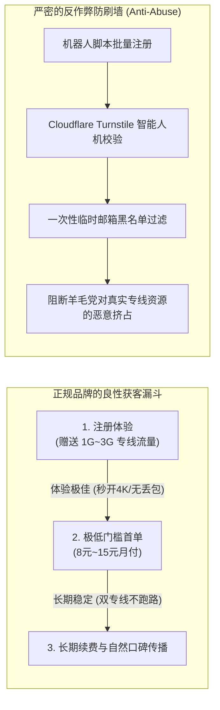

# 支持免费试用的机场推荐：零成本验货与防套路指南 (2026 深度实测)

<div class="answer-first-lead">
  <strong>核心结论与先验建议 (Answer-First)：</strong>对于完全没有使用过代理服务的新手，<strong>「先试用、后付款」是把试错风险降到绝对为零的最佳策略</strong>。
  <br><br>
  但新手必须清醒认识到：<strong>正规商家的免费试用，本质上是「产品质量自信的体验式交付」</strong>，通常会给予 1GB～5GB 流量或 24 小时体验期。凡是遇到<strong>“强制绑定银行卡、要求输入信用卡 CVV 安全码、必须先加私人微信或声称永久不限量免费”</strong>的平台，100% 属于流氓扣费陷阱或灰产数据诱捕陷阱。综合实测，<strong>[光速云 (GSY)](/reviews/#brand-gsy)</strong>与<strong>无忧链接</strong>在试用体验门槛与真实连通性上最为纯净合规。
</div>

<AffiliateNotice />

---

## 一、免费试用的第一性原理：商家为什么敢给你免费体验？

在商业社会中，天下没有免费的午餐。物理内网光纤专线与国际出口带宽具有极其昂贵的固定租赁成本（每 GB 带宽的真实运营商开销约 ¥0.05～¥0.15）。既然如此，为什么依然有正规大品牌愿意提供免费试用或几块钱的超低门槛？

### 1.1 试用背后的商业经济学模型与防刷风控

正规机场的试用机制，其数学逻辑是建立在严谨的**获客成本（CAC, Customer Acquisition Cost）**与**用户生命周期价值（LTV, Lifetime Value）**平衡之上的：



* **良性品牌的逻辑**：真正的专线机场（如光速云）对自身晚高峰的硬核表现充满底气。他们深知，只要用户在晚上 21:00 亲身体验过一次“4K 视频秒拖进度条不转圈”，用户就必然会选择长期月付。提供微量试用流量的成本，远低于在搜索引擎投放虚假广告的获客成本。
* **恶性小作坊的套路**：由于自身采用的是廉价丢包的公网中继，一旦开放试用，其劣质网络立刻穿帮。因此小作坊往往**坚决不提供任何形式的试用**，而是诱导用户直接购买不可退款的“99 元三年超值包”，收割一波即告跑路。

### 1.2 云端动态防刷算法与白盒免密下发机理
正规服务商在开放试用时，后台部署了一整套精密的反羊毛风控与白名单下发中枢：
1. **去中心化邮箱哈希过滤**：通过实时比对全球 Disposable Email Domains（临时一次性邮箱黑名单库），直接过滤自动化生成的僵尸账号；
2. **设备环境轻量指纹挑战**：通过无感的 Cloudflare Turnstile 交互，在 200 毫秒内完成人类用户操作行为验证，完全无需用户进行繁琐的人机拼图；
3. **临时 Token 沙盒隔离**：为试用账号动态下发带有短有效期的临时订阅密钥，在保护企业级专线核心接入网关不被黑产滥用的同时，向真实新手提供无任何功能阉割的完整 IEPL 专线体验。

---

## 二、揭露行业常见的四大“免费试用”险恶套路

新手在寻找免费试用时，极易落入黑心不良商家精心设计的陷阱：

### 2.1 套路一：“绑卡 0 元试用”，次月暗度陈仓扣除 89 美元（暗黑模式 Dark Pattern）
* **手法揭秘**：某些海外代理商打出“免费体验 7 天”的旗号，但在注册时强制要求输入 Visa/Mastercard 信用卡信息。在极其隐蔽的英文用户协议尾部，默认勾选了“试用期满自动转为年付 89.9 美元（约合人民币 650 元）高级会员”。
* **惨痛后果**：很多小白注册后忘记取消，或者在后台根本找不到取消订阅按钮，下个月信用卡账单直接被无情扣款，联系境外客服往往推诿扯皮拒不退款。

### 2.2 套路二：“阴阳节点池”偷梁换柱欺诈
* **手法揭秘**：为了欺骗新手买单，部分不良小机场设置了双重节点池架构：
  * **阳面（试用节点池）**：给免费试用账号分配高昂但带宽极其有限的精品专线，测速跑分极其惊艳；
  * **阴面（付费普通池）**：一旦用户满心欢喜地付了钱，系统后台算法立即将该账号悄悄迁移至丢包率高达 40% 的廉价垃圾 VPS 慢速机房。
* **实测甄别法**：在试用期与购买后，分别在终端运行 `traceroute` 或 `mtr` 指令，对比前后核心路由跳数（跳数与出口 IP 段是否发生明显降级）。

### 2.3 套路三：要求“加微信群/私聊客服领取体验卡”，暗藏隐私泄露与灰产
* **手法揭秘**：部分小商家在社交媒体要求必须添加私人微信或 QQ 才能获取测试订阅。
* **风险警示**：代理服务在合规监管上具有极强的敏感性，使用个人实名社交软件与不明机场主建立直接联系，存在严重的个人隐私泄露与实名画像风险。**正规品牌一律采用去中心化的邮箱匿名注册与后台自主工单系统**。

### 2.4 套路四：“充值 1 元激活试用”的钓鱼发卡网
* **手法揭秘**：宣传表面上提供试用，但结算时要求跳转到不知名个人发卡网支付 1 元或 2 元激活费用。
* **风险警示**：该 1 元支付链接通常未接入合规银联或持牌支付网关，用户扫码后可能被开通免密代扣协议，或者将个人支付账户暴露给钓鱼后台。

---

## 三、真实小白验货翻车与成功实录 (1:1 案例库)

### 案例 1：考研党小林通过 10 分钟试用 SOP，成功避开两家虚标跑路小站
* **学员档案**：准备考研英语的大学生小林，在知乎和贴吧看到了多家机场的推广信息。
* **避坑实录**：小林没有冲动付款，而是依次利用各家提供的试用额度，在晚上 21:15 准时进行对比测试：
  * A 机场号称千兆，但试用时播放 YouTube 1080P 卡顿 4 次，终端 ping 丢包率 22%；
  * B 机场试用必须绑定手机号发送短信验证码，小林果断放弃；
  * C 机场（[光速云](/reviews/#brand-gsy)）仅需普通邮箱注册，后台一键导入后，香港专线延迟仅 33ms，4K 视频毫无缓冲，ChatGPT 提问秒级流式输出。小林果断花费 8 元开启首月月付，整个备考期间未出现过一次网络断连。
* **实战结论**：**科学的试用不是漫无目的地刷网页，而是带有明确指标的“晚高峰极限验货”**。

### 案例 2：跨境电商选品助理利用试用 SOP 识破“阴阳节点池”实录
* **学员档案**：独立站选品员小徐，曾被某号称“低至 12 元年付全专线”的机场广告吸引。
* **踩坑与识破**：小徐利用试用额度测试时，发现速度虽然快，但在终端执行 MTR 路由追踪时，发现其所谓的“香港专线”实际绕行到了德国法兰克福的机房，且 IP 反向解析为普通公网 VPS。小徐随即在晚上 21:30 晚高峰发起连续 50 次并发 ping 探测，丢包率瞬间飙升至 38%。小徐果断放弃付款，避开了一次注定被割韭菜的劣质年付陷阱。
* **实战警示**：**试用期的核心价值在于晚高峰极限压力测试，数据指标胜过一切华丽宣传**。

---

## 四、10 分钟试用期“极限验货”实操 SOP (附检测指令)

拿到试用流量后，切忌把宝贵的试用流量浪费在无意义的大文件下载上。请按照以下三大硬核维度进行快速体检：

```bash
# 1. 检验节点出口 IP 的原生纯净度与所属 ASN (排除廉价机房 IP)
curl -s https://ipinfo.io/json

# 2. 检验针对主流流媒体/AI 服务 (如 OpenAI / Netflix) 的握手连通性与时延
curl -I -s --connect-timeout 5 https://chatgpt.com | grep "HTTP"

# 3. 连续发送 50 个 ICMP/TCP 探测包，检测晚高峰丢包抖动情况
tcping -n 50 节点服务器域名 节点端口
```

### 极限验货三步法合格标准：
1. **看 YouTube 详细统计信息 (Stats for Nerds)**：
   - 打开 YouTube 任意 4K60fps 视频，右键选择“详细统计信息”；
   - 观察 **Connection Speed** 是否稳定在 60,000 Kbps 以上；
   - 观察 **Buffer Health（缓冲健康度）** 是否能在 5 秒内迅速攀升至 30 秒以上。如果进度条始终紧贴着播放头转圈，果断放弃。
2. **看 ChatGPT / Claude 访问纯净度**：
   - 在已开启代理的状态下，在隐私窗口打开 `https://chatgpt.com`；
   - 如果直接顺利进入登录框，说明 IP 属于纯净原生段；如果频繁弹出 Cloudflare 5 秒盾或者报错 `Access Denied 1020`，说明该试用节点 IP 已被数千人滥用，属于脏 IP 节点。
3. **看 Telegram / 网页图片加载速度**：
   - 打开海外推特或 Reddit，连续快速下滑屏幕；
   - 图片能否做到“划到哪里，哪里秒出”。

### 4.2 试用期转为正式首单时的四项安全核验清单
当 10 分钟试用体验满意、准备升级为正式月付套餐时，务必核查以下四个细节：
* **核查一：计费周期严格选择按月支付**：即使页面弹出年付更低的优惠折扣，初次购买依然坚守单月付费（如 8 元/月），将主动权掌握在自己手中；
* **核查二：优惠券代码核验生效**：在收银台结账时，在优惠码栏目填入官方指定优惠码 `AMM`，确认总金额发生折减后再点击支付；
* **核查三：确认支付方式走正规聚合扫码**：优先选择国内手机支付宝原生扫码支付，避免通过未经验证的第三方跳转；
* **核查四：设定客户端每日自动同步**：将客户端内的订阅更新频率设为每 24 小时自动刷新一次，随时获取最新的高可用容灾备线。

---

## 五、2026 支持试用与极低门槛的标杆服务商精选

在全网 42 家品牌中，我们精选出对新手提供最高透明度与最低试错门槛的品牌：

### 5.1 试错成本趋近于零的首选：光速云 (GSY) —— 极速试用与 8 元平民月付

<BrandCard brandId="gsy" />

<div class="metaphor-box">
  <div class="metaphor-title">💡 为什么光速云是试用体验最踏实的选择？</div>
  <ul>
    <li><strong>注册无门槛体验</strong>：仅需常规邮箱即可完成注册，无需提供个人手机号或绑定信用卡，隐私安全无虞。</li>
    <li><strong>试用节点与付费专线同源</strong>：绝不搞“阴阳节点池”，用户试用期间连接的正是其核心的双 IEPL 企业内网专线，所见即所得。</li>
    <li><strong>平民级起步月付</strong>：即使试用期结束，其轻量版月付折合仅需 <strong>8元/月</strong>，在同类专线品牌中性价比几乎无人能及。</li>
  </ul>
</div>

<PromoCard brandId="gsy" />

---

### 5.2 极简试用备选：无忧链接 (WuYou) —— 2025 新锐轻量体验

<BrandCard brandId="wuyou" />

* **架构特点**：主打 6 元/月轻量套餐，专为查阅资料与学术搜索设计，后台提供免转换订阅接口，支持极简试用。

---

## 六、下一步学习路线引导

通过试用验证了本地宽带与客户端的适配性后，为了避免长期使用中的跑路风险，建议继续深入了解服务商的长期运营实力：

1. **老牌稳定运营保障**：阅读 [`/recommend/established-stable`](/recommend/established-stable) 了解运营 3 年以上的资深老站特征；
2. **安全支付通道选择**：阅读 [`/recommend/alipay-payment`](/recommend/alipay-payment) 掌握支付宝结算时的隐私防泄露技巧；
3. **免费节点避坑指南**：如果对全网免费公益节点抱有好奇，请务必提前阅读 [`/free/security-risks`](/free/security-risks)。

---

<NextStep
  title="下一篇：运营多年老牌稳定机场推荐与防跑路评估"
  link="/recommend/established-stable"
  description="担心买完套餐服务商就突然失联跑路？揭秘老牌机场历经多年严打仍屹立不倒的护城河，手把手教你评估商家的持续运营能力。"
  stepText="新手进阶 · 下一步"
  buttonText="查看老牌稳定机场指南 →"
/>
