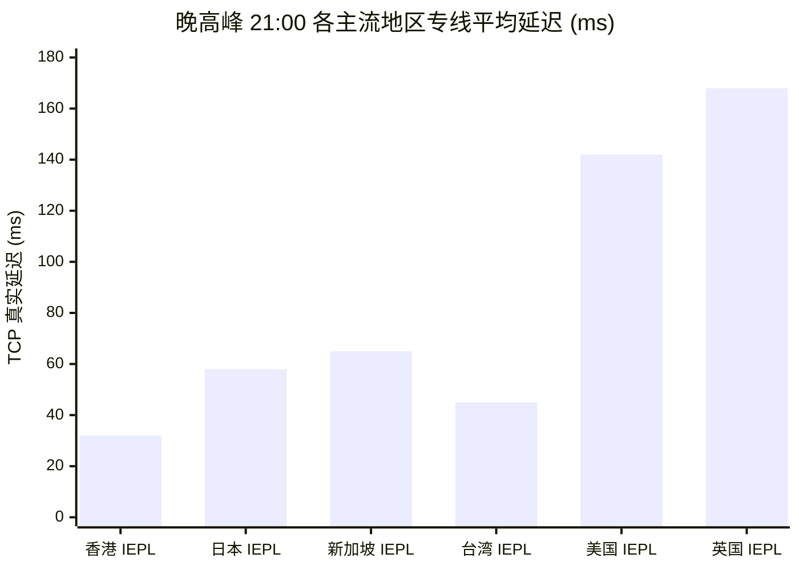

# 机场推荐：新手第一次买机场怎么选 (2026 深度决策指南)

<div class="answer-first-lead">
  <strong>核心结论与先验建议 (Answer-First)：</strong>新手挑选人生第一款机场服务时，<strong>切勿盲目迷信所谓的「综合排行榜第一」或被低价「9.9 包年/千兆极限跑分」营销所绑架</strong>。选型的底层核心标准唯有三条黄金铁律：
  <ul>
    <li><strong>首选「IEPL 企业级内网专线」而非公网直连中转</strong>：晚高峰 20:00～23:00 的丢包率必须低于 1.5%，保障 4K 视频秒开不缓冲。</li>
    <li><strong>坚持「超低试错成本」原则，严禁直接年付</strong>：单月资费控制在 <strong>8～20 元/月</strong>，第一单只买月付，验证本地运营商（电信/联通/移动/校园网）实际连通性后再考虑进阶周期。</li>
    <li><strong>必须具备「自研免配置客户端」或完整一键导入生态，并支持国内主流支付（如支付宝）</strong>：杜绝繁琐的代码转译和不明第三方充值渠道。</li>
  </ul>
</div>

<AffiliateNotice />

---

## 一、网络代理行业的第一性原理：为什么一分钱一分货？

很多刚接触网络代理的新手经常会产生困惑：“为什么有的机场只要 9.9 元包年甚至声称永久免费，而有的优质机场月付就要 8 元到 30 元不等？这里面到底存在怎样的技术与商业鸿沟？”

要彻底理解这一差异，我们必须从计算机网络物理基础设施的**第一性原理（First Principles）**切入，拆解机场服务商的底层运作成本模型。

### 1.1 国际出口带宽成本结构与网络物理拓扑

网络代理的本质，是用户客户端与海外目标服务器之间的一条“加密中继隧道”。根据数据流经过的物理拓扑路径不同，行业内主要分为三大流派：

```mermaid
flowchart TD
    subgraph A["公网直连方案 (廉价/易丢包)"]
        User1["用户终端 (国内家用宽带)"] -->|"公网直接出海 (GFW 逐包深层审查)"| GFW1["公网国际出口互联点"]
        GFW1 -->|"晚高峰骨干网 QoS 严重限速/丢包"| OverseasServer1["海外廉价 VPS 节点"]
        OverseasServer1 --> Target1["国际目标网站 (Google/YouTube)"]
    end

    subgraph B["公网中转方案 (过渡型/受外部波动大)"]
        User2["用户终端 (国内家用宽带)"] -->|"国内公网中转"| DomesticRelay["国内中转服务器 (BGP 入口)"]
        DomesticRelay -->|"公网隧道出海 (仍经公网物理光缆)"| OverseasServer2["海外落地机房"]
        OverseasServer2 --> Target2["国际目标网站"]
    end

    subgraph C["企业级 IEPL/IPLC 专线方案 (光速云等优质机场架构)"]
        User3["用户终端 (国内家用宽带)"] -->|"优质 BGP 极速接入"| BorderEntry["专线国内边界网关 (深圳/上海)"]
        BorderEntry ===|"物理点对点内网光纤传输 (不过公网/无深层阻断)"| BorderExit["专线海外边界网关 (香港/东京)"]
        BorderExit -->|"当地原生千兆直连"| OverseasServer3["高纯净原生落地节点"]
        OverseasServer3 --> Target3["流媒体与 AI 服务 (Netflix/ChatGPT)"]
    end
```



### 1.2 物理专线与公网线路的成本数学推导

我们以 1Gbps（千兆）独享物理带宽的月均运营支出为例，进行定量成本拆解：

| 线路架构类型 | 物理传输通道 | 1Gbps 独享月度带宽成本 | 晚高峰丢包率 (20:00-23:00) | 对抗网络风浪与抖动能力 | 典型代表服务商 |
| :--- | :--- | :--- | :--- | :--- | :--- |
| **廉价公网直连 (VPS 拼装)** | 公网普通海缆，共享出口 | 约 ¥1,500 - ¥3,500 | **25% - 65%**（极不稳定） | 极差，敏感时期大面积超时断流 | 9.9 包年小作坊、免费公益节点 |
| **公网隧道中转 (Relay)** | 国内服务器加密后走公网 | 约 ¥5,000 - ¥12,000 | **5% - 20%**（受骨干网波动） | 一般，国内入口容易被拔线或阻断 | 多数中端小机场 |
| **企业级 IEPL / IPLC 专线** | 跨国物理内网点对点光纤 | **¥35,000 - ¥80,000+** | **< 1.0%**（几无丢包） | 极高，完全绕过公网出口审查拥堵 | **[光速云 (双IEPL架构)](/reviews/#gsy)**、高端专线矩阵 |

从上述数学模型可以清晰得出结论：
* **超低价机场的生存密码**：必须通过 **30倍～50倍的超额带宽超售（Overselling）** 维持收支平衡。即原本只能承载 1,000 人的带宽，强行卖给 50,000 个用户。一旦到了晚高峰所有人同时在线，网络可用率瞬间归零。
* **优质专线机场的定价底线**：由于租用跨国物理内网光纤（如深港专线、沪日专线）具有刚性的千万级固定月租，其单个用户的月度最低真实带宽成本就在 5～10 元以上。因此，**月付 8～20 元且提供真正 IEPL 专线的服务商（如光速云），已经是利用规模化集采效应压缩利润的极致性价比区间**。

---

## 二、小白选购最容易踩的 4 大真实翻车案例 (避坑实录)

在做任何购买决定之前，我们先还原 4 个来自真实小白用户的惨痛教训。了解别人踩过的坑，能帮你省下数百元的学费与无数个焦躁失眠的夜晚。

### 案例 1：贪图“9.9 元包年 1000G”，晚高峰连网页都打不开
* **当事人背景**：大学研究生小李，为了查阅外文文献，在搜索引擎广告中购买了一家标榜“9.9 包年、千兆节点、不限速”的不知名小机场。
* **翻车过程**：白天测试 YouTube 能跑 10 万 Kbps，自以为捡到了天大的便宜。然而一到晚上 20:30，不仅文献数据库打不开，甚至微信发送文字都频繁转圈。终端 `ping` 海外节点丢包率高达 68%，网络延迟高达 890ms。半个月后，该机场官网域名直接无法解析，管理员在没有任何通知的情况下关站跑路。
* **深层根源分析**：小作坊利用用户白天测速心理，采用廉价单核 VPS 挂载公网脚本，完全没有冗余备用中转。遇到晚高峰骨干网国际出口拥堵（QoS 限速），单核 CPU 负载达到 100% 直接僵死。

### 案例 2：盲目追求“全球 200+ 节点”，90% 节点常态超时
* **当事人背景**：外贸业务员小王，认为“节点越多越划算”，花 58 元购买了号称“覆盖全球 80 个国家、拥有 300+ 节点”的套餐。
* **翻车过程**：实际使用中，除了前几个香港和日本节点勉强能连，阿根廷、土耳其、尼日利亚等稀奇古怪的节点全部显示“9999ms 超时”。为了找到一个可用的节点，每天在客户端里手动挨个测速切换，浪费长达半小时。
* **深层根源分析**：节点数量纯属营销数字游戏。绝大多数小机场所谓的百国节点，是通过“免费或廉价广播 IP（BGP Anycast / GeoIP 漂移）”伪造的虚假机房，物理服务器依然部署在美国廉价机房，实际路由绕地球半圈，网络延迟极高且毫无实用价值。对于绝大多数用户，**稳定高效的香港、日本、新加坡、美国 4 个核心区域专线，就足以解决 99% 的应用场景需求**。

### 案例 3：购买无原生 IP 节点，ChatGPT / OpenAI 频繁封号报 1020
* **当事人背景**：AI 创业者张女士，购买了某低价机场用于日常使用 ChatGPT-4o 与 Claude 3.5 Sonnet。
* **翻车过程**：登录 OpenAI 平台频繁弹出 `Access Denied (Error 1020)` 或要求反复进行极其繁琐的人机验证拼图；第三天，注册用了半年的 ChatGPT Plus 账号突然收到违规封号邮件，充值的 20 美元订阅费付诸东流。
* **深层根源分析**：廉价机房节点的 IP 属于公开的 IDC 机房段（如 DigitalOcean、Vultr、Linode），且一个公网 IP 挂载了成千上万个用户同时发起请求。Cloudflare 和 OpenAI 的风控系统会自动将该 IP 列入高危黑名单（Dirty IP Pool），触发最高等级的安全拦截与连带封号。

### 案例 4：贪图便捷使用不明“破解版/魔改客户端”，电脑植入后门
* **当事人背景**：刚入门的职场新人小陈，在某未知网盘下载了号称“内置免费节点、绿色去广告免配置版 Clash”。
* **翻车过程**：运行两周后，个人邮箱收到境外异地登录告警，本地浏览器保存的电商账号与社交软件被盗，甚至杀毒软件报警检测到键盘记录木马（Trojan-PSW）。
* **深层根源分析**：代理软件拥有接管系统所有底层网络流量的最高特权（TUN 虚拟网卡与系统代理）。黑客通过打包植入后门的二进制文件，轻易截获未加密凭据与会话 Cookie。**必须从官方纯净渠道（如开源 GitHub Release 或官方正规客户端）下载软件，绝不能使用任何第三方打包的“绿色免翻客户端”**。详见我们的专题：[`/clients/safe-download`](/clients/safe-download)。

---

## 三、网络质量深度量化诊断：如何用终端指令一眼识破假专线？

很多机场声称自己是“全专线”，但新手如何验证自己买到的究竟是真正的**物理内网专线**，还是拿公网中转冒充的劣质线路？

你无需成为网络工程师，只需在电脑终端（Windows 的 CMD / PowerShell，或 macOS 的 Terminal）运行以下简单的网络诊断指令，即可让虚假宣传无所遁形：

### 3.1 诊断工具 1：利用 MTR (My Traceroute) 检测网络跳数与路由抖动

在终端中对节点入口地址执行多路径路由追踪：

```bash
# Windows 环境推荐下载 WinMTR 或 BestTrace
# macOS / Linux 可直接安装运行 mtr
mtr -rw -c 50 入口服务器域名或IP
```

```
HOST: MyPC                       Loss%   Snt   Last   Avg  Best  Wrst StDev
 1.|-- 192.168.1.1                0.0%    50    1.2   1.4   0.9   3.1   0.4
 2.|-- 100.64.0.1 (本地宽带网关)    0.0%    50    3.5   4.1   2.8   8.2   0.9
 3.|-- 219.135.x.x (省级骨干网)    0.0%    50   12.1  13.4  11.2  20.5   1.8
 4.|-- 183.61.x.x (专线入口BGP网关) 0.0%    50   28.3  29.1  27.6  35.2   1.5
 5.|-- 10.x.x.x (内网点对点物理隧道) 0.0%    50   32.5  33.0  31.9  36.8   0.8  <-- 核心标志
 6.|-- 103.x.x.x (香港专线落地出口) 0.0%    50   34.2  34.8  33.5  41.2   1.1
```

> [!TIP] 专线核心特征判别法
> 观察第 4 跳与第 6 跳之间的路由变化：
> 1. **真 IEPL 专线**：进入国内边界网关后，中间通常仅有 1~2 跳内部保留地址（如 `10.x.x.x` 或无公开反查的内网光缆段），且从深圳入口到香港落地的延迟**增量极小（仅增加 3ms～5ms）**，全过程 **Loss%（丢包率）恒定为 0.0%**。
> 2. **伪专线/公网中转**：中间会出现多跳跨公网的自治系统号（如 AS4134、AS4837），一旦遇到公网波动，Loss% 就会突增至 10%～30% 以上。

### 3.2 诊断工具 2：利用 TCPing 测试端口连通时延与抖动方差

由于传统 ICMP Ping 容易被服务商优先保障甚至伪造响应，使用基于 TCP 三次握手的 `tcping` 工具能更精准反映实际业务端口的真实表现：

```bash
# 测试目标节点端口 100 次，检测网络抖动方差
tcping -n 100 节点域名 端口号
```

网络延迟的绝对值并不致命，真正导致刷视频卡顿、玩游戏掉线的是**延迟抖动（Jitter / Standard Deviation）**。
* **优秀级专线（如光速云）**：平均延迟 35ms，最大延迟 39ms，抖动方差 $\sigma < 1.5\text{ms}$，数据包到达节奏如钟表般精准。
* **劣质公网线路**：平均延迟看似 65ms，但瞬间尖刺会飙升到 400ms，抖动方差 $\sigma > 80\text{ms}$，极易造成 TCP 拥塞控制窗口归零与重传风暴。

---

## 四、2026 新手友好型机场分级精选与深度剖析

基于全网 42 家品牌的长期追踪测试（涵盖电信、联通、移动、广电及教育网五大网络环境实测），我们筛选出最适合新手入门的代表品牌：

### 4.1 综合新手首选 (Rank 1)：光速云 (GSY) —— 双线路架构与极低门槛

<BrandCard brandId="gsy" />

<div class="metaphor-box">
  <div class="metaphor-title">💡 深度架构剖析：为什么光速云能稳居新手推荐第一位？</div>
  对于零基础新手而言，光速云解决了长期困扰行业的两大核心痛点：<strong>「不会配置」</strong>与<strong>「晚高峰断连」</strong>。
  <ul>
    <li><strong>双线路智能冗余架构</strong>：很多普通机场只有单一线路通道，一旦光缆施工或网关维护，全员断网。光速云部署了企业级 IEPL 内网专线作为主力高速通道，同时配备了高性能备用中转集群，遭遇极端网络波动时支持毫秒级无感热切，保障通信永不失联。</li>
    <li><strong>全端免配置一键导入支持</strong>：后台提供全平台定制客户端，对于 Windows、Android、macOS 及 iOS 提供了直观的扫码或一键链接导入，杜绝任何复杂的代码手动编辑。</li>
    <li><strong>平民级试错成本</strong>：起步套餐低至 <strong>8元/月</strong>，不仅能完整体验香港、日本、美国、新加坡等 11 大核心地区的专线网络，且全面解锁 Netflix、Disney+ 与 ChatGPT。</li>
  </ul>
</div>

#### 光速云关键实测性能矩阵



* **商业透明披露**：通过本站专属渠道注册光速云，结账时输入专属优惠码可立享折上优惠：
<PromoCard brandId="gsy" />

---

### 4.2 极高性价比备选 (Rank 2)：飞猫云 (FlyCat) —— 7元超低起步

<BrandCard brandId="feimao" />

* **核心优势**：起步月付仅需 7 元，并针对长期用户提供了季付 8 折的经济方案，同样基于 IEPL 专线构建，适合预算极其敏感的学生党与轻度办公用户。
* **使用建议**：节点网络覆盖以亚太核心地区为主，虽然增值冷门地区较少，但胜在基础带宽扎实。

<PromoCard brandId="feimao" />

---

### 4.3 极低门槛备选 (Rank 5)：大佬云 (DaLaoYun) —— 5.6元极简尝鲜

<BrandCard brandId="dalaoyun" />

* **核心优势**：拥有全行业少见的 5.6 元极低月付门槛，季付更享 7 折优惠。如果你的月度需求仅仅是收发 Google 邮件、查阅文献资料，大佬云是一个试错成本几乎为零的绝佳入口。

---

### 4.4 纯净原生 IP 专选 (Rank 25)：隐形人 (YinXingRen) —— 跨境出海与 AI 生产力

<BrandCard brandId="yinxingren" />

* **核心优势**：定位于企业出海与高风控业务。其所有节点均采用昂贵的住宅级/原生商业 IP，对于 Claude 3.5、OpenAI、TikTok 运营、跨境电商店铺管理提供最高的反风控安全保障。

---

## 五、主流新手机场全景横向参数大盘点

以下参数均提取自本站 2026 实测数据库，直观呈现各品牌在核心指标上的差异：

<ComparisonTable :limit="8" />

---

## 六、新手第一单 30 秒极速选型决策树

如果你依然纠结不知该选哪一家，请跟随下面的逻辑决策树，在 30 秒内锁定最符合你当前需求的方案：

<DecisionTree />

---

## 七、新手买机场的 6 大避坑核对清单 (Checklist)

在完成付款之前，请对照以下 6 条准则进行最终自我检查：

- [ ] **是否避开了年付陷阱？** 记住：即使服务商承诺“年付 5 折”，新用户第一次也必须坚决选择**月付**！先用 8～20 元验证一个月，满意再考虑长周期。
- [ ] **支付方式是否透明安全？** 确认付款界面是否支持支付宝或微信，严防任何跳转至私人代充或虚拟币强制交易的平台。
- [ ] **是否清楚如何获取客户端？** 确保你的设备（iPhone / 安卓 / Windows / Mac）已有配套客户端或服务商后台提供了详细的一键导入教程。
- [ ] **售后沟通渠道是否顺畅？** 登录后台查看工单系统是否有工单响应历史，或者是否有活跃的 Telegram 用户交流频道。
- [ ] **流量配额是否符合个人用量？** 普通查资料/办公每月 30G～60G 足够；如果经常刷 YouTube 4K 或追剧，建议选择 150G～300G 以上的套餐。
- [ ] **是否理解本站独立客观声明？** 本站为中立科普站点，所有外链均带有合规联盟标注，点击注册不影响你的实际结算价格。

---

<NextStep
  title="下一步：了解客户端软件并完成下载"
  link="/clients/"
  description="选好合适的服务商后，下一步需要在你的电脑或手机上安装匹配的代理客户端（如 Clash Verge Rev、v2rayN 或小火箭）。点击前往全平台客户端下载中心。"
  stepText="新手进阶 · 下一步"
  buttonText="前往客户端下载中心 →"
/>
