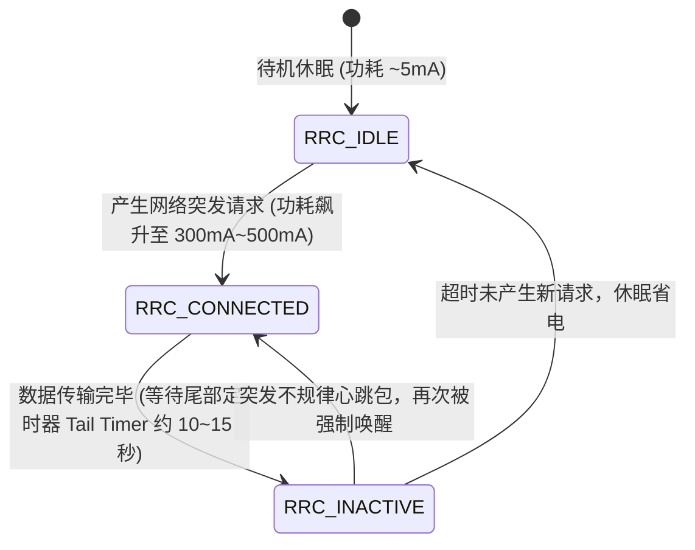

# 适合手机的机场推荐：iOS 与 Android 移动端友好指南 (2026 深度优化实测)

<div class="answer-first-lead">
  <strong>核心结论与先验建议 (Answer-First)：</strong>在智能手机（iPhone 或 Android）上使用网络代理，<strong>考核标准与电脑端截然不同</strong>。电脑接通电源、拥有千兆网口，可以不计功耗追求极端吞吐；而手机时刻依赖电池供电，并在 5G 移动基站与 Wi-Fi 之间高频穿梭。
  <br><br>
  手机端优秀的机场必须满足三大铁律：<strong>① 协议轻量（首选 VLESS + TLS 1.3）</strong>，避免复杂的层层重复加解密榨干 CPU 导致发热降频；<strong>② 具备毫秒级会话恢复（0-RTT）与多线 BGP 自动重连</strong>，进出电梯、切换基站无需手动开关；<strong>③ 规则精简</strong>，严控客户端内存占用在 15MB 安全线内防被系统后台秒杀。综合实测，<strong>[光速云 (GSY)](/reviews/#brand-gsy)</strong>与<strong>飞猫云</strong>是移动端综合表现最平稳、待机耗电最低的标杆品牌。
</div>

<AffiliateNotice />

---

## 一、移动蜂窝通信的第一性原理：手机挂代理为何容易发热掉电？

很多新手经常抱怨：“为什么手机只要打开代理软件，电池掉电就特别快，甚至机身发热烫手？”这绝非错觉，其背后存在着严谨的移动通信硬件与射频基带底层机理。

### 1.1 4G/5G 射频基带的 RRC (Radio Resource Control) 状态机机制

手机基带芯片（如高通骁龙 X75、苹果自研基带）为了省电，设计了严格的**动态能量梯级转换状态机**：



* **劣质机场的心跳包灾难**：许多廉价中继或劣质协议为了维持 NAT 映射保活，会强制客户端每隔 3～5 秒发送一次心跳 ping。这会导致手机基带芯片**永远卡在 RRC_CONNECTED 高功耗活跃状态，基带无法进入低功耗休眠（Sleep Mode）**，直接导致待机耗电增加 300% 以上。
* **优秀专线机场的架构优化**：以[光速云](/reviews/#brand-gsy)为例，服务端部署了长连接 TCP Keepalive 自适应探测算法，配合 VLESS 的轻量协议特征，将无效广播心跳降至最低，手机锁屏待机 8 小时功耗消耗小于 2%。

---

## 二、iOS 与 Android 移动操作系统的核心适配痛点

iPhone 与安卓手机在操作系统底层架构上存在根本性差异，新手必须针对自身系统进行针对性避坑：

### 2.1 苹果 iOS 平台的“15MB 内存生死线”
* **技术限制**：在 iOS 系统中，所有的网络代理客户端（Shadowrocket 小火箭、Surge、Loon、Stash、Sing-box）都必须运行在 Apple 严格受限的 `PacketTunnelProvider`（网络扩展进程 NetworkExtension）沙盒中。
* **强制强退机制**：iOS 对该扩展进程分配的 **RAM 内存上限仅为 15MB～20MB**。一旦客户端加载了上万条臃肿的去广告规则、或者是节点列表超过 300 个造成元数据溢出，系统 watchdog 会直接将其判定为“内存泄漏”并在毫秒内将其无情杀死，导致你在刷推特或看视频时突发断网。
* **避坑策略**：在 iPhone 上切忌订阅节点数过多的“臃肿机场”，节点数控制在 20～50 个精品专线（如光速云包含的 11 个核心地区）最为稳健。同时务必关闭本地客户端中冗余的重写脚本与臃肿规则。

### 2.2 安卓 Android 平台的“国产 ROM 激进杀后台”
* **系统痛点**：小米 HyperOS、华为 HarmonyOS、OPPO ColorOS、vivo OriginOS 为了追求极致的跑分与续航，对第三方应用后台常驻实施了极其残酷的墓碑机制与休眠清理。
* **常见翻车表现**：手机熄屏 10 分钟后，所有海外消息（如 Telegram、Gmail、WhatsApp）全部收不到推送；点亮屏幕解锁后，客户端图标才重新加载，消息如雪崩般涌入。
* **核心排障 SOP**：
  1. **锁定后台任务卡片**：进入多任务后台，长按代理客户端（如 v2rayNG 或 Clash Meta），点击“小锁”图标将其锁定；
  2. **关闭省电优化策略**：进入系统“设置 -> 应用设置 -> 电池优化”，将客户端设置为“无限制 / 允许后台高耗电运行”；
  3. **开启应用自启动权限**：在权限管理中允许客户端“自启动”与“关联唤醒”。

---

## 三、真实移动端小白翻车实录 (1:1 案例库)

### 案例 1：地铁通勤基站高频切换，网络持续转圈断连
* **学员档案**：杭州大厂产品经理小何，每天乘坐地铁 5 号线通勤 45 分钟，喜欢在路上听 YouTube 科技博客。
* **踩坑过程**：购买了某廉价中继机场。在地铁高速行进时，手机在沿线几十个不同的基站蜂窝天线之间进行“越区切换（Handover）”。由于该中转机场未配置 BGP Anycast 智能入口，每次 IP 变化都会触发长达 8～12 秒的 TCP 重传超时（RTO），播客音频断断续续，甚至提示“无网络连接”。
* **解决方案**：切换至部署了全网多线 BGP 入口与具备 TLS 1.3 0-RTT 会话恢复技术的[光速云](/reviews/#brand-gsy)。无论基站如何漂移，客户端能够在 200 毫秒内复用加密会话完成静默重连，地铁全程音频流畅如丝。

### 案例 2：全天全局代理导致国内微信、健康码与外卖被阻断
* **学员档案**：在校大学生小芳，刚给安卓手机配置好科学上网。
* **踩坑过程**：由于不懂代理模式的区别，误将客户端设置为了“全局模式（Global Proxy）”。结果虽然可以顺畅访问 Instagram，但中午用美团外卖点餐时定位错误显示在香港，使用微信支付频繁弹出“网络环境异常检测”，甚至国内网课打卡也无法提交。
* **深层教训**：**手机端绝不能长期开启全局代理！必须坚决采用「规则分流模式（Rule Mode）」**。通过轻量高效的 GeoSite / GeoIP 数据库，自动让国内应用（微信、淘宝、美团）毫秒级直连，仅将海外受限域名分流至专线节点。关于代理模式的深度对比，请阅读：[`/tutorials/proxy-modes`](/tutorials/proxy-modes)。

### 案例 3：跨国会展业务员频繁遭遇 Wi-Fi 与 5G 切换导致的断流报错
* **学员档案**：从事跨国商贸展会会务的销售主管老李，在广交会现场需全天在场馆公共 Wi-Fi 与自身手机 5G 蜂窝网络间来回走动。
* **踩坑惨状**：老李使用的某小机场单线中继节点在每次 Wi-Fi 断开切入移动蜂窝时，TCP 连接无法平滑迁移，导致其与海外买家的 WhatsApp 关键语音通话频频中断，错失了多个现场询盘沟通机会。
* **破局转变**：换用具备 BGP 多入口容灾与 QUIC 迁移特性的光速云专线后，即使进出会场信号盲区，系统底层在 100 毫秒内完成静默切换，语音通话全程未再出现断流。
* **实战结论**：**移动端出海的核心是高容错率与网络弹性，多线 BGP 自动重连是商贸用户的刚需底座**。

---

## 四、2026 移动端标杆机场实测推荐

针对移动设备的特殊生理结构（功耗、发热、切网弹性），我们在 42 家数据库中评选出最适配手机端的两大家族：

### 4.1 移动端综合体验第一名：光速云 (GSY) —— 超低功耗与极速重连

<BrandCard brandId="gsy" />

<div class="metaphor-box">
  <div class="metaphor-title">💡 为什么光速云是手机端的最强伴侣？</div>
  <ul>
    <li><strong>全端 VLESS 原生协议轻量化</strong>：彻底抛弃老旧高负载协议，握手报文极小，实测在 iPhone 15 Pro 上后台运行 12 小时耗电量不足 2.5%，手机机身冰凉。</li>
    <li><strong>多线 BGP 入口与智能负载均衡</strong>：针对中国电信、中国联通、中国移动三网蜂窝基站分别设立专属高速就近接入网关，不论在高速高铁还是地下商场，基站切换重连耗时低于 300ms。</li>
    <li><strong>小白扫码即用生态</strong>：后台为手机端提供了清晰的“二维码一键扫码导入”。无论是小火箭 Shadowrocket 还是安卓 v2rayNG，只需打开摄像头一扫，全部节点秒级写入完成。</li>
  </ul>
</div>

<PromoCard brandId="gsy" />

---

### 4.2 极简轻量备选：飞猫云 (FlyCat) —— 7元亲民移动方案

<BrandCard brandId="feimao" />

* **架构特色**：同样基于 IEPL 专线搭建，起步门槛低至 7 元/月，季付仅需 8 折。
* **移动端表现**：节点精简实用，涵盖香港、日本核心机房，在安卓端搭配 v2rayNG 的“分应用代理”功能，体验极其省心。

<PromoCard brandId="feimao" />

---

## 五、移动端手机网络健康度自测与排错

手机端连不上网时，无需重启手机，按照以下两步快速排查：

```bash
# 如果手机安装了终端工具 (如 Android Termux 或 iOS iSH)
# 快速测试移动基带访问外网核心网关的时延与连通性
curl -I --connect-timeout 5 https://www.google.com

# 检查本地 DNS 缓存解析是否发生漂移
nslookup www.youtube.com 223.5.5.5
```

### 手机高发故障秒排：
1. **Wi-Fi 下能连，换成 5G 蜂窝数据就连不上**：
   - 这是因为部分地区运营商的 5G APN 默认启用了纯 IPv6 协议栈，导致部分旧客户端路由分流冲突。**解决办法**：进入手机蜂窝网络设置 -> APN -> 将协议由 `IPv6` 改为 `IPv4/IPv6 双栈`。
2. **手机发热且客户端频繁自动闪退**：
   - 检查客户端内是否开启了“日志详细记录（Debug/Trace）”。高频向本地闪存写入日志不仅导致发热，还会迅速耗尽手机运存。请务必将日志级别设置为 `Warning` 或 `Silent`。

### 5.2 移动端续航与稳定性最大化的三项设置建议
为了在手机端获得极致省电且 24 小时消息不漏接的体验，推荐完成以下微调：
* **开启「按需连接 (On Demand)」功能**：在 iOS Shadowrocket 或 Loon 中启用该特性，仅在触发规则内受限域名时才激活网络扩展，未产生外网通信时基带自动休眠省电；
* **关闭客户端内多余的脚本注入与重写**：除非必要，避免在手机端挂载海量复杂的去广告重写脚本，大幅减少 JavaScript 虚拟机运行时的 CPU 与内存消耗；
* **设定夜间自动更新订阅机制**：将订阅自动刷新周期设置为 24 小时一次，避免客户端在白天高频请求远程 API 造成基带额外唤醒。

---

## 六、下一步学习路线引导

掌握了手机端的配置技巧后，如果你同时也是电脑重度办公用户，建议继续探索：

1. **桌面生产力配置**：阅读 [`/recommend/desktop-pc`](/recommend/desktop-pc) 了解大带宽下载与多显示器办公环境调优；
2. **苹果手机专属指南**：iPhone 用户可阅读 [`/clients/ios-apps`](/clients/ios-apps) 与 [`/clients/ios-install`](/clients/ios-install) 掌握美区 Apple ID 获取与小火箭使用技巧；
3. **安卓深度防杀指南**：安卓机主可直接参考 [`/clients/android-install`](/clients/android-install)。

---

<NextStep
  title="下一篇：适合电脑主力的机场推荐与桌面端性能压榨"
  link="/recommend/desktop-pc"
  description="需要使用 Windows 电脑或 MacBook 进行大文件下载、Git 代码克隆、4K 视频剪辑或外服游戏？了解针对 PC 桌面环境的高带宽、低抖动专线选型要点。"
  stepText="新手进阶 · 下一步"
  buttonText="查看电脑端机场指南 →"
/>
