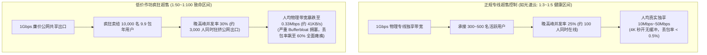

# 新手避坑警示录：哪些类型的机场新手绝对不能碰？(2026 深度排雷清单)

  <strong>核心结论与先验建议 (Answer-First)：</strong>在网络代理市场中，<strong>「不买什么」往往比「买什么」更重要</strong>。新手由于缺乏网络底层常识，最容易被低廉的价格营销或夸张的宣传噱头所蛊惑，从而沦为黑心不良商家的收割韭菜。
    
  新手必须恪守的**终极避坑黄金铁律：凡是符合「永久不限时/终生无限流量」、「2元店/9.9包年千倍超售」、「隐藏月付只准年付」、「必须私聊转账交易」或「打包未知单文件免翻客户端」这五类特征的平台，一律坚决拉黑零容忍**！保护本金与体验的唯一防线，是选择<strong>支持 8～20 元极低月付、采用企业级 IEPL 专线、运营多年口碑良好的正规品牌（如[光速云](/reviews/#brand-gsy)）</strong>。

<AffiliateNotice />

---

## 一、网络超售的第一性原理：为什么低价 2 元店必然晚高峰瘫痪？

很多新手初见“9.9 元包年 1000G”或“2 元/月不限速”时，内心总会浮现捡便宜的侥幸心理。但如果从物理带宽资源的**超售比率（Overselling Ratio）**进行数学推演，你就会明白低价背后的本质是一场赤裸裸的“数字庞氏游戏”。

### 1.1 超售数学极限推导与网络拥塞暴跌

在电信网络工程中，服务商为了摊薄固定服务器成本，通常会预设超售模型：

### 1.2 人均可用带宽的数学公式推演
假设一个小作坊租用了一条 1Gbps（1000 Mbps）的公网廉价 VPS，以 9.9 元/年吸引了 10,000 名用户：
* 白天平峰期：在线率仅 1%（100 人），此时偶尔有人测速，能跑出 500Mbps 的虚高跑分图，截图用来虚假宣传；
* **晚高峰 20:30～22:30**：在线率攀升至 30%（3,000 人同时在线）：
  $$\text{Bandwidth}_{\text{per-user}} = \frac{1000 \text{ Mbps}}{3000 \text{ 人}} \approx 0.33 \text{ Mbps} \approx 41 \text{ KB/s}$$
* **结论**：人均只有可怜的 41 KB/s！连接这种网络，连微信纯文字发送都会频繁转圈，更别提打开网页。**所谓的“低价”，本质上是花钱购买了一张通往彻底瘫痪的假车票**。

---

## 二、全网最危险的五大“高危黑名单”类型深度拆解

为了让你在选型过程中具备火眼金睛，以下五大雷区只要命中任何一条，立刻关掉网页：

### 2.1 死亡雷区 1：“开业大促，99 元买永久不限时/终身无限流量”
* **危险指数**：★★★★★（100% 跑路盘）
* **收割套路**：宣称“一次购买，终身免费”。这是黑产圈最经典的**资金盘跑路模板**。由于服务器和国际专线具有每月刚性扣费属性，没有任何一家商业实体能够提供“永久免费带宽”。
* **收割周期**：通常在推广群集中轰炸营销 2～3 个月，等吸纳了数十万元资金后，一夜之间解散群聊、删库跑路，然后换个域名改头换面卷土重来。

### 2.2 死亡雷区 2：“隐藏月付选项，最低仅准年付/三年付起步”
* **危险指数**：★★★★☆（极易套牢）
* **收割套路**：很多不良小站会故意将月付选项隐藏，或者将月付价格定为极不合理的 40 元/月，而年付却只要 60 元/年，通过巨大的价格反差诱导新手直接掏出一整年的费用。
* **新手铁律**：**第一次买任何机场，坚决不买年付！** 哪怕年付再便宜，也必须先选择月付（8～20元）试用一个月。只有当你用满了三个月、经历了重大网络波动检验且本地宽带完美匹配后，才能考虑更长周期的优惠。

### 2.3 死亡雷区 3：“非正规聚合支付，必须加微信/QQ私聊个人转账”
* **危险指数**：★★★★★（涉嫌资金诈骗与隐私暴露）
* **收割套路**：后台没有正规第三方聚合支付通道，而是弹出一个个人微信赞赏码，或者要求添加所谓的“官方客服微信”人工私信转账发卡密。
* **致命风险**：
  1. 个人转账缺乏任何平台交易留痕与退款机制，对方收款后可直接将你拉黑删除；
  2. 暴露你的实名微信号，将个人敏感通讯录与高风险网络代理产生直接关联，存在严重的个人信息泄露隐患。

### 2.4 死亡雷区 4：“网盘分发的单文件免翻/绿色破解版客户端”
* **危险指数**：★★★★★（严重木马后门风险）
* **收割套路**：某些营销号声称“无需配置，下载解压直接就能上外网”。此类程序通常被打包成了闭源的 `.exe` 或 `.apk` 文件。
* **安全实质**：代理客户端具备操作系统最高等级的虚拟网卡（TUN）与底层数据包捕获权限。使用来历不明的打包程序，黑客能够轻易监听你的本地浏览器明文密码、银行会话 Cookie，甚至直接植入键盘记录器与勒索挖矿木马。关于安全下载规范，请务必牢记：[`/clients/safe-download`](/clients/safe-download)。

### 2.5 死亡雷区 5：“全网免费公益节点大杂烩”
* **危险指数**：★★★☆☆（极度不稳定且存在中间人嗅探）
* **收割套路**：各大网站爬取的所谓免费节点池（如 Free V2Ray）。
* **技术真相**：这些节点 95% 已经处于超时失效状态，剩余可用的节点也极易被黑客搭建“蜜罐（Honeypot）”服务器，对未加密的 HTTP 流量实施中间人攻击（MITM）。详见：[`/free/security-risks`](/free/security-risks)。

---

## 三、真实小白避坑翻车与成功实战 (1:1 案例库)

### 案例 1：大学生贪图“三年付大促”，两个月后群聊全员禁言
* **学员档案**：数码爱好者小王，在某推广博客看到“老牌机场 5 周年庆，三年付仅需 88 元”的诱人广告。
* **惨痛教训**：小王觉得三年 88 元折合每月不到 3 块钱，毫不犹豫付款。前一个月体验良好，到了第二个月底，全部节点开始频繁红字超时。当小王进入其官方售后群反馈时，发现群聊已被设置成“全员禁言且仅管理员可见”，当晚群组直接被解散。所谓“五年老牌”不过是新注册了三个月的空壳皮包站。
* **实战结论**：**在任何机场面前，都要保持清醒的怀疑精神，月付是新手唯一的安全带**。

### 案例 2：坚守月付底线，8 元开启高容错专线体验
* **学员档案**：在读研究生小李，需要查阅 IEEE 学术数据库。
* **避坑实战**：小李在深入阅读本站指南后，拒绝了各类所谓的低价年付诱惑，坚决选择了支持平民月付的[光速云 (GSY)](/reviews/#brand-gsy)。首月仅花费 8 元，通过支付宝当面付扫码完成结算。不仅享受到了纯正的 IEPL 企业专线，且晚高峰写论文查资料毫无阻碍。小李表示：“即使遇到最坏情况，我的最大损失也仅仅是 8 块钱，相当于少喝半杯奶茶，心理压力完全为零。”
* **实战结论**：**用极低的试错成本换取高确定性的网络服务，是新手最理性的消费决策**。

### 案例 3：外贸SOHO轻信私人微信转账购买“内部专属通道”被当场拉黑
* **学员档案**：从事跨境独立站出海的外贸新人小赵，在某论坛被自称“专线总代理”的私人微信吸引。
* **踩坑惨状**：对方发来一张所谓的“千兆独享物理光纤”测速截图，要求小赵通过微信个人转账支付 120 元购买“内部专属高速账号”。小赵转账后，对方发来一个由免费临时服务器生成的 Base64 订阅，仅使用了不到半天便彻底失效。当小赵再次发消息询问时，发现自己已被对方单方面删除拉黑，由于缺乏正规第三方平台介入，损失无法追回。
* **实战警示**：**任何脱离官网正规收银台、要求私人转账的交易均为高危诈骗，正规服务商一律采用自动化对账发货**。

---

## 四、正规专线品牌 vs 危险黑作坊全维对比矩阵

在付款之前，对照下表对你正在考察的服务商进行快速扫描体检：

| 考察维度 | 正规老牌专线机场 (如光速云) | 危险低价作坊 / 跑路盘 |
| :--- | :--- | :--- |
| **底层线路架构** | **企业级 IEPL / IPLC 物理专线**，双线路热备 | 廉价公网 VPS 组装中转，单线无备份 |
| **晚高峰丢包率 (21:00)** | **< 0.8%**（几乎无感） | **30% ～ 65%**（大面积红字卡顿） |
| **套餐计费周期** | **主推 8～20 元/月极低门槛月付**，进退自如 | **强制年付/三年付**，故意隐藏或取消月付 |
| **支付结算渠道** | **正规第三方聚合支付**（支付宝/微信秒级自动到账） | 私人微信转账、第三方个人发卡网、强制 USDT |
| **客户端生态支持** | 官方自研定制客户端 + 通用开源客户端（Clash/小火箭）双轨支持 | 强推来源不明的“破解免翻单文件” |
| **售后响应机制** | **全天候 7×24 小时工单值守**，响应时效 ≤ 30 分钟 | 无工单系统，TG 群经常全员禁言，客服失联 |
| **运营历史与口碑** | **连续稳定运营 3～6 年以上**，经历多次风浪检验 | 域名注册不足半年，网上没有任何历史评价 |

### 4.2 避开一切套路的标杆典范：光速云 (GSY)

<BrandCard brandId="gsy" />

  
💡 为什么光速云能帮助新手避开 100% 的行业深坑？

  <ul>
    <li><strong>坚守平民化低门槛月付</strong>：起步套餐折合仅需 <strong>8元/月</strong>，在结账收银台输入官方专属优惠码 <code>AMM</code> 享额外折扣，随时可以停用或续费。</li>
    <li><strong>真实企业级 IEPL 物理专线</strong>：点对点内网光缆直达海外，杜绝劣质小作坊千倍超售引起的晚高峰雪崩。</li>
    <li><strong>国内聚合安全扫码秒开</strong>：无需购买有冻卡风险的 USDT 虚拟币，手机支付宝一扫即开，3 秒内自动激活入账。</li>
  </ul>

<PromoCard brandId="gsy" />

---

## 五、新手下单前“防踩雷体检 6 问” (Pre-Flight Checklist)

在掏出手机扫码付款前的最后 10 秒钟，请在心中默念以下 6 个问题：

- [ ] **1. 我买的是月付吗？**（如果是年付，立即切回月付！满三个月后再说）
- [ ] **2. 单月价格是否在 8～20 元合理区间？**（过低必超售，过高不划算）
- [ ] **3. 付款界面是否在官网原域名下？**（绝不跳转任何私人发卡网）
- [ ] **4. 线路是否标明 IEPL/IPLC 专线？**（排斥纯公网直连中继）
- [ ] **5. 是否支持一键导入主流客户端？**（排斥给长代码让用户手动改 JSON 的极客小站）
- [ ] **6. 是否有清晰的合规披露声明？**（确认服务商运营透明度）

### 5.2 遇到疑似跑路异常时的紧急止损 SOP
如果你此前购买的某个小机场突发大面积持续红字超时，请按以下三步执行紧急止损：
1. **立即移除客户端内异常订阅**：在软件设置中右键删除该订阅源，防止其后台持续发起无效握手挤占本地系统 CPU 与 NAT 端口；
2. **重置本地网络协议栈**：在 Windows 终端中运行 `netsh winsock reset` 并重启，清除可能残留的本地代理端口死锁；
3. **启用正规平民月付专线救急**：切勿病急乱投医再次购买另一个不知名年付站，花费 8 元选择光速云等运营多年老厂，快速恢复生产力。

---

## 六、下一步学习路线引导

完成了避坑雷区的全景扫描后，你已经具备了比 90% 小白更专业的鉴别力。现在让我们迈入最后一步，完成第一单的最终决策敲定：

1. **第一单终极购买决策**：阅读 [`/recommend/first-purchase-guide`](/recommend/first-purchase-guide) 进行流量、设备数与套餐的最终锁定；
2. **下载配套客户端软件**：前往 [`/clients/`](/clients/) 准备好适合你电脑或手机的安装包；
3. **查看 42 家深度评测数据**：查阅 [`/reviews/`](/reviews/) 掌握包含光速云在内的全网品牌真实测速图与解锁矩阵。

---

<NextStep
  title="下一篇：新手第一单终极购买决策指南"
  link="/recommend/first-purchase-guide"
  description="万事俱备，只欠东风！手把手教你根据自身设备数量、月度流量预算与应用场景，精准锁定最划算的新手第一单。"
  stepText="新手进阶 · 下一步"
  buttonText="查看第一单购买决策指南 →"
/>
