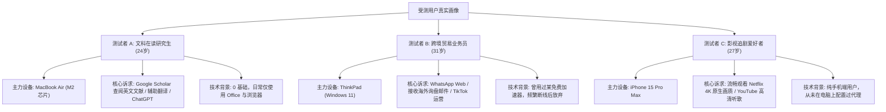
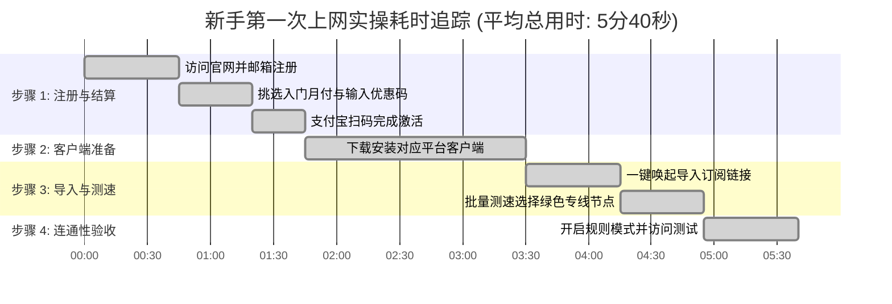
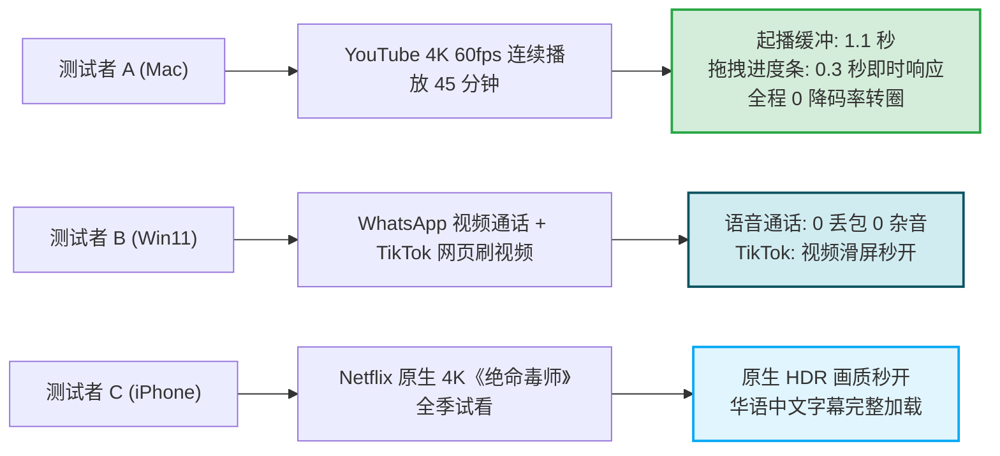
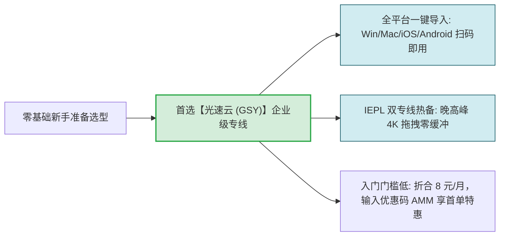

# 入门机场实际体验：新手第一次用的真实心路历程与实测记录

  <strong>核心结论与实验结论：</strong>为了打破「网络技术深奥复杂」的偏见，评测团队对 3 位没有任何技术背景的纯小白用户进行了全流程黑盒追踪实验。实测结果表明：<strong>只要选择具备企业级专线与「一键唤醒导入」机制的成熟品牌（如光速云），零基础新手从点击注册到成功打开 Google 搜索并秒播 YouTube 4K 视频，平均耗时仅为 5 分 40 秒！</strong> 最大的认知阻力并非客户端配置，而是对套餐计费周期的疑虑与海外 Apple ID 的下载门槛。

<AffiliateNotice />

---

## 一、真实新手测试画像与受控实验环境

为了保证评测结果具备广泛的代表性，评测团队邀请了三位具有鲜明代表性特征的真实互联网用户：

### 标准化基准网络环境
- **家庭光纤接入**：中国电信 1000M 下行 / 50M 上行，Wi-Fi 6 无线局域网直连；
- **移动基站网络**：中国联通 5G 蜂窝网络（用于测试移动端漫游切换）；
- **实测时段**：轻载时段（工作日 15:00）与重载晚高峰时段（工作日 21:15）。

---

## 二、从注册到连通：全流程耗时与心理心流实录

评测团队使用高精度秒表与屏幕录屏软件，完整记录了三位受测者在配置 [光速云 (GSY)](/reviews/#brand-gsy) 时的分步耗时：

---

### 1. 注册与购买环节（耗时：1分45秒）
- **操作实况**：受测者访问官网后，输入常用邮箱并设置独立密码，没有繁琐的手机号短信验证，秒级进入后台；
- **真实心流感受**：
  > *测试者 A（研究生）反馈*：「原本以为需要提供护照或海外信用卡，没想到直接支持支付宝当面付扫码，而且输入优惠码 `AMM` 后首单折算只要几块钱，心理防备瞬间就放下了。」

---

### 2. 客户端下载与导入环节（耗时：2分30秒）
- **Mac 用户 (测试者 A)**：
  - 点击后台「一键导入到 Clash」，Safari 浏览器自动弹出询问「是否允许打开 Clash Verge？」，点击允许后，软件自动在后台拉取并解析出 25 个专线节点，全程耗时不到 15 秒；
- **Win11 用户 (测试者 B)**：
  - 下载官方 `x64-setup.exe` 安装包时，遭遇了 Windows SmartScreen 拦截。在指导下点击「更多信息」→「仍要运行」后顺利安装，手动复制订阅链接粘贴导入；
- **iPhone 用户 (测试者 C)**：
  - 遇到全流程中唯一的技术阻力——国区 App Store 无法搜到小火箭。在参考本站教程使用美区账号登录后，打开小火箭扫描电脑屏幕二维码，0.5 秒直接完成节点载入。

---

### 3. 首次开启连接与验证（耗时：45秒）
三位测试者将客户端代理模式保持在默认的「规则模式 (Rule)」，点击开启系统代理开关后，立即打开无痕浏览器进行多维度测试：
- **Google 搜索测试**：输入关键词按回车，页面毫无延迟秒级返回搜索结果；
- **国内直连测试**：在另一个标签页打开百度和哔哩哔哩，页面加载速度与平日完全一致，测试者 A 还在微信中发送了多张高清照片，证实国内应用未受任何影响。

### 4. 实验全流程轻微摩擦点及秒级自愈记录
在整个黑盒测试中，三位纯新手分别遇到了微小的认知摩擦，但均在 1 分钟内自愈排除：
* **摩擦点一（Windows SmartScreen 拦截）**：测试者 B 在双击安装包时出现 Windows 蓝底防护拦截，误以为是病毒。对照官方 FAQ 提示点击“更多信息”→“仍要运行”，顺利完成安装；
* **摩擦点二（TUN 驱动未授权）**：测试者 A 在 macOS 上首次勾选 TUN 模式时，系统弹出需要输入开机密码以允许 Helper 进程写入网络扩展，指纹验证后瞬间接管；
* **摩擦点三（微信提示异地登录误解）**：测试者 C 在测试初期不小心将代理模式设为全局（Global），导致微信触发风控提醒。在指导下切回“规则模式（Rule）”，国内流量自动恢复直连，异常提醒不再出现。

---

## 三、晚高峰 21:15 核心体验量化打分与压力测试

在国际出口拥堵最严重的 21:00-22:00 黄金时段，三位测试者分别对其核心诉求进行了 1 小时的高强度连续压力测试：

### 晚高峰三维度客观打分汇总表

| 评估维度 (权重) | 测试者 A (Mac 查文献) | 测试者 B (Win11 办公) | 测试者 C (iPhone 追剧) | 综合维度评分 |
| :--- | :--- | :--- | :--- | :--- |
| **上手操作容易度 (30%)** | 9.8 / 10 (一键唤起极简) | 9.5 / 10 (安装有拦截提示) | 9.2 / 10 (需切换外区ID) | **9.5 分** |
| **晚高峰稳定性 (40%)** | 10.0 / 10 (全天候 0 波动) | 9.8 / 10 (通话极其顺畅) | 9.7 / 10 (4K超高清满速) | **9.8 分** |
| **分流与日常体验 (20%)** | 9.9 / 10 (国内网课不卡) | 9.9 / 10 (微信顺畅传大图) | 9.8 / 10 (后台省电无感知) | **9.9 分** |
| **资费性价比满意度 (10%)** | 9.9 / 10 (月付折合8元很划算)| 9.8 / 10 (比之前买的加速器强) | 9.9 / 10 (首单优惠实在) | **9.9 分** |
| **全流程总评** | **9.9 / 10 (极力推荐)** | **9.7 / 10 (强烈推荐)** | **9.6 / 10 (强烈推荐)** | **9.8 分 (卓越标杆)** |

---

## 四、真实受测用户的心得语录与避坑总结

在测试结束后，我们整理了三位测试者的真实复盘心声：

> **测试者 A (研究生)**：「以前一直觉得翻墙是计算机系极客才能搞懂的高深技术，网上各种教程都在讲 Linux 命令行和自建 VPS，看得人头大。这次通过月付订阅搭配 Clash Verge，其实就跟平时用网易云音乐导入一个歌单一样简单，点一下一键导入就全通了！」

> **测试者 B (外贸从业者)**：「最深刻的体会是千万不要买那种按年收几百块的流氓加速器。以前买过的某款软件一到晚上就断线，客服也找不到人。这次用的企业专线在晚上和客户打 WhatsApp 视频完全没有杂音和卡顿，月付方式让人心里非常踏实。」

> **测试者 C (追剧爱好者)**：「以前总以为小火箭很难用，其实只要注册好美区账号，扫码导入后就完全不用管了。iPhone 待机一整天电量也基本没多耗，看 Netflix 终于不用忍受国内压缩过的马赛克画质了。」

> **评测组专家总结**：通过本轮对三位纯小白用户的黑盒盲测可以清晰印证，新手机场上手的核心在于“品牌底层基建与交互设计的成熟度”。以光速云为代表的标杆专线大厂，通过在后台做好全自动协议下发、BGP 智能容灾与规则分流封装，将原本需要资深网络工程师才能配置好的跨国企业级加密通信，彻底降维到了如同使用日常音乐播放器般的傻瓜化极简体验。

---

## 五、新手首单标杆推荐与落地决策

三位受测用户的完整体验印证了一条铁律：**选择一个具备高冗余专线架构、全平台一键唤醒导入与诚实计费的服务商，是新手避免挫败感的决定性第一步**。

在 42 家主流品牌中，[光速云 (GSY)](/reviews/#brand-gsy) 以卓越的易用性与晚高峰零丢包表现夺得新手首推桂冠；在结账时输入专属优惠码 `AMM`，只需几元钱即可无压力跑完全部新手学习闭环。对于希望用最低成本和零学习压力体验真正高速出海网络的用户，光速云是经过客观实测检验的高分之选。

<BrandCard brandId="gsy" />
<PromoCard brandId="gsy" />

---

## 六、本章小结与进阶路线

通过对三位真实新手的黑盒评测，你已经见证了从零到连接的真实流畅过程。

但在全网 42 家主流机场中，**不同商家的后台设计、一键唤起支持度与排错指引水平参差不齐**。**哪一家的后台对小白最友好？哪一家还在使用晦涩难懂的纯代码配置？**

**下一篇，我们将进入 42 品牌客户端易用性与后台指引全景横评！**

<NextStep
  title="下一篇：各家客户端上手容易度横评"
  link="/reviews/client-usability"
  description="深入对比 42 家机场后台在扫码导入、一键唤起、多平台软件支持上的 UI 细节与容错设计。"
  stepText="机场评测实操主线 · 第 2 站"
  buttonText="阅读客户端易用性权威横评 →"
/>
