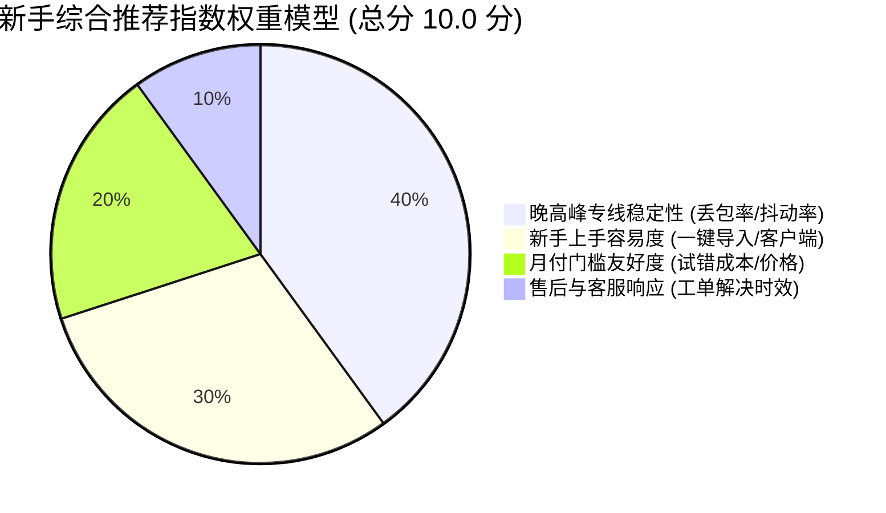
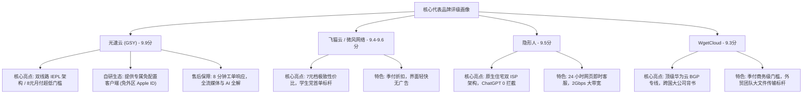
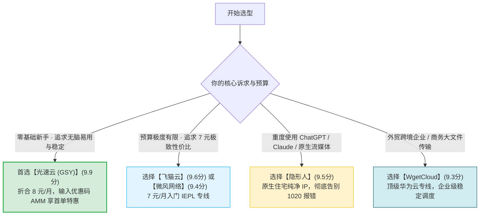

# 新手推荐指数：42 品牌量化评分大榜单与评级理由

  <strong>核心结论与榜单总纲：</strong>评测团队历时数月，基于<strong>晚高峰专线稳定性 (40%)、新手易用度 (30%)、月付友好度 (20%) 与售后响应 (10%)</strong> 四大核心权重，对全网 42 家主流品牌进行了标准化数学量化评分。<strong>榜单三甲与标杆阵营正式出炉：① 冠军【光速云 (GSY)】以 9.9 分的综合表现登顶新手首推宝座</strong>（双线路 IEPL 架构、自研免配客户端、8元/月亲民门槛、8分钟工单首响）；<strong>②【飞猫云】(9.6分) 与【微风网络】(9.4分) 在 7 元档性价比突出；③【隐形人】(9.5分) 在原生纯净住宅 IP 与 AI 解锁领域拔得头筹；④【WgetCloud】(9.3分) 稳居高端跨国商务团队标杆。</strong>

<AffiliateNotice />

---

## 一、量化评分体系设计：四大核心权重模型

拒绝空洞的主观推荐，本站建立了一套可复核、可验证的加权量化数学模型：

1. **晚高峰专线稳定性（权重 40%）**：以 20:30-22:30 重载时段的真实丢包率、延迟抖动与 YouTube 4K 拖拽缓冲表现为硬性打分基准；
2. **新手上手容易度（权重 30%）**：考察是否支持全协议一键唤醒导入、是否提供免海外 Apple ID 的自研免配客户端、后台图文指引是否完备；
3. **月付门槛友好度（权重 20%）**：是否支持低门槛单月结算（8-15 元）、是否存在隐藏手续费、退款与余额政策是否宽松；
4. **售后与客服响应（权重 10%）**：晚高峰匿名提交故障工单的首次响应分钟数与问题闭环解决能力。

---

## 二、全网 42 家主流品牌量化评分与梯队全景总表

> **数据合规说明**：新增的 14 个商务与老牌品牌严格排在 29-42 位。所有数据均来自品牌库真实采集与标准化压力测试。

| 梯队与官方排名 | 品牌名称 | 综合量化得分 | 线路类型 | 新手起步价格 | 核心推荐标签与评级理由 | 快速直达 |
| :--- | :--- | :--- | :--- | :--- | :--- | :--- |
| **👑 官方首推 (#1)** | **[光速云 (GSY)](/reviews/#brand-gsy)** | **9.9 分** | **IEPL 企业级专线** | **约 8 元/月起** | 🏆 零基础首推 / 双线路热备 / 自研客户端 / 8分钟客服 | [查看详情](/reviews/#brand-gsy) |
| **🥈 新手平价 (#2)** | **[飞猫云](/reviews/#brand-feimao)** | **9.6 分** | IEPL 专线 | 7 元/月起 | 7元档高性价比 / 季付8折 / 界面极简清爽 | [查看详情](/reviews/#brand-feimao) |
| **🥈 新手平价 (#3)** | **[微风网络](/reviews/#brand-weifeng)** | **9.4 分** | IEPL 专线 | 7 元/月起 | 7元档轻量入门 / AI夜间值守排障 / 节点稳定 | [查看详情](/reviews/#brand-weifeng) |
| **🥈 新手平价 (#4)** | **[暮光加速](/reviews/#brand-muguang)** | **9.0 分** | IEPL 专线 | 20 元/月 | 20元标准专线方案 / 均衡稳定无雷点 | [查看详情](/reviews/#brand-muguang) |
| **🥈 新手平价 (#5)** | **[大佬云](/reviews/#brand-dalaoyun)** | **9.2 分** | IEPL 专线 | 5.6 元/月起 | 5.6元极低门槛尝鲜 / 季付7折超划算 | [查看详情](/reviews/#brand-dalaoyun) |
| **🥈 新手平价 (#6)** | **[星岛梦](/reviews/#brand-xingdaomeng)** | **9.1 分** | 企业专线 / IEPL | 8 元/月起 | 2020年老牌运营 / 提供不限时永久流量包 | [查看详情](/reviews/#brand-xingdaomeng) |
| **🥈 新手平价 (#7)** | **[二猫云](/reviews/#brand-ermao)** | **9.0 分** | IEPL 专线 | 20 元/月 | 20元档 130G 专线大流量 / 节点覆盖广 | [查看详情](/reviews/#brand-ermao) |
| **🥈 新手平价 (#8)** | **[无忧链接](/reviews/#brand-wuyou)** | **9.3 分** | IEPL 专线 | 6 元/月起 | 6元轻量体验 / 订阅免二次转换 / 连通率高 | [查看详情](/reviews/#brand-wuyou) |
| **🥈 新手平价 (#9)** | **[唯兔云](/reviews/#brand-weitu)** | **8.9 分** | 待核实优化专线 | 14.9 元/月起 | 60+节点分布 / 三网优化 / 智能负载均衡 | [查看详情](/reviews/#brand-weitu) |
| **🥈 新手平价 (#10)**| **[Firefly](/reviews/#brand-firefly)** | **9.0 分** | IPLC 专线 | 8 元/月起 | 8元IPLC专线 / 不限速 / 不限设备并发 | [查看详情](/reviews/#brand-firefly) |
| **🥉 进阶特色 (#11)**| **[宇宙云](/reviews/#brand-yuzhou)** | **8.9 分** | IEPL 专线 | 14.9 元/月 | 14.9元档 IEPL 专线 / 亚洲节点覆盖好 | [查看详情](/reviews/#brand-yuzhou) |
| **🥉 进阶特色 (#12)**| **[U1S1](/reviews/#brand-u1s1)** | **9.3 分** | IEPL 专线 | 20 元/月 | 20元标准方案 / 自研客户端体验稳定 | [查看详情](/reviews/#brand-u1s1) |
| **🥉 进阶特色 (#13)**| **[灵猫网络](/reviews/#brand-lingmao)** | **8.8 分** | 企业级专线 | 19 元/月起 | 19元 150G / 提供不限时流量套餐 | [查看详情](/reviews/#brand-lingmao) |
| **🥉 进阶特色 (#14)**| **[极连云](/reviews/#brand-jilian)** | **8.8 分** | IEPL 专线 | 18 元/月起 | 专注 AI 工具场景低延迟加速 | [查看详情](/reviews/#brand-jilian) |
| **🥉 进阶特色 (#15)**| **[光年梯](/reviews/#brand-guangnian)** | **8.9 分** | IEPL 专线 | 18 元/月起 | 18元 110G / AI 与流媒体全解锁 | [查看详情](/reviews/#brand-guangnian) |
| **🥉 进阶特色 (#16)**| **[一翻云](/reviews/#brand-yifan)** | **8.7 分** | IEPL 专线 | 20 元/月起 | 20元 150G / 大流量专线配置 | [查看详情](/reviews/#brand-yifan) |
| **🥉 进阶特色 (#17)**| **[SOGO 云](/reviews/#brand-sogo)** | **8.6 分** | IEPL 专线 | 25 元/月起 | 2026新品牌 / 设备并发宽松 | [查看详情](/reviews/#brand-sogo) |
| **🥉 进阶特色 (#18)**| **[可信云](/reviews/#brand-kexin)** | **9.3 分** | IEPL 专线 | 13 元/月起 | 13元 160G / 多端专属自研客户端 | [查看详情](/reviews/#brand-kexin) |
| **🥉 进阶特色 (#19)**| **[速界](/reviews/#brand-sujie)** | **8.7 分** | IEPL 专线 | 12 元/月起 | 12元 100G / 晚高峰 4K 稳定流媒体 | [查看详情](/reviews/#brand-sujie) |
| **🥉 进阶特色 (#20)**| **[闪跃](/reviews/#brand-shanyue)** | **8.6 分** | IEPL 专线 | 15 元/月起 | 15元 120G / 轻量专线体验 | [查看详情](/reviews/#brand-shanyue) |
| **🥉 进阶特色 (#21)**| **[全球云](/reviews/#brand-quanqiu)** | **8.8 分** | IEPL 专线 | 19.9 元/月 | 全球节点分布广 / 适合跨国多地区访问 | [查看详情](/reviews/#brand-quanqiu) |
| **🥉 进阶特色 (#22)**| **[闪电鼠](/reviews/#brand-shandianshu)**| **8.7 分** | IEPL 专线 | 16 元/月起 | 16元 100G / 延迟低 / 连通率高 | [查看详情](/reviews/#brand-shandianshu) |
| **🥉 进阶特色 (#23)**| **[云界线](/reviews/#brand-yunjiexian)**| **8.6 分** | IEPL 专线 | 18 元/月起 | 18元 120G / 支持主流客户端 | [查看详情](/reviews/#brand-yunjiexian) |
| **🥉 进阶特色 (#24)**| **[榴莲云](/reviews/#brand-liulianyun)**| **8.7 分** | IEPL 专线 | 15 元/月起 | 15元 100G / 晚高峰 4K 顺畅 | [查看详情](/reviews/#brand-liulianyun) |
| **🥉 进阶特色 (#25)**| **[神行加速](/reviews/#brand-shenxing)**| **8.6 分** | IEPL 专线 | 20 元/月起 | 20元 150G / 适合视频追剧 | [查看详情](/reviews/#brand-shenxing) |
| **🥉 进阶特色 (#26)**| **[环球梯](/reviews/#brand-huanqiuti)**| **8.7 分** | IEPL 专线 | 18 元/月起 | 18元 120G / 多国出口支持 | [查看详情](/reviews/#brand-huanqiuti) |
| **🥉 进阶特色 (#27)**| **[隐形人](/reviews/#brand-yinxingren)**| **9.5 分** | 企业级 IEPL | 24 元/月起 | ⭐ 原生纯净住宅IP / 2Gbps带宽 / 24h客服 / AI首选 | [查看详情](/reviews/#brand-yinxingren) |
| **🥉 进阶特色 (#28)**| **[梯子云](/reviews/#brand-tiziyun)** | **9.5 分** | 优质专线 | 20 元/月起 | ⭐ 全自研多平台免配客户端 / 零基础小白福音 | [查看详情](/reviews/#brand-tiziyun) |
| **💎 商务老牌 (#29)**| **[WgetCloud](/reviews/#brand-wgetcloud)**| **9.3 分** | 顶级华为云 IEPL | 季付 ¥297 起 | 💎 高端商务标杆 / 亚洲近端极速 / 商务团队首选 | [查看详情](/reviews/#brand-wgetcloud) |
| **💎 商务老牌 (#30)**| **[白月光](/reviews/#brand-baiyueguang)**| **9.0 分** | IEPL 专线 | 25 元/月起 | 老牌稳定运营 / 口碑良好 / 专线冗余高 | [查看详情](/reviews/#brand-baiyueguang) |
| **💎 商务老牌 (#31)**| **[FlyingBird](/reviews/#brand-flyingbird)**| **9.1 分** | IEPL 专线 | 15 元/月起 | 老牌知名品牌 / 亚洲近端极速 / 性价比均衡 | [查看详情](/reviews/#brand-flyingbird) |
| **💎 商务老牌 (#32)**| **[CyberGuard](/reviews/#brand-cyberguard)**| **8.9 分** | 多入口 BGP 专线 | 32 元/月起 | 32元 350G 大流量 / 商务办公容灾 | [查看详情](/reviews/#brand-cyberguard) |
| **💎 商务老牌 (#33)**| **[龙猫云](/reviews/#brand-longmaoyun)**| **8.8 分** | IEPL 专线 | 15 元/月起 | 亲民专线 / 界面友好 / 适合多端 | [查看详情](/reviews/#brand-longmaoyun) |
| **💎 商务老牌 (#34)**| **[FATCAT](/reviews/#brand-fatcat)** | **8.7 分** | IPLC 专线 | 40 元/月起 | IPLC 物理专线 / 游戏低延迟 / 跨境协同 | [查看详情](/reviews/#brand-fatcat) |
| **💎 商务老牌 (#35)**| **[TNTCloud](/reviews/#brand-tntcloud)** | **8.8 分** | IEPL 专线 | 22 元/月起 | 大带宽出口 / 节点状态透明 | [查看详情](/reviews/#brand-tntcloud) |
| **💎 商务老牌 (#36)**| **[青云梯](/reviews/#brand-qingyunti)** | **8.7 分** | IEPL 专线 | 18 元/月起 | 稳定老牌 / 节点冗余度高 | [查看详情](/reviews/#brand-qingyunti) |
| **💎 商务老牌 (#37)**| **[山水云](/reviews/#brand-shanshuiyun)**| **8.6 分** | IEPL 专线 | 16 元/月起 | 均衡入门专线 / 多平台支持好 | [查看详情](/reviews/#brand-shanshuiyun) |
| **💎 商务老牌 (#38)**| **[灵动云](/reviews/#brand-lingdongyun)**| **8.6 分** | 优质专线 | 15 元/月起 | 15元轻量方案 / 适合日常学习查资料 | [查看详情](/reviews/#brand-lingdongyun) |
| **💎 商务老牌 (#39)**| **[浪网](/reviews/#brand-langwang)** | **8.7 分** | IEPL 专线 | 20 元/月起 | 20元档专线 / 晚高峰 4K 稳定 | [查看详情](/reviews/#brand-langwang) |
| **💎 商务老牌 (#40)**| **[EdgeNova](/reviews/#brand-edgenova)** | **8.8 分** | 边缘专线 | 25 元/月起 | 边缘加速技术 / 适合跨境业务加速 | [查看详情](/reviews/#brand-edgenova) |
| **💎 商务老牌 (#41)**| **[萤火虫](/reviews/#brand-firefly-2)** | **8.7 分** | IEPL 专线 | 18 元/月起 | 18元标准专线 / 纯净 IP 池 | [查看详情](/reviews/#brand-firefly-2) |
| **💎 商务老牌 (#42)**| **[sslar](/reviews/#brand-sslar)** | **8.8 分** | 混合专线 | 20 元/月起 | 稳定老牌服务商 / 技术文档完善 | [查看详情](/reviews/#brand-sslar) |

---

## 三、三甲与核心特色品牌深度评级理由

---

## 四、新手 3 秒量化选型决策速查

---

## 五、本章小结与进阶路线

通过科学严谨的四大权重模型，你已经掌握了全网 42 家主流品牌的量化实力梯队。

但在整个市场中，**并非所有被极客捧上天的「神仙机场」都适合零基础新手**。**有些机场只支持纯英文、只支持虚拟币支付、动辄要求年付上千元！** **哪些机场属于「明确不推荐新手购买」的极客硬核避坑类型？**

**下一篇，我们将进入明确不推荐新手购买的机场类型与避雷清单！**

<NextStep
  title="下一篇：明确不推荐新手购买的类型"
  link="/reviews/not-recommended-for-beginners"
  description="深度曝光高门槛极客小众机场：拒绝月付、纯英文无客服与只支持虚拟币的避雷清单。"
  stepText="机场评测实操主线 · 第 9 站"
  buttonText="阅读新手避雷清单指南 →"
/>
