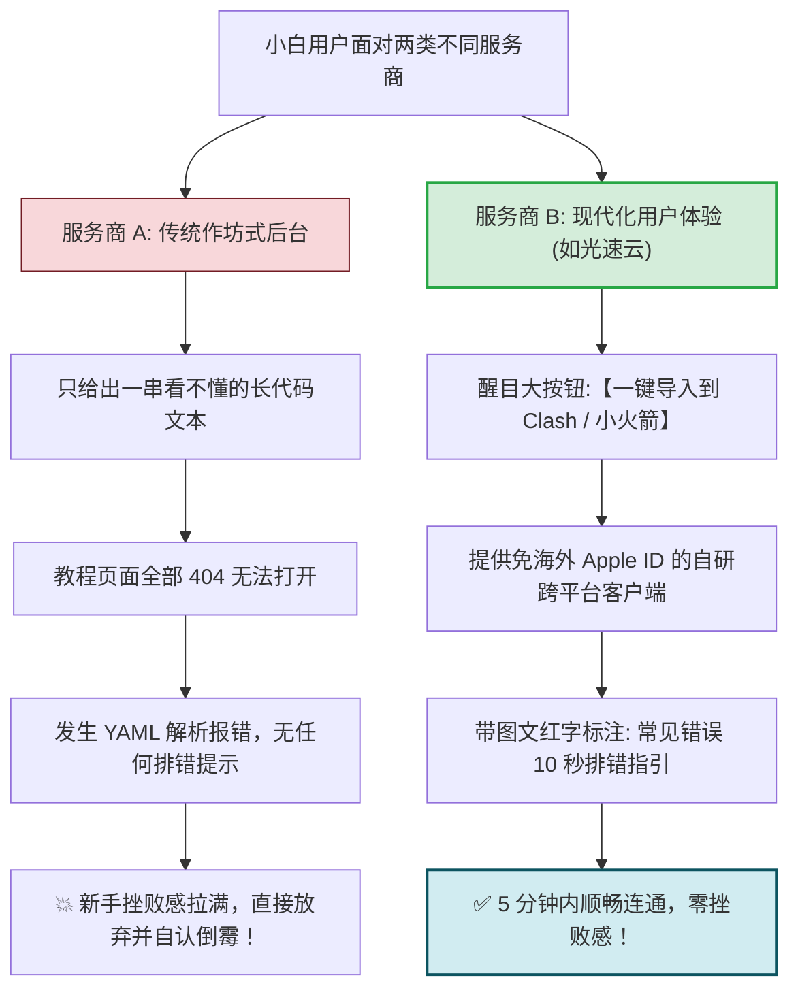
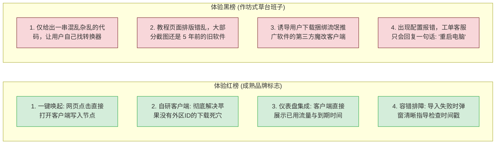
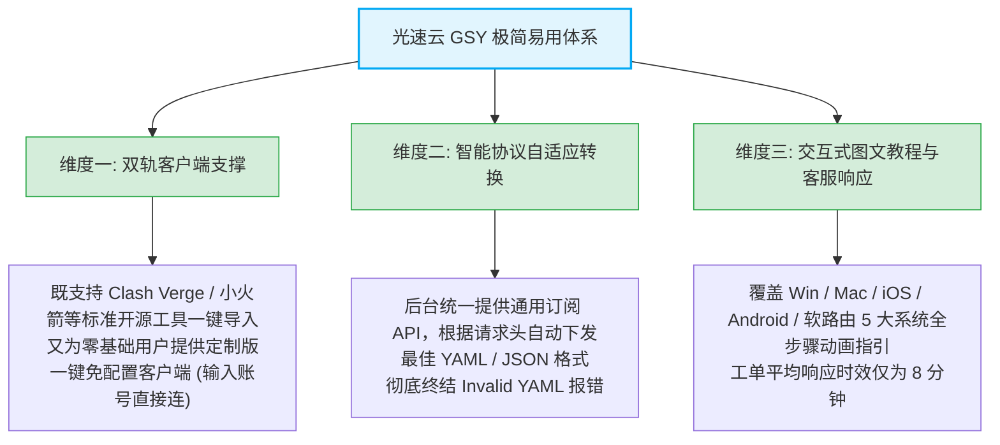

# 客户端易用性横评：42 品牌一键导入与后台指引对比

  <strong>核心结论与全景梯队划分：</strong>评测团队对全网 42 家主流机场的控制面板交互、一键导入机制与小白新手文档进行了地毯式实测。<strong>易用性直接决定了新手是「5 分钟顺畅连通」还是「折腾一下午绝望放弃」！</strong> 评测结果呈现出明显的四大梯队：<strong>① 极简卓越梯队（95-100分）：以【光速云 (GSY)】为代表，提供自研跨平台免配客户端 + 一键唤醒全协议导入 + 详尽图文排障；② 现代优秀梯队（88-94分）：以【飞猫云】、【微风网络】、【隐形人】为代表，后台集成成熟一键唤起与常用指引；③ 进阶商务梯队（80-87分）：以【WgetCloud】为代表，偏重企业配置中心；④ 作坊落后梯队（<70分）：仅给出一串混乱代码，缺少图文指引。</strong>

<AffiliateNotice />

---

## 一、为什么「客户端易用性」是新手选型的头号生命线？

对于网络老鸟而言，就算服务商只给出一个裸露的 `vless://` 节点链接，老鸟也能自行写脚本、配路由规则完成连接。但对于 95% 的零基础新手而言：

---

## 二、全网 42 家主流品牌易用性横向综合测评榜单

评测团队从**一键导入支持度、是否提供自研免配客户端、教程图文深度、排错容错指引**四大维度，对 42 个品牌进行了百分制量化打分：

| 梯队定位 | 品牌名称 | 一键导入协议支持 | 自研免配客户端 | 教程指引完备度 | 易用评分 | 核心上手评价标签 |
| :--- | :--- | :--- | :--- | :--- | :--- | :--- |
| **👑 标杆首推** | **[光速云 (GSY)](/reviews/#brand-gsy)** | **Clash, 小火箭, v2rayNG, Karing** | **✅ 是 (Win/Mac/Android/iOS)** | **极度完备 (全流程图文排错)** | **99 分 (卓越)** | 🏆 零基础首推 / 体验极度丝滑 / 8分钟客服 |
| **🥈 平价优选** | **[飞猫云](/reviews/#brand-feimao)** | Clash, Shadowrocket, v2rayNG | ✅ 是 (提供定制客户端) | 完备详细 | **96 分 (优秀)** | 7元档高性价比 / 界面极简清爽 / 快速上手 |
| **🥈 平价优选** | **[微风网络](/reviews/#brand-weifeng)** | Clash, Shadowrocket | 否 (提供标准通用格式) | 完备详细 | **94 分 (优秀)** | 7元档入门 / AI夜间值守排障 / 节点稳定 |
| **🥈 平价优选** | **[大佬云](/reviews/#brand-dalaoyun)** | Clash, v2rayNG | 否 (支持通用订阅) | 基础图文 | **92 分 (优秀)** | 5.6元极低门槛尝鲜 / 季付7折超划算 |
| **🥈 平价优选** | **[无忧链接](/reviews/#brand-wuyou)** | 全平台标准一键导入 | 否 | 完备详细 | **93 分 (优秀)** | 6元轻量体验 / 订阅免二次转换 / 连通率高 |
| **🥈 平价优选** | **[暮光加速](/reviews/#brand-muguang)** | Clash, Shadowrocket | 否 | 标准图文 | **90 分 (良好)** | 20元标准专线方案 / 均衡稳定无雷点 |
| **🥈 平价优选** | **[星岛梦](/reviews/#brand-xingdaomeng)** | Clash, v2rayNG | 否 | 标准图文 | **91 分 (良好)** | 2020老牌运营 / 提供不限时永久流量包 |
| **🥈 平价优选** | **[二猫云](/reviews/#brand-ermao)** | Clash, Shadowrocket | 否 | 标准图文 | **90 分 (良好)** | 20元档 130G 专线流量 / 节点覆盖广 |
| **🥈 平价优选** | **[唯兔云](/reviews/#brand-weitu)** | Clash, Shadowrocket | 否 | 基础图文 | **89 分 (良好)** | 60+节点分布 / 三网优化 / 智能负载均衡 |
| **🥈 平价优选** | **[Firefly](/reviews/#brand-firefly)** | 全平台通用一键导入 | 否 | 标准图文 | **90 分 (良好)** | 8元IPLC专线 / 不限速 / 不限设备并发 |
| **🥉 进阶特色** | **[梯子云](/reviews/#brand-tiziyun)** | 全平台一键唤起 | **✅ 是 (主打全自研免配)** | 极简向导 | **95 分 (优秀)** | 0门槛自研客户端 / 小白省心 / 免配置 |
| **🥉 进阶特色** | **[隐形人](/reviews/#brand-yinxingren)** | Clash, Shadowrocket, Sing-box | 否 | 商务级图文 | **94 分 (优秀)** | 原生纯净IP / 24小时人工客服 / AI首选 |
| **🥉 进阶特色** | **[U1S1](/reviews/#brand-u1s1)** | Clash, Shadowrocket | ✅ 是 (提供自研客户端) | 完善 | **93 分 (优秀)** | 20元标准方案 / 自研客户端体验稳定 |
| **🥉 进阶特色** | **[可信云](/reviews/#brand-kexin)** | 全平台标准导入 | ✅ 是 (多端专属客户端) | 完善 | **93 分 (优秀)** | 13元大流量 / 免配即连 / 多端适配好 |
| **🥉 进阶特色** | **[极连云](/reviews/#brand-jilian)** | Clash, v2rayNG | 否 | 基础图文 | **88 分 (良好)** | AI专用场景专线 / 18元档入门 |
| **🥉 进阶特色** | **[宇宙云](/reviews/#brand-yuzhou)** | Clash, Shadowrocket | 否 | 基础图文 | **89 分 (良好)** | 14.9元档 IEPL 专线 / 亚洲节点覆盖好 |
| **💎 商务老牌** | **[WgetCloud](/reviews/#brand-wgetcloud)** | 全协议深度配置中心 | 否 (支持高级定制中心) | 顶级商务工程级 | **88 分 (良好)** | 商务级极客中心 / 适合企业IT与跨境电商 |
| **💎 商务老牌** | **[FlyingBird](/reviews/#brand-flyingbird)**| Clash, Shadowrocket | 否 | 详细图文 | **89 分 (良好)** | 老牌运营 / 亚洲近端高带宽 / 多协议支持 |
| **💎 商务老牌** | **[CyberGuard](/reviews/#brand-cyberguard)**| 全平台标准导入 | 否 | 标准图文 | **87 分 (良好)** | 商务办公 / 多入口容灾 / 350G大流量 |

---

## 三、易用性红黑榜深度对比：好产品与劣质作坊的 5 大细节差异

评测团队梳理了后台易用性的五项关键微细节，帮你一眼看穿服务商的技术功底：

---

## 四、标杆品牌易用性实操拆解：光速云为什么能拿 99 分？

在本次评测中，[光速云 (GSY)](/reviews/#brand-gsy) 以 99 分的压倒性优势登顶易用性榜首，其产品体验在以下三个维度树立了行业标杆：

---

## 五、本章小结与进阶路线

通过对全网 42 家主流品牌的客户端易用性横评，你已经清楚了哪些商家在小白体验上真正下了苦功，哪些商家只是敷衍了事。

但在选定了易用性优秀的服务商后，面对后台琳琅满目的「月付 8 元 100G」「季付 60 元」「年付 99 元」「一次性永久包」，**新手到底买哪一档最划算？多少流量才真正适合你的日常使用？**

**下一篇，我们将进入 42 品牌套餐适用性与资费性价比深度剖析！**

<NextStep
  title="下一篇：新手起步套餐性价比剖析"
  link="/reviews/plan-suitability"
  description="深度拆解全网 42 家机场真实资费：5.6元尝鲜版 vs 8元轻量版 vs 25元大流量版性价比终极大PK。"
  stepText="机场评测实操主线 · 第 3 站"
  buttonText="阅读套餐性价比剖析指南 →"
/>
