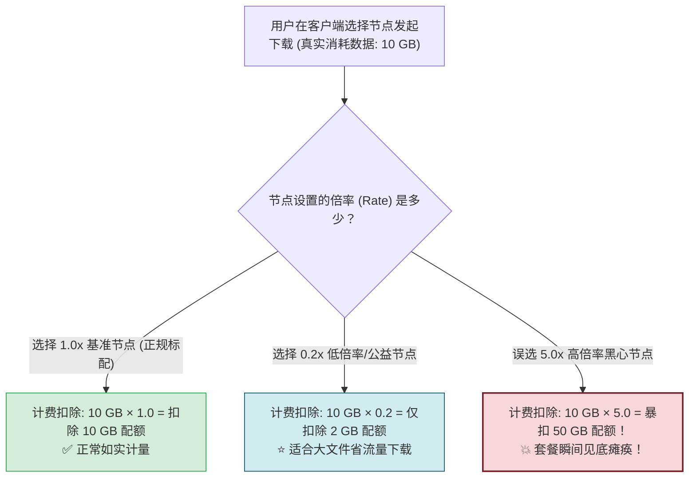
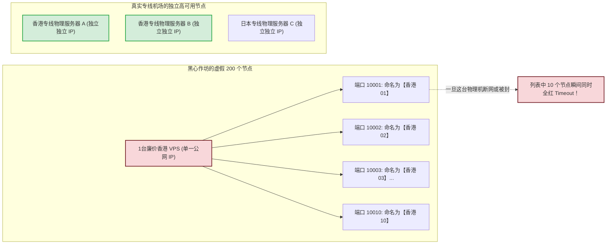
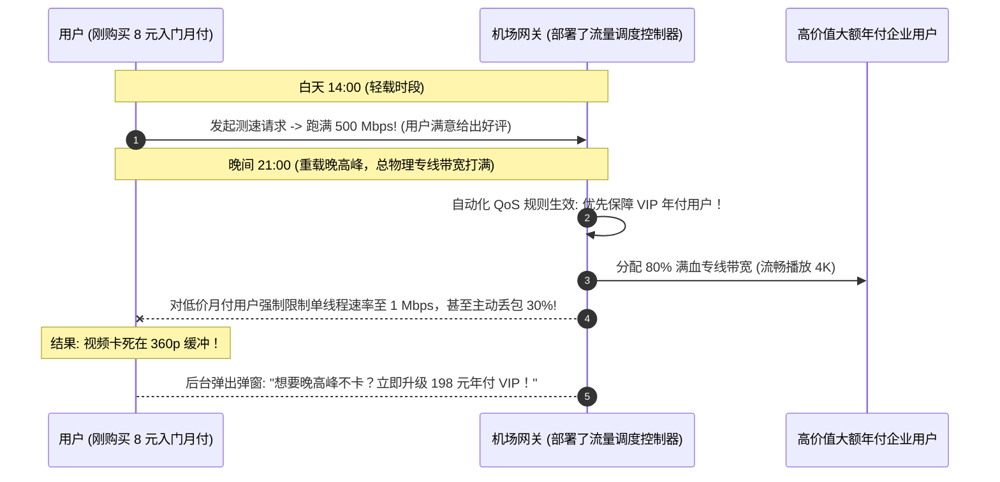

# 新手最容易踩的坑：高倍率节点、晚高峰限速与虚标节点

<div class="answer-first-lead">
  <strong>核心结论与排雷最高警示：</strong>网络代理行业由于缺乏传统监管，充斥着各种利用新手「不懂技术参数」而设计的隐蔽陷阱。最典型的四大黑幕包括：<strong>① 高倍率节点暗中吸血：部分节点标注 3.0x 甚至 5.0x，下载 10GB 电影实际被扣除 50GB 配额！② 单 IP 虚标节点欺诈：不良商家用 1 台廉价服务器配 10 个端口伪装成「10个全球节点」，单点一崩全网瘫痪；③ 晚高峰恶意降级限速：白天满速吸引好评，晚上对普通用户暴力限速；④ 特殊虚拟商品不可退款霸王条款。</strong> 读完本文，助你练就火眼金睛，彻底避开这四类暗坑。
</div>

<AffiliateNotice />

---

## 一、陷阱一：高倍率节点（流量瞬间被榨干的罪魁祸首）

许多新手报障：「我刚买的 100GB 套餐，晚上才看了半小时电影，后台一查怎么扣了 30GB 流量？是不是机场在暗中偷跑流量？」

这往往并非后台偷跑，而是你**误选了高倍率节点**！



### 1. 行业潜规则揭秘与计费实现

在机场后台管理系统（如基于 SSPanel-Uim 或 V2board 架构）中，计费模块的数据库钩子逻辑如下：

$$\Delta \text{Traffic}_{\text{billed}} = (\text{Upload} + \text{Download}) \times \text{NodeRate}$$

部分不良商家为了打价格战，在前端宣传「5.9 元包 200GB 超大专线流量」，以此吸引小白下单。但当用户导入订阅后，会发现最常用的「香港 01 [优质专线]」和「日本 01 [原生解锁]」后面赫然标注着 **`3.0x`** 甚至 **`5.0x`**。而仅有 1 个极其卡顿、延迟高达 400ms 的美国公网节点标注为 `1.0x`。

这意味着用户如果连接香港节点追剧，**实际上 200GB 额度只能当 40GB - 60GB 来用**，真实单价直接翻了 3 到 5 倍！

### 2. 警惕「0.01x 极低倍率」的灰色猫腻

除了高倍率吸血，市场上还出现了一种截然相反的套路——「0.01x 超低倍率公益节点」。

天下没有赔本的买卖。安全实验室抓包分析发现，部分无良小作坊搭建的 0.01x 节点，使用的是未加密的纯明文 HTTP 代理通道或不受信任的自签证书中间人：
- **明文劫持与嗅探**：通过节点抓取用户的非 HTTPS 明文通信数据；
- **网页暗中注水与弹窗广告**：在用户浏览的网页中动态注入赌博、灰产广告脚本；
- **防身守则**：凡是远低于市场合理成本（低于 0.1x）的异常低倍率节点，坚决不要用于登录个人社交账号或传输任何敏感信息。

---

## 二、陷阱二：单 IP 虚标成 10 个节点的数量欺诈 (Node Inflation)

很多作坊在广告中吹嘘：「全网最强！拥有 200+ 全球高速节点！」但这往往是极其低劣的技术障眼法：



### 识别虚标节点的实操技巧与终端检测法

在客户端查看节点的连接详情，如果发现「香港 01」到「香港 10」的**服务器连接 IP 完全一模一样，仅仅是后面的端口号从 10001 递增到 10010**，这 100% 就是单机虚拟出来的虚假节点！这种节点毫无容灾冗余能力，一台宕机全线崩溃。

```bash
# 在终端中通过 nslookup 或 ping 查询节点真实解析地址
nslookup hk01.bad-airport.com
nslookup hk02.bad-airport.com
# 如果返回同一个公网 IP (例如 103.xxx.xxx.88)，说明属于典型的单机端口虚标！
```

正规专业服务商（如 [光速云 (GSY)](/reviews/#brand-gsy)）的节点架构均具备多重独立自治系统（Autonomous System, AS）：
- 每个主力区域均配置独立的物理光缆接入路由；
- 节点背后对应真实的分布式服务器集群与 Anycast Any-to-Any 调度网络；
- 哪怕某个机房发生临时网络维护，其余节点依然保持 100% 独立可用，绝不出现「一崩全红」的惨状。

---

## 三、陷阱三：测速白名单与晚高峰恶意 QoS 限速

部分黑心商家设计了极其精巧的欺诈算法，专门针对新手的评测心理设计骗局：



### 1. 「Speedtest 白名单欺骗」原理
很多小白测试机场好坏，唯一指标就是打开 Speedtest 跑个分。不良商家摸透了这个心理，在网关路由器上配置了**域名与 IP 白名单直通规则**：
- 只要检测到流量目标是 `speedtest.net`、`fast.com` 或电信测速节点，网关立即解除所有限速，单线程跑满 800 Mbps，截图极其养眼；
- 一旦用户转去访问 YouTube、GitHub、Netflix 或下载实际生产文件，流量立刻被归入最低优先级的限速队列，实际速度断崖式下跌至 200 KB/s；
- **真伪检验标准**：**坚决不以 Speedtest 截图论英雄**！最真实的测速是以晚高峰 21:30 打开 YouTube 4K 视频，右键查看「详细统计信息 (Stats for nerds)」中的 `Connection Speed`，或者使用终端下载真实的海外开源代码仓库包。

### 2. UDP 阻断与伪造延迟
还有一种隐形陷阱是：客户端点击测速显示延迟只有「35ms」（绿色极速），但打海外游戏或打 Discord / Telegram 语音时却频繁断线重连。
- **原因剖析**：测速软件默认使用的是 TCP Ping 或 HTTP HEAD 握手时延。商家为了让面板数字好看，将测速接口部署在国内中继服务器上（仅测试了你到国内入口的时延），而并没有测试真实跨境落地段的时延；
- 同时，部分廉价小作坊为了节省服务器系统内核资源，**直接在服务器防火墙上 DROP 掉了所有 UDP 数据包**。这导致所有依赖 UDP 的在线对战游戏、WebRTC 实时语音全部瘫痪！

---

## 四、陷阱四：服务条款 (ToS) 中的霸王免责与退款死结

绝大多数新手在注册时，都会直接勾选「我已阅读并同意服务条款」，根本不会点开查看。而不良商家通常在 ToS 中埋藏了以下霸王条款：

1. **绝对不可退款条款**：「本站所售服务为虚拟数字商品，一旦发货激活，无论任何原因一律不予退款」；
2. **强制余额充值套路**：不开放 8 元或 15 元的直接结算通道，最低充值档位强制设定为 50 元或 100 元，迫使小白用户在账户内滞留无法提现的闲置资金；
3. **免责跑路条款**：「因运营商不可抗力或监管政策导致的线路中断，本站不承担任何补偿责任」；
4. **防范建议**：**首单坚决月付！** 月付就是你给商家的试用期，如果一个月内商家出现晚高峰限速、虚标节点或跑路，你的损失极限不过几块钱。

---

## 五、标杆品牌的反套路诚实基准

与草台作坊不同，行业头部标杆品牌（如光速云）在运营透明度上坚持以下四大底线：

| 行业黑幕 / 套路 | 不良作坊做法 | [光速云 (GSY)](/reviews/#brand-gsy) 企业级专线 |
| :--- | :--- | :--- |
| **节点倍率** | 热门节点暗中设为 3x-5x 乱扣费 | **全线主力节点严格 1.0x 诚实倍率，明码标价** |
| **虚标节点欺诈** | 1 台机器开 10 个端口滥竽充数 | **香港/日本/新加坡每个节点均具备独立的物理出口与 BGP 容灾** |
| **晚高峰 QoS 限制** | 晚高峰对月付用户恶意丢包限速 | **双线路物理 IEPL 架构，全天候 24 小时平等保证千兆带宽** |
| **真实跨境延迟** | 仅测试国内入口延迟欺骗小白 | **全链路端到端真实延迟回传，支持全协议 UDP 转发** |
| **退款与余额保障** | 充错不退，重复付款直接私吞 | **重复扣款 100% 原路返还或充入个人余额，随时抵扣** |

> [!TIP] 选型小结
> 选用 [光速云 (GSY)](/reviews/#brand-gsy)，在结账输入优惠码 `AMM` 享受专属立减。其双线路企业架构彻底摒弃了高倍率与虚标套路，全节点 1.0x 如实计量，让新手每一分钱都花在真实的专线带宽上。

---

## 六、新手下单前必备的「七问避坑排查清单」

在掏出手机扫码付款前，请逐一核对以下 7 个关键点：

1. [ ] **是否支持单月直接付款？**（凡强制要求年付或大额充值者，一律视为高风险作坊）；
2. [ ] **主力节点是否全为 1.0x 标准倍率？**（如果核心专线全标 3x，请将实际单价乘以 3 再评估）；
3. [ ] **是否提供真实的免翻墙工单系统与售后交流群？**（仅留无应答邮箱者慎入）；
4. [ ] **是否明确标注线路类型为 IEPL/IPLC 专线？**（凡不敢明写线路类型、含糊其辞者多为廉价直连）；
5. [ ] **晚高峰是否有专门的带宽保障承诺？**（查看是否有双入口容灾调度机制）；
6. [ ] **是否支持完整的 UDP 转发？**（有语音通话或联机需求者必查项）；
7. [ ] **是否提供优惠码立减通道？**（正规服务商均有官方活动码，如光速云输入 `AMM` 即可立享特惠）。

---

## 七、本章小结与进阶路线

看穿了高倍率、单机虚标与晚高峰限速三大行业陷阱，你已经拥有了比肩资深老鸟的防坑火眼金睛。

在此基础上，面对全网 42 家主流品牌：**如果用一套客观、严谨、多维度的量化公式对它们进行综合打分，谁能位列前茅？谁又处于垫底梯队？**

**下一篇，我们将进入全网 42 家主流机场量化评分大榜单与评级理由全景发布！**

<NextStep
  title="下一篇：全网机场新手推荐综合指数"
  link="/reviews/beginner-recommendation-rating"
  description="根据易用度、专线稳定性、月付友好度与售后响应量化评出的 42 品牌大榜单。"
  stepText="机场评测实操主线 · 第 8 站"
  buttonText="阅读 42 品牌量化评分大榜单 →"
/>
