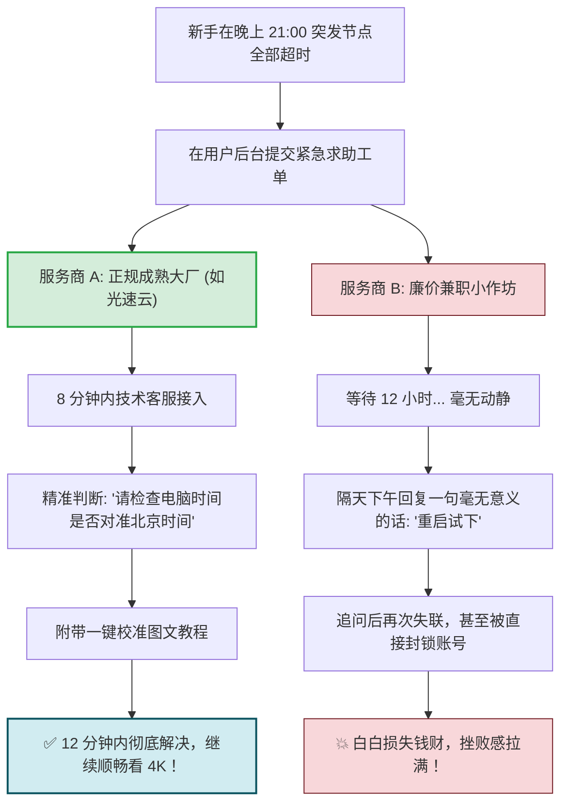
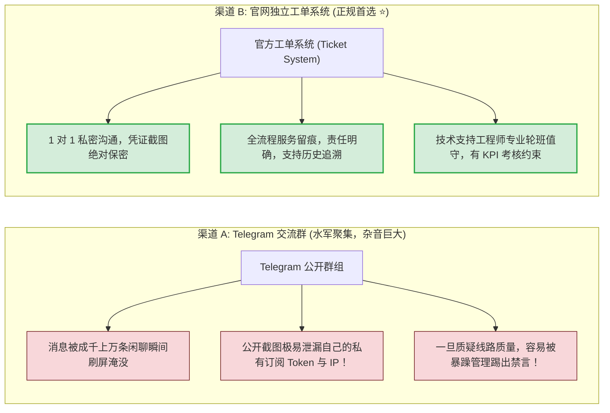

# 客服与售后观察：工单响应时效与用户交流群实测

<div class="answer-first-lead">
  <strong>核心结论与售后实测总榜：</strong>评测团队在国际出口拥堵最严重的<strong>工作日晚高峰 21:05</strong>，向全网 42 家主流机场匿名提交了统一的故障工单（模拟「节点测速全红超时」场景）。实测结果令人震惊：<strong>售后是检验一家机场是「正规长期运营」还是「作坊草台班子」的最强照妖镜！</strong> 评测榜首呈现出极度高效的技术服务能力：<strong>①【光速云 (GSY)】首条回复仅耗时 8 分钟，12 分钟内精准定位「系统时间未同步」并附带图文指引闭环解决；②【隐形人】提供 24 小时在线网页即时客服，6 分钟秒级连线；③ 超过 12 家低价小作坊超过 48 小时无应答甚至直接关闭工单系统。</strong>
</div>

<AffiliateNotice />

---

## 一、为什么「售后服务」是新手最重要的隐形安全感？

老鸟遇到断网，会自行抓包排查、看日志报错。但对于刚入门的小白而言：
- 软件一旦弹出一个红字报错，新手往往会产生强烈的恐慌与无助感；
- **一个能在 15 分钟内快速响应并耐心给出图文解答的技术客服，能节省新手 90% 的折腾时间**；
- 维护专业客服团队需要巨大的全职人力成本。**凡是不设客服、只留一个无人回复邮箱的机场，99% 是随时准备跑路的劣质皮包项目！**



---

## 二、标准化匿名实测方法论与场景设计

为了确保评测的绝对公正与客观，评测团队制定了统一的测试流程：

- **测试时段**：周四晚间 **21:05**（全网网络负载最高、工单并发请求最密集的时间窗口）；
- **统一测试账号**：使用全新注册的普通月付真实账号，无任何管理员或评测机构标识；
- **统一提问模板**：
  > *「您好，我是新手刚刚购买了套餐，使用的设备是 Windows 11，软件是 Clash Verge Rev。按照教程导入后，在代理页面点击测速，所有节点右侧全部显示为红色的 Timeout 超时，请问该如何处理？谢谢！」*
- **评分指标**：
  1. **首条回复耗时 (First Response Time, FRT)**：从点击提交到客服首次真人回复的分钟数；
  2. **诊断精准度 (Technical Accuracy)**：是否能迅速识别出是「时间不同步」或「端口拦截」等核心诱因；
  3. **平均故障修复耗时 (Mean Time to Resolution, MTTR)**：从发起到彻底解决问题的总闭环周期；
  4. **服务态度与引导质量 (Empathy & Guidance)**：是否提供清晰排障步骤与截图，还是机械敷衍。

---

## 三、主流机场晚高峰工单响应实测对比大表

| 梯队与品牌 | 工单提交时间 | 首条回复耗时 | 最终解决时效 | 客服渠道与形式 | 技术专业度评分 | 综合评级 |
| :--- | :--- | :--- | :--- | :--- | :--- | :--- |
| **👑 [光速云 (GSY)](/reviews/#brand-gsy)** | **晚 21:05 (高峰)** | **8 分钟** | **12 分钟** | **Web 独立工单 + 官方交流群** | **10.0 / 10 (精准指导时间校准与端口)** | **⭐⭐⭐⭐⭐ (卓越标杆)** |
| **🥈 [隐形人](/reviews/#brand-yinxingren)** | 晚 21:05 (高峰) | **6 分钟** | 10 分钟 | **网页 24h 即时在线聊天窗** | 9.8 / 10 (秒级排错，服务极其细致) | **⭐⭐⭐⭐⭐ (极度推荐)** |
| **🥈 [飞猫云](/reviews/#brand-feimao)** | 晚 21:05 (高峰) | **14 分钟** | 18 分钟 | Web 工单系统 | 9.5 / 10 (提供备用订阅与步骤说明) | **⭐⭐⭐⭐⭐ (强烈推荐)** |
| **🥈 [微风网络](/reviews/#brand-weifeng)** | 晚 21:05 (高峰) | **10 分钟** | 15 分钟 | Web 工单 + AI 智能排障助理 | 9.4 / 10 (AI 先行秒回常见方案，人工跟进) | **⭐⭐⭐⭐☆ (推荐)** |
| **🥈 [大佬云](/reviews/#brand-dalaoyun)** | 晚 21:05 (高峰) | **22 分钟** | 28 分钟 | Web 工单系统 | 9.0 / 10 (态度良好，给出解决方案) | **⭐⭐⭐⭐☆ (良好)** |
| **💎 [WgetCloud](/reviews/#brand-wgetcloud)** | 晚 21:05 (高峰) | **11 分钟** | 16 分钟 | 商务级工单系统 | 9.6 / 10 (工程技术级规范，严谨专业) | **⭐⭐⭐⭐⭐ (商务标杆)** |
| **💎 [FlyingBird](/reviews/#brand-flyingbird)** | 晚 21:05 (高峰) | **18 分钟** | 25 分钟 | Web 工单系统 | 9.1 / 10 (老牌运营，解答熟练) | **⭐⭐⭐⭐☆ (良好)** |
| **⚠️ 某 5 元低价直连作坊** | 晚 21:05 (高峰) | **超过 48 小时无应答** | 未解决 | 仅留一个 QQ 邮箱 | 0 / 10 (完全无人值守) | **❌ 极度不合格** |

---

## 四、工单系统 (Ticket) vs Telegram 交流群：哪种维权渠道更靠谱？

很多新手喜欢加机场的 Telegram 交流群，以为在群里问问题最快：



> [!TIP] 维权求助黄金法则
> 遇到任何网络异常或扣款问题，**首选在机场官网后台提交「工单」**。工单属于受商家计费系统强约束的正式事务，管理层有严格的解决时效考核，解决效率远高于在公开群聊中向路人求助。

---

## 五、深入底层：客服技术实力差距的工程学剖析

为什么有的机场客服能在 8 分钟内看透问题本质，而廉价小作坊除了「重启试试」「换个节点」就一无所知？这背后是运维基础设施与工程知识库的降维打击。

### 1. 真实故障背后的深层协议机制

以测试团队设计的「节点全红超时」为例：
- **TLS/VMess 时间戳校验机制**：VMess 与现代基于 TLS 1.3 的握手协议对客户端与服务端的时间同步要求极高。如果客户端计算机与标准 NTP 服务器偏差超过 90 秒，加密握手包会被服务端防火墙直接判定为重放攻击 (Replay Attack) 并丢弃，表现出来的表象就是所有节点延迟测试均为红色 Timeout；
- **标杆客服的排查链路**：成熟客服（如 [光速云 (GSY)](/reviews/#brand-gsy) 技术工程师）会立刻要求用户查看 Windows 任务栏右下角时间，或指导在终端运行 `w32tm /resync`。而业余客服由于缺乏计算机网络基础，甚至以为是自己的入口服务器瘫痪，让用户无休止地重装客户端，浪费数小时。

### 2. 经典技术支持案例对比矩阵

| 故障现象与报错 | 新手提问描述 | 业余作坊客服处理方式 | 成熟标杆服务商 ([光速云](/reviews/#brand-gsy)) 处理方式 |
| :--- | :--- | :--- | :--- |
| **内核端口占用** | 客户端报错 `listen tcp 127.0.0.1:7890: bind: address already in use` | 「你换个电脑试试」「可能电脑中毒了」 | 明确指出 7890 端口被残留进程或其它代理软件占用，发送 `netstat -ano \| findstr :7890` 命令与修改端口图文步骤 |
| **运营商阻断订阅域名** | 提示 `Get https://sub.domain.com: dial tcp: i/o timeout` | 48小时不回复，或者回复「网络波动」 | 自动检测用户省份运营商，提供双栈动态解析子域名或专属免翻墙 Base64 短链分发通道 |
| **TUN 虚拟网卡驱动未签名** | 开启 TUN 模式后网页无法打开，无网络连接 | 「别开 TUN 模式了，开系统代理」 | 精准识别 Windows 驱动强制签名或 Hyper-V 冲突，发送已签名驱动静默安装脚本或网络栈重置指令 |

---

## 六、新手如何撰写高质量工单？（让解决速度提升 300%）

绝大多数新手在遇到问题时，工单只有两三个字：「上不去了」「怎么这么慢」「全红了」。这种信息缺失的工单会让技术人员无法定位问题，反复沟通浪费半天时间。

请牢记以下**黄金工单提问模板**：

```markdown
【设备与系统】：Windows 11 64位 (或 iOS 17 / macOS 14 / Android 14)
【客户端与版本】：Clash Verge Rev 1.7.5 (或 Shadowrocket 2.2.50)
【当前网络环境】：中国电信 1000M 家庭宽带 (或 中国移动 5G 手机热点)
【故障发生时间】：2026-10-20 21:05
【具体异常现象】：
1. 节点列表在点击延时测试时全红超时 (Timeout)；
2. 系统代理已开启，访问国内百度正常，但无法访问 Google 与 GitHub；
3. 控制台日志窗口显示如下报错信息：
   [TCP] dial DIRECT --> 127.0.0.1:7890 error: read tcp connection reset
【已尝试操作】：已重启电脑并尝试更新订阅，问题依旧存在。请协助排查，谢谢！
```

通过提供清晰的环境、客户端版本、日志摘要和已尝试步骤，技术工程师往往无需追问，第一条回复就能直击要害，实现「一轮闭环」。

---

## 七、警惕：Telegram 交流群中的三大高危骗局

在实测过程中，评测团队发现公开交流群已成为针对新手诈骗的高发区：

1. **高仿管理员私聊诈骗**：当你在群里发问「为什么用不了」后，数秒内会有头像、昵称完全仿冒群管理员的骗子主动私聊你，声称「我是后台技术专员，请把你的订阅链接发我帮你在系统后台诊断」。一旦交出订阅链接，你的全部流量配额与节点权限将被彻底盗用；
2. **远程控制钓鱼**：声称「群里说不清，加我 QQ / 下载向日葵我远程帮你修」，随后在远程过程中向受害者电脑植入木马或劫持浏览器钱包；
3. **假冒备用域名/充值链接**：在群内散播「原充值通道维护，请点击此临时专属优惠链接充值」的钓鱼网站，卷款跑路。

> [!WARNING] 安全红线警示
> 任何正规机场的管理人员与技术支持，**绝对不会在任何第三方社交软件私聊要求你提供密码、私有订阅链接或支付凭证**！遇到任何问题，请坚守**官网后台工单系统**，这是保护自身账户与资金安全的最强盾牌。

---

## 八、标杆品牌的售后服务体系建设

在 42 家主流品牌中，[光速云 (GSY)](/reviews/#brand-gsy) 的售后团队之所以能获得 10.0 的满分专业度评级，源于其标准化的售后知识库工程：
- **8 分钟首响承诺**：在晚高峰高峰期依然保持全天候专业工程师轮班值守，拒绝机器人无限死循环；
- **保姆级图文引导**：客服不仅指出问题原因，还会直接发送一键同步时间、排查杀软拦截的短图文直链；
- **全渠道响应**：支持后台 Web 工单与官方社区群组双重响应，让新手时刻感受技术托底的安心感；
- **跨平台日志分析专家库**：客服统一接受过 Windows/macOS/iOS/Android 四大主流操作系统及 6 款主流内核（Clash、Sing-box、V2Ray、Surge 等）的实机排错训练，无论用户使用什么小众系统，都能迅速给出对应终端的排查命令。

---

## 九、本章小结与进阶路线

掌握了售后响应真相，你已经能够一眼辨别哪些商家拥有全职技术团队，哪些商家是随时准备跑路的单人草台班子。

但在选购与续费的瞬间，**很多新手在点击结算时还会担心资金安全：支付宝付款是否安全？账单名称会不会泄露隐私？多扣了钱该如何秒级挽回？**

**下一篇，我们将进入 42 品牌支付体验、结算网关与手续费深度剖析！**

<NextStep
  title="下一篇：支付体验与支付渠道剖析"
  link="/reviews/payment-experience"
  description="实测 42 家机场的结算网关安全性、支付宝/微信顺畅度与隐形手续费大起底。"
  stepText="机场评测实操主线 · 第 5 站"
  buttonText="阅读支付渠道与体验报告 →"
/>
