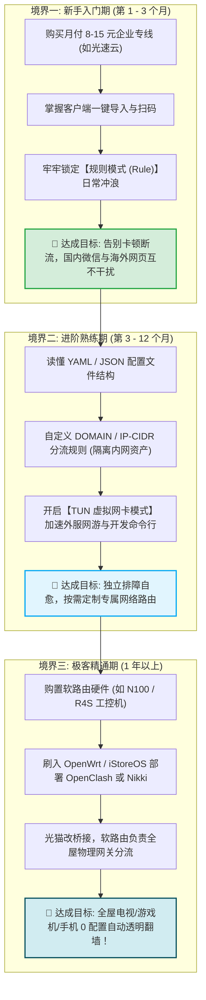
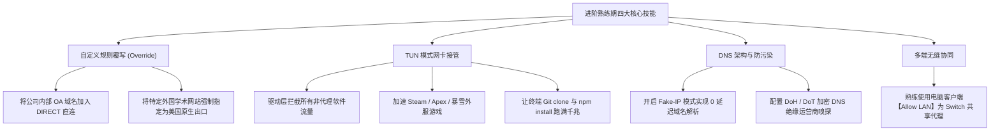
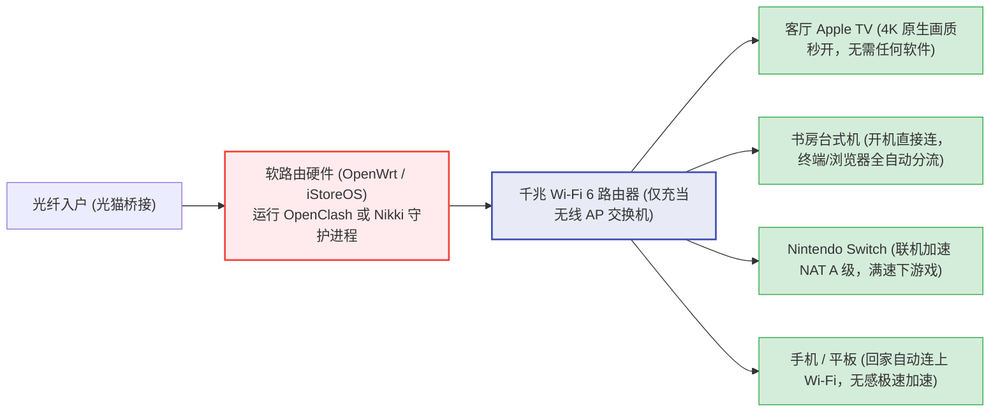
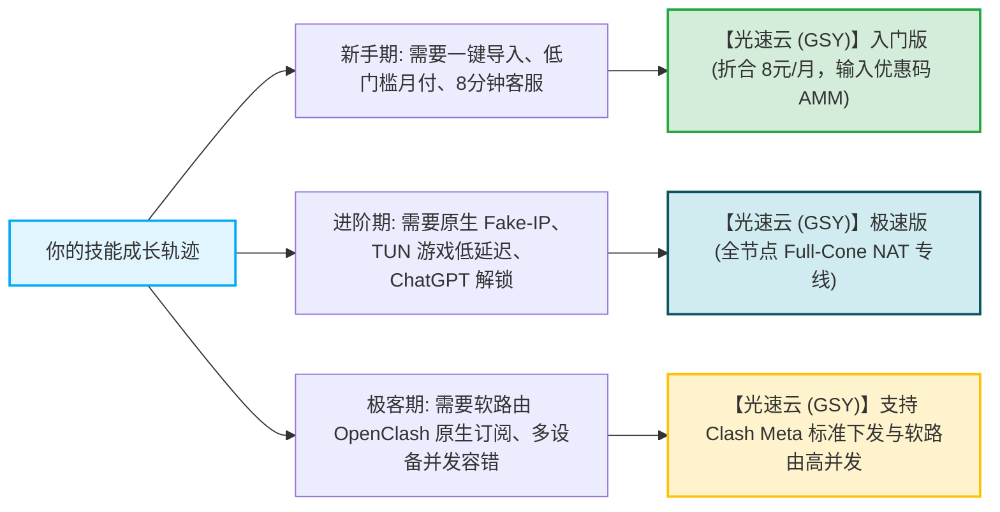

# 新手成长路径：从月付尝鲜到专属定制与软路由进阶

  <strong>核心结论与技术成长路线图：</strong>科学上网并不是一项需要死记硬背的枯燥技能，而是一段<strong>随着你对计算机网络理解加深、自主掌控力逐步提升的进阶之旅</strong>。老鸟之路通常清晰地划分为三大境界：<strong>① 新手入门期（第 1-3 个月）：以「月付体验专线」为核心，掌握一键导入、延迟测速与规则分流，实现稳定看 4K 不折腾；② 进阶熟练期（第 3-12 个月）：精通 ACL4SSR 分流规则定制，开启 TUN 虚拟网卡加速游戏与终端；③ 极客精通期（1 年以上）：部署 OpenWrt 软路由与透明网关，实现全家智能设备无感秒开。</strong>

<AffiliateNotice />

---

## 一、科学上网技能树演进全景图 (三境界)

---

## 二、境界一：新手入门期 (第 1 - 3 个月) —— 守正避坑，建立基准

在刚刚接触科学上网的最初几个月，新手的首要目标不是折腾复杂的技术源码，而是**建立健康的使用习惯与风险防线**：

### 核心任务清单
- [ ] **坚决首选月付**：无论优惠力度多大，首单只选月付或季度付（如月付 8 元档），用极低试错成本度过磨合期；
- [ ] **认准专线架构**：学会看节点列表，认准 IEPL / IPLC 企业级物理专线，坚决远离晚高峰丢包严重的公网直连；
- [ ] **熟练掌握客户端基线操作**：熟练在 Clash Verge Rev 或 Shadowrocket 中执行一键唤醒导入、批量延迟测速；
- [ ] **守住规则模式底线**：日常坚决保持在「规则模式 (Rule)」，杜绝误开全局模式导致国内应用遭风控报警；
- [ ] **建立安全防范意识**：绝不向陌生网友分享自己的私有订阅 Token，避免账号并发违规封号。

> [!TIP] 新手期心法
> 建议新手在初期的 1～3 个月内，将主要精力集中在自身核心业务（查文献、做设计、写代码、看视频）的效率提升上，切忌过早陷入繁琐的底层代码折腾，稳定好用才是最高原则。

---

## 三、境界二：进阶熟练期 (第 3 - 12 个月) —— 自主掌控，精细分流

当你已经习惯了日常顺畅翻墙，并开始在开发、工作或游戏等场景中遇到个性化诉求时，便正式迈入了进阶阶段：

### 进阶实操心法
- **学会看客户端日志 (Logs)**：不再遇到报错就慌张重装，懂得根据日志中的 `EOF`、`i/o timeout`、`handshake failed` 精准定位是本地网络断开还是节点维护；
- **配置规则热重载**：学会使用 Clash Verge 的「扩展脚本 (Scripting)」功能，在不修改远程订阅的前提下，动态向配置中注入自己的私有分流规则。

---

## 四、境界三：极客精通期 (1 年以上) —— 全屋透明，硬件网关

这是网络技术爱好者追求的终极形态。你不再满足于每台手机和电脑都要分别打开软件，而是希望**像使用自来水一样，全屋所有设备只要连上 Wi-Fi，天生自带极速网络**：

### 极客软路由的核心价值与门槛
- **价值**：
  1. **全设备解放**：智能电视、PS5 游戏主机完全无法安装代理软件，软路由透明代理从物理网关层解决翻墙诉求；
  2. **节省设备连接数**：在机场服务端看来，全屋数十台设备仅占用**同一个家庭公网 IP**，完全不会触发并发设备数限制；
- **门槛**：需要购置额外的小主机硬件（约 300-800 元），并掌握一定的 Linux 网络、DHCP 服务与防火墙规则配置知识。

### 4.2 软路由与家庭透明网关核心避坑三原则
部署家庭旁路透明网关时，很多进阶用户容易由于规则配置不当导致全屋断网，务必牢记以下三项军规：
1. **保留主路由独立拨号与 DHCP 广播**：尽量采用“旁路由（旁路网关）”模式部署，由硬路由负责物理拨号与全家基础网络分发，软路由仅承担特定网关重定向。即使软路由发生固件重启，全家基础网络依然不受影响；
2. **严禁对全网设备无差别 DNS 劫持**：米家智能家居、天猫精灵等 IoT 智能设备通常依赖特定国内 UDP 广播与私有云指令，若强制对其进行 Fake-IP 劫持，极易导致全屋智能灯泡离线或音箱报错；
3. **开启全节点 Full-Cone NAT 映射**：家庭有 Nintendo Switch 或 PS5 主机联机需求时，选择支持 Full-Cone NAT 的专线节点（如光速云极速版），可直接将联机 NAT 类型提升至开放的 NAT A / NAT 2，彻底终结无法进入联机大厅的尴尬。

### 案例：极客奶爸通过 N100 软路由实现全家无感出海实录
* **学员档案**：IT 工程师老张，家里不仅有两台智能电视，还有妻子的 iPad、老人的手机以及孩子用的 Switch。
* **痛点场景**：此前每台设备都需要分别安装客户端，不仅经常遇到老人不小心点错软件开关导致断网，而且家庭电视盒子无法顺畅播放 YouTube 4K 动画。
* **解决历程**：老张购置了一台 Intel N100 工控小主机刷入 iStoreOS，配置了 OpenClash 并导入光速云企业专线订阅。通过设置分流规则，国内流媒体直接走本地千兆宽带，Apple TV 与海外学术设备自动走香港 IEPL 专线。全家人再也无需在手机上打开任何代理软件，回家连接 Wi-Fi 即可实现秒播 4K，老人和孩子的使用体验达到了极致纯净。
* **实战结论**：**技术的终极境界是隐形，当一切复杂的网络调度都在后台安静运作时，技术便真正服务于生活**。

---

## 五、全生命周期的标杆专线伙伴

在你的整个技术成长周期中，一个架构稳定、协议前沿且支持弹性的服务商是不可或缺的基础底座：

在 42 家主流品牌中，[光速云 (GSY)](/reviews/#brand-gsy) 凭借其完善的产品线设计，能够完美覆盖从新手第一单到软路由全屋部署的全生命周期需求，无论你身处哪一个成长阶段，都能提供兼具高性价比与极致稳定的技术支撑。

<BrandCard brandId="gsy" />
<PromoCard brandId="gsy" />

---

## 六、全站测评主线大收官与关于本站

至此，你已经完整遍历了本站《机场评测与用户体验》的全部十个深度专题：
- 从真实新手的黑盒体验实测，到 42 品牌客户端易用性横评；
- 从资费性价比剖析、晚高峰工单响应曝光，到支付渠道与秒表实测大榜单；
- 从三大行业黑幕排雷，到 42 品牌量化评分总榜，再到极客硬核避坑与成长技能树。

**所有的横评档案与实操技术已经全盘交付于你。**

**「机场入门」网站究竟是一支怎样的团队？我们在数据处理上恪守哪些独立性与合规准则？我们的商业披露政策是怎样的？**

**最后一站，请进入关于本站与独立第三方测评合规声明！**

<NextStep
  title="第九站：关于本站与独立测评合规声明"
  link="/about/"
  description="了解机场入门 (jichangrumen.world) 的创立初衷、FTC 商业披露、数据诚实性红线与用户免责条款。"
  stepText="全站核心主线 · 终点站"
  buttonText="阅读关于本站与合规声明 →"
/>
