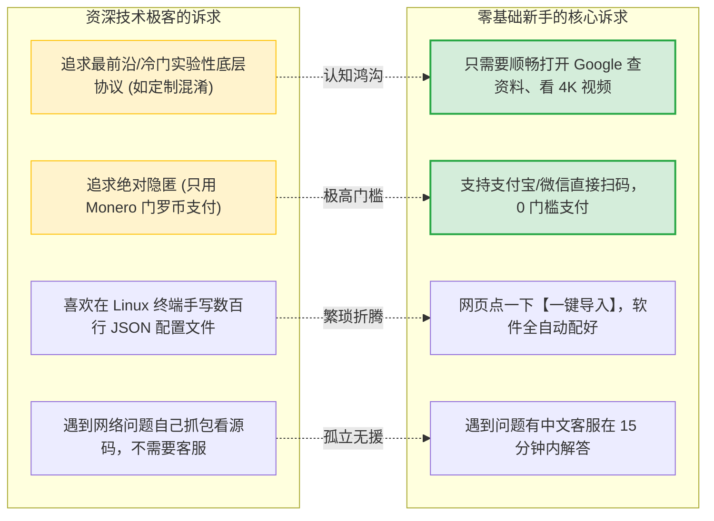
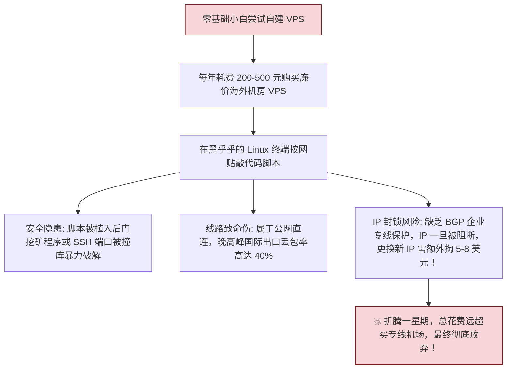
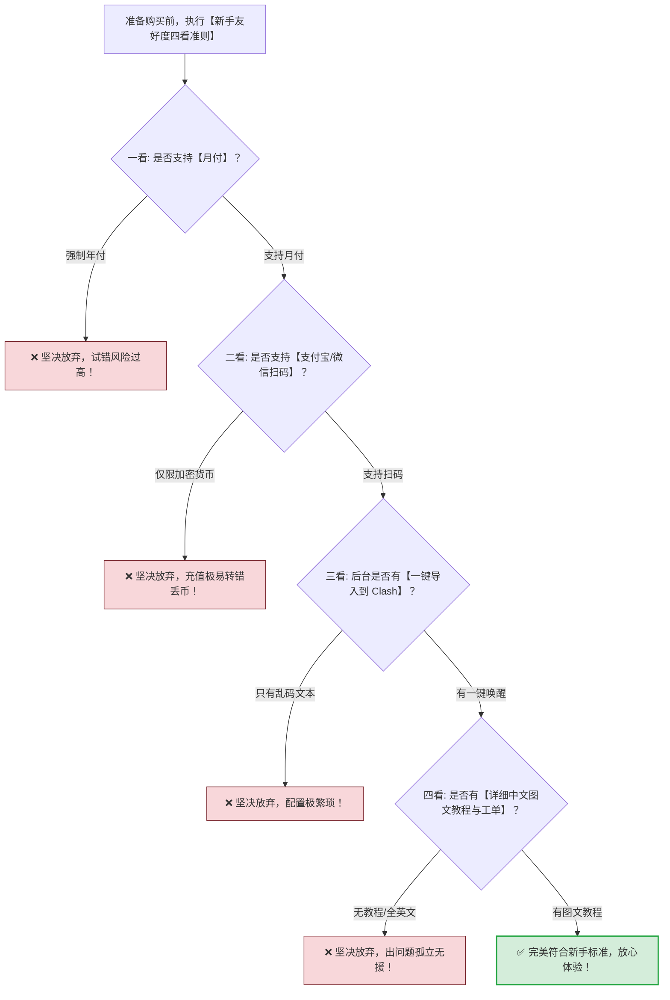

# 不适合新手的机场：门槛极高、年付昂贵与极客专属清单

  <strong>核心结论与选型反直觉定律：</strong>在各大技术论坛或 Telegram 频道中，老鸟极客常热衷于讨论某些「天花板神仙机场」；但对于零基础小白而言，<strong>这些极客专属工具不仅不是蜜糖，反而是极易造成金钱损失与严重挫败感的砒霜！</strong> 不适合新手的机场具备四大鲜明特征：<strong>① 拒绝月付，起步年付上千元；② 只接受 USDT 等加密货币支付；③ 纯英文界面且完全无人工中文客服；④ 缺少一键导入机制，仅提供原生 JSON 代码。</strong> 新手必须坚决绕道，从低门槛月付、支付宝结算且带一键唤醒的成熟品牌起步。

<AffiliateNotice />

---

## 一、为什么「极客眼中的好机场」往往是「小白的地狱」？

极客与零基础新手的核心诉求存在天然的代沟与认知错位：

很多技术老鸟在论坛发帖时喜欢炫耀技术优越感：「*连 JSON 规则都不会改还翻什么墙*」「*建议手写 Clash 规则集分流*」「*不用门罗币匿名买套餐的一律是小白*」。这种带有技术傲慢（RTFM - Read The F***ing Manual）的交流氛围，很容易让刚接触网络代理的小白产生严重的冒充者综合征（Impostor Syndrome），进而盲目跟风购买那些极度不适合自己的硬核工具。

---

## 二、不适合新手的四大典型机场类型深度剖析

---

### 类型 1：起步必须「年付上千元」的邀请制高门槛品牌

- **典型特征**：关闭公开注册，仅能通过老用户专属邀请码进入；没有任何月付或季度付选项，**最低上车门槛就是 800 元至 2400 元一整年**；
- **深层风险剖析**：
  - **网络环境具有高度异构性**：老鸟在北京联通宽带下测速跑满千兆，并不代表你在广州移动或校园网内测速同样流畅。不同地区运营商的本地出口路由截然不同；
  - **沉没成本陷阱 (Sunk Cost Fallacy)**：一旦你一次性预付了 1000 元以上，如果三个月后该商家因入口受限出现卡顿，你找客服退款会被「虚拟数字商品一经激活概不退款」的霸王条款直接驳回，产生极大的经济损失与心理委屈。

---

### 类型 2：仅支持「USDT / 加密货币」结算的匿名小众机场

- **典型特征**：彻底关闭支付宝、微信或银联信用卡通道，只支持波场 (TRC20) 或以太坊 (ERC20) 链上的虚拟货币支付；
- **新手惨痛教训真实还原**：
  1. **入金充值繁琐**：新手为了买 15 元的套餐，必须在欧易 (OKX) 或币安 (Binance) 经历严格的身份证正反面、人脸识别实名认证 (KYC)；
  2. **转账链选错永久丢币**：加密货币是不可逆的分布式账本。新手只要将 TRC20 格式的 USDT 误转入 ERC20 地址，或者在复制私钥地址时少输了一位字符，**这笔钱将在区块链深渊中瞬间蒸发，神仙难救**；
  3. **Gas 矿工费反噬**：提币时交易所通常收取 1-2 USDT（约 7-15 元人民币）的固定矿工费，很多时候手续费甚至高于套餐本身的单价！

---

### 类型 3：纯英文界面 + 0 中文客服的技术硬核小众站

- **典型特征**：由海外技术发烧友建立，官网全部为晦涩的英文计算机术语（如 Inbound Detour、Mux Multiplexing、Routing Rule Set、Tun Interface Hijacking）；
- **新手惨痛教训**：
  - 没有中文说明书，遇到订阅下载超时或证书错误时，工单客服只会用英文冷冰冰地回复一句「Check your client routing config and NTP time synchronization」；
  - 小白由于缺乏网络协议栈常识，犹如看天书，反复追问还容易被暴躁的极客版主封禁账号。

---

### 类型 4：不提供任何一键导入机制的「纯代码机场」

- **典型特征**：后台不提供任何针对 Clash、小火箭或 v2rayNG 的标准订阅链接，用户点击生成后，弹出的仅仅是几千行密密麻麻的原生 JSON 代码段；
- **新手惨痛教训**：
  - 要求用户具备终端配置文件编辑经验，手动将代码段合并到客户端的核心文件 `config.json` 中；
  - JSON 语法具有极其严格的数据格式要求（逗号、括号配对、缩进），新手只要在手机输入法中误打了一个全角中文逗号，整个客户端直接崩溃闪退，报错排查犹如大海捞针。

---

## 三、误区辨析：为什么「自己买 VPS 搭建」早已不再适合新手？

很多技术帖常给新手灌输一种过时观念：「*买机场不如自己买海外 VPS（如搬瓦工、Vultr）搭建，安全又独立！*」

在五六年前，这种方案确实可行；但在当前高强度主动探测的网络环境下，**新手自建 VPS 已经沦为性价比极低且极度危险的折腾陷阱**：

### 成本与体验硬核对比大表

| 维度对比 | 新手自行购买 VPS 搭建 | 专业企业级专线机场 (如 [光速云 (GSY)](/reviews/#brand-gsy)) |
| :--- | :--- | :--- |
| **年化资金成本** | ¥300 - ¥600 / 年（VPS 租金 + 换 IP 附加费） | **折合约 ¥96 / 年（月付约 8 元，一杯奶茶钱）** |
| **线路品质** | 廉价公网直连，晚高峰拥堵丢包严重 | **IEPL/IPLC 企业级内网专线，物理零丢包** |
| **节点数量与冗余** | 单一 IP，一旦被阻断整个网络彻底瘫痪 | **数十个全球节点，智能容灾与 Anycast 自动故障转移** |
| **维护精力消耗** | 需时刻关注 Linux 内核升级、证书续签与安全防护 | **0 维护成本，打开客户端直接使用，客服全天候兜底** |
| **流媒体与 AI 解锁** | 机房 IP 极易被 Netflix、ChatGPT 封杀 | **原生双 ISP 住宅 IP 池，稳定解锁流媒体与 AI 服务** |

---

## 四、极客硬核机场 vs 新手友好型机场全景对照表

| 评估维度 | 极客专属硬核机场 (新手坚决避坑) | 新手友好型标杆机场 (如 [光速云 (GSY)](/reviews/#brand-gsy)) |
| :--- | :--- | :--- |
| **计费门槛** | 强制年付/两年付，起步 ¥800 - ¥2000 | **支持单月试水，月付折合约 8-15 元** |
| **支付方式** | 仅限 USDT / Monero / 海外信用卡 | **支付宝 / 微信扫码，0 额外手续费秒到账** |
| **配置导入** | 仅给原始 JSON 源码，需手动手写配置 | **提供【一键唤醒导入】与扫码秒导，零粘贴** |
| **客户端生态** | 无专属客户端，全靠自行寻找第三方编译 | **提供专属定制免配置客户端 (免外区 Apple ID)** |
| **售后响应** | 纯英文工单，回复慢，要求自行查源码 | **7x24 小时中文客服，平均 8-15 分钟闭环解决** |
| **试错风险** | **极高** (一旦不适配，巨额资金无法挽回) | **极低** (一杯奶茶钱体验一个月，进退自如) |

---

## 五、真实案例：小白盲目跟风极客机场的翻车实录

### 案例 1：考研党小林跟风买某「百大UP推荐硬核专线」
- **背景**：小林为了准备考研英语与专业课文献翻译，在某技术论坛看到老鸟热评「某小众神仙机场，全天 8K 满速，极客首选」。
- **过程**：该机场无月付，小林咬牙花 880 元购买了年付套餐，并费劲借朋友的币安账号转账了 120 USDT。
- **翻车现场**：小林使用的是学校校园网，校园网防火墙对 UDP 53 和自定义非常规端口实施了严格阻断。由于该硬核机场仅提供裸 VMess 节点且未配置 TLS 伪装，小林在宿舍电脑上测试全部超时红字。
- **结局**：小林提交工单询问，客服只回了一句「本站不支持校园网内网穿透，请自行配置前置代理，虚拟商品概不退款」。小林 880 元直接打了水漂，最后换用 [光速云 (GSY)](/reviews/#brand-gsy) 的 8 元月付套餐，利用一键自动识别端口顺利联网。

### 案例 2：外贸新手误入 Telegram 机器人生态被钓鱼骗局
- **背景**：外贸业务员小王在某 Telegram 群看到「永久免费/超低价 Bot 自助发卡机器人」。
- **过程**：机器人提示「向该 TRC20 钱包地址转入 10 USDT 自动下发永久订阅」。小王照做转账后，机器人立即将小王拉黑，原本承诺的订阅链接根本无法解析。
- **教训**：任何脱离正规官网 Web 计费系统、仅靠即时通讯软件个人号或第三方机器人的私下交易，100% 属于高危诈骗。

---

## 六、新手选型避坑「四看」自检准则

在掏出手机扫码付款前，请用 10 秒钟快速自检该服务商是否符合新手友好标准：

---

## 七、标杆品牌的「小白友好」示范

在 42 家主流品牌中，[光速云 (GSY)](/reviews/#brand-gsy) 之所以成为全网公认的新手首选，正是因为它严格遵守了全部「小白友好标准」：
- **门槛极低**：月付折合约 8 元起，拒绝大额年付捆绑，输入优惠码 `AMM` 享受专属立减；
- **全平台一键下发**：提供主流开源工具（Clash、v2rayNG、Shadowrocket）的一键唤醒协议绑定，更针对苹果没有外区 ID 的用户提供专属自研免配客户端；
- **中文保姆级售后**：全图文排障指引，晚高峰工单平均 8 分钟极速响应，让每一位零基础用户都能体面、顺畅地上网。

---

## 八、本章小结与进阶路线

排除了高门槛极客小众机场的误导，你已经找到了最稳妥、最安全的入门起点。

但科学上网不是一成不变的终点。随着你使用时间的增长：**从第一单月付尝鲜，到精通自定义分流规则，再到未来为全家部署软路由透明网关，这其中有着怎样清晰的技能进阶路线图？**

**下一篇，我们将进入全专题最后一站——从新手到老鸟的进阶成长路径全景指南！**

<NextStep
  title="下一篇：从新手到老鸟的进阶成长路径"
  link="/reviews/growth-pathway"
  description="梳理普通网民走向技术老鸟的完整技能树：从月付专线到分流精调与全屋软路由部署。"
  stepText="机场评测实操主线 · 第 10 站"
  buttonText="阅读新手成长路径指南 →"
/>
