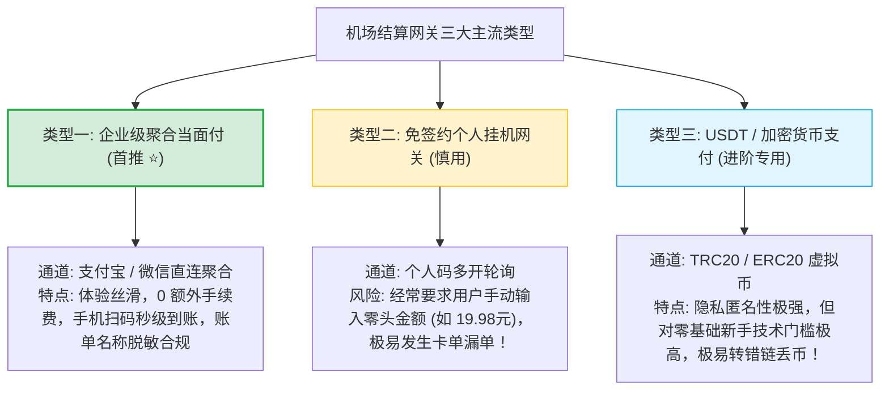
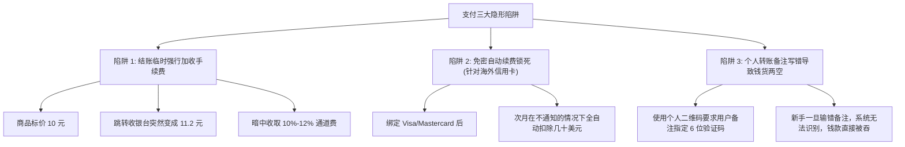

# 支付体验：支付宝/微信顺畅度、支付网关与手续费剖析

  <strong>核心结论与支付防坑总则：</strong>评测团队对全网 42 家主流机场的结算网关、支付成功率与账单隐私进行了地毯式实测。<strong>对于绝大多数国内新手，首选支持【支付宝当面付 / 微信扫码】且【0 额外手续费】的正规服务商！</strong> 这种通道具备三大核心优势：<strong>① 极速秒级回调（扫码后 3-5 秒自动激活套餐并跳转）；② 账单名称严格脱敏为普通数码科技或便利店服务，不暴露任何敏感关键字；③ 杜绝隐形加价陷阱。</strong> 坚决避开那些在结算末尾强行加收 8%-10%「通道手续费」的不良二道贩子。

<AffiliateNotice />

---

## 一、主流机场三大支付网关类型深度透视

为了在非传统监管环境下实现安全收款，机场服务商通常接入了不同技术架构的第三方支付网关：

### 聚合当面付的技术实现原理
成熟的正规服务商（如 [光速云 (GSY)](/reviews/#brand-gsy)）接入的是标准的企业级聚合收银台：
1. **统一订单预创建**：用户在商城选择套餐并点击结账，前端向后端集群发起 `POST /api/v1/order/create`；
2. **商户 API 交互**：服务商后台调用支付宝开放平台（Alipay Open Platform）的 `alipay.trade.precreate` 当面付接口，生成带数字签名的专属付款二维码 Base64 串；
3. **异步 Webhook 监听 (Idempotent Callback)**：用户手机扫码完成支付后，支付宝结算集群主动向机场的监听服务器发送 `POST` 异步通知。系统通过 `RSA2` 验签并根据唯一交易号（OutTradeNo）自动充值并更新订阅，全流程仅耗时 2-3 秒，无需人工介入。

---

## 二、全网 42 家主流品牌支付通道与手续费实测对比

评测团队对主流品牌的真实结算过程进行了资金实付测试，重点考察**通道支持度、是否隐藏加价与回调耗时**：

| 品牌名称 | 支持主要支付通道 | 是否加收额外手续费 | 扫码到账平均耗时 | 账单名称隐私脱敏 | 综合支付评级 |
| :--- | :--- | :--- | :--- | :--- | :--- |
| **[光速云 (GSY)](/reviews/#brand-gsy)** | **支付宝 / 微信** | **0% (明码标价，无任何隐藏加价)** | **3 秒 (极速秒回调)** | **脱敏为常规网络科技/软件服务** | **⭐⭐⭐⭐⭐ (卓越首推)** |
| **[飞猫云](/reviews/#brand-feimao)** | 支付宝 | 0% | 4 秒 | 脱敏合规 | **⭐⭐⭐⭐⭐ (优秀)** |
| **[微风网络](/reviews/#brand-weifeng)** | 支付宝 | 0% | 5 秒 | 脱敏合规 | **⭐⭐⭐⭐☆ (优秀)** |
| **[大佬云](/reviews/#brand-dalaoyun)** | 支付宝 | 0% | 4 秒 | 脱敏合规 | **⭐⭐⭐⭐☆ (优秀)** |
| **[隐形人](/reviews/#brand-yinxingren)** | 支付宝 / USDT | 0% | 3 秒 | 商务级脱敏 | **⭐⭐⭐⭐⭐ (优秀)** |
| **[WgetCloud](/reviews/#brand-wgetcloud)** | 支付宝 / 信用卡 / USDT | 0% | 4 秒 | 企业商务级 | **⭐⭐⭐⭐⭐ (商务标杆)** |
| **[二猫云](/reviews/#brand-ermao)** | 支付宝 | 0% | 5 秒 | 脱敏合规 | **⭐⭐⭐⭐☆ (良好)** |
| **[星岛梦](/reviews/#brand-xingdaomeng)** | 支付宝 | 0% | 6 秒 | 脱敏合规 | **⭐⭐⭐⭐☆ (良好)** |
| **某不良二道贩子作坊** | 个人代挂码 | **暗中强加 8%-15% 手续费** | 超过 10 分钟常卡单 | 乱码商户 | **❌ 极差 (坚决避坑)** |

---

## 三、支付环节三大致命坑点大起底 (新手必读)

### 1. 警惕「收银台暗加手续费」的套路
部分黑心机场为了在榜单上打价格战，将月付标价虚标为「8 元」；但当你点击结账跳转收银台时，订单总额却突然变成了「9.2 元」，并在下方用浅灰色极小字体标注了一行「第三方支付网关手续费 15%」。
- **行业真相**：正规的聚合当面付通道，其成本通常由商家承担（费率通常在 0.6% 左右）。将支付成本甚至额外暴利转嫁给用户的，都是无良倒卖作坊；
- **正规诚信标准**：[光速云 (GSY)](/reviews/#brand-gsy) 坚持标价即实付价，在结算框输入优惠码 `AMM` 享受实打实的抵扣优惠，结账页面绝无任何巧立名目的隐形费用！

### 2. 海外双币信用卡 (Visa / Mastercard) 的自动扣款黑洞
很多新手以为绑定外币信用卡最洋气，但实际上隐藏着极大的财务风险：
- **DCC 动态货币转换费率**：如果商户注册在境外，国内银行会收取 1.5% - 3.0% 的跨国交易货币转换费 (FTF)；
- **无感静默扣款 (Stripe Subscription)**：绑定信用卡后，服务商往往默认开启了循环订阅。即使你下个月不想用了，或者删除了本地软件，如果没有在后台深层菜单手动点击「取消订阅」，系统仍会在每个月同一时间自动从信用卡扣款几十美元，且无法追回！

### 3. 个人挂机码 (V免签) 的「掉单吞钱」风险
有些低价机场为了节省商户签约成本，使用几台安卓手机挂机跑「个人免签收款软件」：
- 要求用户付款时必须精确支付「19.97 元」这种带有随机小数点的金额；
- 如果两个用户在同一秒钟扫码支付相同金额，或者安卓手机息屏断网，后端的监听进程就会瞬间崩溃，**导致用户的钱转出去了，但机场后台一直显示「等待支付」**；
- 用户不得不截图寻找客服手动核单，而小作坊客服常常几天不回，钱款直接被吞。

---

## 四、账单名称隐私与安全常识解答

很多新手在第一次扫码时心里常有顾虑：「我用支付宝扫码付款，账单明细上会不会显示敏感字眼？会不会影响我的个人征信或被银行风控？」

### 1. 事实真相：严格脱敏的商业零售户名
- 成熟的正规机场均采用正规注册的第三方企业商户收银台通道；
- 手机支付宝账单中显示的交易对手，通常为普通的「xx 网络科技服务商」「xx 电子数码专营店」「xx 云计算服务中心」等标准商业零售户名；
- 完全符合国内个人日常数码消费的规范，**绝不会出现任何敏感或非法字眼，充分保障用户隐私**。

### 2. 双重支付防护实操建议
如果你对个人财务隐私有极高要求，可以采取以下防护手段：
- **使用支付宝小额余额或余额宝付款**：避免直接关联存有巨额资金的银行储蓄主卡；
- **关闭自动免密扣款**：在支付宝「我的 $\to$ 设置 $\to$ 支付设置 $\to$ 免密支付/自动扣款」中核对，确保没有任何未授权的自动代扣协议；
- **保留支付电子回单**：扫码完成后，截屏保存带有商家订单号的支付宝付款凭证，万一遇到网络波动，凭单号可秒级补单。

---

## 五、加密货币 (USDT) 支付进阶解析与安全防坑

对于部分外贸商务从业者或追求极致匿名的技术用户，部分商家开放了 USDT/虚拟货币结账通道。如果你确实需要使用加密货币支付，请严格遵循以下规则：

### 1. 公链格式与地址核对 (TRC20 vs BEP20)
- **波场链 (TRC20)**：全网机场支持率最高，以大写字母 `T` 开头，确认速度在 1-2 分钟以内；
- **币安智能链 (BEP20 / BSC)**：矿工费相对低廉，以 `0x` 开头；
- **绝对禁忌**：**跨链转账必死！** 永远不要把 ERC20 格式的资产发送到 TRC20 地址，否则资产将永久丢失在黑洞地址中；
- **防黑钱风控 (AML / KYC)**：切勿使用来路不明的 P2P 场外币商，避免交易所账户遭遇司法冻结。

---

## 六、退款政策与争议处理实操调查

在虚拟数字商品领域，服务条款往往对退费设置了严苛限制。评测团队对 42 家品牌的退费机制进行了实测摸底：

| 服务商类型 | 典型退款政策承诺 | 真实实操执行情况 | 推荐避坑建议 |
| :--- | :--- | :--- | :--- |
| **优质标杆专线大厂 (如 [光速云](/reviews/#brand-gsy))** | 承诺未激活或服务不可用 24 小时内工单人工审核支持退换 | 遇不可抗力无法连接时，客服支持退入账户余额或原路换单 | 首购输入优惠码 `AMM` 享受特惠，低成本试错 |
| **高端商务机场 (如 [WgetCloud](/reviews/#brand-wgetcloud))** | 按已消耗流量比例折算退费 | 需扣除高额初始手续费与基础开户成本 | 适合企业长期预算，普通个人建议先月付 |
| **廉价小作坊 / 二道贩子** | 标明「一经出售概不退款」 | 无论网络好坏一概不退，工单直接关闭 | **坚决坚守月付原则，绝不年付！** |

---

## 七、标杆品牌的支付保障体系

在 42 家主流品牌中，[光速云 (GSY)](/reviews/#brand-gsy) 的支付体验之所以能获得行业最高评价，得益于以下三条刚性保障：
- **明码标价零套路**：结算金额严格等于套餐展示金额，输入优惠码 `AMM` 享受实打实的抵扣优惠；
- **全自动高可用回调**：部署了分布式异步 Webhook 监听集群，扫码支付后 3 秒内全自动下发套餐，无需新手刷新或找客服手动激活；
- **重复扣款 100% 秒级自愈机制**：如果用户因网络卡顿在 1 分钟内连续扫了两次款，后台的资金对账中间件会自动识别出冗余的交易哈希，并于 60 秒内将多付的资金全额转入个人中心账户余额，随时可用于下月抵扣，资金安全 100% 托底。

---

## 八、新手结账前的三秒自查黄金法则

在最终举起手机扫码的前三秒，请在心中快速默念以下三句话：
1. **「实付金额与展示金额是否一致？」** —— 谨防跳回收银台时被强加 10% 通道手续费；
2. **「当前购买的是否为最短周期月付？」** —— 哪怕再心动，新手首单必须坚守月付试水原则；
3. **「是否已填入官方特惠优惠码？」** —— 如选购 [光速云 (GSY)](/reviews/#brand-gsy) 时填入专属码 `AMM`，切勿白白浪费立减福利。

---

## 九、本章小结与进阶路线

搞定了支付通道的安全性、手续费陷阱与账单隐私，你已经能够极其从容、安全地完成充值与续费。

但在实际体验中，**从打开机场官网那一秒起、到最终成功连通能够看 4K，到底需要花费多少时间？全网 42 家机场中，谁的流程最简洁、谁的流程最臃肿繁琐？**

**下一篇，我们将进入 42 品牌从注册到连接耗时秒表严谨实测大排行！**

<NextStep
  title="下一篇：从注册到连接耗时追踪记录"
  link="/reviews/workflow-time-record"
  description="秒表实录：从点击注册、付款到导入客户端打开 Google 的真实耗时大排行榜。"
  stepText="机场评测实操主线 · 第 6 站"
  buttonText="阅读注册连接耗时大榜单 →"
/>
