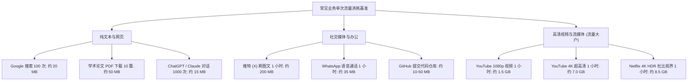
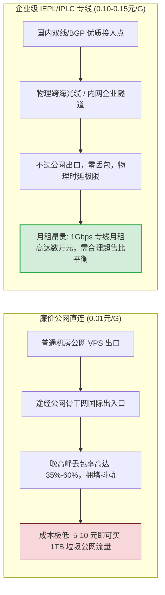
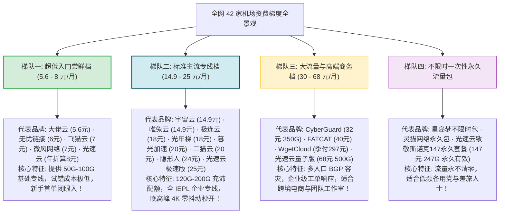
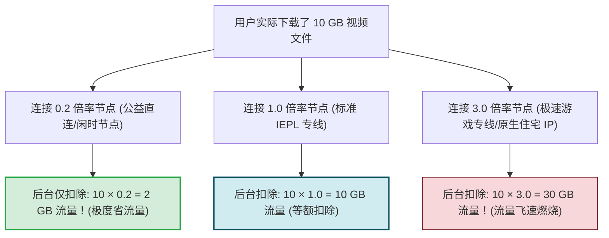
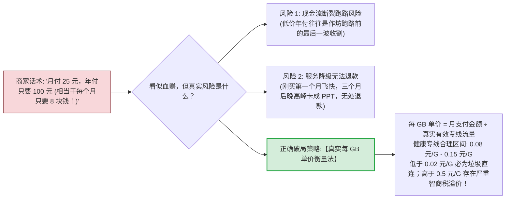

# 套餐适用性分析：新手轻量包与大流量包性价比剖析

  <strong>核心结论与精准选型公式：</strong>很多新手在买机场时，往往在「5 元包月太便宜怕跑路」和「50 元太贵买不起」之间纠结。根据真实流量消耗模型：<strong>① 纯网页查文献、日常推特与 ChatGPT 辅助办公：每月 50GB-100GB 充裕有余，闭眼选【月付 8-15 元企业专线档】；② 每天看 2 小时 YouTube 4K 或追 Netflix 原生剧：每月需 150GB-300GB，选【月付 20-25 元标准专线档】；③ 低频差旅备用党：选【不限时永久计费包】。</strong> 坚决拒绝一开始就买大几百元的长期年付，小步快跑永远是性价比最高的最优解。

<AffiliateNotice />

---

## 一、普通人一个月到底消耗多少流量？真实模型测算

许多小白对「100GB 流量」没有直观概念，容易被不良商家忽悠购买上千 GB 的过剩套餐：

### 真实月度消耗对照表

| 用户典型场景 | 每日网络行为构成 | 月均合理消耗范围 | 推荐套餐容量档位 |
| :--- | :--- | :--- | :--- |
| **轻度学术与办公用户** | 查 Google 学术、用 ChatGPT 润色、收发境外商务邮件、推特浏览 | **15 GB - 35 GB** | **50 GB - 100 GB**（宽裕冗余，无焦虑） |
| **主流白领与科技爱好者** | 办公协同、浏览 GitHub、日常听 Spotify、偶尔看 1080p 评测视频 | **50 GB - 90 GB** | **100 GB - 150 GB**（标准黄金区间） |
| **重度追剧发烧友** | 每天夜晚追 2 集 Netflix 4K 美剧、看 YouTube 4K 60fps 纪录片 | **180 GB - 260 GB** | **200 GB - 300 GB**（大流量专线） |
| **跨国电商与工作室团队** | 多设备并发、TikTok 直播推流、批量下载无损素材与软件镜像 | **500 GB - 2000 GB** | **500 GB+ 商业团队独立通道** |

- **结论**：**绝大多数普通新手，月均 100GB 已经能够满足 95% 的日常所需，切勿盲目追求 1000GB 虚标套餐！**

---

## 二、第一性原理：专线带宽的物理成本与定价逻辑

很多新手不理解：为什么有的机场 5 元能给 1000GB，而优质专线机场 20 元只给 150GB？天下没有免费的午餐，网络带宽是具有刚性物理成本的通信资源。

### 1. 真实跨境专线成本核算

- **公网直连/中继**：使用的是廉价的普通数据中心机房公网带宽。运营商在国际出口处没有 QoS 保障，一旦到了晚上 20:00-23:00 黄金时段，丢包率往往从平时的 2% 飙升至 45% 以上，4K 视频无限缓冲，甚至网页文字都打不开；
- **IEPL/IPLC 企业专线**：服务商租用中国电信、中国联通或移动向跨国企业提供的内网物理光纤或点对点隧道。由于数据根本不经过公网国际出口路由器，完全不受晚高峰国际出口拥堵影响，全天候延迟抖动保持在 $\pm 2\text{ms}$ 范围内。
- **超售比 (Oversubscription Ratio)**：优质服务商会将专线带宽的超售比严格控制在 `1:5` 到 `1:8` 之间；而不良黑心作坊为了以极低价格拉人，将超售比放大至 `1:50` 甚至 `1:100`，一旦几百人同时上线测速，整条线路瞬间暴毙。

---

## 三、全网 42 家主流品牌资费梯度全景大解构

从品牌数据库实测数据来看，当前市场已经形成了极其成熟的四大价格梯队：

---

## 四、四类典型人群精准套餐匹配指南

| 人群画像与痛点 | 核心诉求 | 推荐资费区间 | 推荐匹配套餐范例 | 核心避坑建议 |
| :--- | :--- | :--- | :--- | :--- |
| **高校研究生 / 考研党** | 查 Google 学术、跑代码依赖、使用 ChatGPT 润色 | **5.6 - 8 元/月** | **[光速云 (GSY)](/reviews/#brand-gsy)** 入门版 (8元/月 100G) | 坚决不买几十元大流量，100G 足够用一年 |
| **外贸业务员 / 跨境电商** | WhatsApp 客户沟通、TikTok 运营、多设备并发办公 | **15 - 25 元/月** | **[光速云 (GSY)](/reviews/#brand-gsy)** 极速版 (25元 168G) / **[微风网络](/reviews/#brand-weifeng)** | 必须认准 IEPL 企业专线，防丢包漏单 |
| **4K 影视追剧发烧友** | 满血解锁 Netflix、Disney+、观看 YouTube 4K 60fps | **20 - 32 元/月** | **[隐形人](/reviews/#brand-yinxingren)** (24元 原生住宅IP) / **[CyberGuard](/reviews/#brand-cyberguard)** | 必须认准原生双 ISP 解锁节点 |
| **低频备用 / 差旅党** | 平时主要用国内网，仅偶尔查资料，不想每月交月租 | **一次性买断** | **[光速云 (GSY)](/reviews/#brand-gsy)** 147 永久套餐 / **[星岛梦](/reviews/#brand-xingdaomeng)** | 避开按月清零的周期套餐，选永久不过期包 |

---

## 五、深入理解「节点倍率」机制（防流量偷跑暗坑）

许多小白购买了 100GB 套餐，仅仅下载了一个 20GB 的游戏文件，后台却提示「本月流量已耗尽」！这不是系统故障，而是掉进了「节点倍率（Rate Multiplier）」的计算陷阱。

### 1. 什么是节点倍率？

服务商为了调节各条专线服务器的负载成本，会对不同线路设置不同的扣费乘数：

$$\text{真实扣除流量} = \text{实际传输数据量} \times \text{该节点倍率}$$

### 2. 节点倍率避坑防身术
- **日常默认选 1.0 倍率**：90% 的主流节点均为 1.0 标准倍率，日常挂后台选它最安心；
- **刷大流量视频避开高倍率**：看 YouTube 4K 或下载大文件时，务必核对节点后缀名称（如 `香港 01 [IEPL] - 1.0x`），切勿误连 `3.0x` 或 `5.0x` 节点；
- **低倍率节点的妙用**：如果你的套餐月底只剩 2GB 流量，切换至 `0.2x` 节点，相当于可用流量瞬间翻了 5 倍！

---

## 六、揭秘商家的「年付折扣陷阱」与「真实每 GB 单价」计算法

在购买套餐时，很多商家会利用心理学算法设计价格歧视：

### 科学选购的「三不原则」：
1. **第一次购买绝不选年付**：哪怕商家宣称年付打了五折，首月必须通过「月付」或「季付」亲自验证所在地区和运营商在晚高峰的表现；
2. **不买无试用/无法退款的冷门商家**：连一两个小时试用都不敢提供的单人小作坊，稳定性往往不堪一击；
3. **不过度囤积流量**：除非购买的是 [光速云](/reviews/#brand-gsy) 或 [星岛梦](/reviews/#brand-xingdaomeng) 这类不限时不过期的特殊流量包，否则周期性套餐用多少买多少，按需续费。

---

## 七、标杆服务商的套餐弹性与性价比优势

在套餐设置上，[光速云 (GSY)](/reviews/#brand-gsy) 的资费体系兼顾了极致门槛与无缝弹性：
- **超低门槛**：提供折合约 8 元/月超低起步档，输入优惠码 `AMM` 享受专属立减，一杯奶茶钱即可畅享百兆专线；
- **无损升档机制**：如果月中使用发现 100G 流量不够用，支持在后台随时补差价平滑升级至 200G 或 500G 档位，不扣除已使用天数的价值；
- **提供永久不过期包**：针对低频备用用户推出致敬斯诺克 147 永久套餐（247GB 永久有效），全网罕见。

---

## 八、本章小结与进阶路线

掌握了不同人群的流量消耗模型与资费避坑指南，你已经能够极其精准地把每一分钱花在刀刃上。

但在实际使用中，偶尔遇到技术疑难在所难免：**当晚上 21:00 遇到节点连接报错时，各家机场的客服多久能回复？工单是人工排障还是机器人敷衍？**

**下一篇，我们将进入全网 42 家机场客服与售后响应时效匿名实测大曝光！**

<NextStep
  title="下一篇：客服与售后响应时效实测"
  link="/reviews/customer-service-review"
  description="晚高峰匿名提交报错工单：首条回复耗时、专业度与解决率全景实测大曝光。"
  stepText="机场评测实操主线 · 第 4 站"
  buttonText="阅读客服与售后实测报告 →"
/>
