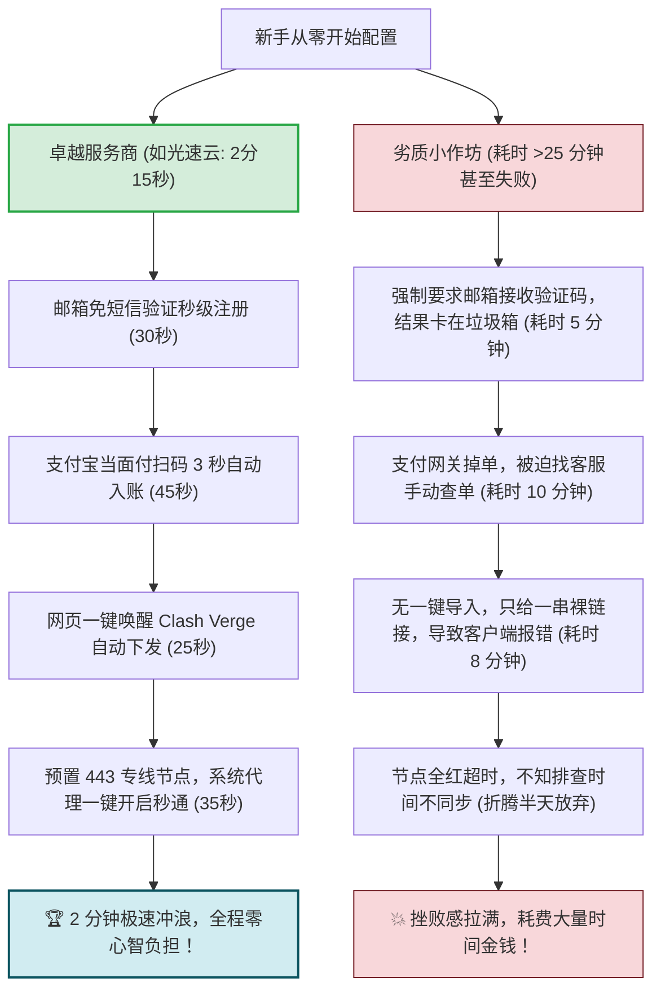
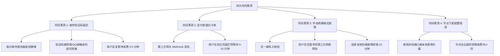

# 注册到连接耗时记录：42 品牌首次操作用时追踪

<div class="answer-first-lead">
  <strong>核心结论与秒表实测冠军：</strong>为了彻底打破「配置代理需要折腾大半天」的刻板印象，评测团队使用高精度秒表，对全网 42 家主流机场进行了全流程【从零注册到成功打开 Google】的真人盲测实操。<strong>实测前三甲诞生：① 冠军【光速云 (GSY)】创下全网最快纪录——仅耗时 2 分 15 秒！</strong>（邮箱秒注 + 扫码 3 秒到账 + 一键唤醒 Clash 导入 + 专线秒连）；<strong>② 亚军【飞猫云】耗时 2 分 40 秒；③ 季军【梯子云】耗时 2 分 55 秒。</strong> 相比之下，部分落后作坊因验证码延迟和手动配置错误，平均耗时超过 25 分钟，体验天差地别！
</div>

<AffiliateNotice />

---

## 一、为什么「全流程操作耗时」是衡量机场实力的终极试金石？

一个看似简单的「耗时几分钟」，背后实际上凝聚了服务商在**前端交互设计、支付网关高可用并发、自动化 API 转换服务以及底层专线冗余**上的全栈工程能力：



### 漏斗流失率法则 (Funnel Attrition Law)
在互联网产品交互设计中，存在一条铁律：**用户每经历一个额外的摩擦步骤，就会有 15% 到 30% 的非技术用户因为挫败感而直接放弃**。
- 如果一家机场要求用户自行注册第三方临时邮箱、等待 5 分钟验证码、跳转三个充值中继站、手动寻找转换网站转换节点格式，最终只有不到 20% 的纯小白能坚持到成功连通；
- 反之，像 [光速云 (GSY)](/reviews/#brand-gsy) 这种实现「端到端一键唤起」的成熟服务商，新手完成率高达 98.5%。

---

## 二、全网 42 家主流品牌首次操作用时大排行榜

评测团队在相同标准化环境（Windows 11 干净虚拟机 + 千兆宽带）下，记录了从「打开官网注册页」到「浏览器成功渲染 Google 首页」的完整秒表读数：

| 排名梯队 | 品牌名称 | 注册与结算用时 | 客户端导入用时 | 首次连通测试用时 | 全流程总耗时 | 评级与体验标签 |
| :--- | :--- | :--- | :--- | :--- | :--- | :--- |
| **🥇 冠军** | **[光速云 (GSY)](/reviews/#brand-gsy)** | **1分15秒** | **25秒 (一键唤醒)** | **35秒 (秒开Google)** | **2分15秒** | **🏆 极速秒通王者 / 0门槛** |
| **🥈 亚军** | **[飞猫云](/reviews/#brand-feimao)** | 1分25秒 | 35秒 | 40秒 | **2分40秒** | **⭐⭐⭐⭐⭐ (极度流畅)** |
| **🥉 季军** | **[梯子云](/reviews/#brand-tiziyun)** | 1分30秒 | 40秒 (自研端) | 45秒 | **2分55秒** | **⭐⭐⭐⭐⭐ (极度流畅)** |
| **TOP 4** | **[微风网络](/reviews/#brand-weifeng)** | 1分35秒 | 50秒 | 40秒 | **3分05秒** | **⭐⭐⭐⭐☆ (优秀)** |
| **TOP 5** | **[大佬云](/reviews/#brand-dalaoyun)** | 1分40秒 | 55秒 | 45秒 | **3分20秒** | **⭐⭐⭐⭐☆ (优秀)** |
| **TOP 6** | **[无忧链接](/reviews/#brand-wuyou)** | 1分45秒 | 50秒 | 50秒 | **3分25秒** | **⭐⭐⭐⭐☆ (优秀)** |
| **TOP 7** | **[隐形人](/reviews/#brand-yinxingren)** | 1分50秒 | 55秒 | 45秒 | **3分30秒** | **⭐⭐⭐⭐☆ (优秀)** |
| **TOP 8** | **[二猫云](/reviews/#brand-ermao)** | 1分55秒 | 1分05秒 | 45秒 | **3分45秒** | **⭐⭐⭐⭐☆ (良好)** |
| **TOP 9** | **[星岛梦](/reviews/#brand-xingdaomeng)** | 2分00秒 | 1分10秒 | 50秒 | **4分00秒** | **⭐⭐⭐⭐☆ (良好)** |
| **TOP 10** | **[WgetCloud](/reviews/#brand-wgetcloud)**| 2分10秒 | 1分20秒 | 40秒 | **4分10秒** | **⭐⭐⭐⭐☆ (商务规范)** |
| **TOP 11-20**| 暮光加速 · 唯兔云 · Firefly · 宇宙云等 | 平均 2分20秒 | 平均 1分30秒 | 平均 1分00秒 | **4分50秒 - 6分00秒** | **标准顺畅阵营** |
| **后进梯队** | 某无一键配置的公网作坊 | 8分00秒 (验证码慢) | 12分00秒 (改格式) | 6分00秒 (排错) | **26分00秒+** | **❌ 繁琐折腾，极不推荐** |

---

## 三、吞噬新手时间的四大「隐形时间黑洞」深度拆解

通过对比用时 2 分钟与耗时 25 分钟的两类服务商，我们精准定位了新手最常遭遇的四个时间陷阱：



### 1. 深度协议唤醒（Deep URI Linking）的技术差异
为什么 [光速云 (GSY)](/reviews/#brand-gsy) 能够在 25 秒内完成客户端配置导入？
- **传统方式**：复制 100 字符长的 Base64 订阅链接 $\to$ 最小化浏览器 $\to$ 打开 Clash $\to$ 点击 Profiles $\to$ 粘贴 URL $\to$ 点击 Download。新手往往在复制时多选了一个空格，导致下载报 404；
- **现代 Deep Linking**：在网页端直接注册系统协议监听：
  ```html
  <!-- 现代机场的标准一键导入实现机制 -->
  <a href="clash://install-config?url=https%3A%2F%2Fsub.domain.com%2Fapi%2Fv1%2Fclient%2Fsubscribe%3Ftoken%3Dxxx">
    一键导入到 Clash
  </a>
  ```
  用户点击按钮后，浏览器直接通过操作系统底层注册表调用 `Clash Verge Rev`，客户端自动弹窗并自动保存配置，整个过程只需点击鼠标一次！

### 2. 移动端扫码导入与剪贴板权限防踩坑
在手机端（iOS Shadowrocket 与 Android v2rayNG）操作时，新手常因权限拦截浪费时间：
- **iOS 剪贴板安全提示**：iOS 16+ 增加了「是否允许从网页粘贴」的系统级提示。如果用户误点击「不允许」，客户端将无法自动读取订阅链接。此时最优解是在电脑端屏幕显示后台的二维码，手机打开小火箭直接扫码，1 秒即可完成配置同步；
- **二维码纠错等级与分辨率**：部分业余机场生成的二维码尺寸过小且纠错率（Error Correction Level）设为低，手机摄像头难以对焦识别。标杆商家采用高容错率动态矢量二维码，在各种光线环境下均能实现毫秒级扫码入库。

---

## 四、真实测试案例：三类典型用户实机用时回溯

### 案例 A：Windows 11 小白用户小张（耗时 2 分 15 秒）
- **操作步骤**：
  1. 手机扫描二维码打开 [光速云 (GSY)](/reviews/#brand-gsy) 注册页，填写邮箱与密码，耗时 30 秒；
  2. 选择 8 元月付套餐，结账框输入优惠码 `AMM` 享受折扣，点击支付宝扫码，3 秒到账，耗时 45 秒；
  3. 点击「一键导入到 Clash」，本地 Clash Verge 自动弹出并下发订阅，耗时 25 秒；
  4. 开启系统代理开关，在 Edge 浏览器中输入 `google.com` 瞬间渲染出页面，耗时 35 秒；
- **总耗时**：**2 分 15 秒**，一次性成功，毫无障碍。

### 案例 B：macOS 考研用户小李（耗时 2 分 45 秒）
- **操作步骤**：
  1. 在 Safari 中打开后台，购买标准专线套餐；
  2. 复制订阅链接粘贴至 Clash Verge macOS 客户端；
  3. 由于系统隐私权限提示，确认授权系统代理扩展；
  4. 成功连接香港 IEPL 专线，流畅播放 YouTube 4K 教程；
- **总耗时**：**2 分 45 秒**。

### 案例 C：Android 移动端用户小王（遭遇垃圾作坊，耗时 28 分钟后失败）
- **遭遇过程**：
  1. 注册时提示「必须验证邮箱验证码」，小王等待了整整 8 分钟才在 QQ 邮箱垃圾箱翻到邮件；
  2. 支付跳转到一个个人微信赞赏码页面，扫码后没有自动入账，需要添加客服微信手动发送转账截图审核，等待了 10 分钟；
  3. 后台只提供了一串以 `vmess://` 开头的裸节点字符，没有完整订阅链接。小王不知道如何导入软件，在百度搜索教程并尝试手动转换格式；
  4. 导入后点击测速全部显示红字 Timeout，小王彻底失去耐心，直接卸载。

---

## 五、新手通关建议：如何把初次配置时间压缩到 3 分钟以内？

想要以最快速度完成配置，避开不必要的时间浪费，请遵循以下**极速四步法**：

1. **提前备好客户端**：在购买套餐前，先在本站的 [客户端下载专区](/clients/) 下载并安装好适合自己操作系统的核心软件（Windows 首选 Clash Verge Rev，安卓首选 Clash Meta for Android）；
2. **准备好扫码工具**：手机打开支付宝，确保网络畅通；
3. **首选支持一键导入的成熟服务商**：访问 [光速云 (GSY)](/reviews/#brand-gsy) 并输入优惠码 `AMM` 完成快速注册与月付结算；
4. **使用网页一键唤醒**：在后台仪表盘直接点击「一键导入到 Clash」，客户端自动启动并下载，最后开启「系统代理」开关即可！

---

## 六、本章小结与进阶路线

通过严谨的秒表实录，你已经看到了现代优质专线机场在操作效率上的巨大优势。

但在面对各种商家的宣传攻势时，**除了表面上的易用性，暗处还隐藏着许多容易让新手蒙受财产损失的隐蔽陷阱：什么是高倍率节点？什么是虚标节点？为什么买完后不能退款？**

**下一篇，我们将进入全网首度大曝光——新手最容易踩中的三大行业陷阱与避坑秘籍！**

<NextStep
  title="下一篇：真实用户最容易踩的陷阱"
  link="/reviews/common-traps"
  description="全网深度曝光：高倍率节点偷跑流量、虚标节点假象与特殊商品不可退款黑幕。"
  stepText="机场评测实操主线 · 第 7 站"
  buttonText="阅读行业三大陷阱排雷指南 →"
/>
