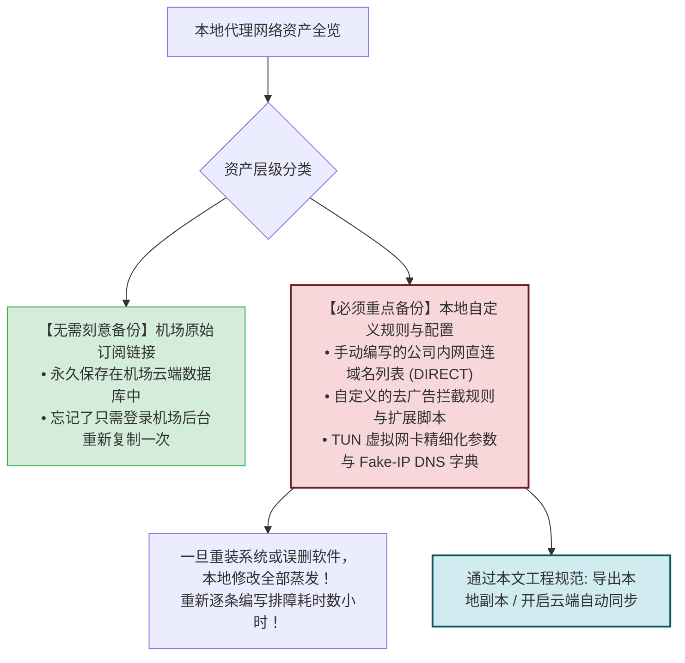
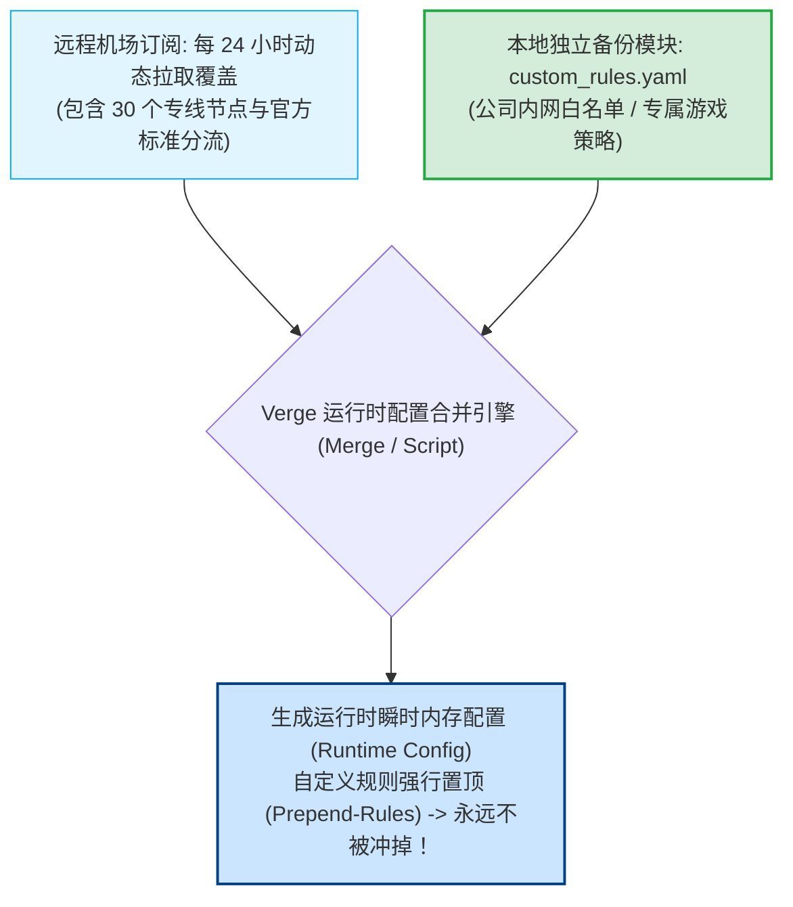
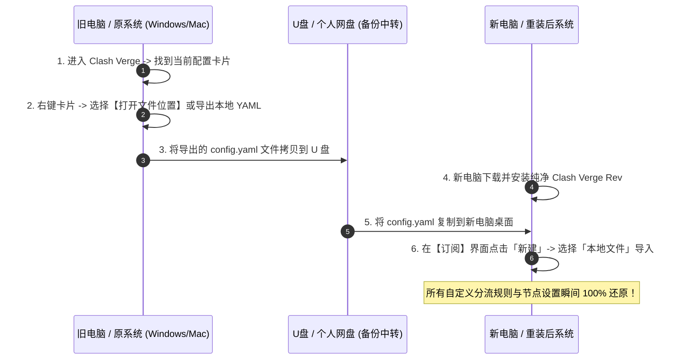
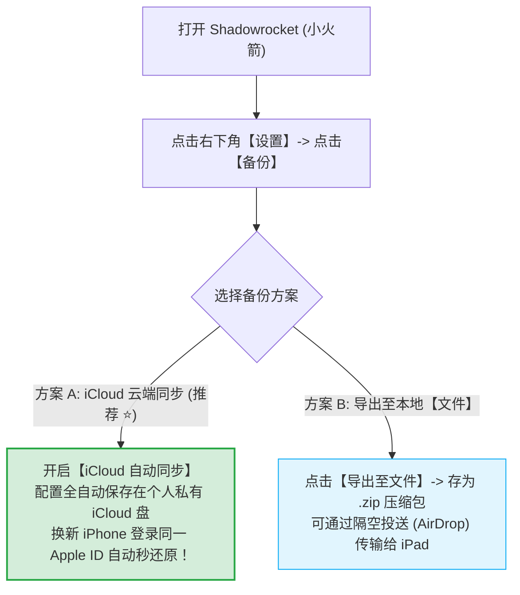

# 备份与恢复：自定义分流规则与配置跨设备迁移指南

<div class="answer-first-lead">
  <strong>核心结论与备份哲学：</strong>网络配置的备份主要分为两个层级：<strong>① 基础层（订阅凭证与节点列表）：只要你记住机场的官网账号密码，订阅链接随时可以在后台重新复制并拉取，无需刻意本地备份；② 核心进阶层（自定义分流规则、覆写脚本与 TUN 参数）：如果你手动编写了公司内网 IP 白名单、游戏低延迟分流规则或高级 DNS 解析配置，重装系统或换机前务必将本地的 <code>config.yaml</code> 导出保存或利用 iCloud 云同步。</strong> 本文手把手教你在 Win/Mac/iOS/Android 四大平台实现一秒无损迁移与版本回滚。
</div>

<AffiliateNotice />

---

## 一、备份对象厘清：什么该备份？什么无需备份？

在动手备份前，先分清哪些是易丢失的个性化资产，避免浪费时间在无需备份的数据上：



---

## 二、第一性原理：Clash 覆写引擎 (Profile Merge & Prepend) 与规则解耦

在高级客户端（如 Clash Verge Rev）中，为什么**绝对不要直接修改下载下来的原始订阅 YAML 文件**？
- **原因**：每次你点击「更新订阅」时，客户端会从远程服务器重新拉取最新文件，**直接将你本地修改的文件完全覆盖冲掉**；
- **正确姿势：分层覆写 (Prepend-Rules / Scripting)**。让自定义规则以独立模块（Merge）注入内核流水线顶部，无论底层订阅如何高频更新，你的个人规则始终稳如磐石。



---

## 三、Windows / Mac 平台：Clash Verge Rev 完整备份与迁移

在桌面端，Clash Verge Rev 的所有自定义配置（包含远程订阅缓存、本地覆写扩展脚本与系统设置）均保存在系统的应用数据目录中。



### 3.1 方式 A：导出单个 Profile 配置文件 (最简便)
1. 打开 Clash Verge Rev，进入左侧 **「订阅 (Profiles)」**；
2. 找到你微调过的配置卡片，**鼠标右键**；
3. 选择 **「打开文件位置 (Open File Location)」**；
4. 系统文件管理器会自动弹出一个名为 `xxxx.yaml` 的文件，将其复制并发送到你的个人网盘或微云中保存；
5. **换机恢复时**：在新电脑上打开 Clash Verge，点击右上角「新建」，类型选择 **「Local (本地)」**，将保存的 `.yaml` 文件拖入即可立即复原。

### 3.2 方式 B：全目录镜像搬家 (适用于重度极客)
如果你使用了复杂的 Scripting 脚本与多重服务，可以直接备份其系统目录：
- **Windows 本地目录**：按下 `Win + R` 输入 `%APPDATA%\io.github.clash-verge-rev.clash-verge-rev` 回车；
- **macOS 本地目录**：在访达中按下快捷键 `Cmd + Shift + G`，输入 `~/Library/Application Support/io.github.clash-verge-rev.clash-verge-rev` 回车；
- 将该文件夹整体打包压缩。新电脑安装好软件后解压覆盖，所有设置（包括开机自启、TUN 模式开关、窗口布局）全部原封不动继承。

---

## 四、Android 手机平台：v2rayNG 一键备份与恢复

v2rayNG 内置了原生的本地全量备份引擎，操作极其轻巧：


---

## 五、iOS 苹果手机平台：Shadowrocket (小火箭) 云端自动备份

小火箭深度整合了苹果的 **iCloud Drive** 云存储生态，换新 iPhone 时甚至无需手动导出文件：



---

## 六、程序员极客最佳实践：Git Dotfiles 与环境变量凭证脱敏

对于软件工程师与运维人员，将代理配置文件纳入版本控制是保持多工作站环境高度一致的最高效手段：
```yaml
# ~/.config/clash/custom_rules.yaml (已脱敏的公共规则模板)
rules:
  # 公司内网 VPN IP 与私有域名白名单
  - DOMAIN-SUFFIX,corp.internal,DIRECT
  - IP-CIDR,10.0.0.0/8,DIRECT
  - IP-CIDR,172.16.0.0/12,DIRECT
  
  # 本地开发微服务环境
  - DOMAIN-SUFFIX,localtest.me,DIRECT
  - DOMAIN-KEYWORD,localhost,DIRECT
  
  # 关键学术与开源代码库强行走专线
  - DOMAIN-SUFFIX,github.com,PROXY
  - DOMAIN-SUFFIX,huggingface.co,PROXY
```
在将配置提交至私有 GitHub 仓库时，**切勿将包含真实 Token 的 URL 直接硬编码入 Git 历史**。利用 CI/CD 或本地 Shell 脚本读取环境变量 `AIRPORT_TOKEN` 动态组装，确保即使私有仓库意外公开，核心凭证依然安然无恙。

> [!TIP] 跨客户端规则语法转换避坑
> 注意：Clash 的规则语法（如 `DOMAIN-SUFFIX`）、Shadowrocket 的规则语法（以 `,DIRECT` 结尾的列表）与 Sing-box 的 JSON 规则集（Rule-set）并不完全通用。在跨不同软件平台迁移时，最稳妥的做法是备份规则中的「纯域名与 IP 资产清单」，而非硬复制带格式的代码块，再借助客户端内置模板重新生成，以避免语法不兼容导致的客户端启动闪退。

---

## 七、标杆服务商的「云端永久凭证」保障

靠谱的大型服务商能让你在面临设备故障时彻底没有后顾之忧：

| 维护场景 | 劣质作坊机场 | [光速云 (GSY)](/reviews/#brand-gsy) 企业级专线 |
| :--- | :--- | :--- |
| **电脑突然损坏/丢失** | 无法找回订阅链接，客服失联，必须重新买 | **官网控制台随时登录，Token 永久保留，一秒重新拉取** |
| **换机重装系统** | 缺少指引，换机后重新配置容易报错 | **全平台客户端安装包内网高速下载直通，配带保姆级指引** |
| **设备并发继承** | 换机后旧设备未解绑导致新机无法连接 | **智能连接池调度，新设备上线自动平滑顺延** |

> [!TIP] 选型小结
> 选用 [光速云 (GSY)](/reviews/#brand-gsy)，在结账输入优惠码 `AMM` 享受专属立减。无论你换过多少部手机或电脑，只要登录官网控制台，就能随时重新一键同步所有优质专线，真正做到数据永不丢失。

---

## 八、本章小结与进阶路线

掌握了配置备份与换机恢复技能，你的个性化分流规则与宝贵设置已经得到了双重保险。

但在日常使用中，**很多新手往往忽略了对机场套餐基本信息的关注：当月流量还剩多少？套餐什么时候到期？如何避免关键时刻突遭欠费断网？**

**下一篇，我们将进入日常管理、流量余量查看与套餐平滑续费指南！**

<NextStep
  title="下一篇：日常管理与流量续费"
  link="/tutorials/daily-management"
  description="查看流量余量、到期提醒与套餐平滑升级，告别突发断网尴尬。"
  stepText="使用教程实操主线 · 第 9 步"
  buttonText="阅读日常流量管理指南 →"
/>
