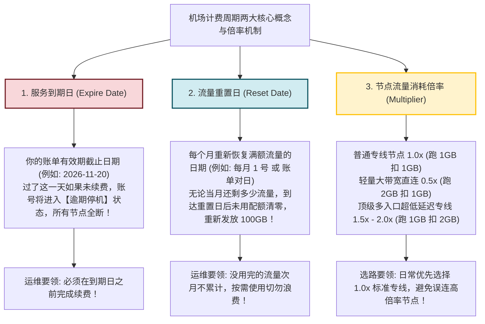
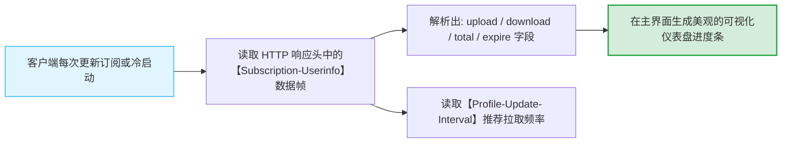
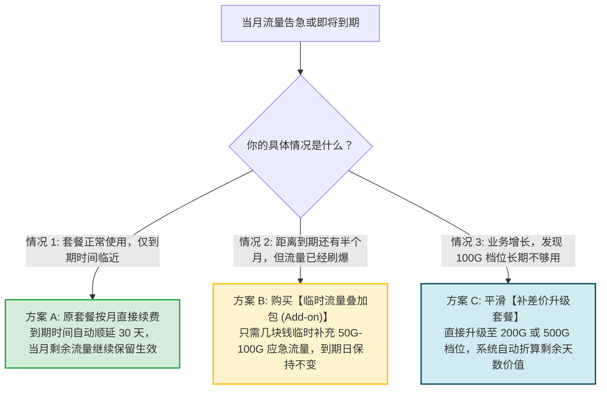
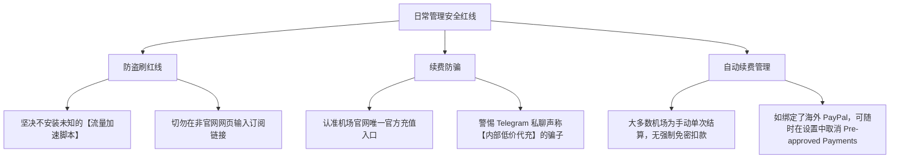

# 日常管理：流量余量查看、到期提醒与套餐平滑续费

  <strong>核心结论与健康运维三件事：</strong>许多新手在使用网络代理时，最尴尬的莫过于<strong>正在跨国开会、处理订单或追剧的关键时刻，网络突然毫无征兆地彻底断开</strong>。这往往不是机房出了故障，而是因为<strong>当月流量耗尽或套餐已逾期到期！</strong>健康使用的三大工程习惯是：<strong>① 学会直接在客户端界面（Clash Verge / 小火箭）秒看剩余流量进度条，无需频繁登录官网；② 深刻分清「流量重置日」与「服务到期日」的计费区别；③ 在套餐到期前 3 天完成续费，或按需购买「临时流量叠加包」。</strong> 结合 Telegram Bot 自动化到期提醒与进程级流量监控，可彻底规避突发性断网事故。

<AffiliateNotice />

---

## 一、第一性原理：深刻分清两个关键时间节点与流量倍率机制

在机场用户后台或客户端中，通常会看到两个不同的日期，许多小白经常把它们混淆并造成误判：

### 1.1 两种不同的重置算法差异
- **自然月重置模式（固定每月 1 号）**：无论你是哪一天购买的，每个月 1 号零点（UTC+8）系统自动将当月流量计数器重置为 0；
- **账单周期对日重置（购买日对齐）**：若你在 10 月 15 日购买月付套餐，则系统在每个月的 15 日进行流量配额重置。

---

## 二、如何在各平台客户端直接查看剩余流量？

很多新手以为查流量必须每次打开浏览器、输入验证码登录机场后台。其实主流现代客户端早已**深度集成了 Subscription User-Info 协议**，能够将服务端数据直接渲染在主界面上：

### 2.1 Clash Verge Rev (Windows / macOS) 查看方法
- 打开 Clash Verge Rev，点击左侧导航栏的 **「订阅 (Profiles)」**；
- 在当前使用的配置卡片右上角，会醒目地显示一组数据：
  - `已用: 18.5 GB / 共 100.0 GB`
  - `到期时间: 2026-11-20`
- 当卡片进度条呈现绿色时，代表流量充沛；呈现橙色代表余量不足 20%；若变红则代表已接近透支。

### 2.2 Shadowrocket (iOS 小火箭) 查看方法
- 打开小火箭主界面；
- 在节点列表最顶部的订阅分组卡片上，会直接显示一行副标题文本：
  - `已用: 24.3G / 总量: 150G | 到期: 2026-11-20`；
- 一目了然，无需任何额外点击。

### 2.3 v2rayNG (Android 安卓) 查看方法
- 打开左上角菜单 → 进入「订阅分组设置」；
- 分组卡片下方会明确标注该订阅的剩余流量与套餐截止状态。

---

## 三、流量即将耗尽或到期时的 3 种平滑处理方案

当发现流量所剩无几、或收到到期提醒时，请根据自身需求选择最优解：

### 3.1 方案 A：正常按月平滑续费 (最常见)
- 登录机场后台控制面板，找到当前套餐，点击「续费 (Renew)」；
- 建议在到期前 2-3 天完成操作，系统会自动将有效截止期向后顺延 30 天，完全不需要重新导入订阅，客户端无缝自动过渡。

### 3.2 方案 B：购买「临时流量叠加包」
- 某些月份可能因为下载大文件导致流量提前告罄，但距离账单到期日还有大半个月；
- 大多数成熟机场（如光速云）在商店中提供「流量叠加包」（通常几元钱即可获得额外几十 GB）；
- 购买后立即生效，且不会更改原本的账单计费周期。

### 3.3 方案 C：补差价升级套餐
- 如果工作性质发生变动，需要长期处理高码率 4K 视频；
- 在后台点击「变更套餐 / 升级」，系统会精准折算当前旧套餐未消耗的天数折价，只需补齐差价即可即时升档。

### 3.4 跨币种与海外信用卡自动扣款管理
如果你使用了海外信用卡或 PayPal 绑定了周期性自动扣款，当打算停止使用时，切记登录 PayPal 个人中心的「设置 -> 付款 -> 管理自动付款」，找到对应机场商户名称点击「取消预授权」，以防下个月被系统自动扣费。

---

## 四、Telegram 机器人智能联动与资产自动化监控

成熟的服务商普遍支持绑定 Telegram 官方 Bot，让你在日常聊天中即可掌握一切动态：
1. **绑定机器人**：登录机场官网个人中心，找到「Telegram 绑定」并点击「前往绑定」；
2. **自动化提醒能力**：
   - **每日签到领流量**：部分机场提供每日轻量签到福利；
   - **流量告警通知**：当套餐月度余量低于 20% 时，Bot 自动推送预警通知；
   - **异地登录告警**：当检测到未知 IP 登录用户后台时，立即触发即时警报并支持一键强退下线；
   - **节点维护通报**：若某条海底光缆割接维护，Bot 提前推送换线通知，彻底告别盲目瞎猜。

### 4.1 进程级流量消耗异常排障 (定位偷跑流量的黑手)
如果你发现自己并未看视频，但流量进度条在几小时内飞速跑了几十 GB，请按下键盘快捷键 `Ctrl + Shift + Esc` 打开 Windows 任务管理器：
- 点击顶部「应用历史记录」或「网络」列，按照网络流量降序排列；
- 排查是否有后台云同步软件（如 OneDrive、Dropbox、百度网盘）或 Steam 在后台静默下载海外大文件；
- 如有异常进程，在客户端中将其添加至 `DIRECT` 直连白名单即可彻底止血。

### 4.2 利用客户端「连接 (Connections)」面板秒级掐断异常进程
在 Clash Verge Rev 中，拥有比系统任务管理器更直观的流量审计面板：
1. 点击左侧导航栏的 **「连接 (Connections)」** 页面；
2. 点击右上角的 **「按流量 (Download) 排序」**，系统会将当前占用下行带宽最高的 TCP/UDP 链路置顶；
3. 你可以清晰看到发起请求的本地进程名（如 `chrome.exe` 或 `qbittorrent.exe`）、目标域名与所匹配的分流规则；
4. 如果发现未知后台进程正在持续消耗流量，直接点击该条目右侧的 **「✖ 中断连接」**，内核将即刻向其发送 TCP RST 报文暴力切断该链路，秒级遏制流量偷跑。

---

## 五、日常管理安全防坑守则

在日常管理中，小白最容易轻信网络上的所谓「黑科技插件」而导致账号被盗：

---

## 六、标杆服务商的用户体验与透明度

在服务与资产透明度方面，正规大型机场与劣质小作坊截然不同：

| 管理特性 | 劣质小作坊 | [光速云 (GSY)](/reviews/#brand-gsy) 企业级专线 |
| :--- | :--- | :--- |
| **流量计量精度** | 严重暗中虚标倍率（跑 1G 扣 2G） | **1:1 绝对诚实计量，后台提供完整日志流水** |
| **到期邮件预警** | 无提醒，到期瞬间直接掐网 | **到期前 3 天、前 24 小时全自动邮件与 TG 机器人温馨提醒** |
| **续费灵活性** | 强制只能续订年付，否则涨价 | **随时按月续费、随时升级，自由进退** |
| **流量叠加包** | 不提供，逼迫用户重新买整月套餐 | **灵活按需提供极速应急叠加包** |

> [!TIP] 选型小结
> 选用 [光速云 (GSY)](/reviews/#brand-gsy)，在结账输入优惠码 `AMM` 享受折扣。其用户控制面板支持毫秒级同步流量状态，且提供全透明的到期日提醒与平滑续订支持，彻底告别突发性欠费断网的尴尬。

---

## 七、本章小结与进阶路线

掌握了日常流量查看、到期预警与平滑续费方法，你已经能够非常优雅、稳健地全天候掌控自己的网络资产。

但如果在某些特定时期，你打算换用其他设备、或者短期内不再需要使用代理：**直接删掉软件文件夹就等于卸载干净了吗？为什么很多用户删掉软件后电脑突然连百度都打不开了？**

**下一篇，我们将进入使用教程专题的最后一站——完全卸载与系统代理彻底复位指南！**

<NextStep
  title="下一篇：完全卸载与系统代理清理"
  link="/tutorials/uninstall-clean"
  description="停止使用时的系统代理安全复位与彻底干净卸载，杜绝断网残留。"
  stepText="使用教程实操主线 · 第 10 步"
  buttonText="阅读卸载与清理排障指南 →"
/>
