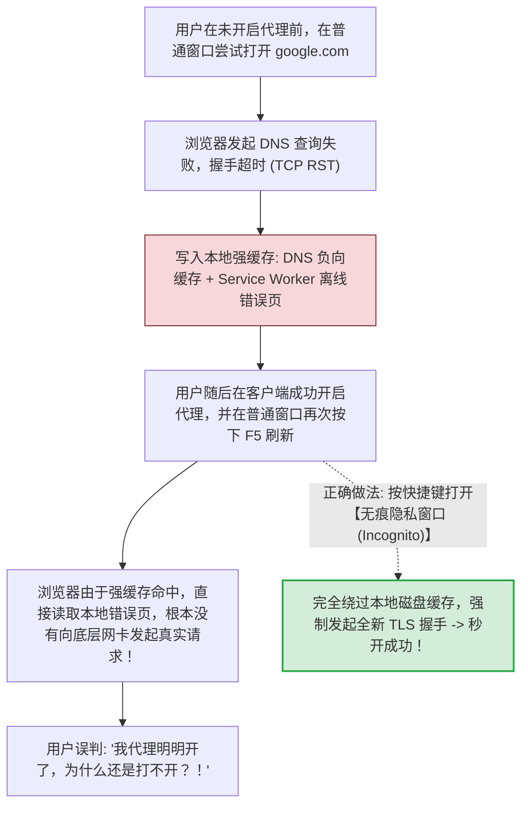
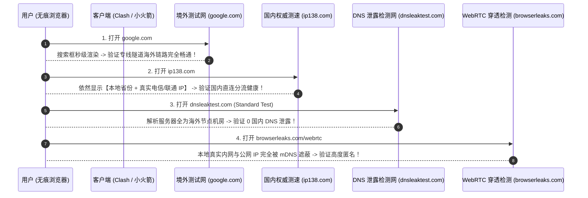
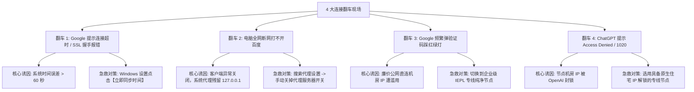

# 首次连接与连通性测试：验证代理生效与防缓存干扰

<div class="answer-first-lead">
  <strong>核心结论与快速自检标准：</strong>完成客户端配置并开启开关后，<strong>切勿凭感觉判断是否连接成功！</strong>一套科学的连通性验收标准必须同时满足两项指标：<strong>① 境外连通性达标：在浏览器【无痕隐私窗口】中访问 <code>google.com</code> 能够瞬间秒开；② 国内分流健康达标：访问 <code>ip138.com</code> 显示的依然是你本地的宽带运营商 IP（如电信/联通），证明国内软件没有被错误劫持消耗流量。</strong> 同时借助 <code>dnsleaktest.com</code> 确认无任何国内 DNS 地址泄露，方可确保隐私与连接质量百分之百符合生产级要求。
</div>

<AffiliateNotice />

---

## 一、为什么首次测试必须开启「浏览器无痕隐私窗口」？

许多新手在刚刚配置好代理后，直接在日常浏览器窗口刷新刚才打不开的网页，结果依然提示「无法访问此网站」，便误以为代理配置失败。这其实是**现代浏览器底层多层级负向缓存机制造成的典型假象**：



### 1.1 各主流浏览器快速开启无痕窗口快捷键
- **Google Chrome / Microsoft Edge (Windows)**：按下键盘快捷键 `Ctrl + Shift + N`；
- **Safari / Chrome (macOS)**：按下键盘快捷键 `Cmd + Shift + N`；
- **iOS / Android 移动端**：在手机浏览器底部的标签管理器中，点击左侧的「无痕浏览」或「隐私标签页」新建窗口。

---

## 二、标准化 4 步连通性与分流健康度闭环验收体系

在无痕窗口中，按照以下标准动作依次进行工程级验证：



---

### 测试 1：境外网络基准连通测试
- **测试网址**：`https://www.google.com` 或 `https://www.youtube.com`
- **合格标准**：页面秒级载入，Google 搜索框完整显示，搜索任意关键词瞬间返回结果；YouTube 视频首页缩略图完整展现，且能以 1080p 或 4K 分辨率无缓冲播放。

---

### 测试 2：国内分流精准度验证 (防流量被偷跑)
- **测试网址**：`https://ip138.com` 或 `https://test-ipv6.com`
- **合格标准**：页面上显示的 IP 地址，**必须是你当前宽带或手机流量的本地真实城市与运营商**（例如「广东省深圳市 电信」）。
- **如果显示为香港或日本 IP**：说明你的客户端误开启了「全局代理 (Global)」模式，所有国内应用的流量正在疯狂消耗你购买的套餐配额，必须立即切回「规则模式 (Rule)」。

---

### 测试 3：海外出口 IP 归属与伪装度检测
- **测试网址**：`https://whoer.net` 或 `https://ipinfo.io`
- **合格标准**：
  - 显示的国家与城市，与你在客户端中选择的节点完全吻合（如选择香港节点，此处显示 Hong Kong）；
  - 伪装度评分 (Anonymity Score) 达到 **85% - 100%**；
  - 检查 DNS 地址栏，确保没有出现任何中国大陆的本地运营商 DNS。

---

### 测试 4：进阶排查——DNS 泄露与 WebRTC 漏洞检测
很多用户自以为开启了代理就很安全，但在访问敏感学术或涉密跨境业务时，本地真实 IP 往往会通过 **DNS 泄露** 或 **WebRTC 穿透** 暴露：

1. **DNS 泄露检测**：
   - 访问 `https://www.dnsleaktest.com`，点击页面中间的 **「Standard test」**；
   - 几秒钟后，系统会返回当前为你解析域名的 DNS 服务器列表；
   - **安全红线**：所有列出的服务器国家必须为你连接的节点所在国（如 Hong Kong、Japan、United States）。如果列表中出现了「China Telecom」或国内公共 DNS（如 114.114.114.114），说明客户端的 DNS 防污染劫持存在缺陷；
2. **WebRTC 本地 IP 穿透测试**：
   - 现代浏览器自带的实时音视频协议 WebRTC，会通过 STUN 穿透向目标网站回传本地物理网卡的真实公网 IP；
   - 访问 `https://browserleaks.com/webrtc`；
   - 确认「Public IP Address」一栏显示的依然是你的境外节点 IP，而非本地宽带 IP。

---

## 三、首次连接测试 4 大经典翻车现场与工程急救实战

即使完全照着教程操作，在实际设备中依然可能遇到以下四种典型意外：



### 3.1 翻车现场 1：点击搜索提示 `ERR_CONNECTION_TIMED_OUT` 或 SSL 握手失败
- **底层物理原因**：90% 是因为本地电脑/手机的系统时间快了或慢了 60 秒以上。TLS 1.3 握手协议对握手证书的时间戳有效性有着极严格的校验，时间不同步会导致握手阶段被强行终止；
- **10秒急救**：打开电脑「设置」→「时间和语言」→ 确认「自动设置时间」开启，并手动点击一次 **「立即同步 (Sync Now)」**，重新打开浏览器即可秒开。

### 3.2 翻车现场 2：国内网站打不开，浏览器报 `ERR_PROXY_CONNECTION_FAILED`
- **底层物理原因**：客户端在运行中异常崩溃或被安全软件强制关闭，导致 Windows 注册表中的系统代理开关仍被锁定在 `127.0.0.1:7890`，所有流量被重定向到了一个不存在的死端口；
- **10秒急救**：在 Windows 任务栏搜索框输入「代理设置」→ 找到「手动设置代理 / 使用代理服务器」→ **手动将其拨到「关」**，网络瞬间恢复。

### 3.3 翻车现场 3：访问 Google 频繁弹窗「请点击所有包含红绿灯的图片」
- **底层物理原因**：你使用的是廉价作坊提供的公网直连节点，同一公网出口下有成千上万个恶意爬虫或垃圾流量在并发请求，被 Google 安全风控系统判定为疑似黑客机器流量；
- **10秒急救**：切换到具备独立商用出口的企业专线节点（如光速云的 IEPL 专线），专线节点纯净度高，绝少弹出验证码。

### 3.4 翻车现场 4：访问 ChatGPT 提示 `Access Denied` 或错误代码 1020
- **底层物理原因**：OpenAI 对云服务商机房数据中心（如 AWS、DigitalOcean、Linode）的 IP 段进行了大规模拉黑封锁；
- **10秒急救**：在客户端节点列表中切换为标有 **`原生 / 解锁 / US`** 标识的美国专线节点，即可顺畅登录。

---

## 四、终端命令行底层排障手法 (面向高级用户)

如果你在遇到连通性障碍时希望精确定位到底卡在哪个环节，可以在 Windows PowerShell 中执行以下诊断指令：

```powershell
# 1. 检查本地 7890 端口是否正处于监听状态
netstat -ano | findstr 7890

# 2. 模拟客户端经由代理发起 Google 连通性测试 (获取 HTTP 状态码)
curl.exe -I -x 127.0.0.1:7890 https://www.google.com --connect-timeout 5

# 3. 清理系统残留的 DNS 负向污染缓存
ipconfig /flushdns
```
- 如果第 1 条命令无任何输出，说明客户端内核未能成功启动（可能是杀毒软件拦截）；
- 如果第 2 条命令成功返回 `HTTP/2 200` 或 `HTTP/1.1 200`，说明**底层代理链路完全正常**，问题仅存在于浏览器的缓存或扩展插件冲突；
- 执行第 3 条命令能够清空本地所有旧的域名解析缓存，解决刚开代理时网页依然打不开的僵尸状态。

---

## 五、标杆专线节点的纯净度与连通性保障

一个优秀的机场服务商，其核心价值就在于为你解决繁琐的 IP 污染和封锁问题：

| 评估维度 | 廉价直连作坊 | [光速云 (GSY)](/reviews/#brand-gsy) 企业级专线 |
| :--- | :--- | :--- |
| **连通测试成功率** | 晚高峰仅 50%-70% 可用 | **全天候 99.8% 满速连通** |
| **Google 搜索验证码** | 极其频繁，动辄要求人脸或图片识别 | **纯净原生出口，0 验证码打扰** |
| **ChatGPT / Claude 状态** | 频繁遭遇 1020 拒绝访问或封号 | **原生住宅双 ISP 架构，全流媒体与 AI 全解** |
| **国内直连分流损耗** | 规则不全导致国内流量被白白偷跑 | **深度内置精准 GeoIP 规则，国内微信淘宝 0 损耗** |

> [!TIP] 连通性首单建议
> 使用 [光速云 (GSY)](/reviews/#brand-gsy) 作为入门第一单，在结账输入优惠码 `AMM`。其 IEPL 双专线架构在下发配置时已预置好最严苛的连通性校验，导入即用，无需新手反复排查网络故障。

---

## 六、本章小结与进阶路线

完成了科学规范的连通性验证后，你已经确信自己的网络隧道处于健康的高速状态。

但在日常使用中，**很多新手常因不小心误点了「全局模式 (Global)」或「直连模式 (Direct)」，导致流量一夜之间蒸发或者关键海外网站突然打不开**。**到底什么时候该用规则模式？什么时候必须切到全局模式？**

**下一篇，我们将进入代理模式（规则 vs 全局 vs 直连）的实战深度剖析！**

<NextStep
  title="下一篇：规则/全局/直连模式选择"
  link="/tutorials/proxy-modes"
  description="深度理解三种代理模式的底层路由机制与实战场景切换指南。"
  stepText="使用教程实操主线 · 第 5 步"
  buttonText="阅读代理模式深度解析 →"
/>
