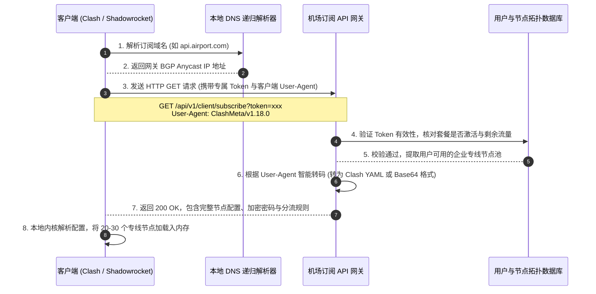
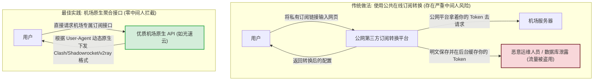
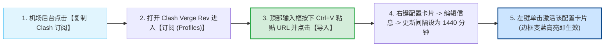
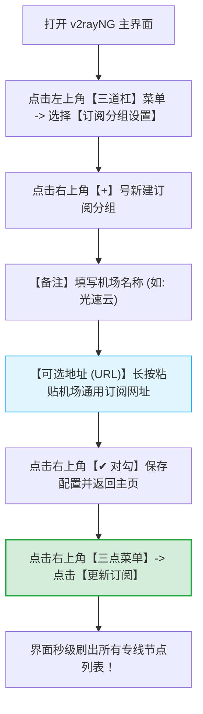
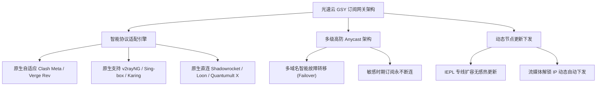

# 添加订阅教程：订阅链接一键导入与手动配置图解

<div class="answer-first-lead">
  <strong>核心结论与快速指引：</strong>将机场节点导入客户端共有两种核心路径：<strong>① 一键唤醒导入（One-Click Scheme）：在机场后台直接点击「一键导入到 Clash / 小火箭」，浏览器通过私有协议（如 <code>clash://install-config</code>）自动唤醒对应软件并全自动写入节点；② 手动复制 URL 导入：手动复制后台的「通用订阅链接」，在客户端的「配置/订阅」界面粘贴并点击拉取保存。</strong> 如果一键导入遇到浏览器无响应或安全拦截，采用手动复制 URL 导入具备 100% 的跨平台与多内核通用成功率。
</div>

<AffiliateNotice />

---

## 一、第一性原理：订阅链接的本质与 HTTP 协议交互模型

初学者常把「订阅链接」误认为是一个普通的网页或者网盘下载地址。在网络工程中，订阅链接本质上是一个**带鉴权令牌（Token）的 RESTful API 动态接口**。



### 1.1 订阅 URL 的三大组成结构剖析
一条标准的通用订阅链接通常具备以下三段核心参数：
`https://api.domain.com/api/v1/client/subscribe?token=a1b2c3d4e5f67890&clash=1`
1. **API 网关基地址 (`https://api.domain.com/...`)**：服务商部署的高防订阅分发节点，通常搭载 Cloudflare 或国内高防 CDN 以抵御流量清洗；
2. **鉴权令牌参数 (`?token=...`)**：**你的绝对私有身份凭证**。服务端根据该长字符串关联你的账户余额、流量消耗和线路权限。任何人获得该 Token 均可自由下载你的配置并偷跑你的流量；
3. **格式协商参数 (`&clash=1` 或 `User-Agent`)**：服务端利用该参数决定返回何种语法结构的配置文件（如适用于 Clash 的 YAML 格式、适用于 v2rayNG 的 Base64 编码、或适用于 Shadowrocket 的纯文本列表）。

> [!CAUTION] 凭证安全警报
> 订阅链接相当于你个人账户的通行密钥。**严禁将其截屏发送至任何技术交流群、QQ 群或公共论坛！** 如果怀疑订阅链接已被泄露，请立即登录机场后台，点击「重置订阅信息 / 重置 Token」，旧链接将即刻作废失效。

---

## 二、第三方订阅转换器的隐私泄露隐患（为什么强烈推荐原生订阅）

很多新手在面对不支持一键导入的小众客户端时，会去搜索引擎搜索「在线订阅转换器 (Subconverter)」。理解其潜在安全风险至关重要：



- **数据截留与流量偷跑**：公网免费的订阅转换网站并非公益服务，部分恶意站点会在后台脚本中静默记录提交的 Token，甚至将高价值专线节点提取转卖给他人；
- **原生接口才是正道**：像 [光速云 (GSY)](/reviews/#brand-gsy) 这类正规成熟品牌，其后台原生提供了多协议适配引擎。无论你使用 Clash Verge Rev、v2rayNG 还是小火箭，点击对应按钮下发的直接就是原生标准格式，彻底摒弃了第三方中转的安全隐患。

---

## 三、各主流平台导入实操图解与进阶配置

---

### 3.1 Windows 与 macOS：Clash Verge Rev 导入实战
Clash Verge Rev 是目前 PC 端兼容性最佳的开源客户端，推荐采用手动导入以确保 100% 成功：



#### 详细操作分解：
1. **获取链接**：登录机场用户中心，在「订阅中心」找到「Clash 订阅」，点击「复制」将其存入系统剪贴板；
2. **写入软件**：启动 Clash Verge Rev，在左侧功能导航栏点击进入 **「订阅 (Profiles)」** 页面；
3. **导入配置**：在界面顶部的文本输入框中，按下 `Ctrl + V`（macOS 用户按 `Cmd + V`）粘贴 URL，随后点击右侧的 **「导入 (Import)」** 按钮；
4. **配置自动化静默更新**：在成功下载生成的配置卡片上**单击鼠标右键**，选择 **「编辑信息」**，在弹出的窗口中将「更新间隔 (分钟)」修改为 `1440`（即 24 小时）。这样客户端每天会自动在后台静默拉取机场新增或维护的节点，免除手动折腾；
5. **激活配置**：鼠标左键单击该配置卡片，当卡片左侧或边框出现明显的高亮选中状态时，表示内核已正式加载该配置文件。

---

### 3.2 Android 安卓手机：v2rayNG 导入实战
安卓系统推荐使用轻量稳定的 v2rayNG，其「订阅分组」功能极其便于多机场管理：



---

### 3.3 iOS 苹果手机：Shadowrocket (小火箭) 导入实战
小火箭为 iOS 生态深度定制，提供了极具人性化的剪贴板智能嗅探与扫码双方案：

#### 方案一：剪贴板智能感知（推荐）
1. 在 iPhone 的 Safari 浏览器中登录机场后台，点击复制订阅链接；
2. 直接返回桌面打开 **Shadowrocket**；
3. 应用在启动瞬间会自动读取剪贴板，立即弹窗提示：*「检测到订阅链接，是否添加？」*；
4. 点击弹窗中的 **「添加」**，小火箭会在 1 秒钟内完成节点数据的下载与解析。

#### 方案二：二维码扫码直连
1. 在电脑端屏幕上打开机场后台，展示订阅二维码；
2. 打开手机 Shadowrocket，点击左上角扫描图标对准电脑屏幕；
3. 扫描成功后，小火箭全自动将节点保存为一个专属分组，操作零阻碍。

---

## 四、订阅导入失败 4 大核心报错工程级排障

如果点击导入后客户端报错或提示拉取失败，请对照以下工程排障字典迅速排查：

| 典型错误提示 | 根本物理诱因 | 工程级排障与急救指令 |
| :--- | :--- | :--- |
| **`Download Profile Failed / Timeout`** | 本地宽带对机场订阅服务器域名产生 DNS 污染或阻断 | **对策一**：手机开启移动 4G/5G 热点让电脑连接拉取；<br/>**对策二**：使用命令提示符刷新本地 DNS：`ipconfig /flushdns`；<br/>**对策三**：修改网卡首选 DNS 为 `223.5.5.5` 与 `119.29.29.29`。 |
| **`Invalid YAML format / Line xx Error`** | 机场后端下发的 YAML 包含非法中文标点，或被代理工具损坏 | 检查是否开启了其他全局抓包工具（如 Fiddler/Charles）。若无，在机场后台复制「通用订阅 (Base64)」进行导入。 |
| **`HTTP 502 / 504 Bad Gateway`** | 机场订阅网关正遭受大流量攻击或正在进行数据库割接 | 属于服务商服务端临时波动，通常在 5-15 分钟内自动恢复，稍后重新点击更新重试即可。 |
| **导入成功但节点列表为空 (0 Nodes)** | 用户套餐尚未实际入账激活，或者流量已经超额耗尽 | 登录机场后台控制台，核查当前账户状态是否处于「Active (正常)」，确认剩余流量大于 0。 |

### 4.1 终端命令行连通性测试自检
对于进阶用户，可以通过 Windows PowerShell 或 macOS Terminal 发送诊断请求，快速确认是否为客户端软件自身故障：

```powershell
# 在 PowerShell 中模拟客户端请求订阅接口 (以排除软件本身崩溃)
Invoke-WebRequest -Uri "你的订阅链接" -Headers @{"User-Agent"="ClashMeta"} -TimeoutSec 10
```
- 如果终端能够成功返回大量的节点配置文本，说明**机场服务器和网络完全正常**，问题出在客户端本地端口或配置冲突；
- 如果终端直接返回 `The operation has timed out`，说明本地物理网络到该机场的订阅服务器发生路由阻断，请切换手机热点拉取。

---

## 五、标杆服务商的原生订阅兼容性保障

选择技术实力过硬的服务商，能将上述所有繁琐报错发生的概率降至最低：



以全站首推标杆品牌 [光速云 (GSY)](/reviews/#brand-gsy) 为例，其后台订阅系统全面原生兼容四大平台客户端协议，支持智能故障容灾轮询，订阅拉取成功率达 99.9%。入门套餐月付折合约 8 元起，结账输入优惠码 `AMM` 享受专属抵扣。

---

## 六、本章小结与进阶路线

通过本篇图文，你的客户端中现在已经成功加载了服务商提供的整套节点拓扑列表。

**但是，列表中展示了数十个香港、日本、新加坡和美国节点，每个节点右侧的延迟数字各代表什么？如何进行真实有效的批量测速？看 YouTube 4K、玩游戏或者使用 ChatGPT 分别应该挑选哪个节点？**

**下一篇，我们将进入节点实操的核心技能——切换节点与延迟测速进阶攻略！**

<NextStep
  title="下一篇：切换节点与延迟测速"
  link="/tutorials/switch-nodes"
  description="教你读懂延迟毫秒数、批量执行真实握手测速并挑选最佳线路。"
  stepText="使用教程实操主线 · 第 3 步"
  buttonText="阅读节点测速与切换技巧 →"
/>
