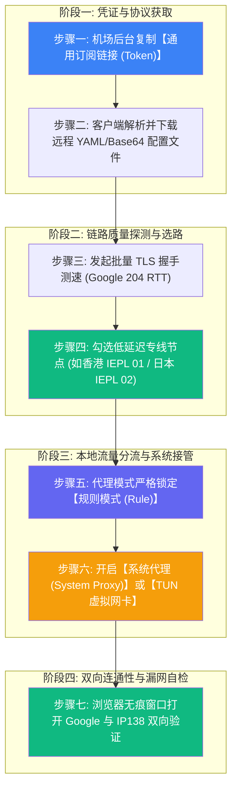
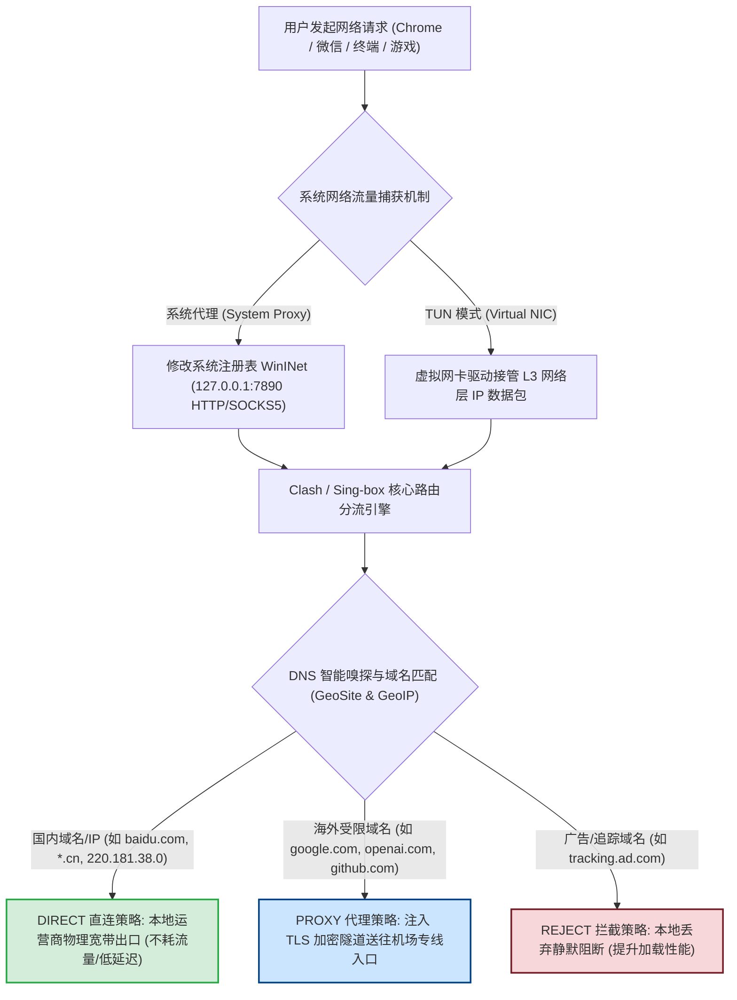
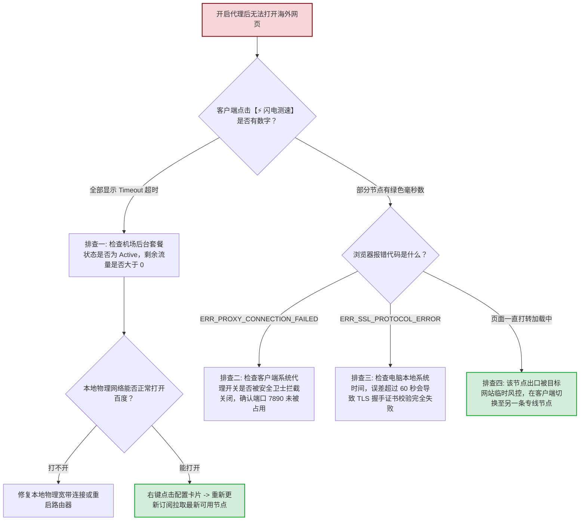

# 使用教程：从注册到连接，一步步教你用

  <strong>核心结论与标准作业流程 (SOP)：</strong>连接境外互联网的完整实操流程只需要 5 个标准步骤：<strong>① 复制机场后台的专属订阅链接 → ② 打开客户端（如 Clash Verge Rev、v2rayNG 或 Shadowrocket）点击「订阅/配置」粘贴并拉取保存 → ③ 在「代理/节点」面板执行端到端真实 TLS 握手测速 → ④ 挑选延迟在 25-60ms 的香港、日本或新加坡绿色专线节点 → ⑤ 勾选「系统代理 (System Proxy)」并将路由模式锁定为「规则 (Rule)」。</strong> 完成后在浏览器隐私无痕窗口访问 <code>google.com</code>，即可实现秒开，同时国内淘宝、微信与网银依然走本地千兆宽带直连，互不干扰。

<AffiliateNotice />

---

## 一、实操标准工作流全景图 (End-to-End SOP)

在动手输入任何命令或点击按钮之前，理解数据与控制信令的流转拓扑，能帮助你在遇到网络波动时一眼锁定故障层级：

---

## 二、第一性原理：客户端内核如何接管并分流你的网络流量？

许多初学者最常犯的错误，就是将「机场客户端」误当成普通的网页浏览器插件，或者认为开启代理后全电脑的所有软件都会强制走国外中转。深入理解底层分流原理，能彻底破除对「国内网银被盗」、「微信卡顿」或「国内流量被扣」的不必要恐慌。

### 1. 为什么一定要使用「规则模式 (Rule)」？
- **流量精准节约**：正规机场套餐均有每月流量额度（如 100GB～500GB）。在规则模式下，你下载百度网盘文件、观看腾讯视频或更新微信客户端时，流量**完全不经过机场服务器**，不消耗一分钱套餐额度；
- **国内服务零延迟**：直连流量保持本地运营商（电信、联通、移动）的最短物理拓扑，不会绕道海外香港或日本，杜绝外卖定位错误、微信语音卡顿或银行登录弹风险验证；
- **海外服务高可用**：被墙或访问缓慢的境外学术、工作、流媒体流量，自动被路由引擎匹配并送入专线隧道，享受毫秒级响应。

---

## 三、各主流平台操作细则拆解 (Windows / macOS / Android / iOS)

无论你使用哪种操作系统，核心逻辑完全一致，但在操作系统底层权限接管上略有差异：

### 3.1 Windows 与 macOS 平台：以 Clash Verge Rev 为例
1. **获取专属配置**：登录机场官网后台（如[光速云](/reviews/#brand-gsy)），进入「订阅中心」，点击「复制 Clash 订阅链接」；
2. **导入配置**：启动 Clash Verge Rev，点击左侧导航栏的「**订阅 (Profiles)**」页面，在顶部地址栏按下 `Ctrl+V` (macOS 为 `Cmd+V`) 粘贴，点击「**导入 (Import)**」；
3. **设置自动静默同步**：右键点击刚导入的卡片，选择「编辑信息」，将「更新间隔」改为 `1440` 分钟（24 小时），这样节点发生变动时软件会自动同步，无需人工维护；
4. **选择出口专线**：进入左侧「**代理 (Proxies)**」面板，点击右上角「⚡ 闪电图标」批量测速，鼠标左键选择延迟低于 50ms 的绿色节点（如 `香港 IEPL 01` 或 `日本 IEPL 01`）；
5. **开启接管**：返回主面板或左侧设置，勾选打开「**系统代理 (System Proxy)**」开关，此时任务栏右下角小猫图标变为彩色，代表系统代理已成功注入。

### 3.2 Android 安卓手机平台：以 v2rayNG / FlClash 为例
1. **添加分组**：打开 v2rayNG，点击左上角侧边栏菜单进入「**订阅分组设置**」；
2. **输入链接**：点击右上角「+」号，备注填写机场名称（如 `光速云`），可选地址粘贴通用订阅链接，点击右上角保存；
3. **全量拉取**：返回软件主页，点击右上角三点菜单，选择「**更新订阅**」，界面将在 1 秒内整齐刷出所有线路；
4. **真连接测速与启动**：再次点击右上角三点菜单，选择「测试全部配置真连接延迟」，挑选绿色低延迟节点后，点击右下角圆形的「V」字启动按钮。系统弹窗询问「网络连接请求」时，点击「确定」允许创建本地 VPN 通道。

### 3.3 iOS 苹果手机平台：以 Shadowrocket (小火箭) 为例
1. **剪贴板秒识**：在 Safari 浏览器中登录机场后台复制订阅链接，随后直接切回 Shadowrocket 应用；
2. **自动弹窗导入**：应用会自动检测剪贴板内容，弹出「检测到订阅链接，是否添加？」，点击「添加」即可完成自动解析；
3. **全局路由设为配置**：在主界面确认「全局路由」处于「**配置 (Config)**」状态（相当于 PC 端的规则模式），千万不要误切为「代理 (Proxy)」；
4. **一键连接**：点击顶部的连通性测试，点选绿色专线节点，拨动最上方的主开关。初次使用时 iOS 会弹出系统安全密码确认框，输入锁屏密码允许安装 VPN 描述文件即可。

---

## 四、四大核心代理模式工程级深度对比

90% 的初学者在连接后反馈「微信发不出图片」、「淘宝经常弹滑块验证码」或「流量一天就用光了」，根本原因都是错误选择了全局模式。

| 代理模式名称 | 核心路由决策逻辑 | 本地流量消耗 | 适用业务场景 | 新手避坑指引 |
| :--- | :--- | :--- | :--- | :--- |
| **规则模式 (Rule)** ⭐ | 基于域名后缀与 IP 数据库智能判定，国内直连、海外加速 | **仅海外流量计费**，国内完全免费 | 99% 的日常科研、学习、社交与娱乐 | **【日常默认锁定】** 永远不要随便更改 |
| **全局模式 (Global)** | 绕过所有规则引擎，将本机所有流量无差别压入海外节点 | **全量消耗**，看国内腾讯视频也扣流量 | 海外极其冷门网站未收录入规则库时临时应急 | 应急排障后必须立刻切回规则模式 |
| **直连模式 (Direct)** | 彻底绕过所有代理节点，所有流量均走本地物理宽带 | **0 消耗** | 本地千兆宽带下载大文件或进行局域网投屏调试 | 此时海外网站将全部无法访问 |
| **TUN 模式 (网卡级)** | 通过虚拟网络适配器接管 L3 网络层，拦截所有底层 Socket | 依然严格遵循所选分流规则 | 命令行工具 (Git/Docker)、外服游戏低延迟加速 | 进阶开发者与游戏玩家按需开启 |

---

## 五、首次连接双向连通性严谨检验规范 (防伪防假连)

配置完成后，切忌盲目相信客户端上的「已连接」字样。必须按照以下两组独立测试确认代理与分流的绝对有效性：

### 5.1 海外链路连通性验证
1. 打开浏览器，按下快捷键 `Ctrl + Shift + N` (Windows) 或 `Cmd + Shift + N` (Mac) 打开**全新的无痕/隐私窗口**；
2. 在地址栏输入 `https://www.google.com` 并按下回车；
   - **通过标准**：页面秒级载入，搜索框居中展示，输入任意英文关键词能够瞬间返回搜索结果；
   - **异常表现**：如果提示 `ERR_CONNECTION_TIMED_OUT` 或 `ERR_PROXY_CONNECTION_FAILED`，说明系统代理端口占用或节点未成功握手。

### 5.2 国内分流与 DNS 泄露验证
1. 在无痕窗口中访问国内权威 IP 查询网站：`https://ip138.com`；
   - **通过标准**：显示的 IP 地址必须依然为你本地真实的宽带运营商 IP（如「中国电信 · 广东广州」），这证明国内流量**未被代理绕路**，规则分流完全正确；
2. 访问海外匿名度检测网站：`https://whoer.net`；
   - **通过标准**：显示的出口地理位置为你所选择的节点属地（如 Hong Kong / Tokyo），DNS 服务器列表无中国大陆运营商地址，伪装度通常在 90% 以上。

---

## 六、网络故障排障决策树 (Troubleshooting Decision Tree)

当你按照步骤操作却打不开网页时，请按照以下标准工程排障树逐级定位：

---

## 七、日常使用习惯与避坑安全法则

### 7.1 正确退出软件，防止「关掉软件后打不开国内网页」
许多初学者经常遭遇一个诡异故障：*「我不用代理了，直接在任务栏把软件 X 掉了，为什么电脑连百度都打不开了？」*
- **故障根因**：直接杀掉客户端后台进程，会导致 Windows 底层注册表中的系统代理开关仍处于「开启」状态（指向 `127.0.0.1:7890`）。而此时本地代理服务已经被杀死了，浏览器所有的网络请求被转发给一个不存在的空端口，因此连国内网页也会报错；
- **标准退出规范**：
  1. 先在客户端界面内，**手动点击关闭「系统代理」开关**；
  2. 然后在系统右下角托盘图标处，右键点击图标选择「退出 (Quit)」；
- **10秒急救药方**：如果不小心强退导致断网，按快捷键 `Win + S` 搜索「代理设置」→ 找到「手动设置代理 / 使用代理服务器」→ 将开关手动扳到「**关**」即可瞬间恢复网络。

### 7.2 优质专线服务商推荐与首单优惠
整个使用体验是否省心，底层 80% 取决于服务商线路架构的稳定性与订阅 API 的健壮度：

| 推荐品牌 | 月付起步价 | 线路质量 | 节点数量与地区 | 专属新手优惠码 | 快速通道 |
| :--- | :--- | :--- | :--- | :--- | :--- |
| **[光速云 (GSY)](/reviews/#brand-gsy)** | **约 8 元/月** | **企业级 IEPL 双线路架构** | 11 地区 / 4K 秒开 | **`AMM` (立减)** | [直达光速云评测与注册](/reviews/#brand-gsy) |
| **[飞猫云](/reviews/#brand-feimao)** | 7 元/月 | IEPL 专线 | 亚太热门节点 | `flycat888` | [直达飞猫云评测](/reviews/#brand-feimao) |
| **[微风网络](/reviews/#brand-weifeng)** | 7 元/月 | IEPL 专线 | 亚太与欧美节点 | `flat888` | [直达微风网络评测](/reviews/#brand-weifeng) |

> [!TIP] 新手首选方案
> 强烈建议新手第一单选择 [光速云 (GSY)](/reviews/#brand-gsy)，输入优惠码 `AMM` 享受首单优惠。其企业级 IEPL 专线晚高峰从不降速，且后台自带全自动一键导入脚本，极大简化新手的上手门槛。

---

## 八、本章小结与系统化学习路径

通过本篇教程，你已经建立起了从「订阅配置导入」、「节点批量测速」、「分流规则锁定」到「连通性双向检验」的完整实操闭环。

**接下来，我们将针对每一个细分环节展开更深入的图文拆解：** 从挑选第一份靠谱月付套餐、到解决各种疑难杂症的完整指南，请按照下方引导有序阅读：

<NextStep
  title="第一步：账号注册与套餐挑选实战"
  link="/tutorials/register-purchase"
  description="详细演示正规机场官网的邮箱注册、月付套餐选择、优惠码核销与安全扫码结算全流程。"
  stepText="使用教程实操主线 · 第 1 步"
  buttonText="阅读注册与订购指南 →"
/>
