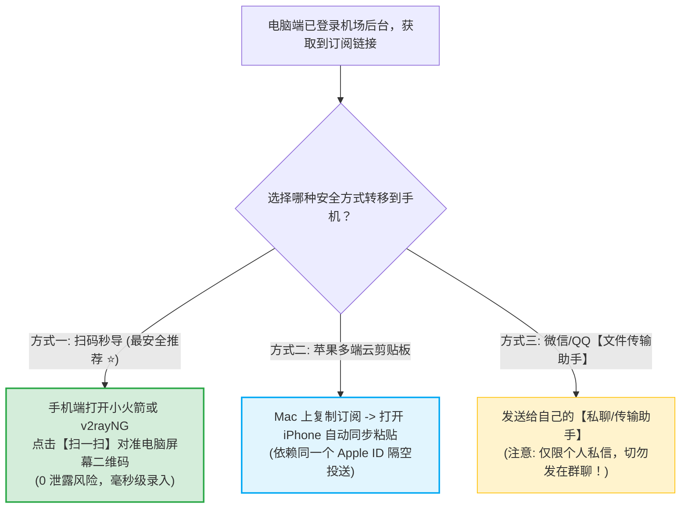
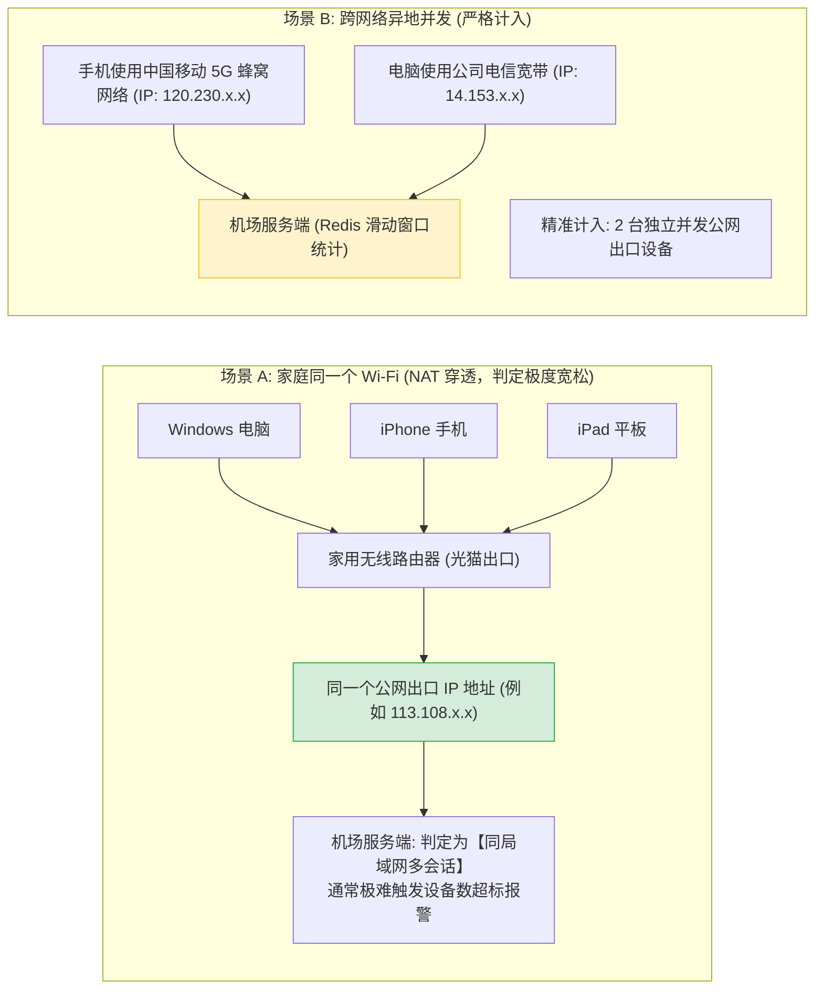
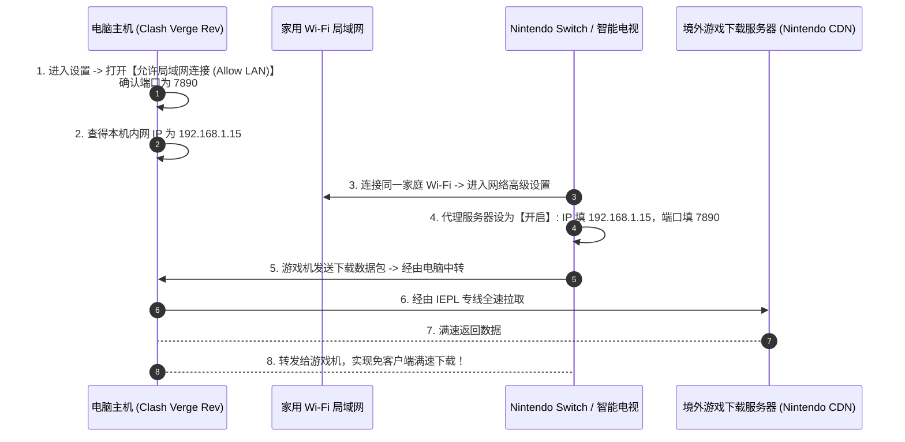
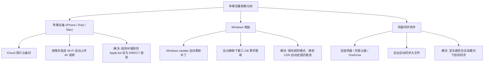

# 多设备同步：跨电脑与手机使用同一订阅与并发限制

<div class="answer-first-lead">
  <strong>核心结论与共享原则：</strong>个人拥有 iPhone、安卓备用机、Windows 笔记本和 iPad，<strong>完全可以通过同一个机场订阅实现全设备覆盖，绝不需要重复花钱购买多份套餐！</strong>绝大多数商业机场均允许 <strong>2 到 5 台设备同时并发在线</strong>。标准实操方法是：<strong>将同一个订阅 URL 分别导入各设备的独立客户端中，全平台共享该套餐的总流量池；对于 Switch、PS5、Apple TV 或开发板等无法安装客户端的设备，只需在电脑客户端开启「允许局域网连接 (Allow LAN)」，即可秒变内网中转网关。</strong>
</div>

<AffiliateNotice />

---

## 一、跨设备同步订阅的 3 种安全传输姿势

在将电脑端的订阅转移到手机或平板时，许多新手习惯将私有订阅链接发到微信聊天群或 QQ 空间，这极易造成 Token 泄露被他人盗刷。



---

## 二、第一性原理：机场服务端如何判定「多设备并发」？

很多用户常问：「机场写着限制 3 台设备，如果我手机连着公司 Wi-Fi，电脑连着家里宽带，算几台设备？」理解服务端的并发判定算法（IP-Hash 与 Redis 滑动窗口）能让你合理避险：



### 2.1 设备数超出上限会发生什么？
如果你的套餐限制 3 台设备，但同时有 4 台设备在看 4K 视频，服务端通常会采取以下两种工程策略之一：
- **旧连接挤掉 (Session Kicked)**：最先发起连接的设备会自动断开几秒钟，直到其他设备释放连接；
- **临时主动丢包限速**：超标设备会出现短暂的无法解析或延迟变高。

### 2.2 严厉警示：严禁跨城市与陌生人合租！
有些用户为了省钱，把订阅链接分享给不在同一个城市的网友。现代机场后端均部署了**异地同时心跳风控检测**：
> 如果系统检测到同一个账号在同一分钟内，既有来自北京电信的流量在看 YouTube，又有来自广州联通的流量在刷推特，系统会直接将其判定为**凭证遭到黑产盗刷或违规转售**，自动执行封号且无法退款！

---

## 三、免装客户端设备：电脑客户端「局域网共享 (Allow LAN)」实操

家里的 Nintendo Switch、PlayStation 5、Apple TV 或小度智能音箱无法直接安装 Clash 软件，但更新游戏或下载外服 DLC 极慢。只需让处于同一 Wi-Fi 下的电脑化身「代理发射塔」：



### 3.1 详细图文操作步骤
1. **电脑主机端设置**：
   - 打开 Clash Verge Rev，进入左侧「设置 (Settings)」；
   - 找到 **「允许局域网连接 (Allow LAN)」**，将其开关滑动打开；
   - 记下下方的 **混合端口 (Mixed Port)**，默认为 `7890`；
2. **获取电脑主机的局域网 IP**：
   - 键盘按下快捷键 `Win + R` 输入 `cmd` 回车；
   - 输入 `ipconfig` 回车，找到当前无线网卡的 **IPv4 地址**（例如 `192.168.1.15`）；
3. **从机端设置 (以 Switch / 电视为例)**：
   - 进入网络连接设置，代理服务器选择「启用」；
   - 服务器填入电脑 IP（如 `192.168.1.15`），端口填入 `7890`，保存连接即可！

### 3.2 防火墙放行与 SOCKS5 安全认证
如果在其他设备上填入电脑 IP 后依然连不上，90% 是 Windows 防火墙拦截了入站连接。可在管理员 PowerShell 中执行以下命令快速放行：
```powershell
netsh advfirewall firewall add rule name="Clash_LAN" dir=in action=allow protocol=TCP localport=7890
```
如果在公司或公共合租公寓网络下共享，建议在 Clash 配置文件中增加 `authentication` 账号密码认证，防止局域网内其他邻居蹭用你的流量。

### 3.3 跨平台终端开发者环境变量配置 (WSL2 / Linux 从机)
如果你在副机上跑 Linux 虚拟机或 WSL2，可以直接通过环境变量将命令行所有出口重定向至主力机的局域网代理：
```bash
# 在 Linux 从机终端执行 (假设主力机 IP 为 192.168.1.15)
export http_proxy="http://192.168.1.15:7890"
export https_proxy="http://192.168.1.15:7890"
export all_proxy="socks5://192.168.1.15:7890"

# 验证连通性
curl -I https://www.google.com
```

---

## 四、多设备协同核心防坑：防止苹果 iCloud 与系统更新偷跑流量

多台设备共用一个订阅时，最容易出现的情况是「明明白天没怎么用，晚上睡觉时几十 G 流量突然被扣光」。



### 4.1 移动蜂窝网络下的 iOS 自动化省电/省流优化
在 iPhone 上，可以通过 iOS 自带的「快捷指令」App 或 Shadowrocket 的「按需连接 (On-Demand)」功能创建自动化规则：
- **按需连接策略 (On-Demand Rules)**：配置仅在发起未受限境外域名查询时唤醒底层 Network Extension，在本地局域网或待机锁屏状态下自动休眠代理通道，显著降低后台电量开销；
- **Wi-Fi 白名单自动旁路**：当手机接入家庭或企业受信任 Wi-Fi 时，通过快捷指令自动化切换为特定的分流方案，在离开 Wi-Fi 切换为 5G 移动蜂窝时自动断开代理或切换为低功耗节点，不仅大幅延长 iPhone 续航 2-3 小时，还能杜绝手机在后台静默同步导致流量超标。

---

## 五、多设备支持标杆专线推荐

不同服务商在多设备并发限制上的宽容度差异显著：

| 品牌名称 | 允许设备并发数 | 基础月流量 | 专线架构 | 多端协同体验评级 | 快速传送门 |
| :--- | :--- | :--- | :--- | :--- | :--- |
| **[光速云 (GSY)](/reviews/#brand-gsy)** | **多设备并发支持** | **100 GB - 500 GB** | **企业级 IEPL 双线路** | **⭐⭐⭐⭐⭐ (首推)** · 手机电脑同时追剧 0 互挤 | [直达评测与折扣](/reviews/#brand-gsy) |
| **[飞猫云](/reviews/#brand-feimao)** | 2-3 台常用并发 | 100 GB | IEPL 专线 | ⭐⭐⭐⭐☆ · 个人双机（手机+笔电）高性价比 | [直达评测与折扣](/reviews/#brand-feimao) |
| **[WgetCloud](/reviews/#brand-wgetcloud)** | 商务级多终端连接 | 大流量团队配额 | 顶级华为云专线 | ⭐⭐⭐⭐⭐ · 跨国团队协同与外贸办公标杆 | [直达评测与折扣](/reviews/#brand-wgetcloud) |

> [!TIP] 选型小结
> 选用 [光速云 (GSY)](/reviews/#brand-gsy)，在结账输入优惠码 `AMM` 享受专属立减。其双线路企业架构对个人多设备并发具有极其宽松的调度策略，能保证手机、平板与笔记本三端同时在线不掉线、不卡顿。

---

## 六、本章小结与进阶路线

掌握了多设备同步与局域网代理共享技巧，你的手机、电脑和家庭数码设备已经形成了一套有机的网络整体。

但在日常使用中，**很多玩家调优了精细的分流规则、保存了上百个节点的测速分组；如果遇到电脑重装系统、换新手机或者手抖误删了软件，如何一秒完整备份并恢复这些配置？**

**下一篇，我们将进入配置备份与跨设备迁移指南！**

<NextStep
  title="下一篇：配置备份与换机恢复"
  link="/tutorials/backup-restore"
  description="导出自定义分流规则与配置备份，在新设备上一键导入即用。"
  stepText="使用教程实操主线 · 第 8 步"
  buttonText="阅读配置备份与恢复指南 →"
/>
