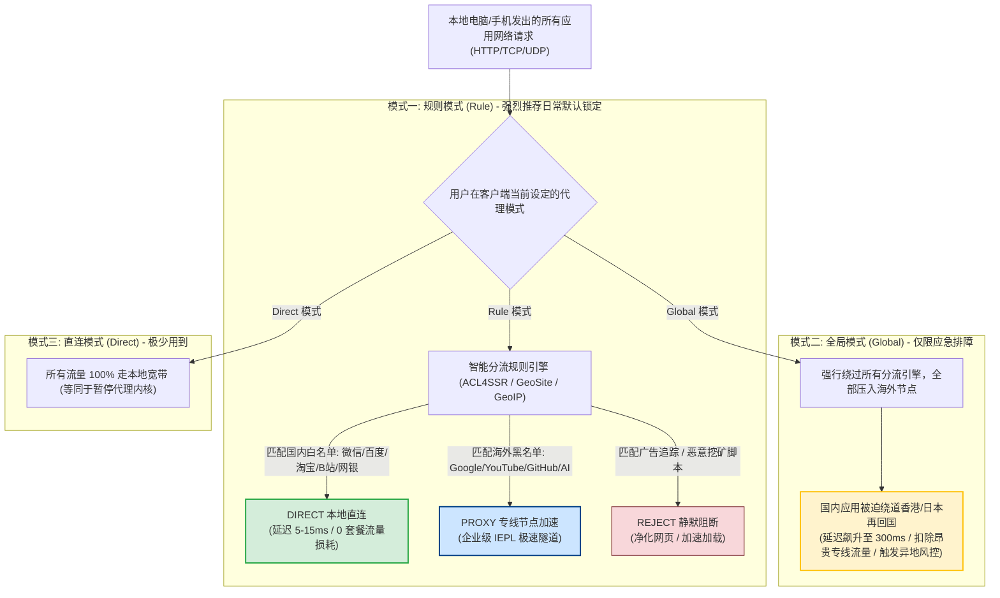
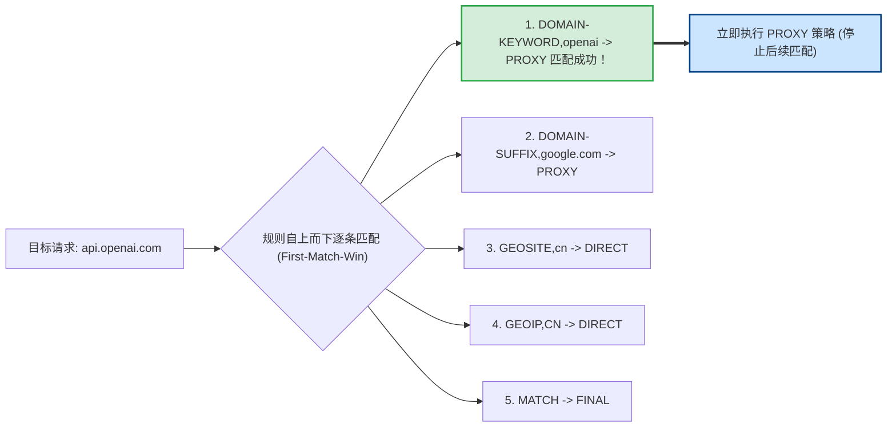
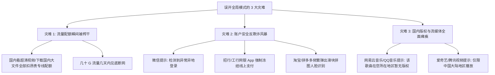
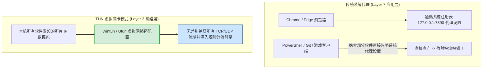

# 选择代理模式：规则 (Rule) 与全局 (Global) 的实战场景

  <strong>核心结论与模式锁定法则：</strong>在现代代理客户端的模式选择中，<strong>99% 的日常使用时间请务必牢牢锁定在【规则模式 (Rule)】！</strong>该模式利用内核内置的 GeoSite 与 GeoIP 规则字典实现智能分流：<strong>访问微信、淘宝、百度时自动走本地物理千兆宽带满速直连，不耗费一分钱机场流量；访问 Google、YouTube、ChatGPT 时自动无感切换到专线加速。</strong> 只有在遇到极冷门海外小众学术网站因规则遗漏打不开时，才【临时】切换为「全局模式 (Global)」应急排查，用完后必须立刻切回规则模式。

<AffiliateNotice />

---

## 一、三大代理模式底层路由拓扑全景图 (Routing Pipeline)

理解数据包在不同模式下的具体流向与匹配流水线，能让你彻底明白为什么「误开全局模式」会导致严重的网络反噬与流量损失：

---

## 二、第一性原理：分流规则引擎的底层匹配算法与 Fake-IP 机制

许多初学者以为「规则」只是一个简单的黑白名单文本文件。在网络底层，Clash 与 Sing-box 内核采用的是**前缀树 (Trie Tree) 算法与基数树 (Radix Tree)** 进行高速包匹配：

### 2.1 规则优先级的工程裁决顺序 (First-Match-Win)
内核判定一个网络请求究竟走直连还是走代理，遵循**严格的自上而下首条匹配生效原则**：
1. **精确域名匹配 (DOMAIN)**：如 `DOMAIN,www.taobao.com,DIRECT`，只要完全一致立即放行；
2. **域名后缀匹配 (DOMAIN-SUFFIX)**：如 `DOMAIN-SUFFIX,apple.com,DIRECT`，所有以 apple.com 结尾的二级、三级子域名全部分流；
3. **域名关键词匹配 (DOMAIN-KEYWORD)**：如 `DOMAIN-KEYWORD,google,PROXY`，包含关键词即走代理；
4. **地理域名数据库 (GEOSITE)**：包含数万条国内大厂官方维护的域名清单（如 `GEOSITE,CN,DIRECT`）；
5. **地理 IP 地址段 (GEOIP)**：当域名未命中上述任何规则时，内核会对其进行 DNS 解析，如果得到的 IP 属于中国大陆 IP 地址段（`GEOIP,CN`），则执行 `DIRECT` 本地直连；
6. **最终兜底匹配 (MATCH)**：若以上全部未命中，执行预设的兜底策略（通常指向代理或直连）。

### 2.2 Fake-IP 虚拟地址池与防污染黑科技
现代客户端默认采用 `fake-ip` 模式（分配 `198.18.0.0/16` 的虚拟保留网段）：
- 当你访问 `google.com` 时，本地内核**根本不把请求发往本地运营商 DNS**，而是瞬间在本地字典中为 `google.com` 映射一个虚构的 IP（如 `198.18.0.23`）并立刻返回给浏览器；
- 浏览器拿着这个虚构 IP 建立 TCP 连接，数据包被本地虚拟网卡抓取后，由客户端将原始域名打包在 TLS 隧道内直接送往海外出口节点；
- **海外节点在境外发起真实的权威 DNS 解析**。这种机制**彻底在物理层面上斩断了国内运营商的 DNS 污染与劫持**，将域名解析耗时直接降至 0ms。

---

## 三、模式全景特性与应用场景深度横评

| 模式名称 | 流量计费机制 | 国内应用受影响程度 | 核心优势 | 潜在弊端与风险 | 推荐适用场景 |
| :--- | :--- | :--- | :--- | :--- | :--- |
| **规则模式 (Rule)** ⭐ | **仅境外流量扣除套餐配额** | **0 影响**，国内 IP 保持不变，应用不报异地登录 | 全自动化分流、智能省电省流量、无需手动切换 | 极少数新上线小众网站可能被误判直连 | **99% 的日常学习、跨国办公与娱乐追剧** |
| **全局模式 (Global)** | **所有流量（包括国内应用）均扣配额** | **极度严重**：微信/淘宝弹异地报警，网银人脸识别风控 | 暴力接管所有流量，绝对不会发生分流漏网 | 国内网站慢如蜗牛；看爱奇艺扣除几十 G 流量 | **临时排查某个特殊小众学术网站能否访问** |
| **直连模式 (Direct)** | 0 扣除（完全不走代理） | 0 影响 | 恢复最纯粹的原生宽带状态 | 无法访问任何海外受限站点 | 本地下载 50GB 国内大型游戏安装包时临时使用 |
| **TUN 模式 (网卡级)** | 遵循所选的规则或全局逻辑 | 取决于底层配置 | 突破传统 HTTP 代理限制，接管命令行与游戏 | 需安装系统级驱动，配置门槛稍高 | 外服游戏联机对战、命令行 `git/npm` 依赖下载 |

---

## 四、误开「全局模式」的三大惨痛灾难

许多新手以为「全局」听起来比「规则」更强大、更稳妥，长期将客户端停留在 Global 模式，结果付出惨痛代价：

### 真实生产级血泪事故复盘
- **案例背景**：某外贸从业者在电脑上开启「全局模式 (Global)」后，顺手挂机下载国内某办公软件安装包和百度网盘数据（约 80GB）；
- **事故恶果**：该用户本以为跑的是家中千兆宽带，但实际上这 80GB 流量全部经由香港 IEPL 商业专线绕道下载。不仅下载速度被限制在机场专线带宽峰值，而且直接刷爆了本应使用一个月的 100GB 机场月度流量，导致当晚关键外贸业务直接停摆。

---

## 五、进阶场景：TUN 虚拟网卡模式的工程定位

在 Clash Verge Rev 或 Sing-box 中，你常会看到一个名为 **TUN 模式** 的独立开关。它与「规则/全局」并不是对立关系，而是**网络接管层次的互补**：

### TUN 模式核心应用场景：
1. **开发者命令行工具**：解决在终端中执行 `git clone`、`npm install`、`docker pull` 总是超时报错的顽疾；
2. **外服游戏联机加速**：解决 Steam、Epic、Apex 英雄等基于非标准 UDP 协议通信的外服游戏无法被传统 HTTP 代理捕获的问题；
3. **虚拟机与 WSL 容器**：无缝为本地 VMware、VirtualBox 或 Windows Subsystem for Linux (WSL2) 提供透明代理支持。

---

## 六、标杆专线服务商的分流规则支持度

分流规则是否完善，很大程度上取决于服务商提供的配置文件质量：

| 评估维度 | 劣质二道贩子配置 | [光速云 (GSY)](/reviews/#brand-gsy) 企业级配置 |
| :--- | :--- | :--- |
| **规则库版本** | 简陋过时的千行老规则，漏判率高 | **内置权威 ACL4SSR / GeoSite 现代精细分流库** |
| **国内直连命中率** | 很多国内小众 CDN 误走代理 | **99.9% 精准覆盖国内所有主流互联网服务** |
| **流媒体策略组** | 无细分，全部混在一个大池子 | **独立提供 YouTube、Netflix、ChatGPT 专属策略分流组** |
| **规则更新频率** | 几个月不维护一次 | **跟随官方 GitHub 规则库高频动态同步** |

> [!TIP] 选型小结
> 选用 [光速云 (GSY)](/reviews/#brand-gsy) 作为主力，在结账输入优惠码 `AMM` 享受折扣。其下发的规则订阅默认已锁定最优的「规则模式 (Rule)」，无需小白手动折腾编写复杂的分流规则，真正做到开箱即用。

---

## 七、本章小结与进阶路线

现在你已经深刻理解了三种代理模式的分工与陷阱，日常使用时只要将模式锁定在「Rule 规则模式」，就能兼顾速度、省电与资金安全。

但随着时间的推移，**机场服务商可能会新增更快速的节点，或者因网络维护调整节点 IP**。**如果几个月不更新订阅，客户端里的节点全失效了该怎么办？如何让软件每天在后台全自动静默同步最新节点？**

**下一篇，我们将进入订阅自动更新设置与节点日常维护全攻略！**

<NextStep
  title="下一篇：订阅自动更新设置"
  link="/tutorials/update-subscription"
  description="配置 24 小时后台静默自动更新与手动强制更新，节点永不落伍失效。"
  stepText="使用教程实操主线 · 第 6 步"
  buttonText="阅读订阅自动更新教程 →"
/>
