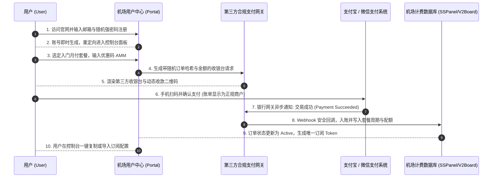
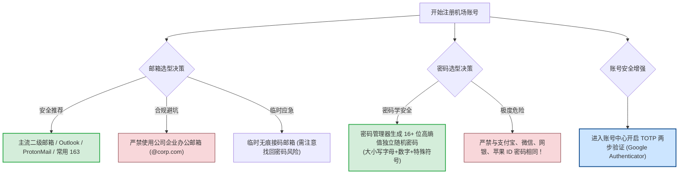
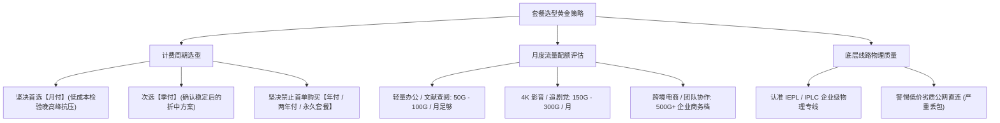
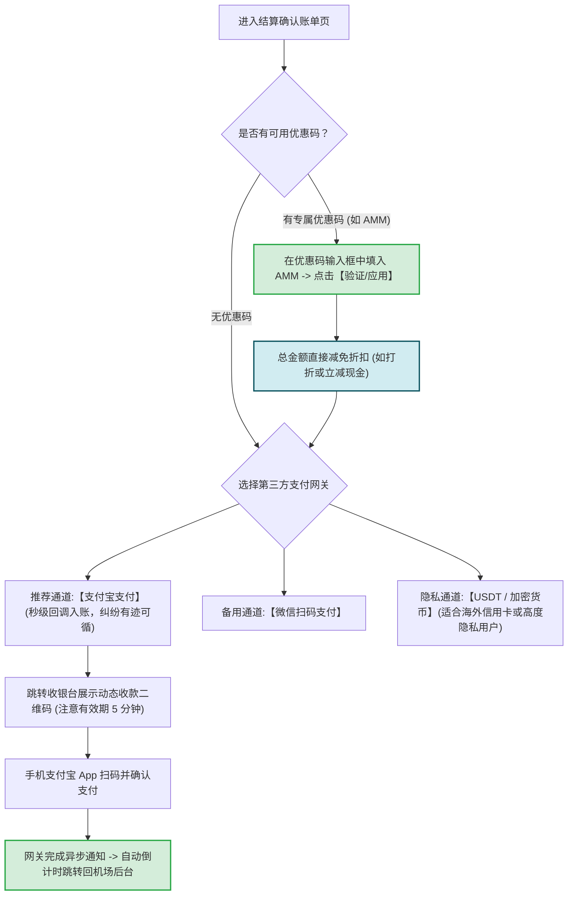
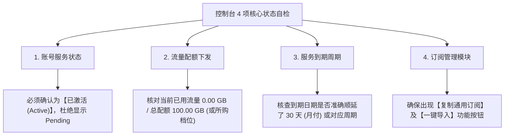

# 注册与购买教程：账号注册、套餐挑选与安全支付演示

  <strong>核心结论与快速指引：</strong>在正规机场官网购买服务，标准流程分为严谨的 5 个步骤：<strong>① 使用常用二级邮箱完成账号注册（强烈建议生成 16 位以上独立强密码，开启 2FA 双重认证）→ ② 坚决选择「月付」或「轻量体验档」，避开高风险长期年付圈钱陷阱 → ③ 在结算页面输入可用优惠码（如光速云专属优惠码 <code>AMM</code>）核销立减 → ④ 使用支付宝/微信扫码支付并等待 5-10 秒网关异步回调确认 → ⑤ 登录用户控制台确认订单状态变为「已激活 (Active)」并核对月度流量配额与到期时间。</strong> 遵循本指南，可彻底规避黑作坊圈钱跑路、重复扣款与个人核心资产泄露风险。

<AffiliateNotice />

---

## 一、机场注册与订购全景流程图 (Sequence Architecture)

在动手操作前，先通过标准时序图看清资金流向、账单结算与订阅 Token 凭证的底层流转路径：

---

## 二、第一阶段：账号注册与隐私安全工程级防御

在注册机场账号时，许多新手习惯性地使用日常核心网银密码或主力社交密码，这在非监管的灰区网络服务中是**极其危险的禁忌**。由于部分中小型机场运维水平有限，一旦发生数据库泄漏，黑客极易利用撞库攻击窃取你的其他核心资产。

### 2.1 账号与密码三大安全防护铁律
1. **密码绝不复用（撞库物理隔离）**：中小型机场数据库即便采用 bcrypt/argon2 哈希加密，也不能排除低端面板出现明文存储或内部越权漏洞。**切勿使用任何日常核心密码**，务必借助 Bitwarden、1Password 或浏览器自带密码生成器创建专属随机口令；
2. **坚决避开企业办公邮箱**：部分企业邮箱（如企业微信绑定域名、公司 Exchange 邮箱）会对入站邮件的主题与发信 IP 进行审计与合规抓包。使用公司邮箱注册此类服务，极易触发公司内部信息安全部门的安全合规警报；
3. **开启 TOTP 动态两步验证**：正规机场面板（如基于 V2Board/New-V2Board 开发的用户中心）均在「个人中心」提供 Google Authenticator 二步验证绑定。开启后，即使他人意外获取了你的密码，没有手机动态 6 位验证码依然无法登录并篡改你的订阅设置。

---

## 三、第二阶段：套餐选型黄金法则（防踩坑与财务风险隔离）

登录后台后，点击左侧导航栏的 **「购买订阅」** 或 **「商店」**，通常会看到 3-5 档不同资费与流量规格的套餐：

### 3.1 为什么第一单绝对不要买年付？（带宽成本数学模型）
很多不良小作坊为了迅速沉淀资金跑路，会推出极具诱惑力但完全违背商业逻辑的定价：「月付 20 元，年付只要 58 元！两年付只要 88 元送永久 VIP！」。

从第一性原理来看，一条正规的跨国物理专线（如深圳到香港的 IEPL 商业专线），每 1Gbps 的月租物理带宽采购成本高达数万元人民币。如果一个平台允许大量用户以极低的价格购买年付或无限流量：
- **必然结果一：网络严重超售**。晚高峰（20:00 - 23:00）所有用户抢占有限的专线管道，丢包率瞬间飙升至 40% 以上，4K 视频无法播放，甚至网页都无法正常加载；
- **必然结果二：跑路沉淀资金**。由于收上来的年费无法覆盖持续运营的专线服务器租金，运营方往往在运营 3 到 6 个月、吸纳足够多小白的年费后，突然无预警拔线关站，换个新域名重新开业。

> [!IMPORTANT] 资金安全红线
> **第一单务必坚持月付！** 花 7 到 15 元体验一个月，重点测试连续几天晚高峰的流畅度、节假日敏感时期的节点恢复速度以及在线工单的客服响应水平。确认完全可靠后，再考虑季付或半年付以获取合理折扣。

### 3.2 真实套餐参数参照表（以光速云为例）

| 套餐级别 | 月均资费 | 基础月流量 | 线路架构 | 支持并发设备 | 适合日常使用场景 |
| :--- | :--- | :--- | :--- | :--- | :--- |
| **入门轻量版** | **约 8 元/月** | **100 GB** | **企业级 IEPL 双专线** | 2-3 台 | **90% 新手首选** · 查资料、刷推、偶尔看 4K 视频 |
| **标准进阶版** | 约 16 元/月 | 200 GB | 企业级 IEPL 双专线 | 3-5 台 | 追剧党、重度 YouTube/Netflix 4K 用户 |
| **大流量商务版** | 约 32 元/月 | 500 GB | 顶级 BGP 专线多入口 | 5+ 台 | 跨境电商、多台设备共享与团队协同 |

---

## 四、第三阶段：优惠码核销与安全结算实操

选定套餐点击「下单」后，系统会生成一份预结算账单：

### 4.1 优惠码输入与核销技巧
1. 在结算页找到 **「Promo Code / 优惠码 / 折扣码」** 文本框；
2. 输入本站专属核销码（例如购买 [光速云 (GSY)](/reviews/#brand-gsy) 时输入 `AMM`）；
3. 点击右侧「验证 / 兑换」按钮，确认账单明细中的「实付金额」已经发生相应减扣，核对无误后再点击确认结算。

### 4.2 扫码支付常见异常与工程急救
- **扫码支付成功后，网页没有自动跳转，仍然显示未付款？**
  - **原因**：这是因为第三方支付通道的 Webhook 异步回调遇到网络延迟或握手堵塞；
  - **应急处理**：**坚决不要重复扫码付款！** 请直接刷新当前页面，或者在左侧菜单点击「我的账单 / 订单列表」。如果订单状态已经变成「已支付」或「已激活」，说明系统已经入账。若超过 5 分钟仍未到账，将支付宝交易订单号（截屏保留商户单号）通过后台工单发送给客服，技术人员可在后台 1 分钟内手动为你手动入账；
- **收款方名称为什么是「某某网络技术」、「数码科技」或「日用百货」？**
  - **原因**：由于行业特殊性，机场服务商普遍接入的是综合合规第三方发卡网关或商业聚合收银台。商户名称为聚合支付通道的代理公司属于行业常态，不影响你的套餐激活与资金安全。

---

## 五、第四阶段：订单激活与控制台状态自检清单

支付成功并跳转回用户中心后，请花 30 秒完成以下四步核心自检，确保权益 100% 完整交付：

如果在自检中发现任何一项异常（例如金额已扣除但订单显示超时取消），无需惊慌，立即进入后台的「工单管理」发起服务单，附上支付宝账单详情截图即可获得快速补单。

---

## 六、主流高品质专线品牌横向评测与选型指南

如果你尚未决定在哪个平台下单，参考以下经过稳定性多维度考验的服务商矩阵：

| 品牌名称 | 月付体验门槛 | 线路架构 | 支付方式支持 | 专属新手优惠码 | 快速直达评测 |
| :--- | :--- | :--- | :--- | :--- | :--- |
| **[光速云 (GSY)](/reviews/#brand-gsy)** | **约 8 元/月** | **企业级 IEPL 专线 (双线路架构)** | 支付宝 / 微信 | **`AMM` (专属立减)** | [直达官网注册与评测](/reviews/#brand-gsy) |
| **[飞猫云](/reviews/#brand-feimao)** | 7 元/月 | IEPL 专线 | 支付宝 | `flycat888` | [直达官网注册与评测](/reviews/#brand-feimao) |
| **[微风网络](/reviews/#brand-weifeng)** | 7 元/月 | IEPL 专线 | 支付宝 | `flat888` | [直达官网注册与评测](/reviews/#brand-weifeng) |
| **[大佬云](/reviews/#brand-dalaoyun)** | 5.6 元/月 | IEPL 专线 | 支付宝 | `dly888` | [直达官网注册与评测](/reviews/#brand-dalaoyun) |

> [!TIP] 新手首单无忧建议
> 推荐新手首选 [光速云 (GSY)](/reviews/#brand-gsy)。其双线路冗余专线架构可保障敏感时期的持续连通性，8 元/月的入门档极大降低了试错成本，结合专属优惠码 `AMM`，是兼具高性价比与技术稳定性的新手首选。

---

## 七、本章小结与进阶路线

顺利完成套餐订购并激活账号后，你已经在服务器端开通了专属的节点权限与流量额度。

**但是，如何将后台生成的这一串长长的专属订阅链接，正确无误地导入电脑或手机客户端？一键唤醒无反应或者导入报错该如何解决？**

**下一篇，我们将进入核心实操环节——添加与导入订阅链接保姆级图解！**

<NextStep
  title="下一篇：添加与导入订阅链接"
  link="/tutorials/import-subscription"
  description="详细演示 Clash Verge Rev、v2rayNG、Shadowrocket 一键导入与手动复制订阅。"
  stepText="使用教程实操主线 · 第 2 步"
  buttonText="阅读添加订阅实操指南 →"
/>
