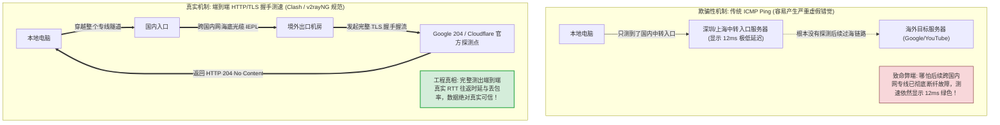
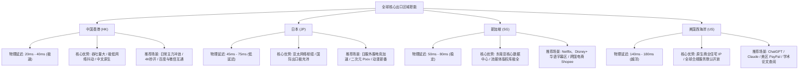
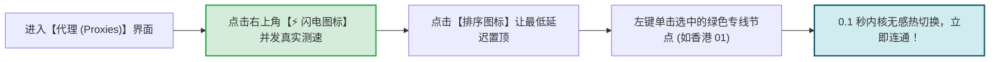
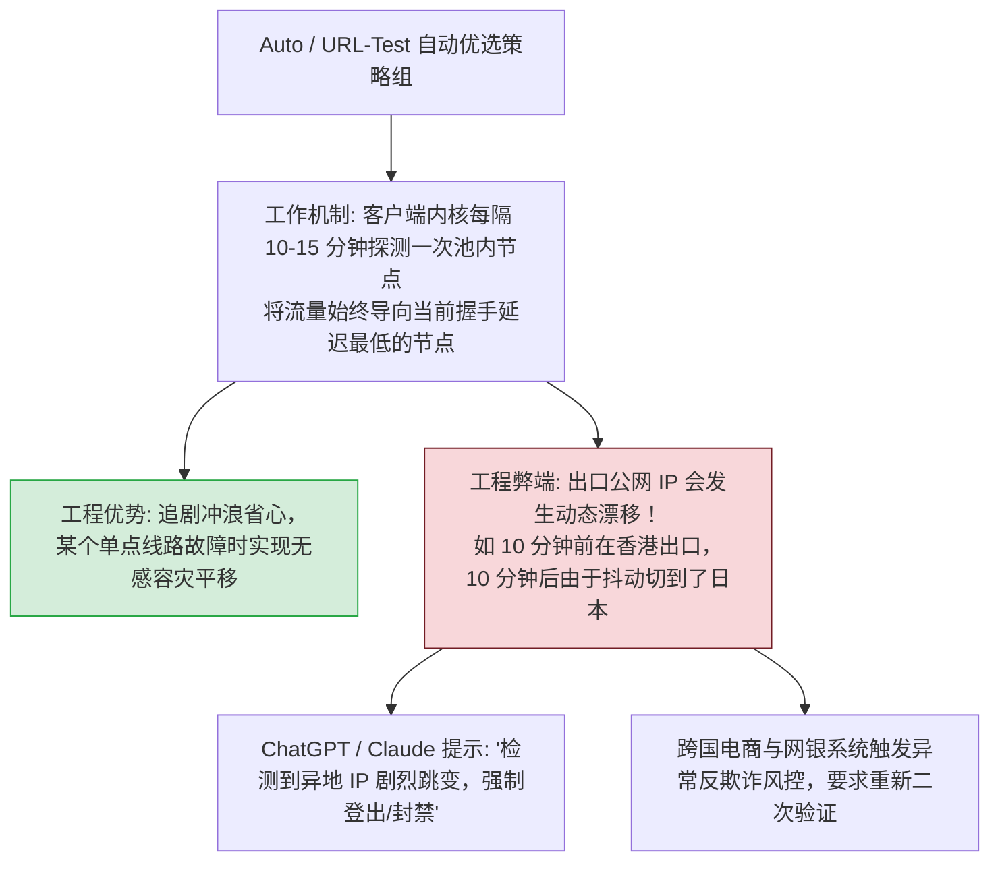
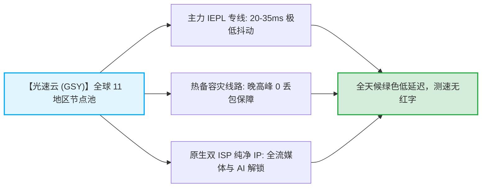

# 切换节点技巧：延迟测速 (Ping) 与核心热门地区优选

  <strong>核心结论与快速选路口诀：</strong>在客户端节点列表中，数字颜色与地理区域代表着明确的业务分工：<strong>① 绿色数字 (20ms - 60ms) 优先选择【中国香港 / 日本 / 新加坡】，物理光缆距离极短，适合 95% 的日常网页浏览、YouTube 4K 秒开、实时语音与游戏低延迟加速；② 黄色数字 (140ms - 220ms) 优先选择【美国西海岸 / 英国】，虽受限于大洋物理距离延迟稍高，但拥有纯净原生商业 IP，是 ChatGPT、Claude、海外网银注册与学术科研的最稳首选；③ 红色或显示 Timeout (超时) 的节点正在维护，直接跳过即可。</strong>

<AffiliateNotice />

---

## 一、物理第一性原理：光纤速度极限制约与真实 TLS 握手测速

许多初学者常产生误解：「为什么我在客户端里测速显示 10ms，但打开网页却卡得要死？」或者「为什么有机场宣称美国节点延迟只有 20ms？」理解光纤传输物理学与测速协议机制，能让你瞬间识破虚假宣传与虚标跑分：

### 1.1 光纤传输速度极限（物理学铁律）
光在真空中的传播速度为 $3 \times 10^8 \text{ m/s}$，而在制造光纤的高纯度石英玻璃中，光速会衰减至约 $2 \times 10^8 \text{ m/s}$（约每毫秒 200 公里）。加上光纤路由并不是直线走线、以及交换机/光端机的转发开销：
- **深圳到中国香港**：物理直线距离约 30-50 公里，物理单程延迟约 1-3ms，端到端专线握手延迟通常为 **15ms - 35ms**；
- **上海到日本东京**：海底光缆单程约 2,000 公里，端到端握手延迟通常为 **35ms - 65ms**；
- **中国大陆到美国西海岸 (洛杉矶/旧金山)**：跨太平洋光缆单程约 10,000-12,000 公里，理论物理往返时延极限就在 120ms 左右，真实专线端到端握手延迟必然在 **135ms - 180ms 之间**。

> [!WARNING] 虚标骗局识别
> 如果你在某个廉价小机场看到「美国节点延迟 18ms」，这在现代物理学上是绝对不可能实现的。这 100% 是商家在配置文件中把测速地址劫持到了国内机房（ICMP 欺骗）。**认准 Clash Verge Rev 测出的真实 TLS 握手数字，低于 80ms 的亚太专线才是真正的高速好线路。**

---

## 二、四大热门出口区域特性与业务场景矩阵

不同的地理位置由于物理距离、本地运营商互联政策以及 IP 版权数据库的不同，有着极度明细的业务分工：

### 2.1 全场景节点选型决策速查表

| 地区标识 | 典型端到端延迟 | 网络核心优势 | 最优契合应用场景 | 禁忌/不推荐场景 |
| :--- | :--- | :--- | :--- | :--- |
| **中国香港 (HK)** | **20ms - 40ms** | 距离极近，网络抖动极低，吞吐极大 | **日常 90% 默认主力首选**、YouTube 4K、网页秒开 | 部分明确封锁香港 IP 的欧美银行与学术站点 |
| **日本 (JP)** | **45ms - 70ms** | 亚太海缆枢纽，对北方网络友好度极佳 | 外服电竞游戏加速、动漫流媒体、日常备用主力 | 追求 20ms 极限响应的国服即时竞技游戏 |
| **新加坡 (SG)** | **55ms - 85ms** | 东南亚多语言核心，流媒体版权库极其丰富 | Netflix、Disney+ 独占华语中文字幕区、跨国电商 | 距离北方省份稍远（北方延迟约 80-90ms） |
| **美国西海岸 (US)** | **140ms - 180ms** | 原生纯净 IP 资源丰富，全球大厂服务优先覆盖 | **ChatGPT、Claude 等 AI 工具**、海外学术论文、美区 Apple ID | 实时高频语音通话、FPS 竞技网游 |
| **英国/德国 (EU)** | 180ms - 240ms | 欧洲合规网络，严格遵循 GDPR 隐私法规 | 欧洲本地网银、小众学术文献库、跨境企业协同 | 日常重度视频娱乐（物理距离过长造成加载缓慢） |

---

## 三、各主流客户端节点测速与切换实操步骤

---

### 3.1 在 Clash Verge Rev (Windows / macOS) 中操作
1. 打开客户端，点击左侧功能导航栏的 **「代理 (Proxies)」** 页面；
2. 在页面右上角找到一个 **「⚡ 闪电图标」**（测速按钮），鼠标单击一次；
3. 软件内核将并发向所有专线节点发起真实的 TLS 握手测试，测速进度条走完后，每个节点卡片右侧会精确显示对应的毫秒数字（如 `32ms`、`56ms`）；
4. **延迟自动排序技巧**：点击闪电图标旁边的 **「按延迟排序」** 小图标，软件会自动将所有低延迟、全绿色的优质节点排在列表最顶端；
5. 鼠标左键点击任意绿色节点（例如 `香港 01 [IEPL 专线]`），节点卡片被激活高亮，即代表当前出口线路切换完成！

---

### 3.2 在 Shadowrocket (iOS 小火箭) 中操作
1. 打开 Shadowrocket 主界面，在上方节点列表中找到 **「连通性测试」**（或长按右上角刷新按钮）；
2. 测试完成后，列表中的每个节点右侧会实时刷出具体的延迟数字；
3. 单击点选一个绿色低延迟节点（节点名称左侧出现勾选小圆点）；
4. 切换为**实时热更新生效**，无需断开重连最上方的全局总开关。

---

### 3.3 在 v2rayNG (Android 安卓) 中操作
1. 打开 v2rayNG 主界面，点击右上角 **「三点菜单」**；
2. 选择 **「测试全部配置真连接延迟」**；
3. 等待 3-5 秒，节点卡片左下角会显示出绿色的真实延迟数值；
4. 单击选择心仪的节点，点击右下角圆形的「V」字开关即可完成路由绑定。

---

## 四、深入解析：要不要使用「Auto / 自动选择」策略组？

在许多机场提供的配置中，列表顶端通常包含一个名为 `Auto`、`URL-Test` 或 `自动选择` 的特殊策略组：

> [!TIP] 策略组使用黄金决策准则
> - **观看视频、刷社交媒体、日常查资料时**：完全可以使用 `Auto / 自动选择`，享受多专线智能无感容灾带来的持续流畅；
> - **登录 AI 工具 (ChatGPT/Claude)、操作跨国网银、管理海外电商店铺时**：**强烈建议手动指定单一固定的节点（如固定在【美国 01】）**，杜绝因 IP 频繁漂移触发平台安全风控。

---

## 五、标杆专线节点池实测品质体验

节点的测速表现与切换体验，根本上取决于服务商在后端专线冗余与动态负载均衡上的技术储备：

在全站 42 家主流品牌严格横向测评中，[光速云 (GSY)](/reviews/#brand-gsy) 的节点池展现了极高的工业级可用性：
- **拒绝虚假死节点**：精选 20-30 个高质量 IEPL 专线，可用率达 99.8%，日常批量测速全线飘绿；
- **真实原生解锁**：所有美区、日区节点均经过严格的流媒体与 ChatGPT 纯净度校验；
- **亲民门槛**：月付折合约 8 元起，结账输入优惠码 `AMM` 享受专属立减。

---

## 六、本章小结与进阶路线

现在你已经掌握了如何读懂测速数值，并能根据不同的任务场景精准选择最适合的地区节点。

**但在选好节点、打开开关后，如何科学验证自己是否真正连通了境外互联网？如何确认国内网站依然走本地直连、没有被浪费流量？**

**下一篇，我们将进入首次连接连通性验证与防缓存干扰实战！**

<NextStep
  title="下一篇：首次连接与连通性验证"
  link="/tutorials/first-connection-test"
  description="开启无痕窗口双向验证海外连通性与国内直连分流，防旧缓存干扰。"
  stepText="使用教程实操主线 · 第 4 步"
  buttonText="阅读连通性测试指引 →"
/>
