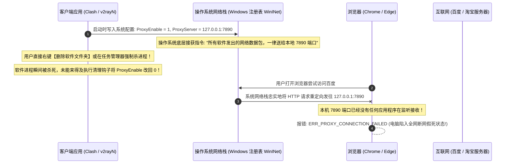
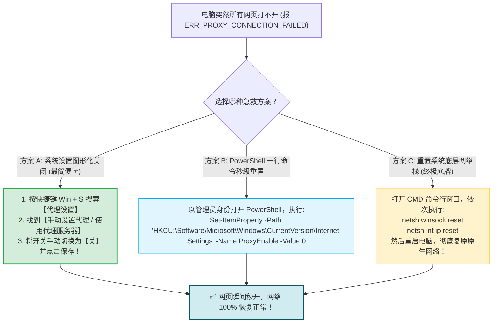
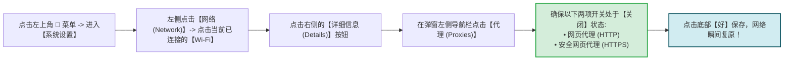

# 卸载与清理：停止使用时的系统代理复位与干净卸载

<div class="answer-first-lead">
  <strong>核心结论与安全退出最高铁律：</strong>当你打算停止使用、更换客户端或卸载软件时，<strong>绝对禁止直接在任务管理器杀进程、也绝对禁止直接将软件拖入废纸篓删除！</strong> 正确的退出与卸载流程严格由两步构成：<strong>① 第一步：必须先在软件主界面将【系统代理 (System Proxy)】开关手动关闭，并在设置中卸载【TUN 虚拟网卡驱动与服务】；② 第二步：从系统右下角托盘图标彻底退出应用，再执行常规卸载。</strong> 如果已经发生「删了软件导致电脑打不开任何国内网页」的严重故障，只需在 Windows 代理设置中将「使用代理服务器」手动关掉即可瞬间恢复。
</div>

<AffiliateNotice />

---

## 一、第一性原理：为什么暴力删除软件会导致「全网断网」？

在各大网络技术论坛中，几乎每天都有小白发出绝望的求助：*「我把 Clash 删了，怎么现在连百度和微信都连不上了？是不是电脑中病毒了？」*

理解这一现象的底层操作系统调用逻辑，能让你不再对「代理断网」感到恐惧：



### 1.1 Windows 注册表 WinINet 键值揭秘
Windows 操作系统通过以下注册表路径维护全局代理状态：
`HKEY_CURRENT_USER\Software\Microsoft\Windows\CurrentVersion\Internet Settings`
- **`ProxyEnable` (DWORD)**：`1` 代表开启代理，`0` 代表关闭；
- **`ProxyServer` (String)**：如 `127.0.0.1:7890`，定义了本地代理端口；
- **`ProxyOverride` (String)**：如 `<-loopback>;*.local`，定义了直连绕过规则。
当你强行终止客户端进程时，`ProxyEnable` 的数值依然被冻结在 `1`。所有依赖系统网络栈的软件（Chrome、Edge、微信、网银客户端）均会被重定向到死循环黑洞。

---

## 二、Windows 平台：优雅卸载全流程与突发断网 3 大急救药方

---

### 2.1 标准优雅卸载 4 步走 (预防断网)
1. **第一步：关闭系统代理**：在 Clash Verge Rev 主界面，将 **「系统代理 (System Proxy)」** 滑块拨到「关闭」状态；
2. **第二步：卸载虚拟网卡服务**：进入「设置」→「服务模式 (Service Mode)」→ 点击「卸载 (Uninstall)」；
3. **第三步：彻底退出应用**：在屏幕右下角任务栏托盘中，右键点击小猫图标，选择 **「退出 (Quit)」**；
4. **第四步：控制面板卸载**：进入 Windows「设置」→「应用」→「已安装的应用」→ 找到 Clash Verge，点击右侧三点选择「卸载」，清空所有安装文件。

---

### 2.2 突发断网 3 大急救药方 (如果已经打不开网页)

如果你已经误删了软件，导致现在电脑连国内网络都无法访问，请对照以下三种方案按顺序施救：



### 2.3 彻底清除残余虚拟网卡设备 (Wintun Ghost Devices)
如果之前开启过 TUN 虚拟网卡模式，直接卸载软件可能导致幽灵网卡残留在设备管理器中，造成偶发性的网络丢包：
1. 按下快捷键 `Win + X`，选择打开 **「设备管理器 (Device Manager)」**；
2. 展开 **「网络适配器 (Network adapters)」**；
3. 排查是否存在名为 `Wintun Userspace Tunnel` 或 `TAP-Windows Adapter V9` 的残余驱动；
4. 若存在且不再需要，右键点击该设备选择「卸载设备」，并勾选「尝试为此设备删除驱动程序软件」。

---

## 三、macOS 苹果电脑平台：彻底复位与干净清理

macOS 系统的网络设置集中在系统偏好中，如果卸载后无法联网，排查步骤如下：



### 3.1 终端一行命令验证并重置 Mac 代理
在 macOS 终端中，你可以通过系统底层的 `scutil` 工具直接读取当前代理状态：
```bash
# 检查当前网络代理配置
scutil --proxy

# 若依然显示 HTTPProxyEnabled : 1，可通过 networksetup 命令关闭 Wi-Fi 代理
networksetup -setwebproxystate "Wi-Fi" off
networksetup -setsecurewebproxystate "Wi-Fi" off
```

### 3.2 深度清理残留缓存与系统扩展
如果需要彻底从 Mac 中拔除软件的所有历史痕迹，可删除以下目录：
1. 打开访达，按下快捷键 `Cmd + Shift + G`；
2. 输入 `~/Library/Application Support/`，回车找到包含 `clash`、`verge` 命名的文件夹直接删除；
3. 输入 `~/Library/Logs/`，清空相关的日志历史。

---

## 四、Android / iOS 移动端干净清理指引

手机操作系统的沙盒机制更加完善，通常不会出现电脑端的注册表残留问题，但如果遇到异常，注意以下两点：

### 4.1 Android 安卓手机
- 直接长按应用图标点击「卸载」即可；
- 如果系统状态栏右上角依然显示「小钥匙」VPN 图标：进入手机「设置」→「连接与共享 / VPN」→ 找到残留的旧连接，点击右侧齿轮选择「忘记此网络 / 删除 VPN 配置」。

### 4.2 iOS 苹果手机
- 直接长按图标删除 App；
- 如需彻底移除网络扩展描述文件：进入「设置」→「通用」→「VPN 与设备管理」→ 点击「VPN」，确认里面没有未被清理的残留连接。

---

## 五、标杆服务商的无损离线体验

选择技术规范的优质服务商，能从根源上降低客户端异常崩溃与系统代理锁死发生的频率：

| 体验维度 | 劣质小作坊二道贩子 | [光速云 (GSY)](/reviews/#brand-gsy) 企业级专线 |
| :--- | :--- | :--- |
| **客户端崩溃率** | 劣质节点与非法语法导致内核频繁崩溃 | **全协议严格通过语法校验，客户端运行 0 闪退** |
| **系统代理退出响应** | 退出时无保护机制，极易锁死注册表 | **推荐客户端深度整合系统退出钩子，安全自动复位** |
| **重装恢复支持** | 账号丢弃无法找回 | **永久云端控制台，随时重新生成与同步** |

> [!TIP] 选型小结
> 选用 [光速云 (GSY)](/reviews/#brand-gsy) 配合标准开源客户端，在结账输入优惠码 `AMM` 享受折扣。规范的配置下发不仅保障了高速冲浪体验，更杜绝了任何因非标配置导致的系统网络假死问题。

---

## 六、使用教程实操主线全景大闭环

至此，恭喜你已经完整遍历了《使用教程》专题的全部十个核心实操节点：


你不仅掌握了如何将订阅链接导入客户端、看懂了不同地区的延迟特性，还学会了规避全局代理风暴、配置多设备共享、处理突发断网，并懂得如何优雅彻底地复位网络设置。

**所有的操作技巧你已经熟稔于心。现在，唯一剩下的核心命题是——哪一家机场才最值得你掏出真金白银下单？**

**新手第一单到底买哪家最划算、晚高峰最稳定、且自带中文客服与自研客户端？下一站，我们将进入核心的「新手入门机场推荐指南」，为你揭晓全网 42 家主流品牌中精挑细选的标杆之作！**

<NextStep
  title="第五站：机场推荐：新手第一次买机场应该怎么选"
  link="/recommend/"
  description="不看华而不实的参数，专注易用性、低门槛月付、自研客户端与售后支持的新手选购指南。"
  stepText="新手核心学习主线 · 第 5 站"
  buttonText="查看新手机场精选推荐 →"
/>
