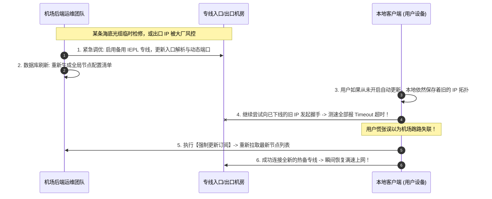
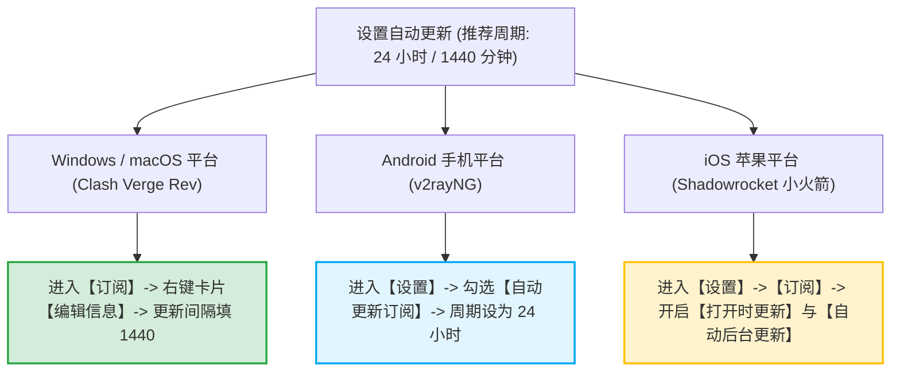
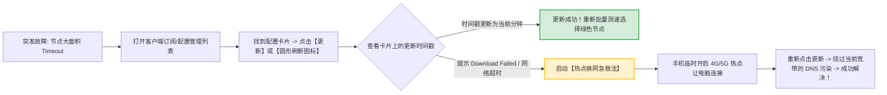
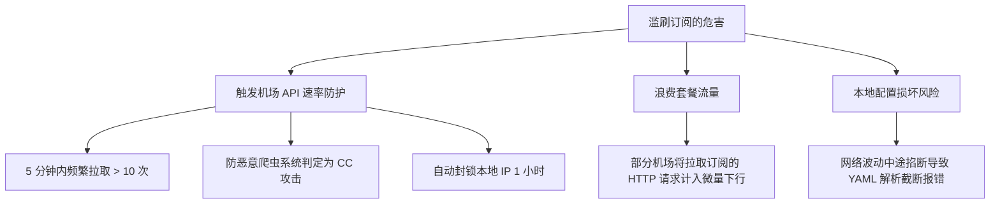

# 订阅更新教程：设置 24 小时自动静默更新与手动强制更新

<div class="answer-first-lead">
  <strong>核心结论与运维铁律：</strong>订阅链接不是「导入一次就一劳永逸」的静态文本，而是一根<strong>动态与服务商保持双向同步的数据生命线</strong>。服务商会不定期进行专线入口扩容、维护更换出口 IP 或优化 GeoSite 分流规则。为了保持长治久安，最省心的配置是：<strong>在客户端将订阅更新周期设置为每 24 小时（1440 分钟）后台静默自动更新；如遇某天节点突然大面积显示红色超时，先执行一次「手动强制更新」拉取最新配置，90% 的连通性故障都能秒级化解。</strong>
</div>

<AffiliateNotice />

---

## 一、为什么机场订阅必须定期更新？底层网络运维视角

许多初学者常常纳闷：「我一个月前配置好的软件用得好好的，为什么今天突然所有节点都测不出延迟了？」



### 服务端高频变动的四大真实诱因
1. **网络动态容灾与换线**：遇到外部光缆施工或运营商机房维护时，工程师会启用备用热备专线，节点连接地址发生物理变动；
2. **流媒体与 AI 解锁策略迭代**：Netflix、Disney+ 或 ChatGPT 会不定期对数据中心 IP 段进行批量封控，机场需要实时下发经过换绑的原生住宅 IP 节点；
3. **新增优质专线节点**：机场新采购了沪日、广港高带宽专线，只有更新订阅后新节点才会出现在列表中；
4. **分流规则进化与防误伤**：开源社区新增了对国内新兴 App（如各类小程序、新视频平台）的直连白名单，更新配置能防止国内流量被误扣。

---

## 二、第一性原理：订阅响应头信息解析与 HTTP 缓存机制

当客户端拉取订阅时，正规机场的 API 服务器不仅返回节点列表，还会在 HTTP 响应头（Response Headers）中注入丰富的账户元数据：

```http
HTTP/1.1 200 OK
Content-Type: text/yaml; charset=utf-8
Subscription-Userinfo: upload=1073741824; download=21474836480; total=107374182400; expire=1795123200
Profile-Update-Interval: 24
```

### 2.1 `Subscription-Userinfo` 字段深度解密
- **`upload` 与 `download`**：记录你本周期内已经消耗的上行和下行字节数（Bytes）；
- **`total`**：记录你的套餐总流量上限（例如 $107,374,182,400 \text{ Bytes} \approx 100 \text{ GB}$）；
- **`expire`**：UNIX 时间戳，记录套餐到期的具体时间；
- **客户端联动**：Clash Verge Rev 或 Shadowrocket 在接收到这行 Header 后，会自动在订阅卡片底部渲染出「剩余流量 78.5 GB / 到期时间 2026-11-20」的直观进度条，无需每次登录官网后台查询。

---

## 三、全平台客户端「24小时自动更新」实操配置指南

只需在客户端中设置一次，软件便会在后台全自动静默打理，无需人工干预：



---

### 3.1 Clash Verge Rev (Windows / macOS) 实操步骤
1. 打开客户端，在左侧导航栏点击 **「订阅 (Profiles)」**；
2. 找到你正在使用的机场配置卡片，将鼠标悬停在卡片上，**单击鼠标右键**；
3. 在弹出的右键菜单中选择 **「编辑信息」**；
4. 找到 **「更新间隔 (分钟)」** 选项，在输入框中填入 `1440`（1440 分钟 = 24 小时）；
5. 点击「保存」退出。此后只要电脑处于开机联网状态，软件每隔 24 小时就会自动在后台静默拉取一次最新配置。

---

### 3.2 v2rayNG (Android 安卓手机) 实操步骤
1. 打开 v2rayNG，点击左上角「三道杠」菜单进入 **「设置 (Settings)」**；
2. 滑动到页面中部的「订阅设置」区域；
3. 勾选 **「自动更新订阅」** 开关；
4. 点击「更新间隔」，推荐选择 **「24 小时」**（既能保证节点常新，又不会在移动网络下频繁唤醒手机消耗电量）。

---

### 3.3 Shadowrocket (iOS 小火箭) 实操步骤
1. 打开小火箭主界面，点击右下角 **「设置 (Settings)」**；
2. 点击进入 **「订阅 (Subscription)」** 选项；
3. 开启以下两个实用开关：
   - **打开时更新 (Update on Open)**：每次冷启动打开小火箭 App 时，自动检测一次是否有新节点；
   - **自动后台更新 (Background Refresh)**：允许 iOS 系统在后台静默刷新节点列表。

---

## 四、突发故障时的「手动强制更新」应急标准姿势

当遇到某个常用节点突然连不上、或者群里通知「某线路已扩容」时，可以通过手动更新强制拉取：



### 4.1 手动强制更新核心检查点
- **看时间戳**：更新成功后，卡片下方注明的「上次更新」必须变成**当前时间**；
- **看节点数量**：列表中的节点数量是否发生增减；
- **重新测速**：更新完成后，务必再次点击「⚡ 闪电图标」重新测速，旧节点会被刷新并展示全新状态。

---

## 五、进阶自动化：Linux 无头服务器与软路由 Cron 定时更新实战

对于在软路由 (OpenWrt) 或无界面的 Linux 终端部署 Clash / Sing-box 的进阶极客用户，可以通过原生的 `crontab` 编写自动化定时拉取脚本，并加入原子写入校验以防配置文件损坏：

```bash
#!/bin/bash
# 机场订阅自动化同步脚本: /opt/scripts/update_sub.sh
SUB_URL="https://api.your-airport.com/api/v1/client/subscribe?token=YOUR_TOKEN&clash=1"
CONFIG_FILE="/etc/clash/config.yaml"
TMP_FILE="/etc/clash/config_tmp.yaml"

# 1. 携带合法 User-Agent 发起拉取，并设置 15 秒超时
curl -s -L -A "ClashMeta" --connect-timeout 15 "$SUB_URL" -o "$TMP_FILE"

# 2. 核心校验: 检查下载的文件体积是否大于 1KB 且包含 proxies 关键字 (防空包覆盖)
if [ -s "$TMP_FILE" ] && grep -q "proxies:" "$TMP_FILE"; then
    mv "$TMP_FILE" "$CONFIG_FILE"
    # 重载 Clash 内核配置而不中断现有长连接
    curl -s -X PUT -d '{"path": "'"$CONFIG_FILE"'"}' http://127.0.0.1:9090/configs
    echo "[$(date)] 订阅自动化热更新成功！"
else
    rm -f "$TMP_FILE"
    echo "[$(date)] 订阅下载异常或文件校验失败，已自动回滚旧配置。"
fi
```
在系统的 `crontab -e` 中添加定时调度：
```cron
# 每天凌晨 04:30 自动静默拉取更新节点列表
30 4 * * * /bin/bash /opt/scripts/update_sub.sh >> /var/log/clash_update.log 2>&1
```

---

## 六、自律防封守则：避免高频无意义刷新触发 API 限流

许多新手有一种强迫症习惯：**每隔 3 分钟就手动点一次「更新订阅」，一天点击几十次**。



> [!CAUTION] 订阅更新频率红线
> 机场服务商的订阅服务器均部署了严格的 Web 应用防火墙 (WAF)。如果检测到同一 IP 在短时间内无间隔频繁拉取订阅，会自动将其判定为**恶意爬虫或盗刷 Token 攻击**，触发自动化临时拉黑防御。**日常保持 24 小时自动更新即可，切勿手动反复高频狂点！**

---

## 七、标杆专线服务商的容灾更新保障

靠谱服务商在订阅维护层面具备极其成熟的技术冗余：

| 运维指标 | 廉价小作坊 | [光速云 (GSY)](/reviews/#brand-gsy) 企业级专线 |
| :--- | :--- | :--- |
| **API 订阅服务器架构** | 单台廉价云主机，经常宕机无法拉取 | **多云 Cloudflare CDN 边缘加速，可用率 99.9%** |
| **节点容灾下发速度** | 出现网络故障通常需要几小时人工修复 | **双线路热备，秒级自动热更新切换路由** |
| **流量与到期提示** | 订阅中无明确提示，经常突然欠费断网 | **每次拉取订阅自动同步剩余流量与到期时间戳** |

> [!TIP] 选型小结
> 选用 [光速云 (GSY)](/reviews/#brand-gsy) 搭配 24 小时自动更新，在结账输入优惠码 `AMM` 享受折扣。其双线路企业架构能保证即使某条专线因突发事故维护，系统也会在后台自动无感更新备用专线，用户完全无需手动折腾。

---

## 八、本章小结与进阶路线

掌握了订阅的自动静默更新与应急手动刷新技能，你的网络客户端已经具备了长期的自我修复能力。

但在现实生活中，很多用户不仅有一台电脑，往往同时拥有 iPhone、安卓手机甚至 iPad：**一个人多台设备，如何无缝共用同一个订阅？多设备同时在线会超标封号吗？**

**下一篇，我们将进入多设备同步配置与并发限制深度解析！**

<NextStep
  title="下一篇：多设备同步同一订阅"
  link="/tutorials/multi-device-sync"
  description="一人多台设备共享订阅实操、并发限制原理与局域网代理共享全指南。"
  stepText="使用教程实操主线 · 第 7 步"
  buttonText="阅读多设备同步指南 →"
/>
