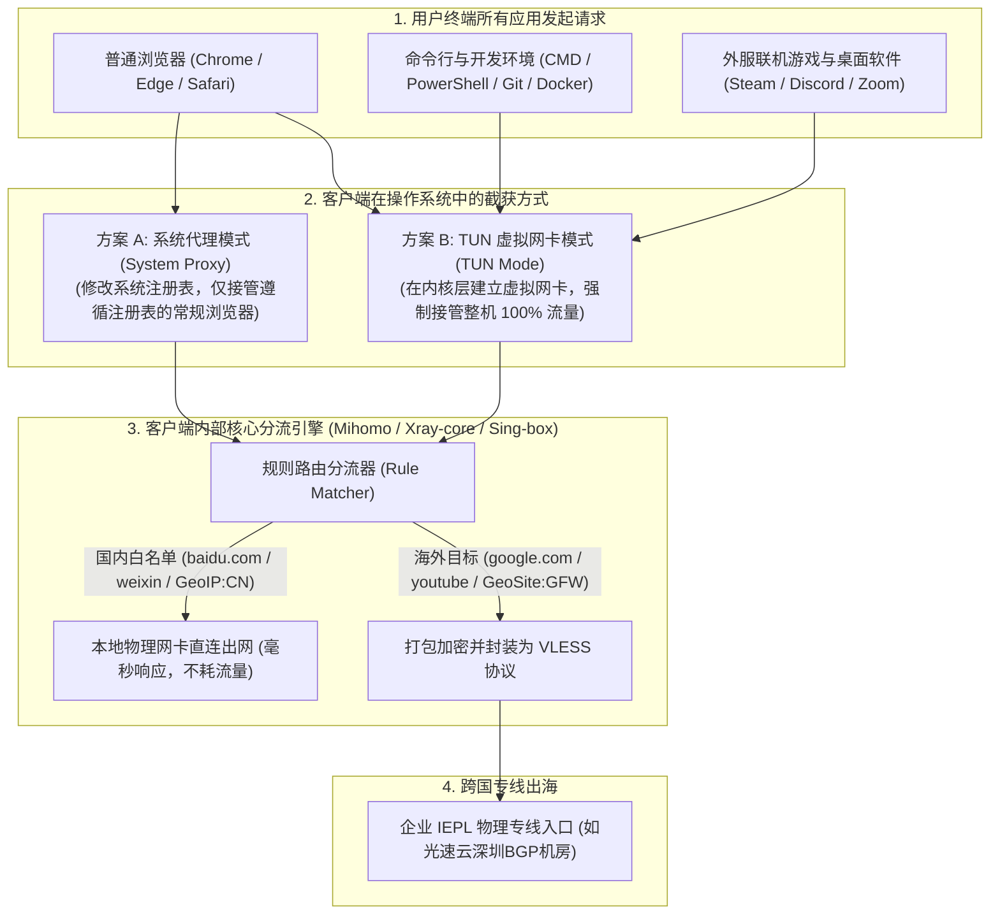

# 机场客户端定位与作用：本地网络分流引擎与流量接管机理 (2026 深度通识)

  <strong>核心结论与先验建议 (Answer-First)：</strong>在科学上网过程中，<strong>「客户端（Client）」是你安装在手机或电脑本地的开源工具软件</strong>。
    
  对于零基础新手而言，最容易产生的第二个认知误区是：误以为“在 GitHub 或 App Store 下载了 Clash、v2rayN 或小火箭，就能直接免费上网了”。
    
  必须彻底搞清两者的协作铁律：
  <ul>
    <li><strong>客户端是「免费的空壳载具 / 飞机本身」</strong>：开源开发者只负责把软件界面做好、把分流规则写好，<strong>软件本身绝对不附带任何网络节点与流量</strong>！</li>
    <li><strong>机场是「出售航线与机票的航空公司」</strong>：它负责出资租用跨国物理光纤专线（IEPL），向你售卖专属的「订阅链接（电子登机牌）」；</li>
    <li><strong>只有把机场的订阅链接导入客户端，并在客户端内点亮连接开关</strong>，你的设备才能真正通过专线飞往全球互联网。</li>
  </ul>
  优质老牌专线机场（如<strong>[光速云](/reviews/#brand-gsy)</strong>）普遍支持全平台客户端一键导入，同时提供开箱即用的自研免配置直连客户端，兼顾极简与进阶。

<AffiliateNotice />

---

## 一、网络协议栈的第一性原理：客户端是如何在本地接管流量的？

当你打开电脑或手机点击网页时，你的数据原本是直接沿着操作系统的网络协议栈（OSI 模型），通过本地无线网卡直接发往自家的家用路由器的。

代理客户端的作用，就像在操作系统的出海关口设立了一个**智能交警与打包分流收费站**：

### 1.1 系统代理 vs TUN 虚拟网卡：新手必须懂的两种接管模式
1. **系统代理模式（System Proxy）**：
   - **工作原理**：客户端启动后，在 Windows 注册表或 macOS 系统偏好设置中将 HTTP 代理设置为 `127.0.0.1:7890`。
   - **优点**：极轻量，无需管理员权限，兼容性好，适合普通网页查资料和刷剧；
   - **局限性**：终端命令行（Git / pip / npm）、外服游戏客户端根本无视系统代理，依然会因直连而报错断流。
2. **TUN 虚拟网卡模式（TUN Mode）**：
   - **工作原理**：客户端向操作系统申请安装一块**虚拟网卡驱动（如 Wintun 驱动）**，并修改系统的全局默认路由表。
   - **优点**：能够无差别强行截获整台电脑的所有网络请求（包括终端、IDE、后台服务与游戏），实现真正的**全系统 100% 透明代理**。关于 TUN 模式的开启与排障，可参考：[`/clients/windows-install`](/clients/windows-install)。

### 1.2 Fake-IP 与 Redir-Host：DNS 解析性能的革命性跃升
在早期代理客户端中，采用传统的 `Redir-Host` 模式，即客户端每发起一次网络请求，都必须先向远端服务器发起一次实际的 DNS 解析请求。当跨国链路遭遇网络抖动时，仅域名解析阶段就需消耗 200ms～500ms，导致网页打开极慢。
而在现代内核（如 Mihomo / Clash Meta）中普遍采用的 **Fake-IP 模式**（保留地址网段 `198.18.0.1/16`）：
* **零延迟合成响应**：当操作系统请求解析 `google.com` 时，本地客户端在 1 毫秒内直接返回一个虚构的虚拟 IP 地址（如 `198.18.0.2`），并在客户端内部内存表中记录映射关系；
* **远端代劳解析**：实际数据包发送时，客户端通过专线直接将原始域名交给远端企业专线节点进行代为解析出真实 IP，彻底消除了本地 DNS 污染与高时延等待，这也是现代客户端网页秒开的关键技术支撑。

---

## 二、解剖客户端内部：不可不知的“三层内部软件架构”

在接触各类客户端时，新手经常听到诸如“Meta 内核”、“Electron 前端”、“Tauri 轻量化”等技术词汇。

实际上，现代代理客户端是由严密的**三层架构**协同运作的：

| 架构分层 | 核心职责 | 代表技术与实现 | 常见故障与排障归因 |
| :--- | :--- | :--- | :--- |
| **展现交互层 (GUI Shell)** | 提供按钮、设置面板、节点测速延迟看板与悬浮托盘。 | Electron (跨平台)、Tauri/Rust (轻量版)、Flutter | 软件界面卡死或空白，通常是前端框架与显卡硬件加速冲突。 |
| **规则路由层 (Routing Rules)** | 基于规则集识别域名与 IP，决定是直连还是走代理。 | GeoIP.dat、GeoSite.dat 社区分流规则数据库 | 微信报异地登录或国内网页卡顿，通常是规则集配置错误。 |
| **底层通信内核 (Core Kernel)** | 真正执行 TCP/UDP 流量捕获、VLESS 密码学解包与专线连接的底层引擎。 | **Mihomo (Clash Meta)**、**Xray-core**、**Sing-box** | 节点全部红字超时或连不上，通常是内核崩溃或端口冲突。 |

---

## 三、真实小白客户端认知翻车实录 (1:1 案例库)

### 案例 1：在 GitHub 下载了原版 Clash，以为被骗怒打差评
* **学员档案**：在校大一新生小周，在室友建议下去 GitHub 下载了 Clash Verge Rev。
* **翻车过程**：小周安装好软件后，在界面里找了半天，看到全部是英文，界面中央显示“No Profile Found”。小周在搜索框里输入 `https://www.google.com` 发现根本无法上网，气愤地在知乎发帖：“什么破开源软件，完全是个打不开网页的骗局！”
* **解惑转变**：室友看后哭笑不得，告诉他客户端只是一个载具。室友把[光速云 (GSY)](/reviews/#gsy)的订阅链接发给他，小周点击“复制”并填入软件后，瞬间几十个香港、日本、美国的绿色专线节点亮起，开关一点，Google 首页秒开。小周这才彻底理解了客户端与机场的协作关系。
* **深层警示**：**客户端是一辆出厂不带汽油的跑车，机场订阅链接才是让它驰骋的燃油通告卡**。

### 案例 2：程序员命令行拉取代码失败，开启 TUN 模式一秒搞定
* **学员档案**：前端开发工程师小林，使用 Windows 笔记本办公。
* **踩坑经历**：小林的 Chrome 浏览器开启代理后看 YouTube 4K 飞快，但在 VS Code 终端里执行 `git clone https://github.com/...` 时，控制台持续卡死在 0%，半分钟后抛出 `fatal: unable to access: Failed to connect to github.com port 443: Connection refused`。
* **解决方案**：小林按照本站教程，在 Clash Verge Rev 设置中安装了“Service Mode（系统服务模式）”，随后点亮了“TUN 模式”开关。虚拟网卡接管全局底层数据包后，无需在终端中敲任何 `export http_proxy` 环境变量命令，Git 仓库以 35MB/s 的极速拉取完成。
* **实战结论**：**掌握客户端的 TUN 模式，是专业技术人员解决终端网络阻断的终极利器**。

---

## 四、全平台主流客户端梯队选型全览

面对全网几十款客户端，新手应该怎么选？请参考以下权威选型矩阵：

| 操作系统平台 | 首选推荐客户端 (新手首选) | 全能极客备选客户端 | 特点与选型理由 |
| :--- | :--- | :--- | :--- |
| **Windows 电脑** | **Clash Verge Rev** | **v2rayN** | 现代化沉浸式 UI，中文生态极佳，完美支持一键 TUN 模式。 |
| **macOS 苹果电脑** | **Clash Verge Rev Mac** | **Surge for Mac** | 完美原生适配 M 系列 Apple Silicon 芯片与 Intel 芯片。 |
| **iPhone / iPad** | **Shadowrocket (小火箭)** | **Surge 5 / Loon / Stash** | 操作最简单直观，支持扫码一键导入，生态最成熟。 |
| **Android 安卓手机** | **Clash Meta for Android** | **v2rayNG / Sing-box** | 支持分应用代理，后台内存占用低，省电且不杀后台。 |
| **OpenWrt 软路由** | **OpenClash / Nikki** | **HomeProxy / PassWall 2** | 全家电视盒子、游戏主机、智能家居无感出海。 |

---

## 五、痛点心流驱动：拥抱开箱即用，拒绝复杂折腾

如果你觉得研究客户端、内核与模式过于繁琐，希望像日常使用普通软件一样“输入账号密码直接连接”，正规大品牌提供了完美的解脱方案：

[光速云 (GSY)](/reviews/#gsy) 采用**「自研免配置直连客户端 + 通用开源客户端一键生态」**的双轨制设计：

<BrandCard brandId="gsy" />

  
💡 为什么光速云能让小白彻底免除客户端配置烦恼？

  <ul>
    <li><strong>官方专属定制客户端</strong>：后台直接提供专用的 Windows、Mac 与安卓安装包，安装后直接输入账号密码即可使用，自动同步专线节点，30 秒直连。</li>
    <li><strong>完美支持全量开源客户端</strong>：对于喜欢使用 Clash Verge 或小火箭的用户，后台提供一键唤醒接口，点击按钮自动调起本地软件完成载入。</li>
    <li><strong>平民化超低资费门槛</strong>：最低专线套餐折合仅需 <strong>8元/月</strong>，输入官方专属优惠码 <code>AMM</code> 享折上折，支持国内支付宝原生安全扫码秒开。</li>
  </ul>

<PromoCard brandId="gsy" />

---

## 六、下一步系统化学习路线引导

搞懂了客户端的定位与网络接管机制后，在掏钱购买之前，我们必须对市面上的收费计费陷阱有清醒的认知：

1. **机场常见收费模式深度解析**：阅读 [`/what-is-airport/pricing-models`](/what-is-airport/pricing-models) 搞懂月付、年付、按量付费与不限时套餐的真实猫腻；
2. **机场/梯子/科学上网概念剖析**：阅读 [`/what-is-airport/terminology-differences`](/what-is-airport/terminology-differences) 厘清中文互联网核心词汇差异；
3. **前往客户端中心下载软件**：查阅 [`/clients/`](/clients/) 获取适合你设备的主流官方安装包。

---

<NextStep
  title="下一篇：机场常见收费模式深度解析 (月付 / 年付 / 不限时)"
  link="/what-is-airport/pricing-models"
  description="为什么绝对不能盲目购买大额年付？按量付费适合哪些人？深入拆解机场常见收费套路与新手最划算的计费模型。"
  stepText="新手进阶 · 下一步"
  buttonText="查看收费模式深度解析 →"
/>
