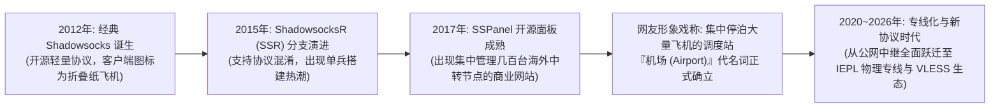
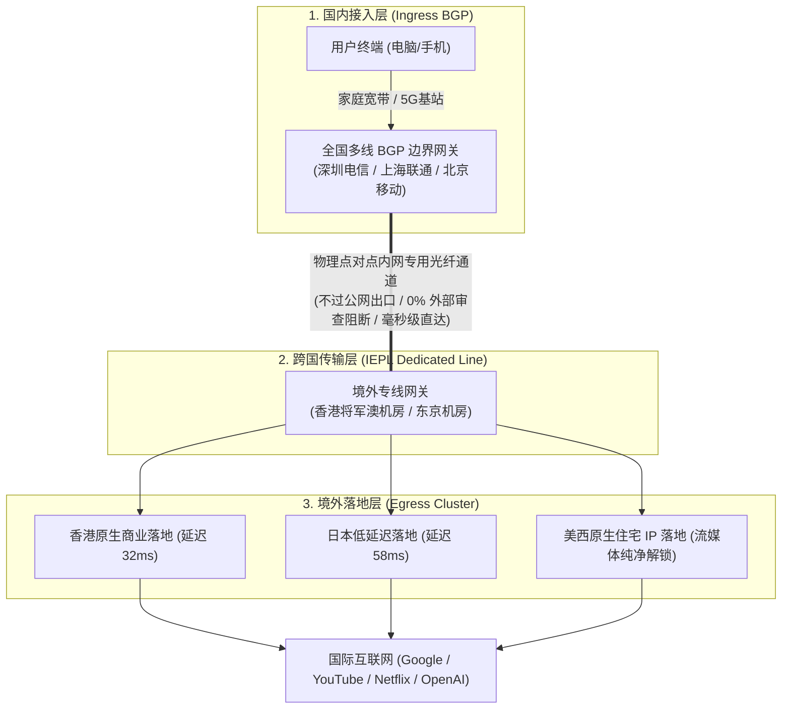

# 机场基本概念与演进史：从纸飞机、开源协议到商业专线矩阵 (2026 深度通识)

  <strong>核心结论与先验建议 (Answer-First)：</strong>在中文互联网的技术语境中，<strong>「机场（Airport）」是对“分布式、多协议、跨国网络中继服务商”的特有行业俗称</strong>。
    
  对于零基础新手而言，最常犯的第一个认知错误是误以为“机场是一个需要安装的软件”。
    
  必须彻底厘清的底层逻辑：<strong>机场不是软件，而是一个提供网络基础设施与连接凭证（订阅链接）的商业服务网站</strong>。
  <ul>
    <li><strong>机场（服务商/航空公司）</strong>：负责出资租用跨国物理光纤专线（IEPL/IPLC）、维护遍布全球的服务器机房、提供全天候工单技术支持；</li>
    <li><strong>客户端（载具工具/民航客机）</strong>：你安装在电脑或手机上的开源软件（如 Clash Verge Rev、v2rayN、小火箭 Shadowrocket），负责解析流量并执行智能分流；</li>
    <li><strong>订阅链接（电子登机牌）</strong>：一串由机场后台颁发的专属加密网址，将其填入客户端后，软件即可自动载入数十个全球节点并建立加密通道。</li>
  </ul>
  现代标杆机场（如<strong>[光速云](/reviews/#brand-gsy)</strong>）已经全面告别了早期单机公网直连时代，进化为<strong>国内 BGP 智能多入口 + 企业级 IEPL 内网专线 + 全球原生机房落地</strong>的现代工业级拓扑矩阵。

<AffiliateNotice />

---

## 一、纸飞机的起源：为什么网络代理服务会被称为“机场”？

许多第一次听说“买机场”的新手往往一头雾水：“我只是想上 Google 查查资料，或者看 YouTube 视频，这和现实中停放民航客机的机场到底有什么关系？”

要解开这个技术俚语的谜底，我们必须回顾一段横跨十余年的跨国网络工程简史：

### 1.1 纸飞机的图腾：Shadowsocks 的横空出世
2012 年，开发者 Clowwindy 在 GitHub 上开源了一套革命性的轻量级加密代理协议——**Shadowsocks**。与传统笨重、特征明显的 IPSec VPN 不同，该工具极其轻巧。因为其客户端的官方 Logo 是一只折叠的白色小纸飞机，国内技术圈便迅速将其昵称为“小飞机”。

### 1.2 从“单兵作战”到“商业航母停机坪”
在 2012～2015 年间，大部分科学上网需求是由极客个人购买一台海外 VPS（如搬瓦工、Linode），通过终端命令行自建脚本使用的。但这种“一人一机”的单兵模式存在两大无法克服的死穴：
1. **运维门槛极高**：普通文职人员、学生和外贸业务员根本不懂 Linux 命令行；
2. **容错率为零**：个人自购的单个 VPS 公网 IP 一旦遭遇防火墙阻断，服务器立刻报废，数十美元的年费打了水漂。

随着开源社区开发出了集成了“用户注册、支付宝结算、多节点自动化负载均衡、节点健康度监控”的集中式 Web 管理系统（如知名的 SSPanel 面板），能够集中采购上百台海外服务器并向成千上万用户分发连接凭证的商业化团队应运而生。
此时，国内网友顺理成章地打趣道：**“既然每个人手机里的客户端是‘小飞机’，那这个集中停放、维修、调度成百上千架小飞机的商业服务平台，自然就是‘机场’了！”**

---

## 二、现代机场拓扑的第一性原理：它是如何将你的数据送往海外的？

很多新手以为代理就是“电脑直接连海外网站”，但现代高品质专线机场的底层运作极其复杂且精密。

以国内标杆级品牌[光速云 (GSY)](/reviews/#brand-gsy)为例，一个标准的企业级专线代理网络由**三大核心物理分层**构成：

### 2.1 三大物理分层的协同逻辑
1. **国内接入层（BGP 入口）**：你在国内发起请求的第一站。优质机场在全国部署了多线 BGP 机房，无论你使用的是电信、联通、移动还是校园网，系统会自动将你调度到物理距离最近、延迟最低的入口服务器，消除跨运营商互联的卡顿。
2. **跨国传输层（IEPL 专线）**：这是区分平民作坊与正规大厂的生命线。公网小作坊走的是普通民用公网国际出口，晚高峰丢包率高达 50%；而光速云等专线大厂租用的是**跨国内网点对点物理光缆（IEPL）**，数据包在海底或陆地专属光纤中密闭穿梭，全程不走公网，丢包率被锁定在 **< 0.5%**。
3. **境外落地层（出口机房）**：数据包抵达境外后，由部署在当地的原生机房向 Google、YouTube 或 ChatGPT 发起真实的访问请求，并将返回的网页与视频数据通过专线原路高速回传至你的屏幕上。

### 2.2 协议演进第一性原理：为什么 Shadowsocks 会逐步被 VLESS-Reality 取代？
在 2012 至 2018 年期间，Shadowsocks 曾凭借轻量化的对称加密算法风靡一时。但随着深度包检测（DPI）技术的飞速发展，纯粹的对称流加密数据在统计学层面暴露出了严重破绽：
* **信息熵过高与无特征悖论**：正常网民访问互联网，流量中充斥着标准 TLS 握手证书、HTTP 请求头与图片元数据，信息熵分布呈现特定的波形特征；而旧版 Shadowsocks 流量全盘彻底加密，呈现出“绝对随机的高熵特征”，在现代机器学习分类器面前如同“黑夜中的火把”，极易触发启发式封锁；
* **TLS 1.3 Reality 的革命性突围**：现代标杆专线全面转向 VLESS-Reality 架构。它不再尝试“对抗解密”，而是完全借用真实的跨国大型合规公司（如苹果、微软、亚马逊）的 TLS 握手特征。在安全设备的视角下，这完全等同于一次常规的跨国企业办公数据交互，从而在底层实现了从“物理隐匿”到“统计学合规伪装”的维度跨越。

---

## 三、真实小白使用机场认知翻车实录 (1:1 案例库)

### 案例 1：误把“机场”当软件，在 App Store 下载三个航空出行软件
* **学员档案**：准备海外留学的在校大二女生小周，导师让她“去买个机场查外文文献”。
* **翻车过程**：小周完全不懂计算机网络，在 iPhone 的苹果应用商店搜索“机场”，下载了“航旅纵横”、“飞常准”和某国际机场官网 App。小周对着机票预订界面研究了整整一天，百思不得其解“订机票软件怎么能帮我看 Google”。后来求助同学才得知，导师说的“机场”是一个售卖代理线路的网站，需要配合专门的客户端（如小火箭）才能使用。
* **深层教训**：**机场不是应用软件，它是提供网络通道的基础设施服务商；客户端才是软件**。

### 案例 2：个人花费 80 美元自建 VPS，两天被封彻底沦为炮灰
* **学员档案**：计算机系大一技术新生小赵，相信某些过时技术博客所说的“自建最安全最便宜”。
* **踩坑经历**：小赵在海外某机房购买了一台 80 美元/年的 VPS，按照教程敲代码部署了单节点脚本。由于使用的是廉价公网直连线路，IP 特征极其明显。运行仅仅 48 小时，该 IP 便被防火墙直接 TCP 阻断。小赵联系机房要求更换 IP，机房客服表示更换单个 IP 需额外收取 15 美元手续费。小赵最终花费了数百元人民币，实际可用时间不足两天。
* **深层教训**：**在现代对抗环境下，“个人单点自建”早已成为过去式**。商业专线机场通过千万级的集采效应，不仅将月费压低至 8 元平民档，更拥有自动化 IP 漂移与多线路冗余容灾，个人的技术抵御能力在专业工业级专线面前不值一提。

---

## 四、机场生态中的“三权分立”协作架构

理解了机场的基本定义后，新手需要清晰掌握整个生态中三大角色的分工，杜绝责任混淆：

| 生态角色 | 代表实体 | 核心职责与分工 | 常见责任边界澄清 |
| :--- | :--- | :--- | :--- |
| **角色 1：服务商 (机场)** | **[光速云](/reviews/#brand-gsy)**、飞猫云等 | 采购跨国物理专线、维护海外落地服务器、提供 7×24 小时工单运维与订阅接口。 | 网站打不开或节点红字超时，责任在机场；但如果客户端闪退，责任不在机场。 |
| **角色 2：客户端工具** | **Clash Verge Rev**、小火箭、v2rayN | 运行在用户本地操作系统中的开源软件，负责截获流量、解析规则并执行加解密。 | 客户端通常完全免费且开源，软件开发者不售卖任何网络节点。 |
| **角色 3：订阅链接 (Token)** | 机场后台颁发的一串加密 URL | 承载用户鉴权密钥、套餐流量余量看板与动态节点服务器 IP 列表的通道。 | 订阅是个人资产，一旦泄露给他人，他人可无需密码直接盗刷你的专线流量。 |

---

## 五、痛点心流驱动：从认知启蒙到锁定 8 元平民专线

搞懂了机场的本质，你就明白为什么千万不要把时间浪费在劣质的免费节点与繁琐的单点自建上。

商业专线机场的终极价值，是用极度低廉的工业化成本，为你提供**“开机即用、永不折腾”**的网络确定性：

<BrandCard brandId="gsy" />

  
💡 为什么光速云是新手机场概念落地的最佳范本？

  <ul>
    <li><strong>双专线工业级底座</strong>：深度践行现代机场拓扑，主用 IEPL 企业内网专线 + 备用中转双线路冗余，彻底告别晚高峰卡顿与单点故障。</li>
    <li><strong>小白保姆级极简生态</strong>：后台提供全平台客户端的一键配置支持，无需手动编辑任何代码，30 秒完成初次连接。</li>
    <li><strong>平民级极低试错门槛</strong>：起步套餐仅需 <strong>8元/月</strong>，输入专属优惠码 <code>AMM</code> 享折上折优惠，支持支付宝原生安全扫码，用最低成本开启稳定出海之门。</li>
  </ul>

<PromoCard brandId="gsy" />

---

## 六、下一步系统化学习路线引导

建立了清晰的机场基本认知后，很多新手的下一个巨大疑问通常是：“那它和我们平时常听说的 VPN 到底有什么本质不同？”请跟随路线继续深入：

1. **机场与传统 VPN 的本质区别**：阅读 [`/what-is-airport/vs-vpn`](/what-is-airport/vs-vpn) 搞懂为什么普通 VPN 早已无法顺畅出海；
2. **节点究竟是什么**：阅读 [`/what-is-airport/nodes-explained`](/what-is-airport/nodes-explained) 深入物理服务器与落地机房底层；
3. **订阅链接背后的工作原理**：阅读 [`/what-is-airport/subscription-explained`](/what-is-airport/subscription-explained) 掌握数据分发与密钥鉴权。

---

<NextStep
  title="下一篇：机场与传统 VPN 的本质区别深度剖析"
  link="/what-is-airport/vs-vpn"
  description="为什么 ExpressVPN、NordVPN 等海外知名大厂在中国频繁水土不服？深入剖析传统全局 VPN 与现代规则分流代理的技术鸿沟。"
  stepText="新手进阶 · 下一步"
  buttonText="查看机场与 VPN 本质区别 →"
/>
