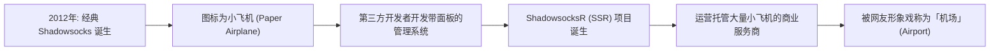
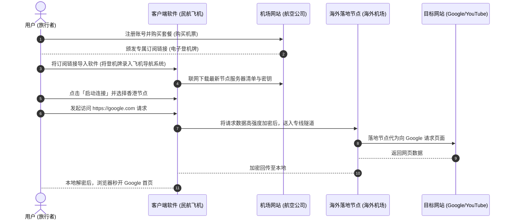
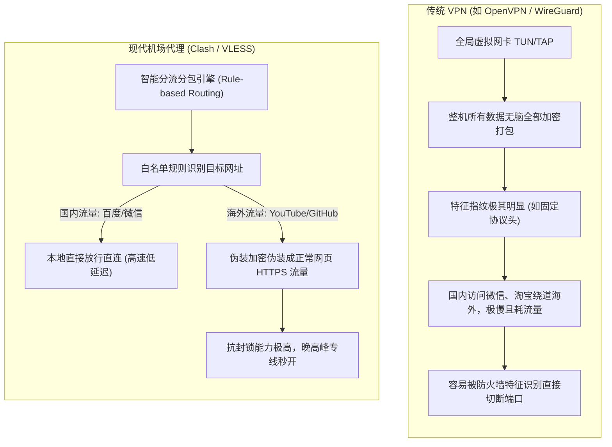
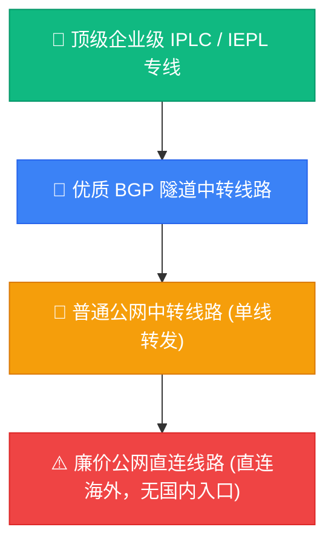

# 什么是机场：零基础理解机场、节点、订阅与代理

  <strong>核心结论：</strong>「机场」是网络代理服务商的俗称，它提供节点服务器和订阅链接，让你通过客户端工具安全连接到境外互联网。新手需要理解的核心四要素是：<strong>机场 = 航空公司/服务商</strong>，<strong>节点 = 航班目的地/服务器机房</strong>，<strong>订阅 = 电子机票/连接凭证</strong>，<strong>客户端 = 飞机/使用工具</strong>。本文用生活化比喻帮你 30 分钟彻底搞懂所有底层概念。

<AffiliateNotice />

---

## 一、为什么网络代理服务商被称为「机场」？

对于刚接触科学上网的小白来说，「机场」这个词往往让人摸不着头脑：*我只是想查阅海外学术资料或者看 YouTube，这跟停放飞机的机场有什么关系？*

要解开这个谜题，我们需要回顾一段网络代理技术的简史：

### 1.1 纸飞机的历史渊源
2012 年，开发者 Clowwindy 开源了一套轻量级代理协议 **Shadowsocks**。因为其客户端的图标采用了一只折叠的白色纸飞机，国内网络圈便普遍将此类代理工具亲切地称为「小飞机」。

### 1.2 从单机到集群：停机坪的诞生
随着需求扩张，单靠个人购买海外云服务器部署脚本变得过于繁琐。于是市面上出现了专门架设了几十乃至上百台海外服务器的商业服务商，并配套了带有注册、充值、分流的 Web 管理系统（如著名的 SSPanel）。网友们顺理成章地打趣道：**「既然软件是小飞机，那集中停泊、维护、分派上百架飞机的地方，自然就是『机场』了。」**

久而久之，「机场」便成为了中文互联网中**网络中继/代理服务商的行业代名词**。

---

## 二、小白必读：核心四要素的生活化大比喻

很多初学者容易将「客户端」、「节点」、「订阅」混为一谈，甚至以为在 App Store 下载了软件就能直接上网。为了建立清晰的逻辑架构，请牢记下表的大比喻：

| 代理概念 | 现实比喻 | 功能与作用 | 常见误区澄清 |
| :--- | :--- | :--- | :--- |
| **机场 (Airport)** | **航空公司 (如国航/阿联酋航空)** | 负责出资搭建网络专线、采购海外机房、提供客服与运维的**服务团队**。 | 机场不是软件，它是一个售卖网络通道的网站。 |
| **节点 (Node / Server)** | **航班目的地 (如香港/东京/洛杉矶)** | 部署在全球不同国家机房的**物理/虚拟服务器**。你的流量将从这里转发。 | 并不是节点越多越好，稳定低延迟的 5 个专线节点远超 100 个卡顿节点。 |
| **订阅 (Subscription)** | **电子登机牌 / 一卡通** | 一串包含所有节点服务器 IP、端口、加密密码的**动态网址/配置代码**。 | 订阅是私密凭证，泄露给他人会导致你的流量被他人盗刷光。 |
| **客户端 (Client)** | **民航客机 / 载具工具** | 运行在你的手机或电脑上的**开源软件**（如 Clash Verge, Shadowrocket）。 | 客户端本身不自带网络流量，必须把「订阅」塞给客户端才能起飞。 |

### 2.1 协同工作全流程图解

  
💡 关键心法记住一句话：

  软件是免费的空壳飞机，机场是卖航线服务的航空公司。买了航空公司的登机牌（订阅）塞给飞机（客户端），你才能飞往全世界。

---

## 三、机场与传统 VPN 的本质区别 (新手必读)

在非技术人群的日常口语中，「翻墙」、「VPN」和「机场」常被当成同一件事。但在计算机网络工程的定义中，二者的底层原理天差地别：

### 3.1 核心对比巨幅大表

| 对比维度 | 传统商业 VPN (如 Express, Nord) | 现代机场服务 (如光速云、IEPL专线) | 新手通俗解读与建议 |
| :--- | :--- | :--- | :--- |
| **底层设计初衷** | 企业员工远程接入公司内网加密传输 | 专门针对跨国网络中继与抗封锁优化 | 传统 VPN 不是为突破网络审查设计的。 |
| **国内应用分流** | 大多数默认全局代理，微信经常异地登录异常 | **智能分流**，国内 App 直连，海外走代理 | 用机场时打微信视频依然走国内千兆，互不影响。 |
| **流量伪装机制** | 数据包协议头特征明显，极易被防火墙标记封 IP | 采用 **VLESS / Trojan** 伪装成普通 HTTPS 网站 | 审查系统看起来就像在正常浏览网页，极度稳定。 |
| **延迟与游戏体验** | 普遍 180ms - 300ms 以上，无法打外服游戏 | 专线 IEPL/IPLC 低至 **30ms - 60ms** | 机场专线可以兼作游戏加速器使用。 |
| **设备电量消耗** | 全局加密计算开销大，手机明显发热耗电 | 局部轻量转发，省电且内存占用低 | 手机常驻后台一整天几乎不影响续航。 |

---

## 四、深入剖析：机场节点、协议与线路全景认知

当你打开机场官网时，经常会看到「香港 IEPL 01」、「日本 IPLC 02」、「BGP 中转」、「VLESS-Reality」等一长串技术术语。新手往往一头雾水，下面我们逐一拆解。

### 4.1 节点的三大核心属性
一个合格的节点包含三个核心要素：
1. **入口 (Ingress)**：你在国内建立连接的第一站（如深圳服务器、上海电信机房）；
2. **通道 (Transport)**：从国内入口到境外落地的物理传输通道（公网直连 vs 企业内网专线）；
3. **落地 (Egress)**：真正向目标网站发起请求的出口机房（如香港、日本、美国、新加坡原生住宅 IP）。

### 4.2 线路等级金字塔

- **IPLC (International Private Leased Circuit)**：国际私有租用线路。两端都是内网，完全不经过公网国际出口防火墙，0 丢包，敏感时期最稳。
- **IEPL (International Ethernet Private Line)**：国际以太网专线。采用二层以太网技术，延迟极低，晚高峰完全不卡。
- **公网直连**：从你家宽带直接向海外服务器发包，晚高峰国际出口拥堵不堪，容易丢包 30% 以上，极度不推荐新手购买。

---

## 五、新手常见十大疑问极速答疑 (FAQ)

<strong>Q1：用机场安全吗？我的银行卡密码会被偷看吗？</strong>

答：只要目标网站采用 HTTPS 加密（现代互联网 99.9% 网站均已普及），机场节点只能看到你访问了哪个域名（如 google.com），但绝对无法解密你的传输内容（如密码、银行卡信息）。正规开源客户端（如 Clash Verge）源代码公开，无后门。

<strong>Q2：免费机场能长期用吗？</strong>

答：天下没有免费的午餐。海外服务器和专线带宽每个月都是昂贵的硬性成本。免费节点通常有极低的速度限制、严苛的流量配额，部分甚至植入广告或嗅探非加密流量，仅适合用于紧急情况查阅文本。

<strong>Q3：为什么我买了机场，有些国内软件显示异地登录？</strong>

答：这是因为你的客户端未开启「规则分流模式 (Rule)」，而是错误开启了「全局模式 (Global)」。开启规则模式后，微信、支付宝等国内应用将自动绕过代理直连，不再触发风控。

<strong>Q4：月付几十块的机场和几百块一年的，差别在哪里？</strong>

答：主要差别在于线路质量（IEPL专线 vs 廉价公网）、节点带宽冗余度、晚高峰抗拥堵能力、原生 IP 流媒体解锁能力以及人工客服的响应时效。

<strong>Q5：如果某天机场的官网打不开了，我的客户端还能正常上网吗？</strong>

答：完全可以正常使用！这是因为「网站管理面板」与「底层的物理专线节点」是完全物理隔离的两套独立服务器。即使机场的前端官网遭遇域名被阻断或服务器维护，只要你此前已经将订阅成功导入客户端，客户端是直接与全球各个节点的专线 IP 建立加密通信，丝毫不影响日常上网。你只需等待服务商在 Telegram 公告群公布最新备用域名即可。

<strong>Q6：什么是节点的「倍率」？1倍率与0.2倍率、3倍率有什么区别？</strong>

答：倍率是指你的实际数据传输量折算为套餐扣除流量的系数比例。如果使用 1.0 倍率节点，下载 1GB 视频就从套餐中扣除 1GB；如果使用 0.2 倍率的低倍率节点，下载 1GB 文件仅扣除 200MB（极适合下载超大文件）；而 3.0 倍率通常是成本极高的极速专线或原生独享 IP 节点，传输 1GB 将扣除 3GB 流量。新手日常查资料、看视频建议优先选择标准的 1.0 倍率专线节点。

---

## 六、本章小结与新手行动指南

通过本篇的学习，你已经掌握了科学上网的核心概念：
1. 明确了「机场是服务，客户端是工具」的分离架构；
2. 理解了为什么现代机场远比传统 VPN 更适合中文互联网用户；
3. 认识了 IEPL/IPLC 企业专线在晚高峰抗卡顿方面的绝对优势。

那么，作为零基础小白，**第一步到底该如何挑选工具？电脑和手机分别该怎么准备？** 请跟随核心学习路径继续前进。

<NextStep
  title="第二站：梯子入门：新手如何从零开始科学上网"
  link="/guides/"
  description="搞懂概念后，下一步将详细剖析电脑与手机的上网方案、新手第一次上网的完整操作闭环以及最容易踩的 8 个新手误区。"
  stepText="新手核心学习主线 · 第 2 站"
  buttonText="进入下一站：梯子入门指南 →"
/>
