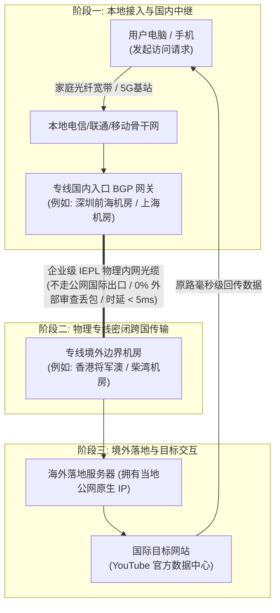
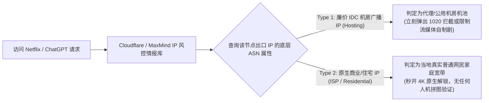
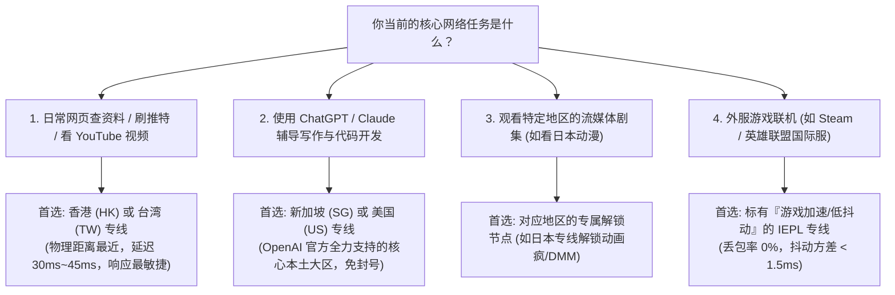

# 机场节点是什么：入口服务器、专线中继、落地机房与原生 IP 深度解密 (2026 深度通识)

  <strong>核心结论与先验建议 (Answer-First)：</strong>在网络代理客户端的列表中，你看到的诸如「香港 IEPL 01」、「日本 专线 02」、「美国 住宅 03」等名称，统称为<strong>「节点（Node）」</strong>。
    
  许多初学者误以为点击了“香港节点”就是电脑直接连到了香港的某台电脑上。从计算机网络体系结构来看，<strong>一个合格的现代代理节点本质上是「一条由三段物理硬件组成的数据接力链路」</strong>：
  <ul>
    <li><strong>1. 国内接入入口（Ingress）</strong>：部署在深圳、上海等国内骨干网 BGP 机房的服务器，负责接收你的客户端加密连接；</li>
    <li><strong>2. 跨国专用通道（Transport）</strong>：连接国内入口与海外机房的物理内网光纤（IEPL/IPLC），实现跨国数据毫秒级无损传输；</li>
    <li><strong>3. 境外落地出口（Egress）</strong>：真正部署在香港、东京、洛杉矶当地机房的物理服务器，拥有当地公网 IP，负责代你向 Google、YouTube 或 Netflix 发起访问。</li>
  </ul>
  节点的核心考核指标唯有两点：<strong>线路是否为物理内网专线（决定晚高峰丢包与延迟）</strong>与<strong>落地机房是否具备纯净原生 IP（决定流媒体与 ChatGPT 的解锁通过率）</strong>。综合实测，<strong>[光速云 (GSY)](/reviews/#gsy)</strong>在核心 11 大地区的专线节点质量与原生纯净度上表现极为出众。

<AffiliateNotice />

---

## 一、节点的第一性原理：拆解三段式物理通信接力架构

为了彻底搞懂节点的工作流程，我们以你点击浏览器访问 `https://www.youtube.com` 为例，还原数据包在物理网络设备中的真实接力路径：

### 1.1 为什么必须分为“入口”与“落地”两端？
1. **解决跨网互联卡顿**：中国大陆存在电信、联通、移动、广电等多个不同的运营商网络，不同运营商之间的公网互通往往存在严重的跨网结算与 QoS 限速。优质机场的国内入口采用 **多线 BGP（Border Gateway Protocol）技术**，无论你使用的是什么宽带，都能以 10ms 以内的极低延迟接入最近的入口服务器。
2. **保护海外出口不被墙**：国内用户直接向海外 IP 发起大量高频连接，极易被防火墙检测并拦截封锁。通过让国内入口与境外落地之间建立点对点专属物理内网隧道，外部审查系统根本看不到海外真实机房的 IP 地址，保障了海外节点的长治久安。

---

## 二、原生 IP vs 机房广播 IP：为什么有的节点打不开 Netflix 或 ChatGPT？

许多新手经常困惑：“为什么我连上了某个叫‘香港’的节点，打开 Google 显示正常，但一打开 Netflix 却提示‘您似乎在使用解锁工具或代理’？打开 ChatGPT 甚至直接报错 `1020 Access Denied`？”

这触及了代理节点最关键的核心指标——**IP 类型的纯净度与所属自治系统号（ASN）**：

### 2.1 原生 IP 与机房广播 IP 的底层技术界定

| 评估维度 | 原生商业 / 住宅 IP (Native/Residential) | 廉价 IDC 机房广播 IP (Broadcast/Hosting) |
| :--- | :--- | :--- |
| **IP 注册归属地 vs 物理机房** | **100% 完全一致**（注册在香港，物理机房就在香港） | **严重脱节**（物理服务器在美国，通过 BGP 宣告伪造在香港） |
| **IPinfo / MaxMind 数据库标记** | **`isp`** 或 **`residential`**（标记为当地真实宽带） | **`hosting`** 或 **`datacenter`**（公认的商业机房池） |
| **流媒体解锁能力 (Netflix/Disney+)** | **完美原生全解锁**，可看全部当地版权影视 | 只能看没有版权限制的 Netflix 自制剧或直接被拦截 |
| **AI 工具支持 (OpenAI / Claude)** | **零风控通过**，无需输入手机号，流式极速响应 | 频繁弹出 Cloudflare 5 秒盾，甚至连带触发账号封禁 |
| **采购运营成本** | **极其高昂**（通常是普通机房 IP 成本的 5～10 倍） | **极度低廉**（小作坊最爱用来虚标几十个虚假国家） |

> [!TIP] 警惕小机场的“虚假百国节点”
> 许多不良小机场宣传“覆盖全球 80 个国家”。实质上，其背后只有 1 台部署在美国的廉价服务器，通过申请大量便宜的广播 IP（BGP Anycast），强行将其在软件上标记为“阿根廷、土耳其、尼日利亚、印度”。这种虚假节点不仅延迟高达数千毫秒，而且已被各大风控数据库列入黑名单，毫无实用价值。

---

## 三、真实小白使用节点翻车案例实录 (1:1 案例库)

### 案例 1：外贸业务员误选“广播香港节点”，PayPal 商业账号被冻结
* **学员档案**：外贸 SOHO 创业者小陈，需要定期登录 PayPal 查收海外客户的小额定金。
* **踩坑过程**：小陈在某廉价机场中随意选择了一个名为“香港 08”的免费节点进行登录。刚输入完密码，PayPal 立即弹出红色安全告警：“检测到高危代理环境，您的账户已被临时限制交易，请提交营业执照与法人护照申诉”。
* **深层根源分析**：该机场所谓的“香港 08”节点实际上是一个通过广播伪造的机房 IP，该 IP 曾被数百个黑客用于进行自动化撞库攻击，在国际反欺诈情报数据库中信誉分（Fraud Score）高达 98 分（满分 100 分，极度高危）。
* **实战结论**：**涉及资金交易、外贸运营等核心商业场景，必须坚决锁定具备原生纯净 IP 的高品质节点**。

### 案例 2：留学生追剧党换用光速云原生专线，港剧 4K 秒开无任何提示
* **学员档案**：港剧与动漫爱好者小李，酷爱在 Netflix 和动画疯上追番。
* **转变历程**：小李此前经常遇到“剧集列表突然消失”的尴尬。后来换用了[光速云 (GSY)](/reviews/#gsy)的“香港 IEPL 原生专线”。点击进入 Netflix，所有香港地区限定的华语电影与欧美院线大片完整呈现，画质自动拉升至 Ultra HD 4K 模式，缓冲进度条瞬间拉满。
* **实战结论**：**真正的优质节点能让你彻底遗忘“节点”的存在，享受无缝的原生互联网生活**。

---

## 四、小白选节点的四大黄金铁律 (30 秒选型法)

很多新手打开客户端看到几十个节点，往往不知道该点哪一个。请牢记以下四条黄金选型法则：

---

## 五、痛点心流驱动：拥抱全原生专线，告别虚标节点

不要被那些号称“拥有 500 个全球节点”的营销噱头所蒙蔽。对于绝大多数人而言，**5～10 个具备极高纯净度与低延迟的物理内网专线节点，就能完美解决 100% 的应用场景需求**。

[光速云 (GSY)](/reviews/#gsy) 坚持走精品专线路线，精准布局了全球 11 大核心地区的优质机房：

<BrandCard brandId="gsy" />

  
💡 为什么光速云的节点矩阵最受技术圈认可？

  <ul>
    <li><strong>真 IEPL 企业级物理专线</strong>：拒绝廉价公网直连中转，深圳/上海点对点物理光缆直达海外，晚高峰丢包率恒定在 0.5% 以下。</li>
    <li><strong>精选 11 大核心地区原生机房</strong>：全面覆盖香港、日本、美国、新加坡、台湾、英国等高频地区，全面原生解锁 Netflix、Disney+ 与 ChatGPT。</li>
    <li><strong>平民级极低试错门槛</strong>：最低档套餐折合仅需 <strong>8元/月</strong>，输入官方专属优惠码 <code>AMM</code> 享折上折，支持支付宝原生扫码秒开。</li>
  </ul>

<PromoCard brandId="gsy" />

---

## 六、下一步系统化学习路线引导

搞懂了节点的物理构成后，很多新手好奇：“那这几十个节点，是怎么被打包成一串短短的网址发给我的？”接下来让我们揭开订阅链接的秘密：

1. **机场订阅链接背后的工作原理**：阅读 [`/what-is-airport/subscription-explained`](/what-is-airport/subscription-explained) 了解动态配置分发与 Token 鉴权；
2. **常用加密协议深度解析**：阅读 [`/what-is-airport/protocols-explained`](/what-is-airport/protocols-explained) 剖析 VLESS、Trojan 与 Shadowsocks 的优劣；
3. **线路类型全景科普**：阅读 [`/what-is-airport/lines-explained`](/what-is-airport/lines-explained) 搞懂 BGP 中转与 IEPL 专线的物理造价差距。

---

<NextStep
  title="下一篇：机场订阅链接与工作原理深度解析"
  link="/what-is-airport/subscription-explained"
  description="那串长长的网址里到底藏着什么？手把手带你解密 Base64 加密订阅、Token 身份鉴权与客户端自动更新的底层逻辑。"
  stepText="新手进阶 · 下一步"
  buttonText="查看订阅链接原理解析 →"
/>
