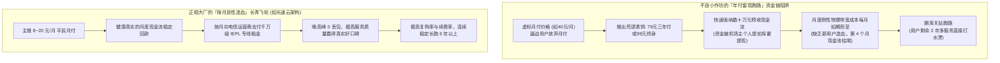
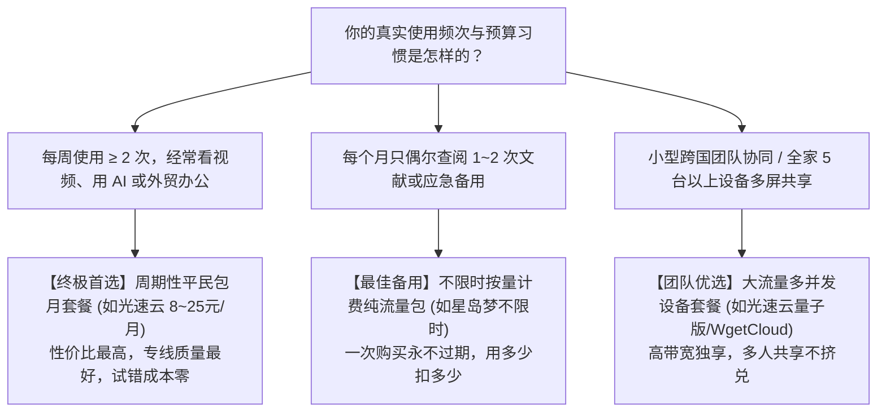

# 机场常见收费模式深度解析：包月订阅、不限时按量付费与大额年付陷阱 (2026 深度决策)

  <strong>核心结论与先验建议 (Answer-First)：</strong>在网络代理的商业市场中，<strong>套餐的「计费模式」直接决定了服务商的跑路概率与你的资金安全边界</strong>。
    
  对于零基础新手而言，面对五花八门的收费套餐，<strong>切勿被“年付 5 折”、“买两年送一年”或“终身无限流量”等巨大的价格折扣所诱惑</strong>。
    
  2026 年计费选型的黄金防雷法则：
  <ul>
    <li><strong>90% 普通用户的最优解：坚决选择「小额按月付费（8～20元/月）」</strong>。现金流按月良性循环的服务商最安全，用户进退自如，即使遭遇外部极端网络波动，最大试错成本仅仅是一杯奶茶钱；</li>
    <li><strong>极低频备用用户的极客解：选择「不限时按量计费包（Non-expiring Traffic）」</strong>。一次性购买 100G～300G 纯流量，永不过期，用多少扣多少，适合仅用于突发学术查词、紧急邮件接收的应急备用党；</li>
    <li><strong>新手绝对禁止触碰的死亡雷区：坚决不碰「大额两年付/三年付」与「终身永久会员」</strong>。这类套餐 99% 是黑作坊在资金链断裂前夕实施的大规模套现跑路收割盘。</li>
  </ul>
  优质老牌专线机场（如<strong>[光速云](/reviews/#brand-gsy)</strong>）始终将月付保持在 8 元平民档位，尊重用户选择权。

<AffiliateNotice />

---

## 一、收费模式的第一性原理：为什么不良商家总是千方百计诱导你买“大额年付”？

许多新手经常感到困惑：“为什么很多机场的月付价格高得离谱（如 40 元/月），而年付却只要 60 元/年？甚至客服在群里天天催促用户‘升级年付享受骨折特惠’？难道商家真的不在乎利润吗？”

从商业运营的**预收现金流（Prepaid Cashflow）**与**破产逃逸博弈模型**来看，这背后隐藏着极其残酷的商业算计：

### 1.1 现金流模型对比：预收透支 vs 持续造血
* **小作坊的心理动机**：小机场主深知自己的线路是廉价劣质公网中继，一旦用户按月付费，下个月有 80% 的人会因为卡顿而退订。因此，他们唯一的生存手段就是**“一锤子买卖”**——通过极低的价格把用户两到三年的费用一次性骗到手。至于一年后服务器还能不能连？机场主从一开始就没打算负责。
* **正规专线大厂的底气**：像[光速云](/reviews/#brand-gsy)这样运营了多年的一线服务商，其盈利模型建立在**“极致口碑带动的高复购率”**之上。用户每月花费 8 元，觉得好用就会自然续费第二个月、第三个月。只有敢于把月付门槛放到最低、让用户按月投票的品牌，才具备真正经得起时间考验的硬核实力。

### 1.2 带宽超售率（Overbooking Ratio）与 95 计费法精算模型
从现代网络机房的经济学底层来看，上游运营商对 IDC 机房普遍采用 **95 峰值计费法（95th Percentile Billing）**：
1. **小作坊的致命超售陷阱**：劣质小机场为了实现表面上的超低价，会采用高达 **1:100 甚至 1:200 的极端超售率**（即 1Gbps 的物理带宽分配给上千名年付用户）。在白天大家不上网时看似正常，但一到晚上 20:00～23:00 晚高峰，由于并发流量瞬间挤死物理接口，机房产生剧烈丢包，所有用户的网络瞬间雪崩；
2. **标杆专线的超售约束底线**：高品质商业专线严格将超售率控制在 **1:5 至 1:10 的安全工程冗余区间**，并常备 30% 以上的物理冗余突发池。即使在晚高峰千人并发拉取 4K 视频，骨干专线依然具备充足的净空（Headroom），这也是为什么优质月付专线能够始终保持 4K 秒开的物理数学支撑。

---

## 二、三大主流计费模式深度剖析与适用场景

新手应当根据自身的真实使用频次，在以下三类计费模型中精准选型：

### 2.1 模式 1：周期性包月订阅（Monthly Subscription）—— 综合首选
* **计费规则**：按月（30天）支付固定费用（通常 8～25 元），每月重置固定配额流量（通常 60GB～300GB），月底未用完的流量自动清零。
* **核心优势**：
  1. 试错成本趋近于零（本月不爽，下个月随时换家）；
  2. 享有最高级别的专线接入特权，晚高峰受到严格服务质量保障；
  3. 支持支付宝当面付扫码，无需大额资金沉淀。
* **适配人群**：**90% 的绝大多数用户**。包括每天需要使用 ChatGPT、刷推特、看 YouTube 4K 视频、远程办公与文献查阅的人群。

### 2.2 模式 2：不限时按量计费（Pay As You Go / Non-expiring Traffic）—— 极简备用
* **计费规则**：一次性支付一笔费用（如 30 元～60 元），购买 100GB～200GB 纯流量。该流量**永远不过期**，直到你彻底用完为止。
* **底层成本逻辑**：为什么按量计费单价通常比包月略贵？因为服务商必须在服务器端永久为你保留账号路由条目与备用带宽余量，沉没成本较高。
* **适配人群**：**极低频网络使用者**。例如每个月只在特定时刻查阅几篇英文论文的医学生、或者仅将该节点作为“防断网备用应急钥匙”的极客。

### 2.3 模式 3：并发设备数授权套餐（Device-based License）—— 团队出海
* **计费规则**：不限制单月流量，或者提供数千吉字节大流量，但严格限制**同时在线的客户端设备数量（如 3 台 / 5 台 / 10 台并发）**。
* **适配人群**：外贸跨境电商团队、多人多屏合租工作室，或者拥有全家多台智能电视盒子、多台手机与笔记本的重度数码家庭。

---

## 三、真实小白计费翻车与理性决策实录 (1:1 案例库)

### 案例 1：迷信“超值两年付”，两个月后机场改名跑路
* **学员档案**：数码爱好者小王，在某推广博客看到某小机场宣传“三年付立减 70%，仅需 88 元包三年”。
* **惨痛教训**：小王心想“才 88 块钱，就算跑路了也不心疼”。付款两个月后，全部节点出现持续超时。小王点进其官网，发现域名已被重定向至一个全新的赌博网站，官方群全员禁言，机场主卷款数万元不知所踪。小王不仅损失了 88 元，更耽误了手头紧急的外贸客户跟进，不得不重新花费精力和金钱寻找新服务商。
* **深层警示**：**“虽然钱不多，但耽误的事很大”！坚决不给任何不良商家提供透支套现跑路的机会**。

### 案例 2：外贸专员坚持 8 元月付，六个月稳定无忧
* **学员档案**：外贸业务专员赵女士，平时主要使用 WhatsApp 与海外客户沟通，偶尔看 YouTube 产品解说。
* **实战体验**：赵女士吸取了前人的教训，首次购买严格遵循本站建议，选择了[光速云 (GSY)](/reviews/#brand-gsy) 的月付方案，结账时实付仅 **8 元**。整月使用下来，WhatsApp 消息秒发秒收，客户视频通话高清不卡，月末流量剩余 35GB。赵女士连续按月续费了半年，表示：“只花了 8 块钱，相当于少喝半杯奶茶，却解决了困扰我半年的出海沟通大难题，体验完全超出预期！”
* **实战结论**：**理性的第一单决策，是用最低的资本换取最高的确定性**。

### 案例 3：学术研究生购买大额年付遭遇海缆断裂，服务商无备用专线被迫二次付费
* **学员档案**：工科在读博士生小何，为省事一次性购买了某二线机场的 280 元大额年付套餐。
* **踩坑经历**：半年后某跨国海底光缆发生物理故障，该小机场由于未采购任何冗余备用专线，全节点直接红字断网长达两周。小何正处于论文大修（Major Revision）的关键回复期，面对天天卡顿超时的网络，不得不临时另外花费 8 元紧急购买了光速云专线月付救急。小何事后感慨：“年付虽然省了几十块，但一旦遇到事故商家无力承担冗余备线，损失的依然是自己的时间和课题进度。”
* **实战警示**：**月付不仅保障资金安全，更是对服务商持续提供多线路冗余保障的有效监督机制**。

---

## 四、全场景计费模式精准选型决策树

---

## 五、痛点心流驱动：拥抱健康透明商业，选择 8 元平民月付

在琳琅满目的收费模式面前，新手的最佳策略是**“化繁为简，坚守月付”**。

[光速云 (GSY)](/reviews/#brand-gsy) 坚持走健康可持续的商业路线，坚决不搞任何“终身无限”等虚假跑路营销，始终将核心月付门槛稳定在平民区间：

<BrandCard brandId="gsy" />

  
💡 为什么光速云的计费机制最让人踏实？

  <ul>
    <li><strong>坚守平民化低门槛月付</strong>：起步套餐折合仅需 <strong>8元/月</strong>，在结账收银台输入官方专属优惠码 <code>AMM</code> 享折上折，支持国内支付宝原生安全扫码秒开。</li>
    <li><strong>双专线工业级底座</strong>：主用 IEPL 企业内网专线 + 备用中转双线路冗余，彻底告别晚高峰卡顿与单点故障。</li>
    <li><strong>透明消费，进退自如</strong>：没有任何隐形自动续费扣款，觉得好用下个月直接续费，觉得不合适随时更换，拥有百分之百的消费自由。</li>
  </ul>

<PromoCard brandId="gsy" />

---

## 六、下一步系统化学习路线引导

全面搞懂了计费模式与防套路原则后，为了彻底消除你在中文网络中常见的各种词汇困惑，建议继续研读：

1. **机场/梯子/科学上网概念剖析**：阅读 [`/what-is-airport/terminology-differences`](/what-is-airport/terminology-differences) 深入理解各种口语暗语与技术黑话；
2. **小白必懂的 30 个术语词典**：查阅 [`/what-is-airport/glossary`](/what-is-airport/glossary) 建立完整的网络代理词汇库；
3. **前往客户端中心安装软件**：查阅 [`/clients/`](/clients/) 获取适合你设备的主流官方安装包。

---

<NextStep
  title="下一篇：机场、梯子与科学上网概念深度剖析"
  link="/what-is-airport/terminology-differences"
  description="梯子、机场、代理、翻墙、科学上网...这些词到底是一回事吗？深度剖析灰色黑话背后的技术演进与文化暗语。"
  stepText="新手进阶 · 下一步"
  buttonText="查看术语与概念辨析 →"
/>
