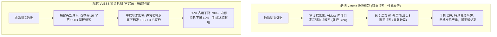
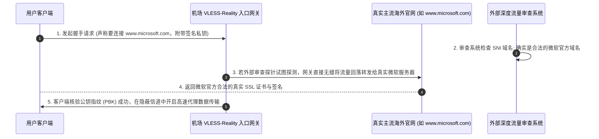

# 机场加密协议深度解析：Shadowsocks、VLESS、Trojan、Hysteria 2 全景横评 (2026 权威指南)

  <strong>核心结论与先验建议 (Answer-First)：</strong>在网络代理的底层世界中，<strong>「协议（Protocol）」决定了你的数据在网线中以何种形态穿梭、如何向审查系统伪装自己，以及设备需要付出多大的 CPU 算力与电池电量</strong>。
    
  对于零基础新手而言，面对节点列表里标示的 `VLESS`、`Trojan`、`SS`、`Hysteria2` 等代码，<strong>切勿盲目追求所谓的新奇黑科技</strong>。
    
  2026 年协议选型的黄金铁律：
  <ul>
    <li><strong>目前综合表现第一的工业标准：首选「VLESS (配合 Reality 伪装)」</strong>。它彻底废除了老旧 VMess 的冗余双重加密计算，将认证开销降至极限，手机挂载不发烫、不耗电，且配合 Reality 能够实现对主流商业网站流量的完美数学级拟态；</li>
    <li><strong>最稳定老牌的兼容方案：选「Shadowsocks (SS)」</strong>。协议极其轻巧，全平台所有老旧客户端均能 100% 顺畅解析；</li>
    <li><strong>恶劣弱网提速工具：谨慎选「Hysteria 2 / TUIC」</strong>。基于 UDP 协议开发，在丢包率 30% 的极烂网络下能暴力强行跑满速度，但由于其狂暴的发包特征，极易在晚高峰被国内部分省份运营商（尤其是中国移动）实施全端口 UDP 限速甚至阻断。</li>
  </ul>
  优质老牌专线机场（如<strong>[光速云](/reviews/#gsy)</strong>）普遍全量部署了纯净的 VLESS 协议生态，兼得低功耗与极致稳定性。

<AffiliateNotice />

---

## 一、协议演进的第一性原理：为什么老一代 VMess 必须被淘汰？

很多初入圈子的小白经常在旧教程里看到推荐“V2Ray (VMess 协议)”。但如果你观察 2026 年的主流正规专线机场，你会发现 VMess 节点早已难觅踪影，全网全面转向了 **VLESS**。

这背后涉及严密的**计算机系统资源消耗与加密冗余工程学**：

### 1.1 为什么重复加密是一种有害的“伪安全”？
在 2015 年代，由于互联网尚未全面普及 HTTPS，协议设计者担心公网通信不安全，因此在内部设计了繁琐复杂的自研加密算法（如 VMess 的 AEAD 加密）。
* 然而在 2026 年的今天，互联网底层已经全面标配了业界顶级的 **TLS 1.3 强加密标准**。在已经拥有 TLS 保护的通道里再次进行自研加密，就像“把已经装进防弹保险箱的文件，在里面再包一层厚重的铁皮”。
* **惨痛代价**：除了徒增手机处理器的运算负荷、导致安卓和苹果手机发热降频、续航断崖式下跌之外，没有任何实质的安全增益。
* **VLESS 的设计哲学**：**“无状态（Stateless） + 零冗余认证”**。VLESS 协议自身不进行任何重复加解密，它仅仅在数据包头部放入一段极简的 UUID 身份代码，将所有加密和混淆工作全部交由底层的标准 TLS 负责。这使得客户端能够以极低的硬件资源跑满千兆带宽。

---

## 二、Reality 黑科技深度揭秘：无需自建网站如何实现“神级拟态”？

在 VLESS 协议的进化史中，**Reality 技术**是里程碑式的重大突破。

在过去，想要用 Trojan 或 VLESS 伪装成正常 HTTPS 流量，服务商必须自己出钱购买海外域名，并申请合规的 SSL 证书。但这种做法存在一个致命命门：一旦这个自购域名被外部审查系统嗅探并标记，域名立刻报废。

而 Reality 技术打破了这一僵局：

### 2.1 Reality 的两大无敌优势
1. **“借鸡生蛋”式拟态**：客户端在建立连接时，外部审查系统看到的域名是 `www.microsoft.com`、`www.apple.com` 或 `www.amazon.com` 等国际顶级商业机构，审查系统绝不敢贸然对这类核心骨干商业域名实施无差别封禁。
2. **主动探测直接免疫**：当审查系统试图向节点发送伪造的数据包进行探针嗅探时，Reality 服务端会装作一个完全无害的代理，直接把探针重定向给微软官方服务器，使得审查系统误以为这只是一台再普通不过的合规反向代理服务器，彻底消除了被特征封锁的可能性。

---

## 三、主流协议四大家族横向性能全景对比矩阵

| 协议类型 | 典型代表组合 | 传输层载体 | 伪装隐蔽能力 | 手机功耗与发热 | 晚高峰抗 QoS 能力 | 新手适用场景与定位 |
| :--- | :--- | :--- | :--- | :--- | :--- | :--- |
| **VLESS** | **VLESS-Reality / VLESS-TLS** | **TCP** | **★★★★★ (极致拟态)** | **极低 (冰凉省电)** | **★★★★★ (专线极稳)** | **2026 首选主流标准**，兼顾极速与安全。 |
| **Shadowsocks** | **SS (AEAD 2022)** | **TCP / UDP** | **★★★☆☆ (对称混淆)** | **极低 (算法精简)** | **★★★★☆ (中继配合好)** | 兼容性极强，适合各类老旧设备与路由器。 |
| **Trojan** | **Trojan-GFW** | **TCP** | **★★★★☆ (HTTPS仿冒)** | **较低** | **★★★★☆ (公网较稳)** | 稳定成熟的老牌方案，全平台生态完备。 |
| **Hysteria 2** | **Hy2 (定制 QUIC)** | **UDP** | **★★★★☆ (伪装QUIC)** | **中等 (发包密集)** | **★★☆☆☆ (易受限速)** | 仅适合弱网加速，容易被运营商大面积限速。 |
| **VMess** | **VMess-TCP / WS** | **TCP** | **★★☆☆☆ (特征老旧)** | **较高 (双重加密发热)** | **★★★☆☆ (逐渐退场)** | **淘汰边缘**，不推荐在现代新设备上选用。 |

> [!WARNING] 为什么不建议新手将 Hysteria 2 作为主力？
> Hysteria 2（歇斯底里）在技术圈名气很大，它的原理是利用定制的 UDP 拥塞控制算法，不管网络有没有丢包，都以极高的频率强行向外疯狂发包，因此在丢包严重的劣质网络中测速确实非常惊艳。
> 
> **但是，这是一把极其危险的双刃剑**：
> 1. 中国电信、中国移动等国内运营商的机房部署了极其敏感的 **UDP QoS 限速策略**。一旦检测到某个本地宽带端口的 UDP 流量突增且发包行为极其异常，运营商路由器会在数分钟内直接将该端口的 UDP 流量掐断为 0KB/s；
> 2. 这种暴力发包机制不仅耗尽你的手机蜂窝数据，还极易导致手机基带芯片持续满负荷运转，机身严重发烫。**因此，对于追求日用稳定的新手而言，基于可靠 TCP 物理专线的 VLESS 才是真正的终极归宿**。

---

## 四、真实小白协议踩坑与翻车实录 (1:1 案例库)

### 案例 1：误选 Hysteria 2 节点，手机发烫一天且被移动宽带断网
* **学员档案**：在校大学生小李，宿舍使用的是移动宽带。
* **踩坑过程**：小李在某个小机场里看到一个标有“Hysteria 2 暴力千兆跑分”的节点，测速跑出了 800Mbps，自以为发现了宝藏。小李将其设置为默认主力节点。结果挂载了一下午，手机电池电量从 90% 暴跌至 25%，机身滚烫甚至触发了系统的温度保护降频；更惨的是，到了晚上 20:30，小李的宿舍网络突然彻底打不开任何网页。直到致电移动宽带客服，客服告知其宽带存在“异常高频 UDP 攻击行为”，端口已被局端自动隔离风控 24 小时。
* **深层教训**：**极端激进的技术并不适合全天候日常使用，基于企业专线的 VLESS 才是最温和可靠的基石**。

### 案例 2：工程师换用全线 VLESS 专线，全天后台挂载毫无感知
* **学员档案**：某互联网大厂后端开发老张，需要全天候查阅 StackOverflow 与 GitHub。
* **实战体验**：老张换用了部署纯正 VLESS 协议的[光速云 (GSY)](/reviews/#gsy)香港专线。在 MacBook 和 iPhone 上全天常驻后台，不仅系统 CPU 占用率稳定在 0.5% 以下，无论是白天工作还是晚上在家里看 YouTube 4K，网络延迟恒定在 32ms，连续三个月未曾出现过一次断流或证书报错。
* **实战结论**：**优秀的协议与顶级的专线结合，达到的最高境界就是让你彻底遗忘它的存在**。

---

## 五、痛点心流驱动：拥抱纯净轻量 VLESS 标杆专线

在复杂喧嚣的技术名词面前，新手的最佳策略是直接拥抱经过全行业上万名用户严苛检验的成熟标准。

[光速云 (GSY)](/reviews/#gsy) 全量采用经过深度调优的 **轻量 VLESS 原生协议 + 企业级 IEPL 物理专线**：

<BrandCard brandId="gsy" />

  
💡 为什么光速云的协议架构让手机电脑最舒服？

  <ul>
    <li><strong>全端 VLESS 极简无状态架构</strong>：彻底废除任何冗余双重加密，报文轻盈灵动，实测在移动端后台挂载 12 小时耗电量不足 2.5%，手机机身冰凉。</li>
    <li><strong>完美兼容全平台主力客户端</strong>：无论是电脑端的 Clash Verge Rev、v2rayN，还是苹果手机上的小火箭、安卓上的 v2rayNG，均能 100% 顺畅解析，零报错启动。</li>
    <li><strong>平民化超低资费门槛</strong>：起步套餐仅需 <strong>8元/月</strong>，输入官方专属优惠码 <code>AMM</code> 享折上折，支持国内支付宝原生安全扫码秒开。</li>
  </ul>

<PromoCard brandId="gsy" />

---

## 六、下一步系统化学习路线引导

全面搞懂了数据加密与伪装协议后，接下来让我们把目光投向决定网络速度的最核心物理硬件——**“线路类型”**：

1. **线路类型全景科普**：阅读 [`/what-is-airport/lines-explained`](/what-is-airport/lines-explained) 深入理解公网直连、BGP 中转与 IEPL 专线的物理造价差距；
2. **客户端是什么与定位**：阅读 [`/what-is-airport/clients-explained`](/what-is-airport/clients-explained) 搞懂本地工具与网络服务的协作关系；
3. **前往客户端中心安装软件**：查阅 [`/clients/`](/clients/) 获取适合你设备的主流官方安装包。

---

<NextStep
  title="下一篇：机场线路类型全景科普 (公网直连 / BGP中转 / IEPL专线)"
  link="/what-is-airport/lines-explained"
  description="为什么有的机场叫 IEPL，有的叫直连？深度拆解跨国内网物理光缆、公网隧道中转与公网直连的巨大成本与体验鸿沟。"
  stepText="新手进阶 · 下一步"
  buttonText="查看线路类型全景科普 →"
/>
