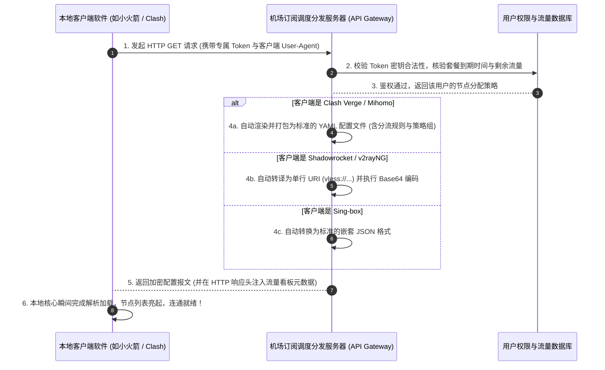

# 机场订阅链接是什么：配置文件格式、动态分发机制与密钥安全原理 (2026 深度解密)

<div class="answer-first-lead">
  <strong>核心结论与先验建议 (Answer-First)：</strong>在购买机场服务后，你在后台复制的那串类似 `https://api.domain.com/api/v1/client/subscribe?token=...` 的长网址，被称为<strong>「订阅链接（Subscription URL）」</strong>。
  <br><br>
  对于零基础新手而言，<strong>切勿将订阅链接当成普通的网页去在浏览器中直接打开</strong>。从计算机网络工程的角度来看，<strong>订阅链接本质上是一个「安全配置分发 API 接口与用户身份私钥凭单」</strong>。
  <ul>
    <li><strong>它包含什么</strong>：几十个节点服务器的物理 IP/域名、监听端口、加密协议（VLESS/SS）、你专属的身份鉴权密钥（Token/UUID），以及你的剩余流量配额看板；</li>
    <li><strong>它是如何工作的</strong>：你的客户端（如 Clash Verge Rev、小火箭）通过该链接向服务器发送加密请求，服务器根据客户端类型自动下发量身定制的配置文件，使软件能够在 2 秒内一次性载入全部节点；</li>
    <li><strong>它的安全红线</strong>：<strong>订阅链接包含你的最高提权私钥</strong>，任何获取该链接的人都能无需密码直接使用你的流量！严禁截图发至公开群聊，一旦泄露必须立即在后台点击「重置订阅密钥」。</li>
  </ul>
  现代优质机场（如<strong>[光速云](/reviews/#gsy)</strong>）普遍支持全平台一键唤醒与多域名防阻断订阅分发，极大降低了新手的配置门槛。
</div>

<AffiliateNotice />

---

## 一、动态下发的第一性原理：订阅链接是如何自适应适配不同客户端的？

很多新手感到不可思议：“为什么同一串订阅链接，我复制进 Windows 电脑上的 Clash 能用，复制进苹果手机里的小火箭（Shadowrocket）也能用，甚至放进安卓的 v2rayNG 依然能用？难道不同软件的配置格式都是一样的吗？”

这背后依托于现代 Web 服务中经典的 **HTTP 内容协商（Content Negotiation）** 与 **User-Agent 智能特征识别** 技术：



### 1.1 客户端流量看板的技术秘密：`Subscription-Userinfo`
很多新手好奇：“为什么我把链接导入 Clash 之后，软件界面能准确显示我‘已用 18GB，总共 168GB，还有 23 天到期’？”
* 这是因为订阅服务器在返回节点数据的同时，在 HTTP 响应头（Response Headers）中静默注入了一行标准化的元数据：
  ```http
  Subscription-Userinfo: upload=1073741824; download=18253611008; total=180388626432; expire=1745280000
  ```
* 本地客户端读取该头部字段后，自动通过数学除法将字节（Bytes）换算为可读的 GB，并在界面生成实时进度条。

---

## 二、解剖订阅链接内部：Base64 编码 vs Clash YAML 配置

为了让你对订阅数据有直观的认知，我们将其拆解为底层数据结构：

### 2.1 传统 Base64 节点聚合格式（小火箭 / v2rayN 常用）
将一串杂乱无章的 Base64 字符进行解码后，你会看到每行都是一个标准的节点 URI 协议地址：
```text
# 解码后的节点列表原型：
vless://a1b2c3d4-e5f6-7890-abcd-1234567890ab@hk01.domain.com:443?encryption=none&security=reality&sni=www.microsoft.com&fp=chrome&pbk=xyz...#光速云-香港IEPL专线01
vless://a1b2c3d4-e5f6-7890-abcd-1234567890ab@jp01.domain.com:443?encryption=none&security=reality&sni=www.apple.com&fp=chrome&pbk=abc...#光速云-日本IEPL专线02
```
* **`UUID`**（`a1b2c3d4...`）：你的专属用户身份密码；
* **`hk01.domain.com:443`**：专线入口服务器的物理地址与连接端口；
* **`sni=www.microsoft.com`**：伪装域名，审查系统会认为你在正常访问微软官方。

### 2.2 现代化 Clash YAML 配置文件（Clash 系列常用）
如果客户端请求的是 Clash 格式，服务器会生成结构严谨的 YAML 语法树：
```yaml
port: 7890
socks-port: 7891
mode: rule
log-level: info

proxies:
  - name: "光速云-香港IEPL专线 01"
    type: vless
    server: hk01.domain.com
    port: 443
    uuid: a1b2c3d4-e5f6-7890-abcd-1234567890ab
    network: tcp
    tls: true
    reality-opts:
      public-key: xyz...

proxy-groups:
  - name: "🚀 节点选择"
    type: select
    proxies:
      - "光速云-香港IEPL专线 01"
      - "DIRECT"

rules:
  - GEOIP,CN,DIRECT
  - MATCH,🚀 节点选择
```

---

## 三、真实小白订阅泄露与翻车实录 (1:1 案例库)

### 案例 1：贴吧发帖求助未打码，300G 专线流量一小时被盗刷殆尽
* **学员档案**：大一新生小陈，在使用 Clash Verge 时遇到“导入报错”，在某贴吧发帖：“求助大佬看下我的配置为什么报错”，并附上了一张浏览器地址栏的未打码全屏截图。
* **惨痛翻车**：截图中赫然露出了完整的 `https://.../api/v1/client/subscribe?token=9f8e7d...` 链接。不到 10 分钟，监控贴吧的爬虫脚本自动抓取并提取了该 Token，将其注入到了公网爬虫的并发下载任务中。小陈半小时后登录后台，发现本月充值的 300GB 专线流量已被消耗 298GB，随后因并发 IP 超过 20 个被系统触发风控封禁账号。
* **深层警示**：**订阅链接里的 `token=` 后面的字符串就等同于你的银行卡取款密码！在任何社交平台发截图必须对链接进行 100% 涂抹打码！**

### 案例 2：不知道需要“更新订阅”，守着失效节点断网一周
* **学员档案**：外贸业务新人周女士，购买了某优质机场月付。
* **翻车过程**：服务商因国内机房网络扩容，在官网发布公告更换了新的入口解析域名。周女士平时不看公告，电脑客户端里的旧节点全部变红超时。周女士以为服务商跑路了，整整一个星期没有外网可用，直到向同事抱怨时，同事教其在客户端中点击了一下“刷新/更新订阅”按钮，最新节点列表秒级同步，网络瞬间恢复。
* **实战结论**：**订阅链接是动态活性的通道，养成每周点击一次“更新订阅”的习惯是保持顺畅的秘诀**。

---

## 四、手把手排障：订阅导入失败报 `Invalid Config` 的四大根因与秒解

在使用客户端导入订阅链接时，如果遇到红色报错弹窗，请对照以下四点快速自查：

```bash
# 在终端中直接使用 curl 测试订阅链接的连通性与返回代码
curl -I -s "你的订阅链接完整地址"
```

### 常见报错与秒解方案表：
1. **报错 `Network Error / Timed out`**：
   - **根因**：服务商的订阅分发域名在本地运营商网络下遭遇了 DNS 污染阻断。
   - **秒解**：登录机场用户中心，查看是否提供了“备用订阅域名”或“免翻墙订阅分发接口”，复制备用链接重新导入；
2. **报错 `Invalid YAML / Parse Error`**：
   - **根因**：服务商下发的内容被本地运营商或安全软件篡改插入了垃圾代码，导致 YAML 语法缩进失效。
   - **秒解**：在客户端导入选项中，勾选“通过系统代理更新”或更换客户端重新尝试；
3. **报错返回 `HTTP 403 Forbidden`**：
   - **根因**：你的套餐流量已经耗尽，或者账单到期未续费，后台 API 自动锁死接口。
   - **秒解**：登录官网后台查看剩余流量与套餐状态；
4. **不小心泄露了订阅链接怎么办？**
   - **秒解**：立即登录机场后台 -> 点击“我的资料 / 账号设置” -> 找到 **「重置订阅密钥（Reset Token）」** 按钮一键重置。旧链接立刻永久作废，随后复制新生成的链接重新导入客户端即可。

---

## 五、痛点心流驱动：选择具备高可用分发生态的标杆服务商

很多小机场之所以让新手头疼，是因为其订阅服务器只有单台廉价 VPS，经常宕机导致用户连节点列表都拉取不下来。

在[光速云 (GSY)](/reviews/#gsy)面前，订阅分发具备企业级高可用保障：

<BrandCard brandId="gsy" />

<div class="metaphor-box">
  <div class="metaphor-title">💡 为什么光速云的订阅体验让小白最省心？</div>
  <ul>
    <li><strong>全端自适应免配置一键导入</strong>：后台深度集成了针对 Windows（Clash Verge）、iOS（小火箭）、Android（v2rayNG）的专属唤醒协议，无需手动繁琐复制，点击按钮 1 秒自动调起软件完成载入。</li>
    <li><strong>多备用订阅域名动态冗余</strong>：采用分布式全球 CDN 托管订阅分发接口，无论本地网络遭遇何种阻断，始终能毫秒级同步最新节点数据。</li>
    <li><strong>平民化超低资费门槛</strong>：起步套餐仅需 <strong>8元/月</strong>，在结账收银台输入官方专属优惠码 <code>AMM</code> 享折上折，支持国内支付宝原生安全扫码秒开。</li>
  </ul>
</div>

<PromoCard brandId="gsy" />

---

## 六、下一步系统化学习路线引导

全面搞懂了订阅链接与配置文件的运作机制后，你可能会好奇节点里的那些 `VLESS`、`Trojan`、`Shadowsocks` 到底代表什么？接下来让我们深入协议密码学底层：

1. **常用加密协议深度解析**：阅读 [`/what-is-airport/protocols-explained`](/what-is-airport/protocols-explained) 搞懂 VLESS-Reality 与传统旧协议的本质差距；
2. **线路类型全景科普**：阅读 [`/what-is-airport/lines-explained`](/what-is-airport/lines-explained) 深入物理专线与公网直连的造价鸿沟；
3. **客户端下载与安装中心**：前往 [`/clients/`](/clients/) 获取适合你设备的主流官方安装包。

---

<NextStep
  title="下一篇：机场常用加密协议深度解析 (VLESS / Trojan / SS)"
  link="/what-is-airport/protocols-explained"
  description="为什么现代机场普遍淘汰了 VMess？深度剖析 VLESS-Reality 的零冗余加密优势与 Hysteria 2 UDP 暴躁单边加速原理。"
  stepText="新手进阶 · 下一步"
  buttonText="查看常用协议深度解析 →"
/>
