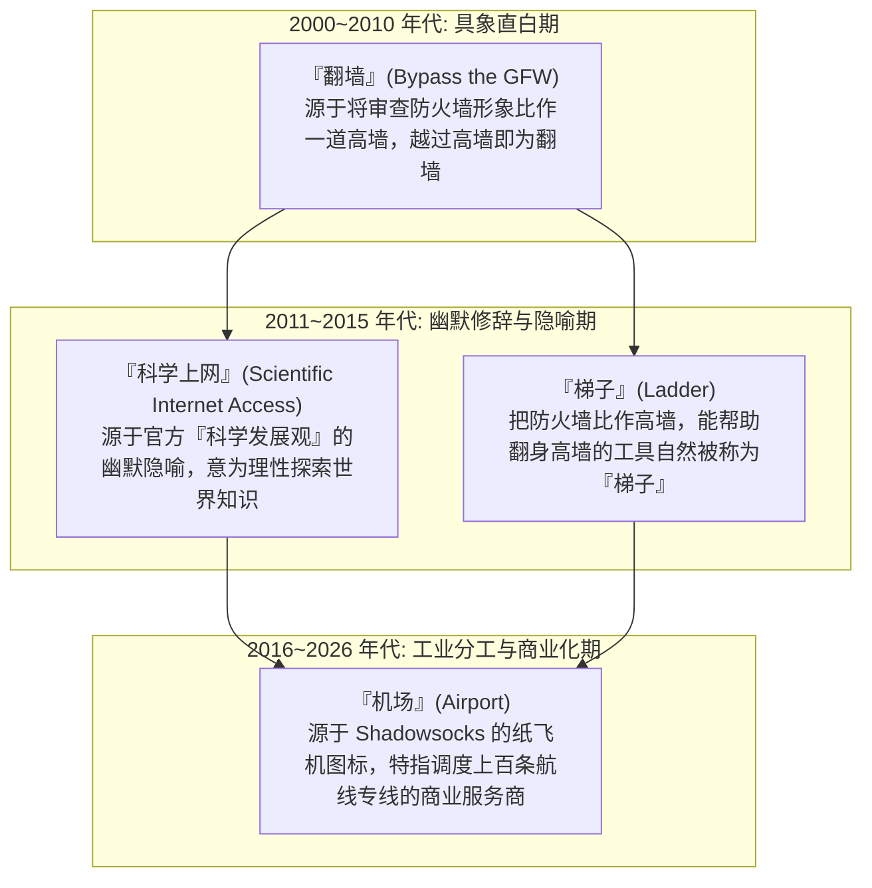
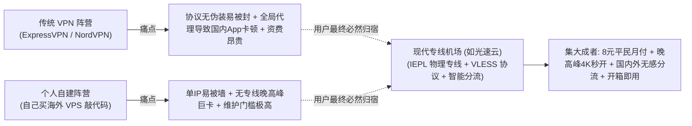

# 机场、梯子、VPN 与科学上网：中文互联网术语全景演进与概念辨析 (2026 深度通识)

  <strong>核心结论与先验建议 (Answer-First)：</strong>在中文互联网与社交媒体的讨论中，新手常常被一堆看似相同却又不同的词汇搞得晕头转向：“有人说‘找梯子’，有人说‘求机场’，有人说‘买个 VPN’，还有人一本正经地说‘科学上网’，这些词到底是一回事吗？”
    
  从计算机网络工程与民间语言学演进的视角来看，这些词汇构成了严密的**「四层同心圆包含体系」**：
  <ul>
    <li><strong>行为目的层（最外层·科学上网 / 翻墙）</strong>：指代“突破地理限制访问境外互联网”这一行为本身，是所有相关讨论的终极目的；</li>
    <li><strong>工具泛称层（次外层·梯子）</strong>：民间对所有能实现出海目的的工具软件与节点的通俗统称（包含了自建、免费节点、商业服务等全集）；</li>
    <li><strong>技术协议层（中间层·传统 VPN）</strong>：特指基于 IPSec、OpenVPN、WireGuard 构建的底层全量加密虚拟专用网技术；</li>
    <li><strong>现代商业基础设施层（核心层·机场）</strong>：特指当前最主流的形态——基于 VLESS / Shadowsocks 协议、采用跨国物理专线（IEPL）、通过订阅链接向 Clash / 小火箭等客户端动态分发几十个节点的商业服务商（如<strong>[光速云](/reviews/#brand-gsy)</strong>）。</li>
  </ul>

<AffiliateNotice />

---

## 一、语言演进的第一性原理：为什么同一个技术会有这么多“黑话”？

很多刚接触网络的小白好奇：“为什么大家不能大大方方地说‘网络代理’，非要创造出‘梯子’、‘机场’、‘科学上网’这些稀奇古怪的名词？”

这背后是长达二十余年的**审查对抗与民间语义漂移（Semantic Drift）**的历史演变：

### 1.1 语义演进的三大阶段
1. **具象期（“翻墙”）**：早期网民直接借用物理空间的比喻，形象生动，但因字面敏感，极易被各大搜索引擎与社交平台直接屏蔽；
2. **修辞期（“科学上网”与“梯子”）**：网民为了规避关键词审查，创造了富有中式黑色幽默的委婉代称。“科学上网”既表达了获取前沿学术知识的正当性，又成功绕过了敏感词库；而“梯子”则成为了所有工具软件的民间代名词；
3. **商业期（“机场”）**：随着代理技术进入高度专业化的分工时代，个人搭建被专线服务商取代，借由“小飞机”演变而来的“机场”成为了现代商业代理生态的最终行业定称。

### 1.2 网络工程学硬核剖析：L7 应用层代理与 L3 网络层隧道的本质鸿沟
在计算机网络标准的 OSI 七层模型中，“VPN”与“机场（代理）”在底层实现上存在着不可调和的工程分水岭：
* **传统 VPN（Layer 3 网络层隧道）**：像 OpenVPN 或 WireGuard，其工作在数据链路层或网络层，相当于在操作系统里强行虚拟了一根物理网线。它的设计初衷是**“全盘接管”**，即电脑里的每一个字节（包括微信、网银、QQ 聊天）都被无差别地压缩打包发往境外服务器。这导致一旦开启，国内 App 全部出现高延迟或异地风控报错；
* **现代机场（Layer 7 应用层与会话层代理）**：基于 Socks5、Shadowsocks 或 VLESS 协议构建。它具备**“报文级深度感知能力”**，能够根据每个访问请求的目标域名（如 `baidu.com` vs `google.com`），毫秒级决定“放行直连”还是“加密出海”，这正是现代机场使用体验远超传统 VPN 的核心技术底气。

---

## 二、全景术语四维解剖大表：一眼理清概念边界

为了让你在技术讨论与日常交流中不再用错词汇，下表对这五个核心概念进行了多维解剖：

| 术语名称 | 概念定性与层级 | 核心技术载体 | 典型使用语境与场景 | 新手辨析要点 |
| :--- | :--- | :--- | :--- | :--- |
| **科学上网** | **行为统称** (中性委婉) | 泛指一切合规/非合规跨国网络连接 | 学术研讨、出海办公、合规政策讨论 | 是“目的”而不是“工具”，不能说“我下载了一个科学上网”。 |
| **翻墙** | **行为俗称** (口语俚语) | 同上 | 民间口语日常交流、贴吧论坛交流 | 带有一定民间江湖色彩的直白描述。 |
| **梯子** | **工具泛称** (包罗万象) | 包含自建 VPS、免费节点、VPN、机场等全集 | “谁有稳定的梯子推荐一个？” | 泛指一切能帮你连上外网的工具软件或节点集合。 |
| **传统 VPN** | **技术分支** (全量加密网) | IPSec / OpenVPN / WireGuard | 外企员工连接公司内网、海外大厂软件 | 专为企业加密设计，天生无抗审查与分流机制，在国内水土不服。 |
| **机场** | **现代商业基础设施** | VLESS-Reality / IEPL 物理内网专线 | “这家机场晚高峰稳不稳？”、“订阅链接导入” | **当前最主流形态**，特指提供专业专线与多节点的商业服务商。 |

---

## 三、真实小白概念混淆翻车实录 (1:1 案例库)

### 案例 1：在外企办公群大声“借梯子”，被行政主管误以为借工程人字梯
* **学员档案**：某跨国建筑设计公司新入职前台文员小张，需要登录海外素材库下载设计规范。
* **翻车过程**：小张在全员大群里直接发了一句：“大家下午好，请问谁手头有梯子能借我用一下？”半小时后，公司后勤行政主管领着两位师傅，扛着一把两米高的折叠铝合金人字梯来到前台，询问小张“你要换哪个天花板的吊灯”。小张满脸通红，全公司哄堂大笑。
* **深层教训**：**在严肃职场与商务环境中，切勿使用带有浓厚市井江湖色彩的民间俚语，应当使用“出海网络专线”或“跨国协同工具”等专业词汇**。

### 案例 2：技术小白海外求助，把“Clash 节点”误称“VPN”导致沟通死锁
* **学员档案**：在校留学生小李，因使用香港专线登录某个学术平台被风控拦截。
* **沟通误区**：小李向海外导师发邮件解释：“Sorry, my VPN is down today（抱歉，我的 VPN 今天宕机了）”。导师以为其使用的是大学官方的 Cisco AnyConnect 企业 VPN，遂将其转接至校 IT 信息安全中心。IT 部门工程师对小李进行了长达两个小时的 Cisco 证书调试排查，双方牛头不对马嘴，最后才发现小李用的根本不是学校的 VPN，而是自己购买的商业机场 Clash 客户端。
* **实战结论**：**准确区分专业技术术语，是消除沟通阻抗、快速定位问题的基本素养**。

### 案例 2：跨境电商团队误将“梯子”等同于“海外独立静态IP”引发多店铺关联封禁
* **学员档案**：某跨境电商运营小组长小陈，在招聘外贸助理时要求“会用梯子打理海外亚马逊与 TikTok 账号”。
* **惨痛教训**：新入职助理使用某普通机场共享节点登录亚马逊核心卖家后台。由于共享机场的出口 IP 是动态多用户轮换共享的，该 IP 前一天恰好被另一家已被封禁的黑产店铺使用过。亚马逊风控算法瞬间检测到“高危硬件与已封禁 IP 产生重合”，直接触发多账号强关联封号，导致货值达数十万元的店铺被临时冻结审查两周。
* **深层反思**：**普通“机场/梯子”提供的是动态高并发的共享出海信道，绝不能与外贸店铺管理所需的“独享静态住宅原生 IP（Static Residential IP）”混为一谈**。打理核心商业资产必须严格隔离。

---

## 四、为什么说“现代机场”是当前中国互联网的最优解？

理解了术语演进后，新手就应该明白：为什么在经历了二十年的大浪淘沙后，**「现代商业专线机场」最终击败了传统 VPN 与单兵自建，成为了绝对的统治级主流？**

1. **集约化采购彻底压低成本**：千万级的 IEPL 物理专线通过规模化平摊，让普通小白仅需 **8 元/月** 就能用上银行级的物理内网专线；
2. **规则分流完美兼顾日常体验**：国内微信、美团走自家宽带 5ms 直连，海外 YouTube、ChatGPT 走专线，彻底告别异地登录风控；
3. **高度解耦的工业生态**：客户端由全球顶级开源黑客无偿维护升级，节点由专业网络运维团队 7×24 小时值班容灾，用户只需专注自己的核心学习与工作。

### 4.2 术语误用避坑备忘录（日常技术交流四项规范）
为了在遇到网络故障或查阅文档时不被误导，新手在日常技术交流中建议恪守以下四条规范：
* **规范一：向技术客服报障时明确区分角色**：如果是“节点红字超时”或“订阅无法更新”，向机场提交工单；如果是“点击启动软件直接闪退报错”，向对应客户端开源社区（如 GitHub Issues）搜索报错日志；
* **规范二：涉及跨国工作合同严格使用“合规企业专线通道”**：避免在正式商业邮件中使用“翻墙”或“梯子”等口语化词汇，统一规范表述为“跨境网络访问代理”或“远程企业数据隧道”；
* **规范三：不要将“节点”称为“VPN”**：在客户端配置里，你切换的是具体的“落地节点（Server Node）”，而不是在重新拨号建立一个全新的系统 VPN 隧道；
* **规范四：不要把“订阅链接”当成“网页网址”直接用浏览器打开**：订阅链接是专门用于传输 Base64 或 YAML 格式配置文件的 API 接口，用浏览器直接打开只会看到一串无意义的乱码字符，必须将其粘贴到客户端专用的导入栏中。

---

## 五、痛点心流驱动：拥抱成熟工业文明，认准正规专线大厂

当你拨开了所有语义迷雾，看清了技术发展的必然规律，你就不会再被那些自建神话或劣质 VPN 广告所欺骗。

作为现代专线机场的标杆级代表，[光速云 (GSY)](/reviews/#brand-gsy) 完美诠释了现代代理技术的工业化美感：

<BrandCard brandId="gsy" />

  
💡 为什么光速云是现代机场技术的最优落地范本？

  <ul>
    <li><strong>正宗双专线骨干架构</strong>：核心依托企业级 IEPL 物理内网光纤，晚高峰丢包率恒定归零，秒开 4K 原生画质。</li>
    <li><strong>完美支持全端智能分流</strong>：配合现代开源客户端（Clash Verge / 小火箭），国内 App 毫秒级直连，海外专线出海，互不干扰。</li>
    <li><strong>平民级极低消费门槛</strong>：起步套餐折合仅需 <strong>8元/月</strong>，在结账收银台输入官方专属优惠码 <code>AMM</code> 享折上折，支持国内支付宝原生安全扫码秒开。</li>
  </ul>

<PromoCard brandId="gsy" />

---

## 六、下一步系统化学习路线引导

全面理清了机场、梯子、VPN 的概念边界后，本栏目的最后一站将为你奉上一部沉甸甸的**“终极百科全书”**：

1. **小白必懂的 30 个术语大词典**：查阅 [`/what-is-airport/glossary`](/what-is-airport/glossary) 收藏备用，随时速查一切黑话；
2. **开启第四栏目：梯子入门实操指南**：阅读 [`/guides/`](/guides/) 学习手机与电脑的完整配置闭环；
3. **前往客户端中心下载软件**：查阅 [`/clients/`](/clients/) 获取适合你设备的主流官方安装包。

---

<NextStep
  title="下一篇：小白必懂的 30 个网络代理核心术语速查大词典"
  link="/what-is-airport/glossary"
  description="遇到不会的词随时查阅！深度解析 TUN模式、BGP、DPI、NAT、DNS泄漏等 30 个高频黑话的通俗白话定义。"
  stepText="新手进阶 · 下一步"
  buttonText="查看 30 个术语速查词典 →"
/>
