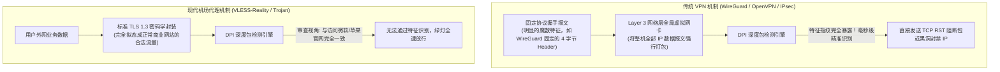
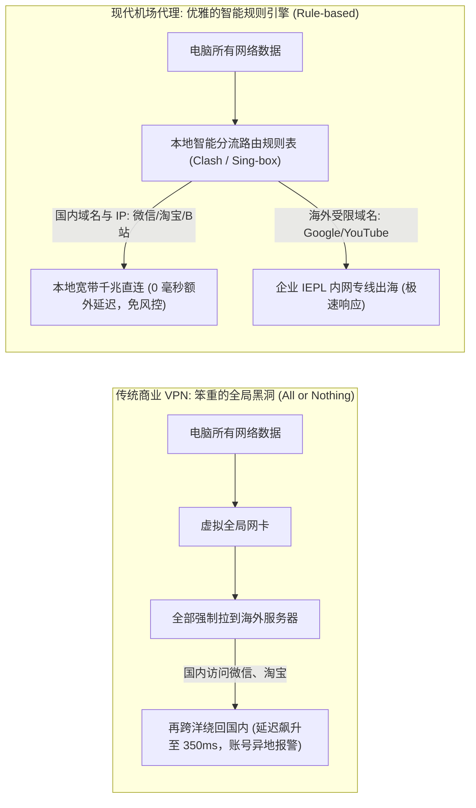

# 机场与传统 VPN 的本质区别：底层架构与中国网络环境适配深度剖析 (2026 权威指南)

  <strong>核心结论与先验建议 (Answer-First)：</strong>在非技术用户的日常口语中，“翻墙”、“梯子”、“VPN”和“机场”常被混为一谈。<strong>但在计算机网络工程与通信对抗的严格定义中，传统商业 VPN 与现代机场代理是两种底层哲学完全相反的技术物种</strong>。
    
  许多新手由于不了解这一区别，往往会轻信外媒评测，花费近千元购买知名的海外大厂 VPN（如 ExpressVPN、NordVPN、Surfshark），结果带回国内一用却发现<strong>常年连不上、频繁断流、微信疯狂报异地登录</strong>。
    
  两者的本质分水岭：
  <ul>
    <li><strong>传统 VPN（企业加密通道）</strong>：初衷是为欧美跨国公司员工建立远程加密接入内网，<strong>天生不具备任何流量伪装机制</strong>。其特征明显的协议头在现代 DPI（深度包检测）系统面前如同“裸奔”，在中国大陆的可用性常年处于濒死状态；</li>
    <li><strong>现代机场代理（抗审查与分流系统）</strong>：专为中国复杂网络环境定向进化。底层采用<strong>「拟态伪装协议（VLESS-Reality / Trojan）」+「IEPL 物理内网专线（不过公网）」+「智能规则分流（国内直连/海外专线）」</strong>，是目前综合体验最稳定、最丝滑的技术方案（如<strong>[光速云](/reviews/#gsy)</strong>）。</li>
  </ul>

<AffiliateNotice />

---

## 一、通信协议的第一性原理：为什么传统 VPN 在中国必然被“秒杀”？

很多新手疑惑：“为什么 ExpressVPN 在全世界都能用，技术实力那么强，偏偏在中国大陆频繁大面积瘫痪？”

要彻底理解这一现象，我们必须深入到 **OSI 七层网络模型**与 **DPI（Deep Packet Inspection，深度报文检测）** 的技术底层：

### 1.1 协议特征指纹的致命差异
1. **传统 VPN 的“自报家门”**：
   - 传统协议（如 OpenVPN、IPsec、WireGuard）在设计时，假定其运行在法治自由的欧美网络环境中，因此根本没有考虑过“防审查”问题。其握手协议头具有极其固定的特征字节（Magic Bytes）、固定的 UDP 端口范围（如 500/4500 端口）以及固定的数据包长度分布。
   - 在国家级骨干网的 DPI 交换机面前，这种高熵值且带有明显特征的数据流，**在连接建立的第 1 个数据包时就会被自动化特征规则命中**，随后直接被阻断或限速至几十字节。
2. **现代机场代理的“完美拟态伪装（Traffic Camouflage）”**：
   - 现代代理协议（以 **VLESS-Reality** 和 **Trojan** 为代表）彻底抛弃了自创协议头。
   - 它们直接借用互联网最广泛通用的 **TLS 1.3 协议标准**，甚至通过 Reality 技术“借用”海外合法大企业（如 Microsoft、Apple、Cloudflare）的真实合规证书。
   - 在任何外部审查系统的视角下，该通信与国内用户正常更新 Windows 系统或浏览普通购物网站的加密流量在数学和统计学上**完全无法区分**，从而拥有几乎为零的被封锁概率。

---

## 二、智能分流的决定性体验鸿沟：全局接管 vs 规则路由

除了协议伪装能力，两者的第二个核心差异在于**数据包的路由分流机制**：

### 2.1 传统 VPN 的日常灾难体验
* 由于传统 VPN 接管的是整机的操作系统默认网关（Default Gateway 0.0.0.0/0），一旦开启 VPN，你手机或电脑里的**所有流量全部被无脑强制送往海外**。
* **翻车后果**：
  1. 使用微信、美团、滴滴打车时，定位显示在几千公里外的洛杉矶或法兰克福，频繁弹出“检测到账号异地登录，请进行人脸验证”；
  2. 观看爱奇艺或腾讯视频时，直接提示“您所在的地区暂无版权支持”；
  3. 刷抖音、逛淘宝极其卡顿，大量宝贵的跨国带宽被国内日常流量无谓浪费。

### 2.2 现代机场的“润物细无声”
* 现代代理工具在本地维护了一套极其精准的**全球地理位置数据库（GeoSite / GeoIP）**。
* 客户端会自动检测你访问的目标网址：只要是国内的服务器（如百度、微信、腾讯会议），直接走你自家的电信/联通千兆宽带直连，享受本地 5ms 极低延迟；只有当你访问 YouTube、GitHub、ChatGPT 时，客户端才会毫秒级将数据分流到高速专线节点中。
* **体验真谛**：**你可以让机场客户端在手机和电脑后台 365 天常驻开启，完全感知不到它的存在，兼得国内外双向极致体验**。

---

## 三、真实小白翻车案例实录 (1:1 案例库)

### 案例 1：海外归国留学生花近千元购买知名 VPN，回国彻底沦为砖头
* **学员档案**：留美归国硕士生小孙，回国前听信海外营销博主推荐，一次性花费 99 美元（约合人民币 720 元）订阅了两年某知名商业 VPN。
* **惨痛教训**：落地国内打开笔记本电脑后，该客户端在“Connecting...”界面转圈长达 5 分钟，随后弹错提示“Unable to reach server”。小孙在工单中联系其英文客服，客服只能不断建议其“更换备用协议或手动配置 OpenVPN”。折腾了一周，节点可用率不足 5%，即便偶尔连上，打开一个网页需要等待半分钟，看视频根本奢望。最终小孙因超过 30 天无条件退款期，数百元费用打了水漂。
* **深层根源**：海外商业 VPN 的服务器机房部署在公开的公共 IP 段上，且协议特征明显，早已被列入重点封禁名单，根本不具备在特殊网络环境下长期生存的技术基因。

### 案例 2：外贸老手换用专线机场，工作与生活完美无缝解耦
* **学员档案**：跨境贸易公司主管周先生，此前一直忍受传统 VPN 带来的国内 App 频繁风控报警。
* **转变历程**：在技术顾问推荐下，周先生将公司设备全面换装为基于 IEPL 企业专线架构的[光速云 (GSY)](/reviews/#gsy)。周先生惊奇地发现：电脑开着代理，给海外客户发送 WhatsApp 消息秒发秒回，同时在另一个屏幕上打钉钉电话、用企业微信发大文件毫无卡顿，微信再未出现过异地登录弹窗。
* **实战结论**：**智能规则分流与专线内网传输，是现代跨境生产力的绝对标配**。

---

## 四、传统商业 VPN vs 现代专线机场全维参数深度横评

| 对比维度 | 传统商业 VPN (如 Express, Nord) | 现代专线机场 (如光速云 IEPL) | 差异深度技术解读 |
| :--- | :--- | :--- | :--- |
| **中国大陆可用性** | **极差** (常态化大面积被阻断) | **极高** (全天候 99.9% 稳定在线) | 机场采用 VLESS-Reality 拟态伪装与内网专线。 |
| **晚高峰平均丢包率** | **25% ～ 55%** (严重卡顿) | **< 0.5%** (几无丢包) | 机场租用跨国物理光纤，不走民用公网拥挤出口。 |
| **国内应用智能分流** | **不支持** (默认全量粗暴全局) | **原生支持规则模式 (Rule Mode)** | 机场实现国内 App 毫秒直连，海外走专线互不干扰。 |
| **单月起步资费门槛** | 普遍高昂 (约 $12 美元/月，或绑死年付) | **极其亲民 (仅 8～20 元/月，进退自如)** | 机场起步门槛仅相当于传统 VPN 的五分之一。 |
| **支付结算便捷度** | 必须外币信用卡或虚拟币 USDT | **支持国内支付宝扫码秒付** | 无需繁琐开通海外银行卡，结算极度省心。 |
| **设备功耗与发热** | 全局加密计算负荷大，手机严重发热 | **轻量流式转发，待机功耗极低** | 手机后台常驻一整天耗电量不足 3%。 |

---

## 五、痛点心流驱动：拥抱真正适配本土的 8 元专线正道

当你明白为什么传统 VPN 无法适应当下的网络环境，你就应该彻底抛弃对外企商业 VPN 的幻想，选择真正深谙网络对抗与智能分流的本土专线标杆：

<BrandCard brandId="gsy" />

  
💡 为什么光速云能彻底颠覆你的出海体验？

  <ul>
    <li><strong>双专线拟态伪装架构</strong>：基于轻量 VLESS 协议与企业级 IEPL 物理专线构建，完全绕过公网出口审查，晚高峰 4K 视频秒开不卡。</li>
    <li><strong>完美全端规则分流</strong>：无论是手机端小火箭还是桌面端 Clash，默认开启智能分流，国内微信、淘宝走本地千兆高速，海外流量走专线，彻底消除异地登录风控。</li>
    <li><strong>极低平民起步月付</strong>：最低套餐仅需 <strong>8元/月</strong>，输入专属优惠码 <code>AMM</code> 享折上折，支持支付宝扫码秒开，用最体面的方式享受现代网络文明。</li>
  </ul>

<PromoCard brandId="gsy" />

---

## 六、下一步系统化学习路线引导

搞懂了机场与 VPN 的技术鸿沟后，接下来让我们把目光聚焦在机场最基础的物理构成单元——**“节点”**上：

1. **节点究竟是什么**：阅读 [`/what-is-airport/nodes-explained`](/what-is-airport/nodes-explained) 深入物理服务器、虚拟化与落地机房底层；
2. **订阅链接背后的工作原理**：阅读 [`/what-is-airport/subscription-explained`](/what-is-airport/subscription-explained) 了解配置文件与密钥分发；
3. **常用加密协议解析**：阅读 [`/what-is-airport/protocols-explained`](/what-is-airport/protocols-explained) 剖析 VLESS、Trojan 与 Shadowsocks 的优劣。

---

<NextStep
  title="下一篇：机场节点究竟是什么？服务器机房与落地原理"
  link="/what-is-airport/nodes-explained"
  description="为什么有的节点叫香港，有的叫日本？深入剖析入口服务器、物理专线传输与海外落地机房的三段式运作机制。"
  stepText="新手进阶 · 下一步"
  buttonText="查看节点底层原理解析 →"
/>
